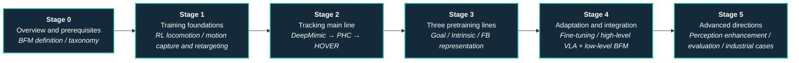

# Humanoid Behavior Foundation Models (BFM)

**At a glance**:

- **Who it's for**: people who want to control a humanoid's whole body with a single checkpoint.
- **Path**: Stage 0–5 · overview and prerequisites → RL locomotion and motion-capture foundations → tracking main line (DeepMimic → HOVER) → three pretraining lines → adaptation and integration → advanced directions.
- **Depth roadmap**: a branch of the [Motion Control main roadmap](motion-control.md); forms a sister roadmap pair with [VLA depth](depth-vla.md) as "body-level coordination / task-level semantics".

## Roadmap overview

## How to use this path

- The target reader is someone who can train locomotion policies in simulation and wants to enter the "humanoid whole-body behavior prior" direction
- BFM addresses **body-level coordination**: a single checkpoint covers tracking, disturbance rejection and multi-interface whole-body control; it is not responsible for language understanding and task semantics, which are the topic of [VLA depth](depth-vla.md)
- Each stage has prerequisites, core questions, what to do, what to read, and what you should be able to produce

**Relation to the main roadmap:**
- This roadmap is an advanced direction after main roadmap L5 (RL and imitation learning), leaning toward the "whole-body control side"; the training side heavily reuses experience from [RL depth](depth-rl-locomotion.md) (PPO, reward design, sim2real)
- On the motion-data side, it shares a pipeline with the motion retargeting stage of [Imitation Learning depth](depth-imitation-learning.md)
- If the end goal is "a complete humanoid that understands instructions", after finishing Stage 4 it merges with [VLA depth](depth-vla.md) into a "high-level VLA + low-level BFM" dual stack

---

## Stage 0 Behavior foundation model overview and prerequisites

**First separate the boundaries between BFM and task-specific RL, and between BFM and VLA, before entering the lineage; otherwise the 41 papers will blur into a mess.**

### Prerequisites
- Proficient in Python + PyTorch
- Understand basic RL concepts (see [Reinforcement Learning](../../wiki/methods/reinforcement-learning.md))
- Concept-level understanding of VLMs / VLAs (know that they handle semantics, not whole-body coordination)

### Core questions
- The essential difference between BFM and task-specific RL: cross-task behavior priors + adaptation with little / zero retraining
- Which layer of the robot stack BFM and VLA each address, and why they are usually stacked rather than chosen between
- How the BFM taxonomy is sliced: three pretraining lines × two adaptation lines

### What to do
- Read the BFM survey taxonomy closely, go through the 41-paper map, and mark 3 papers in your own direction for close reading
- Using the taxonomy page, find one representative work each for VLM / VLN / VLA / WAM / BFM, and write a one-page comparison table

### What to read
- [Behavior Foundation Model](../../wiki/concepts/behavior-foundation-model.md) - the main taxonomy entry point
- [BFM 41-Paper Technology Map](../../wiki/overview/bfm-41-papers-technology-map.md)
- [VLM / VLN / VLA / VLX / World Model Taxonomy](../../wiki/comparisons/vlm-vln-vla-vlx-world-model-taxonomy.md)
- [Foundation Policy](../../wiki/concepts/foundation-policy.md) - its parent-child concept relationship with BFM

### What you should be able to produce
- Able to state in one sentence what BFM is and what it is not
- Able to place any BFM paper into a cell of the "three pretraining lines × two adaptation lines" grid

---

## Stage 1 Training foundations: RL locomotion and motion-capture data

**The two legs of BFM: one is a large-scale parallel RL training pipeline, the other is motion-capture data and retargeting.**

### Prerequisites
- [RL depth roadmap](depth-rl-locomotion.md) Stage 0–2 level: able to train locomotion policies in simulation
- Stage 0 content

### Core questions
- Training differences between humanoid whole-body RL and quadruped locomotion (degrees of freedom, support region, reward design)
- What motion-capture data (AMASS) looks like, and what problem motion retargeting must solve
- How the quality and coverage of reference motion data affect downstream behavior priors

### What to do
- Train a humanoid walking policy in Isaac Lab / legged_gym to get familiar with the whole-body RL pipeline
- Run retargeting of an AMASS dataset onto a target humanoid model end to end, and check joint limits and interpenetration

### What to read
- [Motion Retargeting](../../wiki/concepts/motion-retargeting.md) and [Motion Retargeting Pipeline](../../wiki/concepts/motion-retargeting-pipeline.md)
- [AMASS](../../wiki/entities/amass.md) and [Humanoid Reference Motion Dataset Comparison](../../wiki/comparisons/humanoid-reference-motion-datasets.md)
- The dataset-bfm series, such as [Humanoid-X](../../wiki/entities/dataset-bfm-humanoid-x.md)
- [Reward Design](../../wiki/concepts/reward-design.md)

### What you should be able to produce
- A complete data pipeline that goes from motion-capture data to simulated reference trajectories
- First-hand judgment of the respective bottlenecks on the "data side" and the "training side"

---

## Stage 2 Tracking main line: from DeepMimic to HOVER

**The first trunk of BFM: the motion-tracking lineage moves step by step toward "unified multi-mode control".**

### Prerequisites
- Stage 1 content

### Core questions
- How DeepMimic uses an imitation reward to turn motion-capture clips into executable policies
- How ASE's adversarial skill embeddings differ from DeepMimic's per-clip tracking
- How PHC → MaskedMimic achieve "whole-library tracking + partial-goal control"
- What engineering problem HOVER's multi-mode unification (tracking / velocity / joint multi-interfaces sharing one policy) solves

### What to do
- Use the open-source PHC / MaskedMimic implementations to run a humanoid motion-tracking demo in simulation
- Compare the performance of "single-clip imitation" and "whole-library tracking" policies on unseen motions

### What to read
- Lineage anchors: [DeepMimic](../../wiki/methods/deepmimic.md), [ASE](../../wiki/methods/ase.md), [PHC](../../wiki/entities/phc.md), [MaskedMimic](../../wiki/entities/paper-bfm-17-maskedmimic.md), [HOVER](../../wiki/entities/paper-bfm-14-hover.md)
- [SONIC](../../wiki/methods/sonic-motion-tracking.md) and [BeyondMimic](../../wiki/methods/beyondmimic.md) - engineering-ready tracking foundations
- [Teacher-Student Multi-Skill BFM Learning](../../wiki/methods/teacher-student-multi-skill-bfm.md) - one of the three BFM lines: a privileged teacher learns multi-reference motion tracking in simulation, then is distilled into a single deployable student
- [PFM-HR](../../wiki/entities/paper-pfm-hr.md) - an unordered-pose Flow Matching prior + Pose Geometry Score modulating the tracking reward, mounted frozen onto ADD/BeyondMimic without changing the deployment stack; improves sample efficiency on highly dynamic skills (Backflip, Double Kong, etc.) by 14–29% over PDF-HR, and reduces general LaFAN1 tracking position error by about 8–10% relative to both ADD and PDF-HR; code repo is a placeholder pending release
- [ZEST](../../wiki/entities/paper-zest.md) (Science Robotics 2026, RAI Institute × Boston Dynamics) - uses ViCap (video-to-motion-capture) to produce references the same day, with a minimal observation/reward recipe reused across 100 kg Atlas / 35 kg G1 / 12-DoF Spot; a full-size Atlas for the first time stably performs multi-contact skills with knees/elbows/torso on the ground (crawling, forward rolls, floor dance); confirmed not open-sourced
- [HumanTracker](../../wiki/entities/paper-humantracker.md) - a four-family optical tracking benchmark + HumanScore, fixing reference representation/rollout bookkeeping/termination criteria for unified evaluation of GMT/TWIST2/SONIC/Humanoid-GPT; family-balanced agreement rate 90.83%, about 6.8 points higher than the strongest single analytical diagnostic; evaluation code open-sourced, 153h/25K dataset pending release
- [GigaBrain-WBC-0.5](../../wiki/entities/paper-gigabrain-wbc-0-5.md) - the first humanoid Behavior World Model: a causal Transformer jointly predicts action/state/next-command GMM, with automatic 3D terrain annotation + online Mahalanobis retract; Terrain SR 81.3%, Fall recovery 99.3%; code coming soon
- [Whole-Body Tracking Pipeline](../../wiki/concepts/whole-body-tracking-pipeline.md)
- [Query: Humanoid Motion Tracking Method Selection](../../wiki/queries/humanoid-motion-tracking-method-selection.md)
- [SuperMimic](../../wiki/entities/paper-supermimic.md) - jointly trains a motion-tracking policy with a differentiable world model; short imagined rollouts + analytic gradients reduce the training compute for large-scale humanoid whole-body control
- [MorphMimic](../../wiki/entities/paper-morphmimic.md) - adds a canonical humanoid interface and morphology conditioning on top of the SuperMimic route, so G1 / X2 Ultra / T2 share one world model and one tracking policy
- [ScaleBFM](../../wiki/entities/paper-scaling-bfm-humanoid.md) - a scaling recipe for humanoid BFMs: holistic tracking in the global frame + synergy between on-policy rollouts and reference motion diversity + a 3M-parameter Humanoid Transformer

### What you should be able to produce
- A working humanoid motion-tracking demo
- Able to explain, for each step of the lineage, "what capability was added and what price was paid"

---

## Stage 3 Three pretraining lines: Goal / Intrinsic / FB representation

**Tracking is only the entry point: the core claim of BFM is pretraining reusable behavior priors.**

### Prerequisites
- Stage 2 content

### Core questions
- The signals and costs of the three pretraining lines: goal-conditioned (tracking-driven), intrinsic-reward (skill discovery), forward–backward (reward-free representation)
- Why FB representations can achieve "give a reward at test time and get a policy immediately" (zero-shot RL)
- The complementary relationship between skill discovery (the DIAYN family) and motion-capture-driven pretraining
- How to design multi-mode control interfaces (masks / latent variables)

### What to do
- Read BFM-Zero / MetaMotivo closely and derive the mathematical skeleton of FB representations
- Reproduce a DIAYN-style skill discovery experiment in a small environment and observe skill diversity

### What to read
- Category pages for the three lines: [FB representation](../../wiki/overview/bfm-category-01-forward-backward-representation.md), [Goal-conditioned](../../wiki/overview/bfm-category-02-goal-conditioned-learning.md), [Intrinsic-reward](../../wiki/overview/bfm-category-03-intrinsic-reward-pretraining.md)
- Representative works: [BFM4Humanoid](../../wiki/entities/paper-behavior-foundation-model-humanoid.md), [BFM-Zero](../../wiki/entities/paper-bfm-zero.md), [MetaMotivo](../../wiki/entities/paper-bfm-02-metamotivo.md), [DIAYN](../../wiki/entities/paper-bfm-30-diayn.md)
- [TeCH](../../wiki/entities/paper-tech-humanoid-control.md) - unsupervised pretraining based on TLDR contrastive temporal-distance representations: dense progress reward in latent space + off-policy, zero-shot tracking/goal reaching; on G1 its tracking accuracy matches SONIC while cutting GPU time by nearly two orders of magnitude

### What you should be able to produce
- Able to explain to colleagues the signal source, applicable scenarios and costs of the three pretraining lines
- Intuition for multi-mode control interfaces (masks / latent variables)

---

## Stage 4 Adaptation and integration: fine-tuning, hierarchy and the dual stack

**How to use pretrained behavior priors: fine-tuning, hierarchy, and the mainstream engineering form of current humanoid systems - high-level VLA + low-level BFM.**

### Prerequisites
- Stage 3 content
- [VLA depth](depth-vla.md) Stage 2 level (know what a VLA outputs)

### Core questions
- The two adaptation lines: fine-tuning (LoRA / task token) vs hierarchy (high-level planning + low-level BFM execution)
- Why end-to-end "language → whole-body joints" is currently hard to train directly (data scarcity, control frequency, safety)
- How to design hierarchical interfaces: text / latent vectors / motion tokens / reference trajectories, and the expressiveness and bandwidth of each
- How LangWBC, LeVERB and GR00T-WholeBodyControl differ in how they cut the hierarchy
- How to close the loop on the exposure bias of open-loop cascades (ReactiveBFM)

### What to do
- Read the interface definitions of GR00T-WholeBodyControl / LeVERB and draw the hierarchical data-flow diagram of each
- In simulation, connect a language-instruction pipeline to a low-level motion tracker (even if you relay through a finite state machine at first)

### What to read
- Category pages for the two adaptation lines: [Adaptation](../../wiki/overview/bfm-category-04-adaptation.md) and [Hierarchical](../../wiki/overview/bfm-category-05-hierarchical-control.md)
- [LangWBC](../../wiki/entities/paper-bfm-37-langwbc.md) and [LeVERB](../../wiki/entities/paper-bfm-36-leverb.md)
- [GR00T-WholeBodyControl](../../wiki/entities/gr00t-wholebodycontrol.md) and [Humanoid-VLA](../../wiki/entities/paper-loco-manip-161-121-humanoid-vla.md)
- [ReactiveBFM](../../wiki/entities/paper-reactivebfm.md)
- [ILA: Interface-Level Compliant Adapter](../../wiki/entities/paper-ila-interface-level-adapter.md) - corrects upper-body reference motion in front of an existing frozen WBT policy; forms an interface-level counterpart to fine-tuning/internal-feature adaptation (validated with three trackers: MT, MimicLite, Sonic).

### What you should be able to produce
- Able to design a hierarchical scheme for "humanoid + language tasks" and explain the trade-offs in interface selection
- Judgment, grounded in data / frequency / safety, on "what should be end-to-end and what should be hierarchical"

---

## Stage 5 Advanced directions

### Prerequisites
- Stage 4 content

**Direction A: perception enhancement**
- Give BFMs environmental perception, moving from "tracking with eyes closed" to "coordinating the whole body while watching the environment"
- Keywords: [Perceptive BFM](../../wiki/entities/paper-perceptive-bfm.md), [P-BFM](../../wiki/entities/paper-p-bfm.md), [Perceptive Locomotion depth roadmap](depth-perceptive-locomotion.md)
- [P-BFM](../../wiki/entities/paper-p-bfm.md): uses an FB latent to express terrain-agnostic intent, a depth-perception policy to adapt execution, and ERI to supplement global heading/velocity commands

**Direction B: RL fine-tuning and self-improvement**
- Continue improving pretrained behavior priors with RL / real-robot data loops
- Keywords: [ENPIRE](../../wiki/methods/enpire.md), [Safe Real-World RL Fine-Tuning](../../wiki/concepts/safe-real-world-rl-fine-tuning.md)

**Direction C: mobile manipulation extension**
- Extend behavior priors from "tracking motions" to "manipulating while walking"
- Keywords: [Loco-Manipulation](../../wiki/tasks/loco-manipulation.md), [Loco-Manipulation depth roadmap](depth-loco-manipulation.md)

**Direction D: evaluation, selection and industrial-grade cases**
- Establish your own evaluation baselines and follow industry's complete-robot solutions
- Keywords: [Query: Humanoid Motion Tracking Method Selection](../../wiki/queries/humanoid-motion-tracking-method-selection.md), [AgiBot BFM-2](../../wiki/entities/agibot-bfm-2.md)

---

## Quick entry summary

| Stage | Core questions | Knowledge page entry |
|------|---------|-----------|
| Stage 0 | BFM definition and taxonomy | [Behavior Foundation Model](../../wiki/concepts/behavior-foundation-model.md) |
| Stage 1 | Training and data foundations | [Motion Retargeting Pipeline](../../wiki/concepts/motion-retargeting-pipeline.md) |
| Stage 2 | Motion-tracking lineage | [BFM 41-Paper Technology Map](../../wiki/overview/bfm-41-papers-technology-map.md) |
| Stage 3 | Three pretraining lines | [FB representation](../../wiki/overview/bfm-category-01-forward-backward-representation.md) |
| Stage 4 | Adaptation and dual-stack integration | [GR00T-WholeBodyControl](../../wiki/entities/gr00t-wholebodycontrol.md) |
| Stage 5 | Advanced directions | [Perceptive BFM](../../wiki/entities/paper-perceptive-bfm.md) |

## Relation to other pages

- Full growth roadmap reference: [Main roadmap: Motion Control → Full-Stack Physical Intelligence Growth Roadmap](motion-control.md)
- Related depth roadmaps (by topical proximity; for the full index see [Roadmap overview](motion-control.md#depth-optional-index)):
  - [Motion Retargeting](depth-motion-retargeting.md) - the prerequisite for getting reference motions into trackers
  - [Motion Generation](depth-motion-generation.md) - a synthesis source for reference motions
  - [RL Locomotion](depth-rl-locomotion.md) - tracking/skills often serve as locomotion priors
  - [Humanoid Boxing](depth-humanoid-boxing.md) - a product-oriented expansion of latent-space skills and adversarial play
  - [Model Architecture](depth-model-architecture.md) - a cross-cutting view: structural choices for foundation backbones, skill latent spaces and action heads

## References

- [Behavior Foundation Model](../../wiki/concepts/behavior-foundation-model.md) and [BFM 41-Paper Technology Map](../../wiki/overview/bfm-41-papers-technology-map.md)
- "DeepMimic: Example-Guided Deep Reinforcement Learning of Physics-Based Character Skills" (Peng et al., 2018) - the starting point of the motion-tracking lineage
- "A Survey of Behavior Foundation Model" (Yuan et al., 2025, arXiv:2506.20487) - the main reference for the BFM taxonomy
- "HOVER: Versatile Neural Whole-Body Controller for Humanoid Robots" (He et al., 2024) - representative of unified multi-mode control
