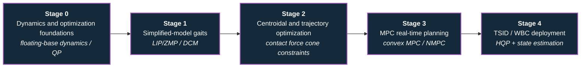

# Classical Model-Based Control (Classical Control)

**At a glance**:

- **Who it's for**: people who want to drive a humanoid robot with a classical model-based control stack.
- **Path**: Stage 0–4 · dynamics and optimization foundations → LIP/ZMP → DCM → Centroidal trajectory optimization → MPC → TSID / WBC and real-robot deployment.
- **Depth roadmap**: a branch of the [motion control main roadmap](motion-control.md).

## Roadmap overview

## How to use this path

- The target reader is an engineer or researcher who wants to systematically master the model-based humanoid control backbone rather than jumping straight into RL
- Requires linear algebra and basic dynamics intuition; convex optimization is filled in progressively along the roadmap
- Each stage has prerequisites, core questions, what to do, and what you should be able to produce

**Relation to the main roadmap:**
- This roadmap is the in-depth expansion of the "classical control backbone" of main roadmap L2–L4: the main roadmap aims for breadth, while this roadmap aims to turn each layer into a runnable controller
- If you follow the [RL depth roadmap](depth-rl-locomotion.md) to Stage 3 and need to combine with MPC/WBC, this roadmap is the corresponding theoretical and engineering supply line
- After finishing this roadmap, reading [WBC vs RL](../../wiki/comparisons/wbc-vs-rl.md) and [MPC vs RL](../../wiki/comparisons/mpc-vs-rl.md) will give you an entirely different level of judgment

---

## Stage 0 Dynamics and optimization foundations

### Prerequisites
- Linear algebra (matrix operations, least squares)
- Basic intuition for rigid-body mechanics (force, torque, inertia)
- Proficient in Python

### Core questions
- How floating-base dynamics differs from fixed-base manipulator dynamics
- Why almost all modern humanoid controllers boil down to solving a QP
- What the standard form of an optimal control problem looks like

### What to read
- [Floating-Base Dynamics](../../wiki/concepts/floating-base-dynamics.md)
- [Quadratic Programming](../../wiki/formalizations/quadratic-programming.md)
- [Optimal Control](../../wiki/concepts/optimal-control.md)
- [LQR](../../wiki/formalizations/lqr.md)
- [Modern Robotics textbook](../../wiki/entities/modern-robotics-book.md) — Chapter 8 (dynamics)
- [Query: Pinocchio quick start](../../wiki/queries/pinocchio-quick-start.md)
- [Modeling and solving (control problem framework)](../../wiki/concepts/modeling-and-solving-for-control.md) — first fix the state/input/dynamics and constraints, then choose a solver such as QP/MPC/iLQR/RL; the common upstream of model-based and learning-based approaches

### What to do
- Load a humanoid URDF with [Pinocchio](../../wiki/entities/pinocchio.md), and compute the center of mass, inertia matrix, and gravity term
- Hand-write a small QP with CVXPY (e.g., constrained least squares), and understand what constraint activation means

### What you should be able to produce
- Be able to write the floating-base dynamics equation \(M\dot v + h = S^\top\tau + J_c^\top f_c\) and explain each term
- Be able to manually convert a simple control problem into QP standard form

---

## Stage 1 Simplified-model gaits (LIP/ZMP → DCM)

### Core questions
- Why humanoid walking can first be approximated by a linear inverted pendulum (LIP)
- What the ZMP stability criterion is actually saying, and when it fails
- What additional problems Capture Point / DCM solve compared with ZMP

### What to read
- [LIP / ZMP](../../wiki/concepts/lip-zmp.md)
- [ZMP-LIP formalization](../../wiki/formalizations/zmp-lip.md)
- [Capture Point / DCM](../../wiki/concepts/capture-point-dcm.md)
- [Locomotion task map](../../wiki/tasks/locomotion.md) and [Footstep Planning](../../wiki/concepts/footstep-planning.md)
- [SLIP + VMC (spring-loaded inverted pendulum and virtual model control)](../../wiki/methods/slip-vmc.md) — an intermediate simplification layer after LIP and before WBC: spring legs approximate the stance phase + virtual impedance forces mapped to joint torques
- Kajita et al., *Biped Walking Pattern Generation by using Preview Control of ZMP* (2003)

### What to do
- Implement a 1D LIP model and generate a center-of-mass trajectory with ZMP preview control
- Add DCM feedback and observe how footstep locations adjust after a push (push recovery)

### What you should be able to produce
- Be able to derive LIP dynamics and explain the relationship between the ZMP and the support polygon
- Be able to generate a trackable center-of-mass + footstep reference trajectory

---

## Stage 2 Centroidal dynamics and trajectory optimization

### Core questions
- Why centroidal dynamics is the best compromise between "whole-body dynamics" and "simplified models"
- How contact force cone (friction cone / contact wrench cone) constraints enter the optimization
- What the division of labor is between trajectory optimization (TO) and real-time control

### What to read
- [Centroidal Dynamics](../../wiki/concepts/centroidal-dynamics.md)
- [Contact Wrench Cone](../../wiki/formalizations/contact-wrench-cone.md)
- [Friction Cone](../../wiki/formalizations/friction-cone.md)
- [Trajectory Optimization](../../wiki/methods/trajectory-optimization.md)
- Orin et al., *Centroidal dynamics of a humanoid robot* (2013)
- [Floating-base trajectory optimization in the SE(3) tangent space](../../wiki/entities/paper-se3-tangent-to.md) — compares Euler angles/quaternions/SE(3) tangent-space parameterizations under the same Ipopt collocation setup; only the tangent space succeeds at the G1 backflip and Go2 side flip
- [AHMP](../../wiki/entities/paper-ahmp.md) — adds a layer of CEM-MD contact sequence discovery on top of SE(3) tangent-space TO, 20/20 feasible in the Talos handrail corridor; from the same Patras LAR lineage as the previous entry

### What to do
- Solve a centroidal trajectory optimization problem with [Crocoddyl](../../wiki/entities/crocoddyl.md) or a hand-written DDP
- Compare the contact forces obtained with / without friction cone constraints

### What you should be able to produce
- Be able to write the centroidal momentum dynamics and explain the role of the angular momentum term
- Be able to solve offline for a physically feasible center-of-mass + contact force trajectory for a gait

---

## Stage 3 MPC real-time planning

### Core questions
- What must be sacrificed to put Stage 2's optimization into a real-time loop (model accuracy vs. solve frequency)
- What scenarios convex MPC and NMPC are each suited for
- What the relationship is between LQR / iLQR and MPC

### What to read
- [Model Predictive Control (MPC)](../../wiki/methods/model-predictive-control.md)
- [Nonlinear MPC](../../wiki/methods/nonlinear-model-predictive-control.md)
- [SRBD + convex MPC + WBC](../../wiki/concepts/srbd-convex-mpc-wbc.md) — a layered convex MPC architecture with a single-rigid-body approximation of center-of-mass motion, the mainstream engineering compromise for real-time humanoid walking
- [Centroidal NMPC + WBC stack](../../wiki/methods/centroidal-nmpc-wbc-stack.md) — centroidal dynamics + nonlinear MPC, a higher-fidelity classical control top layer than convex SRBD-MPC
- [LQR / iLQR](../../wiki/methods/lqr-ilqr.md)
- [MPC vs RL](../../wiki/comparisons/mpc-vs-rl.md)
- [Query: MPC solver selection](../../wiki/queries/mpc-solver-selection.md) and [Query: MPC tuning guide](../../wiki/queries/mpc-tuning-guide.md)
- Di Carlo et al., *Dynamic Locomotion in the MIT Cheetah 3 Through Convex Model-Predictive Control* (2018)

### What to do
- Implement a convex MPC based on a simplified model (LIP or single rigid body) that tracks velocity commands in simulation
- Tune the horizon length and solve frequency, and observe the effect on stability and computation

### What you should be able to produce
- Be able to explain how receding horizon works and the significance of warm starting
- A simplified-model MPC gait controller that runs in real time in simulation

---

## Stage 4 TSID / WBC and real-robot deployment

### Core questions
- How the center-of-mass/contact plan output by MPC becomes torques for each joint
- How to design TSID and HQP task hierarchies (contact constraints > center-of-mass tracking > posture > regularization)
- How to handle state estimation errors and contact detection errors on the real robot

### What to read
- [TSID](../../wiki/concepts/tsid.md) and [TSID formalization](../../wiki/formalizations/tsid-formulation.md)
- [Whole-Body Control](../../wiki/concepts/whole-body-control.md)
- [HQP](../../wiki/concepts/hqp.md)
- [Null-space control](../../wiki/concepts/null-space-control.md) — explicit projection on a 7-axis arm; HQP is its upgrade to inequalities
- [MPC-WBC integration](../../wiki/concepts/mpc-wbc-integration.md)
- [State Estimation](../../wiki/concepts/state-estimation.md) and [Contact Estimation](../../wiki/concepts/contact-estimation.md)
- [Query: WBC implementation guide](../../wiki/queries/wbc-implementation-guide.md) and [Query: WBC tuning guide](../../wiki/queries/wbc-tuning-guide.md)
- [Gravity compensation](../../wiki/concepts/gravity-compensation.md) — suspended $\tau=g(q)$ acceptance testing before real-robot deployment
- [G1 Confined-Space WBP](../../wiki/entities/paper-g1-confined-space-wbp.md) — three-stage whole-body planning (environment TO → differentiable SCA → full-order dynamics) + residual RL tracking; the real Unitree G1 traverses narrow environments beyond NIST; code not open source

### What to do
- Implement a standing-balance WBC with TSID (or [Drake](../../wiki/entities/drake.md) / an in-house QP), and connect it to Stage 3's MPC output
- Add observation noise and contact delay to the simulation, and verify the robustness of the estimator + WBC

### What you should be able to produce
- A complete simulated control chain of "MPC → WBC → joint torques"
- Be able to explain HQP's behavior when task priorities conflict, and know which signals to check first when deploying on the real robot

---

## Quick entry summary

| Stage | Core question | Knowledge page entry |
|------|---------|-----------|
| Stage 0 | Dynamics and QP foundations | [Floating-Base Dynamics](../../wiki/concepts/floating-base-dynamics.md) |
| Stage 1 | Simplified-model gaits | [LIP / ZMP](../../wiki/concepts/lip-zmp.md) |
| Stage 2 | Centroidal and TO | [Centroidal Dynamics](../../wiki/concepts/centroidal-dynamics.md) |
| Stage 3 | Real-time MPC | [Model Predictive Control](../../wiki/methods/model-predictive-control.md) |
| Stage 4 | TSID / WBC | [Whole-Body Control](../../wiki/concepts/whole-body-control.md) |

## Relation to other pages

- Full growth roadmap reference: [Main roadmap: motion control → full-stack physical intelligence growth roadmap](motion-control.md)
- Related depth roadmaps (by topical proximity; for the full directory see [Roadmap overview](motion-control.md#depth-optional-index)):
  - [Safe control](depth-safe-control.md) — the constraint layer that embeds CLF/CBF into WBC/MPC
  - [RL locomotion](depth-rl-locomotion.md) — contrasted with and composable with the model-based backbone
  - [Torque motor design](depth-torque-motor-design.md) — the joint torques output by WBC are realized by the torque loop of this roadmap
  - [Full-system hardware design](depth-humanoid-hardware-design.md) — model parameters such as center-of-mass height, swing inertia, and torque latency are determined there
- Related knowledge pages:
  - [Optimal Control](../../wiki/concepts/optimal-control.md)
  - [LIP / ZMP](../../wiki/concepts/lip-zmp.md)
  - [Centroidal Dynamics](../../wiki/concepts/centroidal-dynamics.md)
  - [Model Predictive Control](../../wiki/methods/model-predictive-control.md)
- [Whole-Body Control](../../wiki/concepts/whole-body-control.md)
- [Null-space control](../../wiki/concepts/null-space-control.md)
- [WBC vs RL comparison](../../wiki/comparisons/wbc-vs-rl.md)

## References

- [LIP / ZMP](../../wiki/concepts/lip-zmp.md)
- [Centroidal Dynamics](../../wiki/concepts/centroidal-dynamics.md)
- [Model Predictive Control](../../wiki/methods/model-predictive-control.md)
- [TSID formalization](../../wiki/formalizations/tsid-formulation.md)
- Kajita et al., *Biped Walking Pattern Generation by using Preview Control of ZMP* (2003)
- Di Carlo et al., *Convex Model-Predictive Control for Quadruped Locomotion* (2018)
- [Modern Robotics textbook](../../wiki/entities/modern-robotics-book.md)
