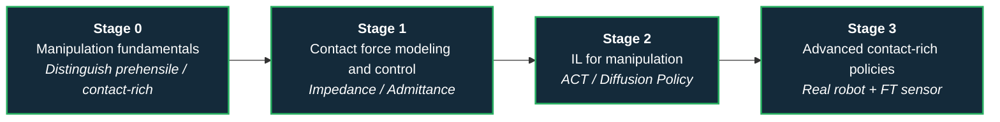

# Contact-Rich Manipulation

**At a glance**:

- **Who it's for**: People who need to do fine contact manipulation such as assembly, screwing, and insertion/extraction.
- **Path**: Stage 0–3 · Manipulation fundamentals → contact force modeling and control → imitation learning for manipulation → advanced contact-rich policies.
- **Depth roadmap**: A branch of the [motion control main roadmap](motion-control.md).

## Roadmap overview

## How to use this path

- The target reader is an engineer with an RL/IL background who wants to go deeper into manipulation tasks
- You need to understand basic dynamics and control, and be fluent in Python programming
- Each stage has prerequisites, core questions, what to do, and what you should be able to produce

**Relation to the main roadmap:**
- Manipulation tasks share the foundations of WBC / impedance control / contact modeling with locomotion
- This roadmap overlaps heavily with the [imitation learning depth roadmap](depth-imitation-learning.md), because the current mainstream approach for contact-rich tasks is IL
- Much Sim2Real experience can also be borrowed from Stage 4 of the [RL depth roadmap](depth-rl-locomotion.md)

---

## Stage 0 Manipulation fundamentals

### Prerequisites
- Robot kinematics basics (forward and inverse kinematics)
- Basic control theory (PID, impedance control concepts)
- Python + ROS or a similar framework

### Core questions
- What "contact-rich" means, and how it differs from free-space manipulation
- What scenarios rigid grasping and compliant control are each suited for

### What to read
- [Manipulation](../../wiki/tasks/manipulation.md)
- [Contact-Rich Manipulation](../../wiki/concepts/contact-rich-manipulation.md)
- Mason, *Mechanics of Robotic Manipulation* — Chapter 1-2

### What to do
- Make a table: give 2 tasks each for prehensile / non-prehensile / contact-rich, and mark whether each is better suited to rigid grasping or impedance control
- After reading Mason *Mechanics of Robotic Manipulation* Chapter 1–2, explain in your own words what impedance control solves in contact tasks

### What you should be able to produce
- Be able to distinguish prehensile / non-prehensile / contact-rich manipulation
- Understand the basic principle of impedance control

---

## Stage 1 Contact force modeling and control

### Core questions
- How to model contact forces and friction
- What the differences are among impedance control vs. admittance control vs. force control

### What to read
- [Contact Dynamics](../../wiki/concepts/contact-dynamics.md)
- [Force Control basics](../../wiki/concepts/force-control-basics.md)
- [Impedance Control](../../wiki/concepts/impedance-control.md) and [Hybrid force/position control](../../wiki/concepts/hybrid-force-position-control.md)
- [Whole-Body Control](../../wiki/concepts/whole-body-control.md)
- Hogan, *Impedance Control* (1985)

### What to do
- Implement an impedance controller in MuJoCo or Isaac Sim and complete a box-pushing task
- Observe the effect of the contact stiffness parameter on stability

### What you should be able to produce
- Be able to write the mathematical form of impedance control
- Be able to explain the difference between a soft contact model (MuJoCo) vs. hard contact

---

## Stage 2 Imitation learning for manipulation

### Core questions
- When demonstrations are available, safe exploration is possible, or simulation is available, how to choose among IL, RL, and residual/post-training combinations after IL initialization
- What scenarios ACT and Diffusion Policy are each suited for

### What to read
- [Imitation Learning](../../wiki/methods/imitation-learning.md)
- [Behavior Cloning](../../wiki/methods/behavior-cloning.md)
- [Diffusion Policy](../../wiki/methods/diffusion-policy.md) and [Action Chunking](../../wiki/methods/action-chunking.md)
- [Bimanual Manipulation](../../wiki/tasks/bimanual-manipulation.md)
- [Query: imitation learning in manipulation tasks](../../wiki/queries/il-for-manipulation.md)
- [Data gloves vs vision teleoperation](../../wiki/comparisons/data-gloves-vs-vision-teleop.md) — collection scheme selection
- [DexVerse](../../wiki/entities/paper-dexverse.md) — dexterous manipulation benchmark of 100 tasks × 3 arms × 6 hands; π₀.₅ / DP3 average success rate is only 34%, exposing bottlenecks in cross-skill generalization and sub-centimeter contact alignment
- [DexBench](../../wiki/entities/dexbench.md) — RLWRLD × NVIDIA open specification for industrial dexterous manipulation: OSC six-axis difficulty diagnosis, five Dexterity Regimes defining capability envelopes, 18 tasks / 55 use cases + procurable physical objects; the official evaluation repo and Isaac Lab-Arena integration are yet to be released
- Zhao et al., *Learning Fine-Grained Bimanual Manipulation with Low-Cost Hardware* (ACT, 2023)
- [Survey of imitation learning for contact-rich tasks](../../wiki/entities/paper-imitation-learning-contact-rich-tasks-survey.md) — organizes the method lineage of IL for contact-rich manipulation by contact perception, force/tactile representation, and policy structure
- [HandsOn](../../wiki/entities/paper-handson.md) — cross-embodiment dexterous manipulation simulation platform and benchmark (66 tasks / 18,000 demonstrations, Core-50 + Transfer-16)

### What to do
- Collect teleoperation data with the ACT framework and train a grasping policy
- Vary the predicted chunk and the actually executed open-loop prefix separately, and record success rate, peak contact force, and response latency

### What you should be able to produce
- Be able to explain ACT's action chunking mechanism and the multimodal advantage of Diffusion Policy
- Be able to design a data collection scheme for a contact-rich task

---

## Stage 3 Advanced contact-rich policies

### Core questions
- How to handle contact inconsistency in contact-rich tasks during sim2real
- What learning methods exist specifically for contact-rich tasks

### What to read
- [Query: contact-rich manipulation practice guide](../../wiki/queries/contact-rich-manipulation-guide.md)
- [Demo Data Collection Guide](../../wiki/queries/demo-data-collection-guide.md)
- [Tactile Sensing](../../wiki/concepts/tactile-sensing.md) and [Visuo-tactile fusion](../../wiki/concepts/visuo-tactile-fusion.md)
- [Tactile impedance control](../../wiki/methods/tactile-impedance-control.md) and [In-Hand Reorientation](../../wiki/methods/in-hand-reorientation.md)
- [Query: tactile feedback in RL](../../wiki/queries/tactile-feedback-in-rl.md)
- [ContactMimic](../../wiki/entities/paper-contactmimic.md) — explicitly tracks per-body contact commands beyond keypoint tracking; contact controllability verified on a real G1, carrying boxes without task-specific rewards
- [UHAS unified hand action space](../../wiki/methods/uhas-unified-hand-action-space.md) — canonical-sphere geometric deformation action representation + cascaded IK; a single PPO policy transfers zero-shot across Allegro / LEAP / Shadow
- [FastGrasp](../../wiki/entities/paper-fastgrasp-mobile-dexterous-grasping.md) — sim2real mobile high-speed dexterous grasping with CVAE point-cloud grasp guidance + whole-body RL + binary tactile feedback
- [TouchWorld](../../wiki/entities/paper-touchworld-tactile-foundation-dexterous-manipulation.md) — predictive–reactive tactile foundation model: a tactile world model predicts contact subgoals + TRT high-frequency residuals; real-robot success rate on six long-horizon humanoid tasks 65.0% (clean) / 53.7% (human perturbation)
- [REGRIND](../../wiki/methods/regrind-retargeting-guided-rl.md) — single-shot human hand–object motion capture retargeting + residual RL tracking object keypoints, zero-shot deployment on LEAP/WUJI to complete contact-rich tool manipulation such as scissors and screwdrivers
- [ADEPT](../../wiki/entities/paper-adept-dexterity.md) (NVIDIA/Michigan) — 16-primitive reposing RL pretraining + BC/critic-warmup/conservative PPO post-training + two-stage vision distillation; zero-shot real-robot on Kuka–Allegro and Flexiv–Sharpa, tactile 8/10 vs vision-only 3/10; code Coming soon
- [Blind Grasp Reflex](../../wiki/entities/paper-blind-grasp-reflex.md) — decouples arm reaching from hand contact control: a 20-DoF hand policy uses only the history of joint positions/command errors for proprioceptive grasping and outputs a grasp score; simulation includes 92% dynamic grasping; official code to be released
- [Distributed Whole-Arm Interaction (soft-arm whole-arm contact)](../../wiki/entities/paper-distributed-whole-arm-interaction-soft-robot.md) — recurrent RL driven by embedded IMU proprioceptive history, blind whole-arm contact for hybrid rigid–soft manipulators
- [TouchScale](../../wiki/entities/touchscale.md) — human visuo-tactile interaction dataset from unified wearable collection (about 500 h in the paper, 100 h currently released on HF)
- [SpectRobot](../../wiki/entities/paper-spectrobot-single-point-tactile.md) — converts high-bandwidth single-point sensing signals into time–frequency maps so a visual encoder can read contact history.
- [Norm2Tex](../../wiki/entities/paper-norm2tex.md) — converts normal textures into height information and modifies depth maps before tactile rendering, adding high-frequency surface detail to existing simulators.
- [Berkeley QUAD Hand](../../wiki/entities/paper-berkeley-quad-hand.md) — uses asymmetric actuation and compliant coupling to divide labor among fingers, balancing dexterity and sustained grip force while controlling size and heat.
- [CoDance](../../wiki/entities/paper-codance.md) — constructs bimanual force-aware clips from partner dance videos; multi-link compliance augmentation + RL lets G1 yield to contact forces while following a dance partner
- Luo et al., *DEFT: Dexterous Fine-Grained Manipulation Transformer* (2024)

### What to do
- Try deploying an ACT policy on a real robot, using an FT sensor to record contact forces
- Analyze failure cases and find contact force error patterns

### What you should be able to produce
- Be able to identify the main bottlenecks of contact-rich sim2real transfer
- Be able to design a simple correction mechanism using FT sensor feedback

---

## Quick entry summary

| Stage | Core question | Knowledge page entry |
|------|---------|-----------|
| Stage 0 | Distinguish prehensile / contact-rich | [Contact-Rich Manipulation](../../wiki/concepts/contact-rich-manipulation.md) |
| Stage 1 | Impedance / admittance / force control | [Impedance Control](../../wiki/concepts/impedance-control.md) |
| Stage 2 | IL for manipulation | [Imitation Learning](../../wiki/methods/imitation-learning.md) |
| Stage 3 | Real-robot contact and touch | [Query: contact-rich manipulation practice guide](../../wiki/queries/contact-rich-manipulation-guide.md) |

## Relation to other pages

- Full growth roadmap reference: [Main roadmap: motion control → physical intelligence full-stack growth roadmap](motion-control.md)
- Related depth roadmaps (by topical proximity; full catalog in the [roadmap overview](motion-control.md#depth-optional-index)):
  - [Imitation learning](depth-imitation-learning.md) — the current mainstream approach for contact-rich tasks is IL
  - [Teleoperation](depth-teleoperation.md) — demonstration collection and finger contact preservation
  - [Loco-Manipulation](depth-loco-manipulation.md) — the extension of this roadmap toward "manipulation while moving"
  - [Motion retargeting](depth-motion-retargeting.md) — adjacent roadmap for dexterous-hand interaction retargeting
- Related knowledge pages:
  - [Manipulation](../../wiki/tasks/manipulation.md)
  - [Contact-Rich Manipulation](../../wiki/concepts/contact-rich-manipulation.md)
  - [Bimanual Manipulation](../../wiki/tasks/bimanual-manipulation.md)
  - [Imitation Learning](../../wiki/methods/imitation-learning.md)
  - [Behavior Cloning](../../wiki/methods/behavior-cloning.md)
  - [Query: contact-rich manipulation practice guide](../../wiki/queries/contact-rich-manipulation-guide.md)

## References

- [Manipulation](../../wiki/tasks/manipulation.md)
- [Contact-Rich Manipulation](../../wiki/concepts/contact-rich-manipulation.md)
- [Contact Dynamics](../../wiki/concepts/contact-dynamics.md)
- Zhao et al., *Learning Fine-Grained Bimanual Manipulation with Low-Cost Hardware* (ACT, 2023)
- Hogan, *Impedance Control* (1985)
- Mason, *Mechanics of Robotic Manipulation*
