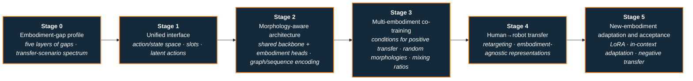

# Cross-Embodiment Transfer (Cross-Embodiment)

**At a glance**:

- **Who it's for**: people who want a policy to survive a change of gripper, camera, or morphology without retraining from scratch.
- **Path**: Stage 0–5 · embodiment-gap profile → unified action / state interface → morphology-aware architecture → multi-embodiment co-training → human→robot transfer → new-embodiment adaptation and acceptance.
- **Depth roadmap**: a branch of the [motion control main roadmap](motion-control.md); it continues from the [motion retargeting depth roadmap](depth-motion-retargeting.md), extending cross-skeleton mapping at the reference level to cross-embodiment at the policy level.

## Roadmap overview

## How to use this path

- The target reader can already train a usable policy on **one** robot (any of WBT / RL locomotion / BC / VLA) and has started to get stuck on "every time we switch robots we have to recollect data and retrain"
- Cross-embodiment transfer addresses **policy-level reuse**: the same weights (or the same shared backbone) serve multiple embodiments; it is not the same as [motion retargeting](depth-motion-retargeting.md) (which only maps reference trajectories), nor the same as [Sim2Real](depth-sim2real.md) (simulation↔real hardware for the same embodiment) - but the three are often chained together
- **Read Stage 0 before choosing a method**: all called "cross-embodiment", swapping a gripper, swapping to a humanoid of the same family, and human→quadruped are three completely different problems; a method at the wrong level is worse than not transferring at all
- Each stage has prerequisites, core questions, what to do, what to read, and what you should be able to produce

**Relation to the main roadmap:**
- This roadmap is the advanced direction after main roadmap L5.4 (motion retargeting) that leans toward "one policy serving many embodiments"; on the manipulation side it meets L10 (VLA / Foundation Policy); its starting point is the modular multi-robot transfer of Devin et al., which splits a policy into **task modules × robot modules** ([arXiv:1609.07088](https://arxiv.org/abs/1609.07088), ICRA 2017)
- On the data side it chains with the [embodied data depth roadmap](depth-embodied-data.md) (how to aggregate cross-embodiment data); on the whole-body control side it chains with the [BFM depth roadmap](depth-bfm.md) (one checkpoint controlling the whole body)
- If the goal is "read one demonstration and switch tasks", that is the [ICL depth roadmap](depth-icl.md); this roadmap is about "switching bodies"

## Lineage at a glance (primary sources)

The table below lists the key milestones of this direction in chronological order; all numbers are taken from the paper abstracts. Works whose names are linked have detail pages on this site; read the rest directly from the original papers.

| Year | Work | Primary source | Significance for this roadmap |
|------|------|----------|----------------|
| 2017 | Modular multi-robot policies (Devin et al.) | [arXiv:1609.07088](https://arxiv.org/abs/1609.07088) (ICRA 2017) | Splits the policy into task modules × robot modules, which can be composed into robot–task pairs never trained on; **starting point of this roadmap** |
| 2018 | NerveNet | [Project page](https://www.cs.toronto.edu/~tingwuwang/nervenet.html) (ICLR 2018) | Models the agent's body as a graph and uses a GNN as the policy; proposes size-transfer and "disabled-limb" transfer benchmarks |
| 2019 | [RoboNet](../../wiki/entities/paper-rcl-1910-11215-robonet-large-scale-multi-robot-learning.md) | [arXiv:1910.11215](https://arxiv.org/abs/1910.11215) (CoRL 2019) | 7 platforms, 15 million frames; fine-tuning on held-out Franka / Kuka outperforms single-robot methods that use 4–20x more data |
| 2020 | Shared Modular Policies | [arXiv:2007.04976](https://arxiv.org/abs/2007.04976) (ICML 2020) | One identical module per actuator that sees only local sensing and passes messages; a single policy controls different skeletons and generalizes to unseen morphologies |
| 2022 | MetaMorph | [arXiv:2203.11931](https://arxiv.org/abs/2203.11931) (ICLR 2022) | A Transformer takes the body structure as extra input; after multi-morphology pretraining it controls unseen robots zero-shot |
| 2023 | [Open X-Embodiment / RT-X](../../wiki/entities/paper-open-x-embodiment.md) | [arXiv:2310.08864](https://arxiv.org/abs/2310.08864) | 21 institutions, 22 robots, 527 skills; RT-X improves the capabilities of multiple robots by leveraging experience from other platforms (positive transfer) |
| 2023 | Polybot | [arXiv:2307.03719](https://arxiv.org/abs/2307.03719) | Wrist cameras + a unified modular codebase align observations/actions, then contrastive learning aligns representations; 3 arms, about 60 h |
| 2024 | Mirage | [arXiv:2402.19249](https://arxiv.org/abs/2402.19249) (RSS 2024) | At deployment, masks out the target robot and inpaints the source robot (cross-painting); zero-shot across arms/grippers |
| 2024 | [Octo](../../wiki/entities/paper-octo.md) | [arXiv:2405.12213](https://arxiv.org/abs/2405.12213) | Pluggable token inputs and readout heads; few-shot adaptation to new observation/action spaces |
| 2024 | CrossFormer | [arXiv:2408.11812](https://arxiv.org/abs/2408.11812) | About 900k trajectories, 20 embodiments (single/dual arm, wheeled, quadruped, quadrotor); no manual alignment of observation/action spaces, a single set of weights matches each embodiment's specialist |
| 2024 | HPT | [arXiv:2409.20537](https://arxiv.org/abs/2409.20537) (NeurIPS 2024) | Each embodiment's proprioception and vision are first aligned into a short token sequence, then fed into a shared trunk; 52 datasets, over 20% improvement when fine-tuning on unseen tasks |
| 2024 | URMA | [arXiv:2409.06366](https://arxiv.org/abs/2409.06366) | Morphology-agnostic encoder/decoder; one legged locomotion policy across embodiments, transferred to unseen platforms (simulation and real hardware) |
| 2024 | RoVi-Aug | [arXiv:2409.03403](https://arxiv.org/abs/2409.03403) (CoRL 2024) | Generative models synthesize training images of different robots and viewpoints; zero-shot deployment to unseen robots, success rate up to +30% |
| 2024 | LAPA | [arXiv:2410.11758](https://arxiv.org/abs/2410.11758) (ICLR 2025) | A VQ-VAE learns inter-frame latent actions to pretrain a VLA on videos without action labels; positive transfer appears even with human videos only |
| 2025 | Embodiment Scaling Laws | [arXiv:2505.05753](https://arxiv.org/abs/2505.05753) (CoRL 2025) | About 1000 procedurally generated embodiments; increasing the number of training embodiments generalizes more broadly than adding data on fixed embodiments; zero-shot on Go2 and H1 |
---

## Stage 0 Embodiment-gap profile: first state which layers differ

**"Cross-embodiment" is not one problem but a family of problems; first break the gap between source and target embodiments into five layers, then decide which layers go to the interface, which to training, and which can only be handled by target-robot data.**

### Prerequisites
- Have fully trained and deployed a policy on one robot
- Can read URDF / MJCF: kinematic tree, limits, mass and inertia, actuator parameters

### Core questions
- **Five layers of gaps**: ① observation (camera pose, viewpoint, sensor types) ② kinematics (topology, DoF, link proportions, closed chains/hip-axis structure) ③ dynamics (mass distribution, actuator torque/bandwidth, PD gains) ④ end effector/tool (gripper, dexterous hand, tool head) ⑤ control interface (action semantics, absolute/delta, control frequency)
- **Transfer-scenario spectrum** (near to far): same morphology, different configuration (only swap camera/gripper) → swap end effector → close-relative humanoids (joints roughly one-to-one) → heterogeneous humanoids → across morphology classes (humanoid↔quadruped↔arm) → human→robot
- **The boundary of "general"**: the generality of embodied foundation models is task generalization; its effective scope is still constrained by the action space, sensing loop, and safety boundaries, and it does not mean the embodiment definition can be dropped
- Trade-offs among the three main paths: single-embodiment retraining + retargeting (most stable, most expensive), efficient post-training of an existing expert (e.g., Any2Any), and multi-embodiment joint training from the start (low marginal cost, highest upfront cost)

### What to do
- Fill in a five-layer gap table for your own "source embodiment → target embodiment", marking each layer as: absorbable by the interface / must be absorbed by training / requires target-robot data
- Walk through the decision tree in the selection guide, and write down which path you land on and why not the other two

### What to read
- [Cross-embodiment transfer (knowledge-chain summary)](../../wiki/overview/hub-cross-embodiment.md) — the knowledge hub of this roadmap: selection and failure modes of retargeting, domain randomization, and Any2Any-type methods
- [Cross-embodiment policy transfer selection guide](../../wiki/queries/cross-embodiment-transfer-strategy.md) — decision tree and failure-mode table for the three paths: single-embodiment retraining / Any2Any / multi-embodiment joint training
- [Embodied foundation models and embodiment co-design](../../wiki/concepts/embodied-foundation-model-hardware-codesign.md) — "general" means task generalization, not independence from the embodiment
- [Emergent Transfer](../../wiki/entities/paper-emergent-transfer-cross-config.md) — the nearest end of the scenario spectrum: same morphology, different configuration; legacy demonstrations are useless until the new robot crosses the threshold τ(T)
- [GEN-1 Thousand Hands](../../wiki/entities/generalist-gen1-thousand-hands.md) — end-effector/tool axis: the same base across about 9000 end-effector variants (closed source, self-reported)

### What you should be able to produce
- A five-layer gap table + a one-sentence positioning: "which tier of the scenario spectrum my transfer falls in, and which path it takes"
- Be able to explain why "edit the URDF and deploy directly" fails - retargeting only solves the reference level; dynamics gaps still have to be absorbed by training

---

## Stage 1 Unified interface: how to align action and state spaces

**The premise for multiple embodiments sharing one policy is that they share one "language"; the higher the interface abstraction, the easier it is to share, and the lower, the higher the fidelity - this is the first core trade-off of this direction.**

### Prerequisites
- Stage 0 content
- Forward/inverse kinematics, end-effector pose representations (SE(3), camera frame vs base frame)

### Core questions
- **Five classes of interfaces**:
  - **Coarse end-effector actions**: OXE / RT-X mainly aligns each dataset to 7-D end-effector actions (translation + rotation + gripper) - what is unified is storage and a coarse interface, not dynamics
  - **Canonical slots + masks**: place joints into fixed slots by body semantics, masking missing joints - XHugWBC's 32 slots, GreenWAM's 79 anatomical joint slots, Qwen-RobotManip's 80-D canonical state-action
  - **Geometric anchors**: use wrist/grasp geometry observable in the camera frame as a shared target, then a translator outputs each embodiment's commands (UCAG-P); or project the TCP frame into the image so a VLM outputs deltas directly (EASG)
  - **Domain-specific canonical spaces**: for dexterous hands, a canonical spherical deformation + cascaded IK maps to different hands (UHAS); for human hands/dexterous hands/grippers, wrist SE(3) + finger-joint slots (AdvDex)
  - **Latent actions**: learn embodiment-agnostic latent actions from video, then decode to each embodiment (LAPA uses a VQ-VAE to learn discrete inter-frame latent actions; for an empirical study of 41 LAM designs see Latent Actions Matter)
- **Align or not align**: Polybot manually aligns observations/actions with wrist cameras and a unified codebase, then aligns internal representations with contrastive learning; CrossFormer instead argues against manual alignment and feeds the native observations/actions of 20 embodiments directly to a Transformer - the trade-off between the two routes is engineering contract vs data scale
- **Appearance gaps at the observation layer**: robots looking different is itself a distribution shift - Mirage masks out the target robot at deployment and inpaints it as the source robot; RoVi-Aug uses generative models at training time to synthesize different robots and viewpoints
- **Camera frame vs base frame**: across embodiments, the semantics of base-frame actions change with the mounting position; the camera frame is more transferable but depends on extrinsics
- **The description file is itself an interface**: if DoF mappings, chain structure, and collision approximations are derived manually from the URDF every time, the interface becomes inconsistent already at the engineering level

### What to do
- On two embodiments at hand, implement both the "coarse end-effector action" and the "canonical slots + masks" interfaces once each, and record what information each one drops (usually fingers, waist, redundant degrees of freedom)
- Write a slot definition table: the semantics, units, coordinate frame, and masking rule when missing for each slot - this table is the contract for all subsequent co-training

### What to read
- [Open X-Embodiment](../../wiki/entities/paper-open-x-embodiment.md) — a unified schema for 60+ datasets and 22 embodiment types; the origin and limitations of 7-D coarse end-effector actions
- [XHugWBC](../../wiki/entities/paper-xhugwbc-cross-humanoid.md) — 32-slot joint semantic space + controllability masks, an example slot interface for heterogeneous humanoids
- [GreenWAM](../../wiki/entities/paper-greenwam.md) — maps 20 robot types onto 79 shared anatomical joint slots, jointly training world prediction and policy
- [Qwen-RobotManip](../../wiki/entities/qwen-robot-manip.md) — 80-D canonical state-action + camera-frame EEF delta
- [UCAG-P](../../wiki/entities/paper-ucag-p.md) · [EASG](../../wiki/entities/paper-easg-vlm-native-action-model.md) — two ways to realize camera-frame geometric anchors
- [UHAS](../../wiki/methods/uhas-unified-hand-action-space.md) · [AdvDex](../../wiki/entities/paper-advdex.md) — two unified action spaces at the dexterous-hand level (RL sphere vs VLA joint slots)
- [Latent Actions Matter](../../wiki/entities/paper-latent-actions-matter.md) · [LAC-WM](../../wiki/entities/paper-lac-wm-cross-embodiment-latent-action-world-model.md) — empirical evidence for latent-action interfaces and their use in cross-embodiment world models
- [URDD](../../wiki/entities/paper-urdd-universal-robot-description-directory.md) — organizes URDF-derived DoF mappings, chain structure, etc. into a versioned module directory
- Primary sources: [Polybot (arXiv:2307.03719)](https://arxiv.org/abs/2307.03719) · [CrossFormer (arXiv:2408.11812)](https://arxiv.org/abs/2408.11812) · [LAPA (arXiv:2410.11758)](https://arxiv.org/abs/2410.11758) · [Mirage (arXiv:2402.19249)](https://arxiv.org/abs/2402.19249) · [RoVi-Aug (arXiv:2409.03403)](https://arxiv.org/abs/2409.03403)

### What you should be able to produce
- An interface selection note: interface type × range of embodiments covered × information lost × extrinsics/calibration required
- Your own slot contract table, directly shareable by the data pipeline and the training code

---

## Stage 2 Morphology-aware architecture: what is shared, what is embodiment-specific

**The core architectural decision is "how thick the shared layers are, how thick the embodiment layers are": the thicker the shared layers, the more worthwhile transfer becomes; the thicker the embodiment layers, the more it degenerates back to one policy per robot.**

### Prerequisites
- Stage 1 content
- Usage-level intuition for Transformers / GNNs; able to modify the input and output heads of a policy network

### Core questions
- **Shared backbone + embodiment-specific heads**: Octo uses pluggable readout heads to handle new action spaces; HPT first aligns each embodiment's proprioception and vision into a short token sequence before the shared trunk; GR00T N1 gives each embodiment its own state/action encoder-decoder MLPs; X-WBC puts human motion semantics in a shared backbone and leaves morphological differences to lightweight embodiment modules - the origin of this branch is Devin 2017's "task modules × robot modules"
- **Morphology as input**: encode the kinematic tree itself into the network. The lineage is NerveNet (GNN, ICLR 2018) → Shared Modular Policies (one module per actuator + message passing, ICML 2020) → MetaMorph (Transformer takes the body structure as input, ICLR 2022) → URMA (morphology-agnostic encoding/decoding) / GET-Zero (embodiment-graph connectivity as attention bias); recent works on this site include XHugWBC's embodiment graph network, RecMorph's DFS ordering of the kinematic tree + bidirectional spatial RNN, and Hodge message passing that models a quadruped as a cell complex - when the morphology changes, the network structure does not need to
- **Shared behavior, separate execution**: CrossBFM shares only a high-level behavior latent space, and each robot keeps its own low-level tracker - placing cross-embodiment reuse at the behavior interface rather than copying joint commands
- **History as identification**: LocoFormer uses Transformer-XL cross-episode memory for deployment-time adaptation under unseen morphologies/motor failures; UP-OSI (RSS 2017) uses an online identifier to estimate parameters and then adjust the policy - the embodiment gap is treated as "a latent variable to be inferred from history"
- **Used in reverse**: the same multi-embodiment policy can also serve as a design tool (Shape Your Body first trains a URMA multi-embodiment policy and then modifies body parameters along the value gradient; Transformer Transformer unifies co-design and cross-embodiment control)

### What to do
- On the same batch of multi-embodiment data, compare two structures: shared backbone + per-embodiment MLP heads vs a morphology-aware network with graph/sequence encoding, and record how much code each needs to change and how many steps to train when adding one embodiment
- Run an "embodiment layer thickness" ablation: gradually move layers from shared to embodiment-specific, and plot average performance against the adaptation cost for a new embodiment

### What to read
- [Octo](../../wiki/entities/paper-octo.md) — readout heads are the main transfer interface: new cameras and new action spaces do not require retraining the whole network
- [GR00T N1](../../wiki/entities/paper-hrl-stack-34-gr00t_n1.md) — per-embodiment state/action MLPs project into a shared DiT latent space
- [X-WBC](../../wiki/entities/paper-x-wbc.md) — the split "motion semantics can be shared, physical execution cannot"; joint training on 9 simulated humanoids, the same interface on 4 real robots
- [XHugWBC](../../wiki/entities/paper-xhugwbc-cross-humanoid.md) · [RecMorph](../../wiki/entities/paper-recmorph.md) · [Hodge morphology priors](../../wiki/entities/paper-hodge-morphology-priors-quadruped-degradation.md) — three encodings of morphology as input
- [CrossBFM](../../wiki/entities/paper-crossbfm-shared-latent-behavior.md) — shared latent behavior space + per-embodiment trackers
- [LocoFormer](../../wiki/entities/paper-locoformer.md) · [UP-OSI](../../wiki/entities/paper-up-osi-universal-policy-online-sysid.md) — absorbing embodiment gaps via history context / online identification
- [Shape Your Body](../../wiki/entities/paper-shape-your-body-value-gradient-design.md) · [Transformer Transformer](../../wiki/entities/paper-transformer-transformer.md) — multi-embodiment policies feeding back into body design
- Primary sources (morphology-aware lineage): [NerveNet](https://www.cs.toronto.edu/~tingwuwang/nervenet.html) · [Shared Modular Policies (arXiv:2007.04976)](https://arxiv.org/abs/2007.04976) · [MetaMorph (arXiv:2203.11931)](https://arxiv.org/abs/2203.11931) · [URMA (arXiv:2409.06366)](https://arxiv.org/abs/2409.06366) · [GET-Zero (arXiv:2407.15002)](https://arxiv.org/abs/2407.15002)
- Primary source (shared backbone): [HPT (arXiv:2409.20537)](https://arxiv.org/abs/2409.20537) — a trunk scaling study on 52 datasets

### What you should be able to produce
- An architecture selection table: what goes in the shared layers / embodiment layers, and the code changes and training cost of adding a new embodiment
- Be able to state clearly "what is shared" in your system - semantics, behavior, or joint commands

---

## Stage 3 Multi-embodiment co-training: when does positive transfer happen

**Stuffing data from multiple robots into the same training run does not automatically produce cross-embodiment capability; positive transfer has conditions and thresholds, and it can also be lopsided.**

### Prerequisites
- Stage 2 content
- Able to write a multi-dataset mixing sampler and read per-dataset metrics in training curves

### Core questions
- **Lineage**: RoboNet (CoRL 2019) pooled 15 million frames of visual experience from 7 platforms into a shared dataset; fine-tuning on held-out Franka / Kuka already outperforms single-robot methods using 4–20x more data, but a "relevant subset" can beat a larger mixed pool → OXE / RT-X (2023) tested on 22 robots when cross-embodiment co-training yields positive transfer
- **The number of embodiments is also a scaling axis**: Embodiment Scaling Laws (CoRL 2025) procedurally generated about 1000 embodiments and reports that increasing the number of training embodiments generalizes more broadly than adding data on fixed embodiments; the best policy transfers zero-shot to Go2 and H1 - a conclusion for legged locomotion, still to be verified on the manipulation side
- **Threshold phenomenon**: Emergent Transfer reports that a new configuration must first cross a task-dependent threshold τ(T) using its own data before cross-generation co-training yields large emergent gains - mixing in legacy data too early often yields zero gain
- **Broadening the morphology distribution**: XHugWBC uses physically consistent random morphologies that adjust geometry, mass, and inertia together; LocoFormer uses procedurally generated robots - the morphology distribution seen during training determines how far zero-shot can go
- **Generalist ↔ specialist loop**: EAGLE-WBC iterates generalist → specialist fine-tuning → DAgger distillation back, letting a single policy span humanoids such as H1/G1/T1
- **Lopsidedness and mixing ratios**: embodiments with large data volumes dominate the gradient; reweight by embodiment difficulty and report metrics per embodiment instead of only looking at the average
- **Embodiment-free pretraining**: Xiaomi-Robotics-1 first pretrains on >100k h of embodiment-free UMI data, then post-trains with ~10k h of cross-embodiment data - deferring "embodiment" to the post-training stage

### What to do
- Run a minimal co-training experiment: three settings - embodiment A alone / A+B mixed / A+B reweighted by difficulty - reporting success rates per embodiment, and determine whether it is positive, zero, or negative transfer
- Plot a standalone data-amount–success-rate curve for the target embodiment, and find the inflection point where adding data from other embodiments starts to pay off

### What to read
- [RoboNet](../../wiki/entities/paper-rcl-1910-11215-robonet-large-scale-multi-robot-learning.md) — an early dataset of shared multi-robot experience; relevant subsets can beat larger mixed pools
- [Open X-Embodiment concept page](../../wiki/concepts/open-x-embodiment.md) — cross-embodiment data normalization and generalist policy pretraining
- [Emergent Transfer](../../wiki/entities/paper-emergent-transfer-cross-config.md) — the τ(T) threshold and phase-aware collection rules
- [EAGLE-WBC](../../wiki/entities/paper-notebook-embodiment-aware-generalist-specialist-distillat.md) — generalist→specialist→DAgger; 5 robots in simulation, 4 real robots
- [Xiaomi-Robotics-1](../../wiki/entities/xiaomi-robotics-1.md) — embodiment-free UMI pretraining + cross-embodiment post-training
- [Embodied scaling laws](../../wiki/concepts/embodied-scaling-laws.md) — a discussion of power laws in data scale, parameter count, and cross-embodiment generalization
- [Embodied data depth roadmap](depth-embodied-data.md) — how to aggregate, clean, and mix cross-embodiment data
- Primary sources: [RoboNet (arXiv:1910.11215)](https://arxiv.org/abs/1910.11215) · [Open X-Embodiment (arXiv:2310.08864)](https://arxiv.org/abs/2310.08864) · [Towards Embodiment Scaling Laws in Robot Locomotion (arXiv:2505.05753)](https://arxiv.org/abs/2505.05753) · [Pushing the Limits of Cross-Embodiment Learning (arXiv:2402.19432)](https://arxiv.org/abs/2402.19432) (arms, quadrotors, quadrupeds, and mobile bases co-train one goal-conditioned policy)

### What you should be able to produce
- A per-embodiment co-training ablation table (alone / mixed / reweighted) that directly answers "did the mixed-in data actually help"
- A collection recommendation: how many episodes to collect on the target embodiment first before starting to mix in data from other embodiments

---

## Stage 4 Human→robot transfer: cross-embodiment at the largest span

**Humans are the most numerous, cheapest, and most "heterogeneous" embodiment; the entire difficulty of this line lies in turning human motion into something a robot can execute, not in pretending the robot is a human.**

### Prerequisites
- Stage 3 content
- [Motion retargeting depth roadmap](depth-motion-retargeting.md) Stage 0–2 level (kinematic vs dynamic feasibility)

### Core questions
- **Route 1: explicit retargeting**: human motion → reference on the target skeleton → tracking policy; X-Morph retargets human motion via G1 and then across morphologies + physics correction + tracking distillation, providing behavior priors for Go2 / hexapod / B2-Z1
- **Route 2: retarget the object, not the human hand**: a phone captures object poses and contact intervals, and simulation-based executability is checked for each URDF - of 42 captures × 8 robots, about 31% pass and 52% fail, showing that "what a human can do, a robot cannot necessarily do"
- **Route 3: embodiment-agnostic representations**: EgoJEPA learns embodiment-agnostic latent actions from egocentric human videos without relying on manual retargeting; LaST-HD uses an action-conditioned world model to align unpaired human-hand and robot trajectories into a shared latent space
- **Strength of paired data**: only strong pair data (strictly aligned scene, frame-by-frame timing, and replayable actions) can pull human dynamics into the robot domain; weak pairs only align task semantics
- **Evaluation gap**: the generation quality of human video → video of a specified robot embodiment needs a dedicated diagnostic benchmark (H2R-Bench)
- **Industry claims**: OM-1 claims to drive policies across industrial arms and humanoids using only human wearable demonstrations, with no teleoperation/on-robot data - closed source and self-reported, needs independent verification

### What to do
- Pick one task and run it once each through the "explicit retargeting" and "embodiment-agnostic latent action" routes, counting failures in three categories: **kinematically unreachable / dynamically infeasible / semantics lost**
- Run an executability screen on your own human data: what fraction is physically feasible on the target embodiment - this fraction determines the real "conversion rate" of human data

### What to read
- [EgoX](../../wiki/entities/paper-egox-mxt-plus.md) — unified egocentric modalities, a shared trunk and embodiment-specific action heads, training-time future-latent Dreaming
- [SALA](../../wiki/entities/paper-sala-latent-actions.md) — aligns unpaired human videos with robot control latents via soft neighborhoods of action semantics
- [X-Morph](../../wiki/entities/paper-xmorph.md) — human→non-humanoid legged robots: retargeting + physics correction + privileged tracking distillation
- [Unified Inertial Encoder](../../wiki/entities/paper-unified-inertial-encoder.md) — human→G1 transfer at the **sensing/state-estimation layer** via retargeting and a shared 12-part IMU interface; not control policy transfer - see the detail page for the boundaries of real-robot weight training and checkpoint selection
- [Retargeting objects rather than human hands](../../wiki/entities/paper-human-demos-object-retargeting.md) — simulation-based executability check for each URDF; about 31% pass
- [EgoJEPA](../../wiki/entities/paper-egojepa-egocentric-latent-action.md) — egocentric human video → embodiment-agnostic latent actions
- [LaST-HD](../../wiki/entities/paper-last-hd-latent-physical-reasoning.md) — aligns unpaired human-hand and robot trajectories into a shared latent physical-reasoning space
- [Strong pair data](../../wiki/concepts/strong-pair-data.md) — grading the strength of human–robot paired data
- [H2R-Bench](../../wiki/entities/paper-h2r-bench.md) — a cross-embodiment diagnostic benchmark for human video → video of a specified robot embodiment
- [Human2Dex](../../wiki/entities/paper-human2dex-wrist-centric-dexterous.md) — the same batch of human-hand demonstrations retargeted separately to two different dexterous hands
- [OM-1 (Reward AI)](../../wiki/entities/reward-ai-om1.md) — an industry example of cross-embodiment driven directly by human demonstrations only (closed source, self-reported)
- Primary source: [LAPA (arXiv:2410.11758)](https://arxiv.org/abs/2410.11758) — pretraining a latent-action VLA on human manipulation videos alone also shows positive transfer

### What you should be able to produce
- The shortest chain from "human data → executable trajectories on the target embodiment", marking which link is most fragile
- A record of human-data conversion rate: amount collected × executable fraction × downstream gain

---

## Stage 5 Fast adaptation and acceptance for a new embodiment

**The last mile of transfer is "how much data, compute, and risk it takes on the day a new robot arrives"; the numbers must be reported together with source-embodiment degradation, negative transfer, and safety guardrails.**

### Prerequisites
- Stage 4 content
- LoRA / parameter-efficient fine-tuning; the safety layer for real-robot deployment (see the [Sim2Real depth roadmap](depth-sim2real.md))

### Core questions
- **Freeze + low-rank patches**: Any2Any splits the gap into gradient-free kinematic alignment + LoRA on dynamics-sensitive layers, transferring to a new humanoid at about 1% of full training cost; on close-relative skeletons SONIC-Transfer freezes even more (closed-form codec + about 0.25% of parameters); TRACE transfers SONIC from G1 to H2
- **Generating adaptation parameters per context**: MorphAct generates low-rank parameter updates for a shared VLA rather than fine-tuning separately for each scenario
- **Few-shot on-device adaptation**: the Gemini Robotics On-Device blog claims adaptation to a new dual-arm embodiment in a few hours with on the order of <200 examples - self-reported numbers
- **In-context adaptation**: adapt to a new embodiment from deployment history without changing weights (LocoFormer); isomorphic to the mechanism selection in the [ICL depth roadmap](depth-icl.md)
- **Three things for acceptance**: ① performance on held-out embodiments (never seen in training) ② whether the source embodiment degrades (catastrophic forgetting) ③ safety guardrails for the new robot's first day - torque/velocity limits come before any policy goes on the robot
- **Numbers across papers are not directly comparable**: embodiment sets, reference motion corpora, and metric definitions all differ between works; choose by scenario spectrum and budget, not by leaderboard

### What to do
- Do a full adaptation accounting for one new embodiment: target-robot data amount, GPU hours, change in source-embodiment metrics, held-out task success rate, and safety measures for the first time on the robot
- Write your own cross-embodiment evaluation protocol: which embodiments participate in training, which are held out, which metrics are reported for each embodiment, and how negative transfer is determined

### What to read
- [Any2Any](../../wiki/entities/paper-any2any-cross-embodiment-wbt.md) — kinematic alignment + dynamics LoRA, transferring to a new humanoid at about 1% cost
- [SONIC-Transfer](../../wiki/entities/paper-sonic-transfer.md) · [TRACE](../../wiki/entities/paper-trace-humanoid-transfer.md) — frozen transfer on close-relative skeletons and a two-stage G1→H2 curriculum
- [MorphAct](../../wiki/entities/paper-morphact.md) — a shared VLA that generates low-rank parameter updates per context
- [Gemini Robotics](../../wiki/entities/gemini-robotics.md) — On-Device fast cross-embodiment adaptation (closed source, self-reported)
- [Whole-Body Tracking Pipeline](../../wiki/concepts/whole-body-tracking-pipeline.md) — where cross-embodiment transfer sits in the full WBT pipeline
- [Embodied model evaluation depth roadmap](depth-embodied-eval.md) — held-out set splits and sim↔real calibration

### What you should be able to produce
- A new-embodiment adaptation ledger that directly answers "how much does it cost to bring in another new robot"
- A cross-embodiment evaluation protocol document, including held-out embodiments, source-embodiment degradation, and negative-transfer criteria

---

## Quick entry summary

| Stage | Core question | Knowledge page entry |
|------|---------|-----------|
| Stage 0 | How many layers of embodiment gap, which tier the transfer falls in | [Cross-embodiment transfer knowledge chain](../../wiki/overview/hub-cross-embodiment.md) · [Selection guide](../../wiki/queries/cross-embodiment-transfer-strategy.md) |
| Stage 1 | How to align the action/state interface | [Open X-Embodiment](../../wiki/entities/paper-open-x-embodiment.md) · [XHugWBC](../../wiki/entities/paper-xhugwbc-cross-humanoid.md) |
| Stage 2 | What is shared, what is embodiment-specific | [X-WBC](../../wiki/entities/paper-x-wbc.md) · [Octo](../../wiki/entities/paper-octo.md) |
| Stage 3 | When multi-embodiment co-training yields positive transfer | [Emergent Transfer](../../wiki/entities/paper-emergent-transfer-cross-config.md) · [EAGLE-WBC](../../wiki/entities/paper-notebook-embodiment-aware-generalist-specialist-distillat.md) |
| Stage 4 | How to transfer from human to robot | [X-Morph](../../wiki/entities/paper-xmorph.md) · [EgoJEPA](../../wiki/entities/paper-egojepa-egocentric-latent-action.md) |
| Stage 5 | New-embodiment adaptation and acceptance | [Any2Any](../../wiki/entities/paper-any2any-cross-embodiment-wbt.md) |

## Relation to other pages

- Full growth roadmap reference: [Main roadmap: motion control → full-stack physical intelligence growth roadmap](motion-control.md)
- Related depth roadmaps (by topical proximity; for the full directory see [Roadmap overview](motion-control.md#depth-optional-index)):
  - [Motion retargeting](depth-motion-retargeting.md) — cross-skeleton mapping at the reference level, upstream of Stage 4 of this roadmap
  - [BFM](depth-bfm.md) — one checkpoint controlling the whole body; cross-embodiment is BFM's next problem
  - [Sim2Real](depth-sim2real.md) — simulation↔real hardware for the same embodiment, often chained with cross-embodiment
  - [Embodied data](depth-embodied-data.md) — aggregation and mixing ratios of cross-embodiment data
  - [VLA](depth-vla.md) — the main vehicle for cross-embodiment pretraining on the manipulation side
  - [ICL](depth-icl.md) — switching tasks vs switching bodies; isomorphic deployment-time adaptation mechanisms

## References

- [Cross-embodiment transfer knowledge-chain summary](../../wiki/overview/hub-cross-embodiment.md)
- [Cross-embodiment policy transfer selection guide](../../wiki/queries/cross-embodiment-transfer-strategy.md)
- [Learning Modular Neural Network Policies for Multi-Task and Multi-Robot Transfer (arXiv:1609.07088)](https://arxiv.org/abs/1609.07088) — Devin, Gupta, Darrell, Abbeel, Levine; task modules × robot modules, starting point of this roadmap
- [NerveNet: Learning Structured Policy with Graph Neural Networks (ICLR 2018, project page)](https://www.cs.toronto.edu/~tingwuwang/nervenet.html) — Wang, Liao, Ba, Fidler; graph-structured policies and structure-transfer benchmarks
- [RoboNet: Large-Scale Multi-Robot Learning (arXiv:1910.11215)](https://arxiv.org/abs/1910.11215) — a shared multi-robot dataset
- [One Policy to Control Them All: Shared Modular Policies for Agent-Agnostic Control (arXiv:2007.04976)](https://arxiv.org/abs/2007.04976) — Huang, Mordatch, Pathak; ICML 2020
- [MetaMorph: Learning Universal Controllers with Transformers (arXiv:2203.11931)](https://arxiv.org/abs/2203.11931) — Gupta, Fan, Ganguli, Fei-Fei; ICLR 2022
- [Open X-Embodiment: Robotic Learning Datasets and RT-X Models (arXiv:2310.08864)](https://arxiv.org/abs/2310.08864) — cross-embodiment data aggregation and a test of RT-X positive transfer
- [Polybot: Training One Policy Across Robots While Embracing Variability (arXiv:2307.03719)](https://arxiv.org/abs/2307.03719) — Yang, Sadigh, Finn
- [Mirage: Cross-Embodiment Zero-Shot Policy Transfer with Cross-Painting (arXiv:2402.19249)](https://arxiv.org/abs/2402.19249) — RSS 2024
- [Pushing the Limits of Cross-Embodiment Learning for Manipulation and Navigation (arXiv:2402.19432)](https://arxiv.org/abs/2402.19432)
- [GET-Zero: Graph Embodiment Transformer for Zero-shot Embodiment Generalization (arXiv:2407.15002)](https://arxiv.org/abs/2407.15002)
- [Scaling Cross-Embodied Learning: One Policy for Manipulation, Navigation, Locomotion and Aviation (arXiv:2408.11812)](https://arxiv.org/abs/2408.11812) — CrossFormer
- [RoVi-Aug: Robot and Viewpoint Augmentation for Cross-Embodiment Robot Learning (arXiv:2409.03403)](https://arxiv.org/abs/2409.03403) — CoRL 2024
- [One Policy to Run Them All: an End-to-end Learning Approach to Multi-Embodiment Locomotion (arXiv:2409.06366)](https://arxiv.org/abs/2409.06366) — URMA
- [Scaling Proprioceptive-Visual Learning with Heterogeneous Pre-trained Transformers (arXiv:2409.20537)](https://arxiv.org/abs/2409.20537) — HPT; NeurIPS 2024
- [Latent Action Pretraining from Videos (arXiv:2410.11758)](https://arxiv.org/abs/2410.11758) — LAPA; ICLR 2025
- [Towards Embodiment Scaling Laws in Robot Locomotion (arXiv:2505.05753)](https://arxiv.org/abs/2505.05753) — CoRL 2025
