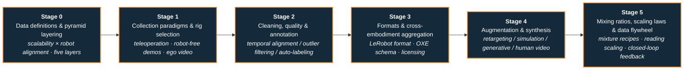

# Embodied Data

**At a glance**:

- **Who it's for**: people who want to treat embodied data as a deliverable engineering pipeline.
- **Path**: Stage 0–5 · data definitions and layering → collection paradigms → cleaning and annotation → formats and cross-embodiment aggregation → augmentation and synthesis → mixing ratios, scaling laws, and the data flywheel.
- **Depth roadmap**: a roadmap-style expansion of the [training data pipeline knowledge chain](../../wiki/overview/hub-data-pipeline.md); the shared upstream supply side of the [Imitation Learning](depth-imitation-learning.md) / [VLA](depth-vla.md) / [BFM](depth-bfm.md) depth roadmaps.

## Roadmap overview

## How to use this path

- The target reader is someone "responsible for the data supply of an embodied model (VLA / BFM / WAM / manipulation policy)": the main battlefield is collection ledgers, cleaning pipelines, dataset formats, mixing recipes, and data-flywheel infrastructure, not the training algorithms themselves
- Embodied data answers **"what does the policy eat"**: it is not responsible for training the policy well (that is the subject of the [Imitation Learning depth roadmap](depth-imitation-learning.md) and the [RL depth roadmap](depth-rl-locomotion.md)), nor for proving whether the policy is good (that is the subject of the [Embodied Model Evaluation depth roadmap](depth-embodied-eval.md)); it is responsible for **compressing the physical world into auditable, reusable, scalable training assets**
- Each stage has prerequisites, core questions, what to do, what to read, and what you should be able to produce

**Relation to the main roadmap:**
- This roadmap is an expanded version of the "where does training input come from" step within main-roadmap **L5 (learning methods) and L7 (data/evaluation infrastructure)**; you can enter it on its own without finishing L5: being able to record one timestamped observation–action sequence is enough to start
- Stage 1 teleoperated collection shares the same hardware and takeover conventions as the [Teleoperation depth roadmap](depth-teleoperation.md); the difference is that this roadmap cares about **whether the data is still usable after collection**; Stage 4 retargeting shares the mapping pipeline with the [Motion Retargeting depth roadmap](depth-motion-retargeting.md)
- This roadmap and the [Real2Sim depth roadmap](depth-real2sim.md) are **two legs of the same supply problem**: Real2Sim builds simulation-side assets, this roadmap manages the full lifecycle of real-robot and human-side data, and Stage 4 is where the two meet

---

## Stage 0 Data definitions and pyramid layering: first nail down what counts as "embodied data"

**The first lesson is to distinguish which layer the data can supervise: timestamped video can be used for visual representation or latent-action pretraining, but when it lacks proprioceptive state, action semantics, and alignment labels, it cannot be used directly as action-labeled BC trajectories.**

### Prerequisites
- Know that action-supervised policy samples need observations, action semantics, and temporal alignment; fields required for other objectives such as video pretraining are defined separately
- Understand the basic data-distribution requirements of [imitation learning](../../wiki/methods/imitation-learning.md) and [behavior cloning](../../wiki/methods/behavior-cloning.md)

### Core questions
- **Embodied data ≠ internet data**: training needs **physical quantities** such as velocity, pose, force/touch, egocentric vision, and contact slip; you cannot just crawl text the way LLMs do (see [Humanoid robot data collection industry map](../../wiki/queries/humanoid-robot-data-collection-landscape.md))
- **Five-layer pyramid and two axes**: [Data Pyramid](../../wiki/entities/paper-data-pyramid-embodied-manipulation.md) (arXiv:2607.24744) arranges the ecosystem along two axes, **scalability × robot alignment**, into five layers: real robot / UMI / Ego-Exo / simulation / general. Higher layers are more expensive and better aligned, lower layers cheaper and less aligned; any recipe is essentially picking a point on these two axes
- **data ≠ trainable data**: raw MoCap / video often lacks contact and force information or has an embodiment gap, and must pass quality assessment and retargeting before entering a policy (see [training data pipeline knowledge chain](../../wiki/overview/hub-data-pipeline.md))
- **Four-axis quality criteria**: physical feasibility, contact consistency, embodiment gap, scale and diversity; only with criteria can you discuss "how much data is enough" (see [Motion Data Quality](../../wiki/concepts/motion-data-quality.md))

### What to do
- Place any batch of collected recordings you have into the five-layer pyramid, and for each one mark which physical quantities it lacks and what must be added before it can feed a policy
- Write a one-page "data specification" for the target task: observation keys, action semantics, control frequency, success/failure labels, and metadata that must be kept (embodiment, scene, operator)

### What to read
- [Embodied data from collection to flywheel (four-part series map)](../../wiki/overview/embodied-data-collection-to-flywheel-album.md) — hub for the WeChat article series: terminology → pyramid → flywheel → supervision branching
- [Data Pyramid for Embodied Manipulation](../../wiki/entities/paper-data-pyramid-embodied-manipulation.md) — the five-layer pyramid and the data-recipe view of three classes of foundation models; the backbone page of this stage
- [Training data pipeline (knowledge chain summary)](../../wiki/overview/hub-data-pipeline.md) — end-to-end chain from raw motion → quality assessment → retargeting → policy input
- [Motion Data Quality (dimensions of motion data quality)](../../wiki/concepts/motion-data-quality.md) — the four-axis quality criteria and their causal link to the need for retargeting
- [Humanoid training data pipeline selection guide](../../wiki/queries/humanoid-training-data-pipeline.md) — a decision tree in which reference-motion source / retargeting scheme / training paradigm constrain one another across three layers

### What you should be able to produce
- A one-page data specification for the target task (observation keys / action semantics / frequency / labels / metadata)
- Be able to state in one sentence which pyramid layer the data you need sits in, and whether you gave up scalability or alignment for it

---

## Stage 1 Collection paradigms and rig selection: who produces these physical quantities

**The cost structure of collection sets the ceiling of the whole pipeline: with the same budget, buying teleoperation rigs, handing out robot-free demonstration grippers, or gathering first-person human video will put data volume and alignment at completely different orders of magnitude.**

### Prerequisites
- Stage 0 content
- Understand the basic forms of [teleoperation](../../wiki/tasks/teleoperation.md) (VR / exoskeleton / master–slave)

### Core questions
- **Six parallel paradigms**: in-the-wild robot flywheels, VR/exoskeleton teleoperation, wearable robot-free collection, services-for-data, consumer-side sensing, and the annotation and scene (real-estate) layer; the [Humanoid robot data collection industry map](../../wiki/queries/humanoid-robot-data-collection-landscape.md) gives representative nodes and business structure for each paradigm
- **With robot vs without robot**: teleoperation data is naturally aligned with the embodiment but low throughput; UMI-style handheld collection (e.g., [HandUMI](../../wiki/entities/handumi.md), [BifrostUMI](../../wiki/entities/paper-bifrost-umi.md)) collects without the robot, with high throughput but embodiment alignment must be restored downstream
- **Sensor selection for dexterous collection**: data gloves vs vision-based teleoperation each have hard boundaries in precision, cost, occlusion robustness, and force feedback (see [Data gloves vs vision teleoperation](../../wiki/comparisons/data-gloves-vs-vision-teleop.md))
- **First-person human video**: turns people into distributed collectors ([Ego topic · data collection](../../wiki/overview/ego-category-01-data-collection.md)); [EgoMimic](../../wiki/entities/paper-ego-03-egomimic.md) reports that human data scales more efficiently than an equal amount of robot data, but viewpoint and hand–gripper differences must be aligned downstream
- **QC is the scarce item, not the number of cameras**: collection is becoming commoditized, and differentiation lies in "who can judge which clips are learnable" (industry map conclusion 2)

### What to do
- For the same task, collect 20 episodes each with teleoperation and robot-free demonstration, record **valid samples per unit time** and **downstream usable rate**, and turn the cost structure into "how much money / how many minutes per usable trajectory"
- Build a minimal collection ledger: record operator, scene, embodiment, and failure reason for each episode, leaving a basis for Stage 2 filtering

### What to read
- [Query: Humanoid robot data collection industry map](../../wiki/queries/humanoid-robot-data-collection-landscape.md) — six paradigms, with a page for each project/paper mentioned; the panoramic page of this stage
- [Manipulation demonstration data collection guide](../../wiki/queries/demo-data-collection-guide.md) · [Dexterous manipulation data collection guide](../../wiki/queries/dexterous-data-collection-guide.md) — hardware selection, quality assurance, and common pitfalls
- [Data gloves vs vision teleoperation](../../wiki/comparisons/data-gloves-vs-vision-teleop.md) — selection comparison for dexterous collection
- [GenRobot DAS 2.0](../../wiki/entities/genrobot-das-2-0.md) — choose head-mounted vision, wrist close-up, and hand tactile per task; first check device generation and actual output fields, and do not apply new hardware specs to the older [Gen-HumanEgo](../../wiki/entities/gen-human-ego-dataset.md) public MCAP data
- [HandUMI](../../wiki/entities/handumi.md) · [BifrostUMI](../../wiki/entities/paper-bifrost-umi.md) — two forms of robot-free demonstration interface: gripper side and humanoid whole-body side
- [ACE-Data-0](../../wiki/entities/paper-ace-data-0.md) — a scene-based collection example that turns real homes into spatiotemporally calibrated recording studios (150 h / 17M frames / 75k episodes)
- [EgoScale](../../wiki/methods/egoscale.md) · [EgoMimic](../../wiki/entities/paper-ego-03-egomimic.md) — first-person human video as a scalable supervision source
- [VBot Exo2Ego Policy](../../wiki/entities/paper-vbot-exo2ego-policy.md) — dual-iPhone EGO/EXO paired RGB-D + single-view crowdsourced collection, distinguishing real viewpoints from generated ones; not yet demonstration data with robot action ground truth

### What you should be able to produce
- A selection table of "paradigm × cost per usable trajectory × alignment"
- A collection ledger template with metadata that can trace the source and failure reason of any trajectory

---

## Stage 2 Cleaning, quality, and annotation: turning dirty data into expert trajectories

**Every millisecond of jitter, every hesitation, and every retargeting interpenetration at the collection end becomes distributional entropy in the policy at training time; cleaning is not optional, it is the precondition for imitation learning not learning the wrong thing.**

### Prerequisites
- Stage 1 content
- Can write basic temporal resampling and interpolation, and understand physical checks such as joint limits / velocity limits

### Core questions
- **Temporal alignment**: record sensor sampling, command dispatch, and actual execution times separately, measure clock offset and link latency, then resample to the target control frequency; NTP/PTP or hardware triggering only solves the corresponding clock/sampling synchronization and does not automatically remove transmission and execution latency (see [Embodied data cleaning](../../wiki/concepts/embodied-data-cleaning.md))
- **Three-piece kit for outlier trajectory filtering**: physical checks (joint limits / angular velocity / instantaneous contact force), task success/failure judgment, and smoothness checks (abrupt second-derivative changes)
- **Retargeting error repair**: human hands and dexterous hands have different topologies, so after mapping a small IK refinement is needed to eliminate "moving objects through the air"; the robot-ready criterion given by [HumanNet](../../wiki/entities/humannet.md) is **retargeting error < 15 mm and valid-frame coverage > 60%**
- **Segmentation and trimming**: remove idle periods at the start and end, keep only interaction segments that substantively contribute to the task, and raise information density
- **Auto-labeling**: using a VLM to generate text descriptions and success labels for massive raw trajectories is key to turning cleaning from labor-intensive into scalable (see [Auto-labeling Pipelines](../../wiki/methods/auto-labeling-pipelines.md))
- **Failure data is not garbage**: success/failure labels are themselves a supervision signal; [Data Pyramid](../../wiki/entities/paper-data-pyramid-embodied-manipulation.md) lists "failure recovery" as one of six open challenges; keeping only successful trajectories across the board throws away recovery ability

### What to do
- Run a batch of raw episodes through the four steps "alignment → physical checks → success/failure judgment → trimming", count the rejection rate at each step, and find the real throughput bottleneck
- Use a VLM to auto-label the same batch of trajectories, manually spot-check 50 to compute accuracy, and judge whether auto-labeling can replace manual QC

### What to read
- [Embodied Data Cleaning](../../wiki/concepts/embodied-data-cleaning.md) — the four-step pipeline of temporal alignment / outlier filtering / retargeting repair / segmentation and trimming; the core page of this stage
- [Auto-labeling Pipelines](../../wiki/methods/auto-labeling-pipelines.md) — VLM auto-generation of descriptions and success labels
- [HumanNet](../../wiki/entities/humannet.md) — a large-scale three-stage pipeline of collection → processing → annotation, with quantitative criteria for the robot-ready subset
- [Dexterous manipulation data pipeline and RL training infrastructure guide](../../wiki/queries/dexterous-manipulation-data-pipeline.md) — how cleaning outputs connect to training infrastructure
- [Motion Data Quality](../../wiki/concepts/motion-data-quality.md) — scoring cleaning results with the four-axis criteria

### What you should be able to produce
- A re-runnable cleaning script + a per-step rejection-rate report
- An accuracy comparison of auto-labeling vs manual QC, able to say which labels must keep a human in the loop

---

## Stage 3 Formats, datasets, and cross-embodiment aggregation: making data readable by others (and by yourself tomorrow)

**Format determines reuse radius. The same batch of trajectories written as a custom pickle can only be trained by you; written in a common schema, it can enter joint training, public leaderboards, and other people's ablations.**

### Prerequisites
- Stage 2 content
- Understand the data interface of one open-source training framework (e.g., LeRobot dataset)

### Core questions
- **What is unified is the schema, not the dynamics**: [Open X-Embodiment](../../wiki/concepts/open-x-embodiment.md) ([arXiv:2310.08864](https://arxiv.org/abs/2310.08864)) organizes **60+ datasets, 22 embodiment types, and over 1 million trajectories** into a relatively unified format; its value lies first in data infrastructure and only then in the RT-X models; but unification happens only at the storage schema and common end-effector action layer, and **does not eliminate embodiment differences** (see [OXE detail page](../../wiki/entities/paper-open-x-embodiment.md))
- **Metadata must travel with trajectories**: each episode must retain embodiment, data source, task text, observation keys, action semantics, and temporal structure; otherwise unified tensors hide non-comparable data
- **Positive transfer is not guaranteed**: RT-X actually put only 9 embodiments into the same model; the conclusion supports "data diversity helps transfer", not "train once and zero-shot control any robot"
- **Toolchain and format ecosystem**: [LeRobot](../../wiki/entities/lerobot.md) brings collection, training, simulation evaluation, and deployment under one data abstraction, and is currently one of the least-effort format choices for deployment
- **Example of a vendor model's data supply**: [KUAVO-VLA-1.0](../../wiki/entities/kuavo-vla-1.md) claims to use 600+ hours of Kuavo real-robot data for secondary training; its accompanying data currently requires application and review; see the entity page for the screenshot figures and licensing boundaries.
- **Dataset selection and licensing**: reference-motion and manipulation datasets differ greatly in scale, modality, and license ([dataset selection comparison](../../wiki/comparisons/humanoid-reference-motion-datasets.md)); collections such as [NVIDIA Physical AI datasets](../../wiki/entities/nvidia-physical-ai-datasets.md) have **some gated subsets**, so check commercial-use boundaries before selecting

### What to do
- Export a batch of your own data into a LeRobot-compatible format and get the minimal loop "someone else clones it and can train directly" working
- Pick 3 public datasets (e.g., [AMASS](../../wiki/entities/amass.md), [AgiBot World 2026](../../wiki/entities/agibot-world-2026.md), [Humanoid Everyday](../../wiki/entities/humanoid-everyday-dataset.md)) and check item by item whether modality, license, and embodiment metadata are complete

### What to read
- [Open X-Embodiment](../../wiki/concepts/open-x-embodiment.md) and the [OXE / RT-X detail page](../../wiki/entities/paper-open-x-embodiment.md) — the boundaries of cross-embodiment aggregation and the evidence chain for positive transfer
- [LeRobot (Hugging Face)](../../wiki/entities/lerobot.md) — a data abstraction putting collection–training–evaluation–deployment in one frame
- [Robot manipulation dataset and benchmark selection](../../wiki/comparisons/robot-manipulation-data-benchmark-selection.md) — compares training data and evaluation suites separately and checks observations, action interfaces, and licenses; complements the other use of the human reference-motion data below
- [Humanoid reference motion and manipulation dataset selection](../../wiki/comparisons/humanoid-reference-motion-datasets.md) — comparison of AMASS / LAFAN1 / OMOMO / PHUMA / Humanoid Everyday
- [HiPHI](../../wiki/entities/paper-hiphi.md) — Frame–LU designed collection coverage; the 617.5 h release volume includes mirror augmentation; when studying synchronized HOI and data scaling, pay attention to raw duration, units, splits, and license
- [OpenLET LET-HumanMotion-Roban2](../../wiki/entities/openlet-humanmotion-roban2.md) — Leju Roban 2.2 cerebellum whole-body motion set: five motion categories retargeted to Roban, resampled at 120 fps, application-based access; used for locomotion-control imitation training
- [AgiBot World 2026](../../wiki/entities/agibot-world-2026.md) · [NVIDIA Physical AI datasets](../../wiki/entities/nvidia-physical-ai-datasets.md) — two kinds of public data source, real-robot manipulation and official collections; watch for gating and licensing
- [das-datakit](../../wiki/entities/cn-os-das-datakit.md) · [DataEval](../../wiki/entities/cn-os-dataeval.md) — the open-source tooling side for MCAP parsing/conversion and dataset evaluation

### What you should be able to produce
- A format specification for your own data (schema + metadata fields + license)
- Be able to say **what you can borrow and what you cannot** from cross-embodiment aggregation in your own setting

---

## Stage 4 Augmentation and synthesis: trading cheap data for expensive data

**Real-robot trajectories are the most expensive layer at the top of the pyramid. All the work in this stage is using retargeting, simulation, generation, and human video to "convert" cheap-layer data into valid samples at the aligned layer.**

### Prerequisites
- Stage 3 content
- Understand the basic concepts of [motion retargeting](../../wiki/concepts/motion-retargeting.md) and [Sim2Real](../../wiki/concepts/sim2real.md)

### Core questions
- **Retargeting: human → embodiment**: mapping human motion capture/video onto the robot skeleton is the main path for converting the Ego-Exo layer to the real-robot layer; physical reliability requires dedicated datasets and pipelines (e.g., [PHUMA](../../wiki/entities/dataset-bfm-phuma.md)); see the [Motion Retargeting depth roadmap](depth-motion-retargeting.md) for details
- **Simulation and Real2Sim: scenes → trainable environments**: simulation data is easy to scale, but its diversity is limited by the modeling capability of the physics engine; for compressing real scenes into trainable assets, see the [Real2Sim depth roadmap](depth-real2sim.md) and [SimFoundry](../../wiki/entities/paper-simfoundry-real2sim-scene-generation.md)
- **Generative augmentation: long tail → samples**: use diffusion/video editing to synthesize long-tail failures and rare interactions in a targeted way, expanding the demonstration library at low cost (see [Generative Data Augmentation](../../wiki/methods/generative-data-augmentation.md))
- **Human video substituting for teleop (quantifiable)**: [Perceptron Isaac 0.5](../../wiki/entities/perceptron-isaac-05.md) reports under a fixed 80:30:30 general:ego:UMI mixture that as general video rises from 1k h to 1M h, the teleop needed to reach the same held-out action loss drops from about **5.9k h to 28 h (about 210×)**; this is one of the few open-source comparisons that gives a "substitution contour" rather than a single-point conclusion
- **Distortion boundary of augmentation**: synthetic data must also pass the Stage 2 cleaning criteria; otherwise you have merely moved the gap from the collection end into the training set

### What to do
- Prepare three equal-budget datasets for the same task (real robot only / real robot + simulation / real robot + human video), compare downstream success rate on the same policy, and measure the "conversion rate" for your own setting
- Pick one type of long-tail failure (slipping, occlusion, wrong grasp), add 200 episodes with generative augmentation, and verify whether what you added is the distribution the model actually lacks

### What to read
- [Generative Data Augmentation](../../wiki/methods/generative-data-augmentation.md) — low-cost synthesis of long-tail and rare physical interactions
- [VBot Exo2Ego Policy](../../wiki/entities/paper-vbot-exo2ego-policy.md) — third-person manipulation video turned into first-person RGB via MiniMax-H3/LoRA; geometric annealing and hand–object supervision during training, no target-camera calibration needed at inference; verify the realism of synthesized contacts/actions before use
- [ARSTAG](../../wiki/entities/paper-arstag.md) — produces simulated demonstrations from a single image and task instruction via scene reconstruction, expert generation, and augmentation; belongs to the synthetic-data branch, not to be treated as a real-robot collection rig
- [Perceptron Isaac 0.5](../../wiki/entities/perceptron-isaac-05.md) — open-source contour of general video substituting for teleop; the most actionable quantitative anchor of this stage
- [EgoScale](../../wiki/methods/egoscale.md) — a two-stage recipe of human-video pretraining + small-scale viewpoint-alignment mid-training
- [Real2Sim depth roadmap](depth-real2sim.md) and [SimFoundry](../../wiki/entities/paper-simfoundry-real2sim-scene-generation.md) — sister roadmap for simulation-side asset supply
- [PHUMA](../../wiki/entities/dataset-bfm-phuma.md) and the [Motion Retargeting depth roadmap](depth-motion-retargeting.md) — the physical-reliability side of human → embodiment conversion
- [SoftMimicGen](../../wiki/entities/paper-softmimicgen.md) — a small number of teleoperated demonstrations + subtask annotation + automatic trajectory generation, batch-synthesizing manipulation data for deformable objects such as towels / ropes / plush toys (ICRA 2026)

### What you should be able to produce
- A "cheap data → valid real-robot samples" conversion-rate table for your own setting
- Be able to say which capabilities can be filled in with synthetic data and which must be collected on a real robot

---

## Stage 5 Mixing ratios, scaling laws, and the data flywheel: from "hoarding data" to "data that grows by itself"

### Prerequisites
- Stage 0–4 content
- Understand the basic reading of [embodied scaling laws](../../wiki/concepts/embodied-scaling-laws.md)

**Direction A: mixing ratios are a recipe problem, not a summation problem**
- Picking points on the five-layer pyramid is the recipe: [Data Pyramid](../../wiki/entities/paper-data-pyramid-embodied-manipulation.md) analyzes three classes of foundation models (embodied brain / VLA / WAM) from a data-recipe perspective, showing that the same batch of data has different value to different model families
- Cross-embodiment mixed training often beats single-embodiment training, and **diversity often matters more than high precision on a single task** ([Embodied Scaling Laws](../../wiki/concepts/embodied-scaling-laws.md) core observations 1–2); but the mixing ratio itself is a hyperparameter that needs your own ablation

**Direction B: how to read scaling curves (and how they get misread)**
- **Open-source and comparable**: [EgoScale](../../wiki/methods/egoscale.md) reports a near log-linear relation between validation loss and data scale over 1k–20k h of egocentric trajectories, strongly correlated with real-robot dexterous post-training performance
- **Closed-source self-reports should be down-weighted**: [Dyna-2](../../wiki/entities/dyna-2.md) (1k–1M h human→robot), [GEN-1.5](../../wiki/entities/generalist-gen15-one-shot.md), and [Skild S1](../../wiki/entities/skild-s1.md) (1k→100k h; unseen-task ICL 66% vs language 9%) differ in metric domain and protocol; **read them side by side rather than merging the curves**
- **Parameter scaling cannot replace embodied supervision**: under a unified recipe, [RynnBrain 1.1](../../wiki/entities/paper-rynnbrain-1-1.md) shows negative scaling for matched Qwen3.5 on reasoning-intensive cognition, and on localization the largest Qwen still falls below the smallest RynnBrain; explicit spatial/embodied supervision and parameter scaling are complementary

**Direction C: data flywheel and evaluation feedback**
- Flywheel = an automated closed loop of "collection–cleaning–training–deployment", relying on scaling laws so that coverage and performance reinforce themselves (see [Data Flywheel](../../wiki/concepts/data-flywheel.md))
- The academic anchor for in-the-wild closed loops is [RPDF / Scanford](../../wiki/entities/paper-scanford-robot-powered-data-flywheel.md): the robot auto-labels using task structure while working, and fine-tunes in a closed loop
- The flywheel's brake is evaluation: without credible acceptance criteria, fed-back data only amplifies existing biases; for the evaluation side see the [Embodied Model Evaluation depth roadmap](depth-embodied-eval.md) and the [embodied evaluation benchmark knowledge chain](../../wiki/overview/hub-embodied-eval-benchmark.md)

**Direction D: converging with the full-robot stack**
- The outputs of this roadmap directly determine the ceiling of the [VLA depth roadmap](depth-vla.md), [BFM depth roadmap](depth-bfm.md), and [WAM depth roadmap](depth-wam.md); every missing criterion on the data side will eventually surface as "the policy fails inexplicably on the real robot"
- On the industry side, scene ownership and the annotation layer (self-built factories vs existing properties, human QC vendors) are becoming invisible infrastructure and are worth factoring into selection (see [Humanoid robot data collection industry map](../../wiki/queries/humanoid-robot-data-collection-landscape.md))

---

## Quick entry summary

| Stage | Core question | Knowledge page entry |
|------|---------|-----------|
| Stage 0 | Data definitions and pyramid layering | [Data Pyramid for Embodied Manipulation](../../wiki/entities/paper-data-pyramid-embodied-manipulation.md) |
| Stage 1 | Collection paradigms and rig selection | [Humanoid robot data collection industry map](../../wiki/queries/humanoid-robot-data-collection-landscape.md) |
| Stage 2 | Cleaning, quality, and annotation | [Embodied data cleaning](../../wiki/concepts/embodied-data-cleaning.md) |
| Stage 3 | Formats and cross-embodiment aggregation | [Open X-Embodiment](../../wiki/concepts/open-x-embodiment.md) · [RoboFlywheel](../../wiki/entities/roboflywheel.md) (LeRobot V2.1 unified directory + Recipe) |
| Stage 4 | Augmentation and synthesis | [Generative Data Augmentation](../../wiki/methods/generative-data-augmentation.md) |
| Stage 5 | Mixing ratios, scaling laws, and flywheel | [Embodied Scaling Laws](../../wiki/concepts/embodied-scaling-laws.md) · [Data Flywheel](../../wiki/concepts/data-flywheel.md) |

## Relation to other pages

- Full growth roadmap reference: [Main roadmap: Motion control → full-stack physical intelligence growth roadmap](motion-control.md) (this roadmap is an expanded version of the L5/L7 training-input and data-infrastructure step)
- Knowledge chain summary page: [Training data pipeline (knowledge chain summary)](../../wiki/overview/hub-data-pipeline.md) — the wiki-side hub of this roadmap
- Sister roadmap: [Real2Sim (real world → simulatable assets/scenes/twins)](depth-real2sim.md) — simulation-side asset supply, meeting this roadmap at Stage 4
- Related depth roadmaps (ordered by topical proximity; for the full catalog see [Roadmap index](motion-control.md#depth-optional-index)):
  - [Teleoperation](depth-teleoperation.md) — the hardware side of Stage 1 collection rigs
  - [Imitation learning](depth-imitation-learning.md) — the first consumer of this roadmap's outputs
  - [Motion retargeting](depth-motion-retargeting.md) — the method side of human → embodiment conversion
  - [VLA](depth-vla.md) — the main training outlet for large-scale cross-embodiment data
  - [Embodied evaluation](depth-embodied-eval.md) — the acceptance side of the flywheel
  - [Model architecture](depth-model-architecture.md) — the capacity ceiling supported by data supply ultimately lands on architecture choice

## References

- [Data Pyramid for Embodied Manipulation](../../wiki/entities/paper-data-pyramid-embodied-manipulation.md) and [Data Pyramid for Embodied Manipulation](https://arxiv.org/abs/2607.24744)
- [Query: Humanoid robot data collection industry map](../../wiki/queries/humanoid-robot-data-collection-landscape.md) and [Humanoid Robot Data: Collection Methods and Investment Opportunities](https://leoinai.substack.com/p/invest-humanoid-robot-datacollection)
- [Embodied data cleaning](../../wiki/concepts/embodied-data-cleaning.md) and [HumanNet paper](https://arxiv.org/abs/2605.06747)
- [Open X-Embodiment](../../wiki/concepts/open-x-embodiment.md) and [OXE / RT-X detail page](../../wiki/entities/paper-open-x-embodiment.md) ([arXiv:2310.08864](https://arxiv.org/abs/2310.08864))
- [Embodied Scaling Laws](../../wiki/concepts/embodied-scaling-laws.md) and [EgoScale: Scaling Dexterous Manipulation with Diverse Egocentric Human Data](https://arxiv.org/html/2602.16710v1#S1), [Introducing Isaac 0.5](https://www.perceptron.inc/blog/introducing-isaac-0-5)
- [Data Flywheel](../../wiki/concepts/data-flywheel.md) and [Robot-Powered Data Flywheels: Deploying Robots in the Wild for Continual Data Collection and Foundation Model Adaptation](https://arxiv.org/abs/2511.19647)
- [Training data pipeline (knowledge chain summary)](../../wiki/overview/hub-data-pipeline.md), [Motion Data Quality](../../wiki/concepts/motion-data-quality.md), [Auto-labeling Pipelines](../../wiki/methods/auto-labeling-pipelines.md)
