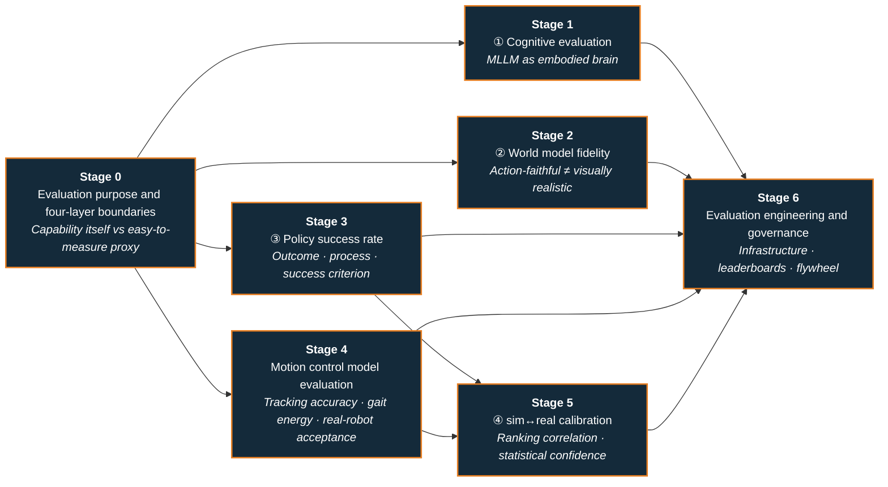

# Embodied Evaluation

**At a glance**:

- **Who it's for**: People who have trained an embodied model and want to know how to "test / prove it".
- **Path**: Stage 0–6 · Evaluation purpose and boundaries → choose a branch by subject (cognition / world model / task policy / motion control) → sim↔real calibration as needed → engineering and leaderboard governance.
- **Depth roadmap**: A branch of the [motion control main roadmap](motion-control.md); the shared acceptance step for the three modeling routes [BFM](depth-bfm.md) / [VLA](depth-vla.md) / [WAM](depth-wam.md).

## Roadmap overview

## How to use this path

- The target reader is someone who **can already train (or has already chosen) an embodied model** and now needs to issue credible conclusions about it; technology selection, release decisions, paper experiment design, and internal benchmark building all live on this roadmap
- The subjects under test include both **task-side manipulation/VLA policies** (Stages 1–3) and **motion-control-side locomotion / whole-body tracking / MPC-WBC controllers** (Stage 4); the two have different metric systems, so do not apply one to the other
- This roadmap addresses **"whether a score measures the capability itself, or an easy-to-measure proxy of the capability"**: it does not teach you how to train a model well (that is the topic of [BFM](depth-bfm.md) / [VLA](depth-vla.md) / [WAM](depth-wam.md) / [imitation learning](depth-imitation-learning.md)), only how to prove/disprove that it is really good
- Each stage has prerequisites, core questions, what to do, what to read, and what you should be able to produce
- **Choose a branch by subject under test**: Stages 1–4 serve cognition, world models, task policies, and motion controllers respectively, and are not sequential requirements; add Stage 5 when you need to extrapolate to real robots, and every branch can go directly into Stage 6's protocol and engineering checks.

**Relation to the main roadmap:**
- This roadmap is the **acceptance layer** after L5 (RL and imitation learning) and between L6 (sim2real deployment) and L7 (exit) of the main roadmap: the training routes are responsible for "building it", this roadmap is responsible for "proving it holds"
- It shares the same physical root cause as the [Sim2Real depth roadmap](depth-sim2real.md) but lands differently: Sim2Real asks "can the policy still run on the real robot", while Stage 5 of this roadmap asks "does the **ranking** given by simulation still hold on the real robot"
- It connects with the [Real2Sim depth roadmap](depth-real2sim.md) on evaluation assets: Real2Sim produces evaluable scene/episode twins, and this roadmap judges whether scores on those twins can be extrapolated
- Stage 4 directly serves L2–L5 of the main roadmap and the [RL motion control depth roadmap](depth-rl-locomotion.md) / [classical model-based control depth roadmap](depth-classical-control.md) / [BFM depth roadmap](depth-bfm.md): they are responsible for training the controller, and Stage 4 is responsible for giving it acceptance numbers

---

## Stage 0 Evaluation purpose and four-layer closed-loop boundaries

**First nail down "whether this layer measures the capability itself or an easy-to-measure proxy", then pick benchmarks; otherwise the whole evaluation chain will stop at some pretty upper-layer score.**

### Prerequisites
- Have trained / deployed at least one embodied model (VLA, BFM, WAM, or a pure policy all count)
- Basic intuition for the respective semantics of success rate, QA accuracy, and video quality metrics

### Core questions
- Why "running a success rate" does not constitute a complete evaluation: what cognition, world model fidelity, policy success rate, and sim↔real calibration each measure, and where their boundaries are
- What the four cross-layer misjudgments look like: high cognition score ≠ dispatchable actions, realistic video ≠ policy gains, simulation success rate ≠ real-robot success rate, benchmark saturation ≠ scenario readiness
- Why reproducibility and real-world representativeness are inherently opposed in evaluation; there is no free evaluation that is "both clean and representative of real robots"

### What to do
- Read the TL;DR table of the [evaluation benchmark selection loop Query](../../wiki/queries/embodied-eval-benchmark-selection-loop.md), compare your current project's evaluation plan against it line by line, and mark which layer it stops at
- Write one page of "the evaluation question I need to answer": who it is for (your own iteration / external release / paper submission), how much real-robot rollout cost you can afford, and how much extrapolation risk is acceptable

### What to read
- [Embodied evaluation benchmark selection loop (knowledge-chain hub)](../../wiki/overview/hub-embodied-eval-benchmark.md) — the hub page for this roadmap
- [Query: embodied foundation model evaluation benchmark selection loop](../../wiki/queries/embodied-eval-benchmark-selection-loop.md) — four-layer decision tree and per-layer misjudgment quick reference
- [Simulation evaluation reproducibility ↔ real-world representativeness tradeoff](../../wiki/concepts/sim-vs-real-eval-gap.md) — the physical root cause of this gap
- [Query: embodied foundation model family taxonomy loop](../../wiki/queries/embodied-fm-taxonomy-loop.md) — sister chain: pick a model family first, then return to this roadmap for acceptance

### What you should be able to produce
- A self-check table of "which layer my evaluation chain stops at and which layer is still missing"
- Be able to say in one sentence under what conditions each layer's metrics will mislead

---

## Stage 1 ① Embodied brain / MLLM cognitive evaluation: first prove the "brain" is qualified

**This is the cheapest and most reproducible of the four layers; the cost is that it measures a cognitive proxy, not action capability.**

### Prerequisites
- Stage 0 content
- Understand the dual-system paradigm (System 2 high-level cognition + System 1 low-level execution) and the basic capability boundaries of MLLMs

### Core questions
- Which dimensions high-level cognition breaks down into: intent understanding → scene perception → planning and generalization → affordance refinement → failure diagnosis
- How spatial intelligence differs between "passively looking at images" and "the observer is the actor": why the active perception–action loop must be tested separately
- Why the correlation between cognition scores and downstream success rate **needs dedicated validation** rather than being assumed to hold

### What to do
- On the five-dimension, 14-capability table of [RoboBench](../../wiki/entities/robo-bench.md), mark the two dimensions where your model is most likely to break, and run only those two first to save compute
- Take a set of failed QA samples and attribute them: perception did not see it, planning was infeasible, or it could say the right thing but could not dispatch an executable action

### What to read
- [RoboBench](../../wiki/entities/robo-bench.md) — five dimensions, 14 capabilities, 25 tasks, 6092 QA; the planning dimension uses MLLM-as-world-simulator to check physical/visual feasibility, and an 8-backbone transfer experiment audits the relation between cognition and downstream control: CALVIN perception correlation is significant, LIBERO-Long affordance shows only a non-significant positive trend
- [ESI-Bench](../../wiki/entities/esi-bench.md) — 3081 questions in 10 categories / 29 subcategories on OmniGibson, requiring an actively closed perception–action loop; exposes MLLMs' action blindness and metacognitive gaps
- [Daily-Omni](../../wiki/entities/paper-daily-omni.md) — cross-modal temporal alignment of everyday audio-video (684 videos / 1197 MCQA), filling in the dimension of "whether ambient sound and visuals are understood in alignment"
- [MMHU](../../wiki/entities/paper-mmhu.md) — human-centric Behavior VQA in driving scenes, a neighboring-domain reference

### What you should be able to produce
- A cognitive dimension breakdown report: which dimension is the bottleneck and which is saturated
- Be able to explain that the relation between cognition scores and downstream success rate must be validated under a specified model, task, and protocol, and that QA scores cannot be treated as a necessary condition for all policies

---

## Stage 2 ② World model prediction fidelity evaluation: visually realistic ≠ action-faithful

**This layer is mandatory only when the team actually uses a world model for lookahead or as an evaluator; evaluating policies with an unfaithful WM doubly amplifies error.**

### Prerequisites
- Stage 0 content; Stage 1 is optional reading only if you also evaluate high-level cognition
- [WAM depth roadmap](depth-wam.md) Stage 0–1 level (know what role a world model plays in the policy stack)

### Core questions
- How many axes fidelity actually measures: scene conservation / end-effector trajectory consistency / semantic-logical alignment, and their relation to image quality metrics (PSNR, FVD)
- Why "looks good on expert replay" does not equal "off-expert actions are still faithfully executed"; the latter is exactly the distribution encountered during policy improvement
- When to switch benchmarks: open-domain multi-scene camera controllability, interactive intervention, and long-horizon persistence each have dedicated leaderboards; do not substitute one for another

### What to do
- Score your WM once with the three axes of [EWMBench](../../wiki/entities/ewmbench.md), then look separately at one **long-horizon** sample to judge whether it is short-term realistic or long-horizon faithful
- Construct a set of off-expert action sequences, feed them into the WM, and check whether the visuals remain valid and whether the end effector follows the commands

### What to read
- [EWMBench](../../wiki/entities/ewmbench.md) — three-axis scoring after unified initialization on an Agibot-World subset; data and evaluation code are open-source
- [GigaWorld-1 policy evaluation](../../wiki/entities/paper-gigaworld-1-policy-evaluation.md) — WMBench + 7 classes of video WMs, 4 action encodings, 324K+ rollouts; core conclusion: **long-horizon action-faithful rollouts determine evaluation quality more than short-term visual realism**
- [WorldEcho / WorldSync](../../wiki/entities/paper-worldecho-worldsync.md) — visual gating + \(\mathrm{SE}(3)\) NDTW specifically testing off-expert action following
- [WorldScore](../../wiki/entities/paper-worldscore.md) — unified Ctrl/Quality/Dynamics leaderboard for open-domain 3D/4D/video multi-scene world generation (a neighboring axis; **do not** use it in place of manipulation fidelity)
- [HarnessEval-W](../../wiki/entities/paper-harnesseval-w.md) — agentic evaluation of interactive world models: intervention/persistence evidence trees, Intentional ranking with human ρ=0.93
- [Uranus](../../wiki/entities/paper-uranus.md) — action-conditioned multi-view video simulator: an external policy provides qpos and the model autoregressively predicts visual consequences, used for closed-loop evaluation of embodied policies
- [SC3-Eval](../../wiki/entities/paper-sc3-eval.md) — reverse usage: treats self-consistent video generation itself as an evaluator for real-robot VLA policies, closed-loop Pearson 0.929
- [How should world models be evaluated for embodied AI (survey-style inquiry)](../../wiki/entities/paper-sa-2606-15032-how-should-world-models-be-evaluated-for-embodie.md)

### What you should be able to produce
- A dual list of "world-side metrics vs policy-side metrics", making clear which metrics are only image-quality proxies
- Be able to judge whether your WM should be trusted as an evaluator

---

## Stage 3 ③ Policy success rate evaluation: outcome metrics, process metrics, and success criteria

**This layer looks most like "the final answer", and is also the easiest to be fooled by averages, magic grasps, and cross-leaderboard comparisons. This stage is about the task side (manipulation / VLA / long-horizon task chains); for the metric system of motion control models, see Stage 4 below.**

### Prerequisites
- Stage 0 content (Stages 1–2 can be skipped as needed)
- Have run the full rollout process of at least one simulation task suite

### Core questions
- Why outcome metrics (task success rate) hide long-tail failure modes; what process metrics (progress curves / intermediate states) add, and where they may decouple from real gains
- Whether **the success criterion itself** is right: trajectory similarity vs goal equivalence, which one counts as "successful imitation"
- Why contact/deformable/latency-sensitive tasks must additionally report safety or timing dimensions; reporting only Goal hides overpressure and timeouts
- Why directly comparing leaderboards across benchmarks does not hold: task sets, observation interfaces, reset protocols, and success criteria all come from different sources

### What to do
- First pick a suite matching your target morphology and run a baseline: tabletop manipulation goes to [LIBERO](../../wiki/entities/libero-benchmark.md) / [CALVIN](../../wiki/entities/calvin-benchmark.md) (long-horizon task chains, error accumulation), classic visual manipulation goes to [RLBench](../../wiki/entities/rlbench.md), quadruped agility goes to [Barkour](../../wiki/entities/paper-barkour-quadruped-agility-benchmark.md)
- Add one process evaluation on top of existing rollouts (no need to rerun the policy), and compare whether the SR ranking and the progress-curve ranking agree
- Cluster failed rollouts by mode (grasp failure / subtask switching failure / timeout / overpressure) instead of reporting only one average

### What to read
- [RoboDojo](../../wiki/entities/robodojo.md) — unified sim-and-real evaluation: 42 five-dimension simulation tasks + 18 real-robot tasks, Isaac heterogeneous parallelism + RealEval cloud real robots; verified leaderboard entries must open-source training/inference and weights
- [2026 BEHAVIOR Challenge](../../wiki/entities/behavior-challenge-2026.md) — competition protocol for 100 long-horizon household tasks: the main ranking Q-score is the partial completion of final-state BDDL predicates, not full-task success; also check the RGB-D+proprio observation restrictions and the public/hidden instance split
- [Robot manipulation benchmark audit](../../wiki/entities/paper-manipulation-benchmark-audit.md) — checks language shortcuts, statistical significance, overfitting to test conditions, and training data provenance; a counterpoint reading for interpreting high scores on LIBERO/CALVIN etc.
- [Harness VLA](../../wiki/entities/paper-harness-vla.md) · [StarVLA-α](../../wiki/entities/paper-starvla-alpha.md) — check, respectively, memory conditioning, task coverage, and aggregation weights, and the differences between single-benchmark/joint training and success rate/progress score.
- [PRM-as-a-Judge](../../wiki/entities/paper-prm-as-a-judge.md) — turns rollout videos into progress curves for process evaluation (OPD / FNS / DRR / SQS); on RoboDojo it **reshuffled the SR ranking**
- [NimCritic: action-aware long-horizon progress modeling](../../wiki/entities/paper-nimcritic.md) — explicitly accounts for effective progress / failed attempts / destructive regressions during manipulation; combines VLM object segmentation with a joint video-progress critic to produce curves and completion judgments, suitable for Stage 3 process scoring and rollout filtering
- [Imitator Game](../../wiki/entities/paper-imitator-game.md) — L0–L3 intent-level imitation benchmark: the success criterion is changed to **goal equivalence rather than trajectory similarity**; L3 functional substitution collapses, zero-shot on unseen tasks <13%
- [SoftVTBench](../../wiki/entities/paper-softvtbench.md) — deformable visuo-tactile tasks report both Goal Success and Safety Success; looking only at Goal hides overpressure
- [LIBERO-VPro](../../wiki/entities/paper-libero-vpro.md) — perturbs visual evidence at execution time (missing, delayed, contradictory multi-view, scene changes), forming a closed-loop visual robustness benchmark on LIBERO.
- [PackLab](../../wiki/entities/paper-packlab.md) — connects a simulation platform, a dedicated multimodal model, and difficulty-tiered evaluation, letting the model choose objects and placements as the in-box state updates.
- [ReflexVLA / ReflexBench](../../wiki/entities/paper-reflexvla.md) — latency-aware dynamic task evaluation
- [DexBench](../../wiki/entities/dexbench.md) — industrial dexterity specification (OSC six-axis / 18 tasks), advocating breakdown curves rather than a single SR; note its evaluation repo is still marked coming soon, so it is **a specification page rather than a runnable simulation leaderboard**
- [ManiSkill-HAB](../../wiki/entities/paper-notebook-maniskill-hab-a-benchmark-for-low-level-manipula.md) · [Mimicking-Bench](../../wiki/entities/paper-notebook-mimicking-bench-a-benchmark-for-generalizable-hu.md) — low-level manipulation / humanoid imitation suites
- [VLA SOTA Leaderboard](../../wiki/entities/vla-sota-leaderboard.md) — external index of relative standings for tabletop VLAs (scores taken from papers; mind protocol differences)

### What you should be able to produce
- An evaluation report with a **failure-mode breakdown**, rather than a single success rate
- Be able to say in one sentence what success criterion you use and which kinds of "not actually done" it will miss

---

## Stage 4 Motion control model evaluation: tracking accuracy, gait quality, and real-robot acceptance

**For motion control models the question is not "was the task done" but "does it track accurately, does it walk stably, can it be trusted on a real robot"; the metric system is completely different from Stage 3, and applying one to the other leads to wrong conclusions.**

### Prerequisites
- Stage 0 content (Stages 1–3 can be skipped as needed)
- [RL motion control depth roadmap](depth-rl-locomotion.md) or [classical model-based control depth roadmap](depth-classical-control.md) Stage 0–2 level: able to train/run a locomotion or whole-body tracking policy

### Core questions
- **Why reporting only MPJPE misleads**: MPJPE is usually averaged only over **executed segments**, so rollouts that trigger termination early actually have smaller errors; it must be reported together with Succ (fraction completed under the termination criterion), otherwise "more accurate" may just mean "died earlier"
- **Are you comparing the tracker or the post-processing**: different works differ in reference representation, rollout bookkeeping, termination criteria, and metric implementation; without pinning down these four, there is no comparability
- **Tracking vs command following**: whole-body tracking looks at reference error and human preference; velocity-command locomotion looks at command tracking error, CoT, terrain traversal rate, and fall frequency
- **Model-based controllers have additional evaluation axes**: solve time and real-time factor, constraint violation and feasibility, robustness margins under gain/model errors; these never appear in pure RL metric tables
- **Without difficulty tiers you cannot "compare against SOTA"**: the same average may come from completely different motion difficulty distributions
- **Reward terms ≠ evaluation metrics**: energy penalties and jitter penalties are training signals; using them directly as acceptance metrics is self-confirming

### What to do
- Tracking: first unify the four items **reference representation / rollout bookkeeping / termination criterion / metric implementation**, then compare trackers side by side; break the main table down by motion family (or difficulty tier), do not give just one overall score
- Locomotion: build the table following the [evaluation metric checklist on the locomotion task page](../../wiki/tasks/locomotion.md): speed, CoT, terrain adaptation, fall frequency, command tracking error, hardware safety margins (torque/current/temperature rise/impact peaks)
- Do tiered acceptance in three stages, **simulation → hardware-in-the-loop → real robot**: simulation looks at success rate and energy, hardware-in-the-loop looks at latency and current, real robot looks at temperature rise, impacts, and long-duration stability
- Archive failed rollouts by mechanism (falls, slipping, knee hyperextension, foot oscillation); these guide the next round of changes better than average reward

### What to read
- [Motion control model evaluation metrics](../../wiki/concepts/motion-control-policy-evaluation-metrics.md) — **the concept home page for this stage**: complete definitions of four metric groups (tracking error / command following / model-based solving / hardware deployment), the four comparability alignment items, difficulty tiers, and three-stage acceptance
- [HumanTracker](../../wiki/entities/paper-humantracker.md) — 153 h / 25K four-family optical benchmark + preference-aligned metric HumanScore; compares GMT / TWIST2 / SONIC / Humanoid-GPT after pinning down reference representation, rollout bookkeeping, termination criteria, and metric implementation; family-balanced alignment rate 90.83%; evaluation code and HumanScore weights are released, dataset to be released
- [Motion Difficulty Score / MD-AMASS](../../wiki/entities/paper-notebook-benchmarking-humanoid-imitation-learning-with-mo.md) — uses rigid-body dynamics to give a policy-independent motion difficulty score, paired with MID (maximum imitable difficulty) and DSJE (difficulty-stratified joint error), turning "compare against SOTA" into "compare within each difficulty tier"
- [HumanoidBench](../../wiki/entities/humanoid-bench.md) — 15 whole-body manipulation + 12 locomotion tasks under unified MuJoCo, with Dreamer / SAC / PPO / TD-MPC2 baselines, for testing whether an algorithm can handle both high-dimensional body control and task interaction
- [TrackerLab](../../wiki/entities/trackerlab.md) — a shared experiment interface across multiple embodiments / motion datasets / tracking configurations, comparing the effects of reference representation, reward, and robot model **separately**; when performance suddenly degrades after switching embodiments, use it first to rule out environment differences
- [Barkour](../../wiki/entities/paper-barkour-quadruped-agility-benchmark.md) — a quadruped agility course that compresses multi-obstacle sequences + timing penalties into a 0–1 agility score, convenient for comparing "specialist switching vs Transformer generalist" and sim2real pipelines
- [Mimicking-Bench](../../wiki/entities/paper-notebook-mimicking-bench-a-benchmark-for-generalizable-hu.md) — generalization evaluation suite for humanoid imitation
- [Locomotion task page · evaluation metrics and engineering deployment checks](../../wiki/tasks/locomotion.md) · [Whole-body tracking pipeline](../../wiki/concepts/whole-body-tracking-pipeline.md)
- [Humanoid policy reward functions](../../wiki/concepts/humanoid-policy-reward-functions.md) — read it to **distinguish** training reward terms from acceptance metrics; do not substitute one for the other
- [Query: humanoid motion tracking method selection](../../wiki/queries/humanoid-motion-tracking-method-selection.md) — sister page on the selection side

### What you should be able to produce
- A motion control evaluation table: **Succ + error-type metrics + human preference/agility scores** broken down by motion family or difficulty tier, rather than a single average
- A fixed "simulation → hardware-in-the-loop → real robot" tiered acceptance process, including hardware safety margin items and failure-mode archiving

---

## Stage 5 ④ sim↔real evaluation gap calibration: does the ranking still hold

**This layer is the most expensive and the least dispensable: it decides whether the scores from all the previous layers can be used for release decisions.**

### Prerequisites
- Stage 3 or Stage 4 content (depending on whether the subject is a manipulation policy or a motion control model)
- Have a real robot (or cloud real robot) to run on, even if the sample size is very small

### Core questions
- The difference between the evaluation gap and the policy transfer gap: the former only requires sim↔real **ranking correlation**; inflated absolute success rates are acceptable
- When ranking correlation silently fails: the training pipeline and the evaluation share the same simulation distribution (evaluation set leakage), the benchmark is gamed to saturation, distribution drift
- What to do when real-robot samples are too expensive to reach statistical significance: use a simulation library as a prior, switch to anytime-valid intervals rather than forcing n up

### What to do
- Pick 3–5 checkpoints, run them in both simulation and on the real robot, and compute a ranking correlation once (Spearman / Pearson); this is more informative than chasing absolute scores
- Audit the overlap between training data and evaluation scenes, and explicitly list which assets/layouts are shared
- When real-robot samples are insufficient, use betting-based methods to give intervals rather than point estimates

### What to read
- [Simulation vs real-robot evaluation gap](../../wiki/concepts/sim-vs-real-eval-gap.md) — reproducibility ↔ representativeness cost table and three engineering routes for narrowing the gap
- [Simulation evaluation infrastructure](../../wiki/concepts/simulation-evaluation-infrastructure.md) — the prerequisite for treating evaluation as scalable closed-loop infrastructure and converting the iteration-speed bottleneck from wall-clock time into compute
- [Bet4Sim2Real](../../wiki/entities/paper-bet4sim2real.md) — sequential betting on a simulation library yields anytime-valid real-robot performance certificates, narrowing by 51.6% on average; G1/NIST/Go2 replays are open-source
- RealEval cloud real robots in [RoboDojo](../../wiki/entities/robodojo.md) — one ready-made answer for standardizing the real-robot side
- [Policy evaluation under sim-to-real transfer](../../wiki/entities/paper-sa-2508-11117-robot-policy-evaluation-for-sim-to-real-transfer.md) · [Real-to-sim policy evaluation with Gaussian reconstruction](../../wiki/entities/paper-sa-2511-04665-real-to-sim-robot-policy-evaluation-with-gaussia.md)
- [Sim2Real depth roadmap](depth-sim2real.md) · [Real2Sim depth roadmap](depth-real2sim.md) — expanded versions on the transfer side and the asset side

### What you should be able to produce
- A conclusion with **ranking correlation evidence**, rather than "92% in simulation"
- An evaluation-set leakage self-check list

---

## Stage 6 Evaluation engineering, leaderboard governance, and advanced directions

### Prerequisites
- Complete the branch among Stages 1–4 corresponding to your subject under test; complete Stage 5 as well when the conclusion involves real robots

**Direction A: Evaluation infrastructure and integration cost**
- How the integration explosion of N policies × M environments converges to O(N+M); what a unified policy–environment contract and dependency-isolated serving look like
- Keywords: [XPolicyLab](../../wiki/entities/xpolicylab.md) (the same adapter serves RoboTwin / RoboDojo-sim / RoboDojo-real), [Simulation evaluation infrastructure](../../wiki/concepts/simulation-evaluation-infrastructure.md), [AgiBot simulation training and evaluation category](../../wiki/overview/agibot-release-category-02-sim-training-eval.md)

**Direction B: Leaderboard governance and reproducibility**
- Whether verified leaderboard entries should be required to open-source training/inference and weights and publish evaluation videos; how to design a challenge protocol with synthetic training + real-only evaluation
- Keywords: [RoboDojo](../../wiki/entities/robodojo.md) public-interest leaderboard rules, [RoboSynChallenge](../../wiki/entities/paper-robosynchallenge.md) (synthetic state-action training / real-robot-only evaluation), [VLA SOTA Leaderboard](../../wiki/entities/vla-sota-leaderboard.md)

**Direction C: Evaluation as post-training signal (evaluation–training flywheel)**
- Feed evaluation conclusions back into training: failure modes → targeted data collection → re-evaluation; how world-model evaluators couple with post-training
- Keywords: [Action consequence category 04 · evaluation and post-training](../../wiki/overview/wm-action-consequence-category-04-eval-posttrain.md), [Six routes of embodied world models · evaluation route](../../wiki/overview/embodied-wm-route-evaluation.md), [WAM depth roadmap](depth-wam.md) Stage 5 Direction C

**Direction D: Domain-specific evaluation**
- Cross-embodiment generation evaluation ([H2R-Bench](../../wiki/entities/paper-h2r-bench.md)), physical consistency in human–robot collaboration ([Physics-Consistent HRC Benchmark](../../wiki/entities/paper-physics-consistent-hrc-benchmark.md)), bimanual teleoperation ([TeleopBench](../../wiki/entities/paper-notebook-teleopbench-a-simulator-centric-benchmark-for-du.md))
- For the overall lineage of simulation and benchmarks, see [Paper notes category 11 · simulation and benchmarks](../../wiki/overview/paper-notebook-category-11-simulation-benchmark.md)

---

## Quick entry summary

| Stage | Core question | Knowledge page entry |
|------|---------|-----------|
| Stage 0 | Four-layer boundaries and proxy metric traps | [Embodied evaluation benchmark selection loop](../../wiki/overview/hub-embodied-eval-benchmark.md) |
| Stage 1 | MLLM cognitive evaluation | [RoboBench](../../wiki/entities/robo-bench.md) |
| Stage 2 | World model fidelity | [EWMBench](../../wiki/entities/ewmbench.md) |
| Stage 3 | Task-side policy success rate and process criteria | [RoboDojo](../../wiki/entities/robodojo.md) |
| Stage 4 | Motion control model tracking accuracy and real-robot acceptance | [Motion control model evaluation metrics](../../wiki/concepts/motion-control-policy-evaluation-metrics.md) |
| Stage 5 | sim↔real calibration | [Simulation vs real-robot evaluation gap](../../wiki/concepts/sim-vs-real-eval-gap.md) |
| Stage 6 | Evaluation infrastructure and leaderboard governance | [XPolicyLab](../../wiki/entities/xpolicylab.md) |

## Relation to other pages

- Full growth roadmap reference: [Main roadmap: motion control → physical intelligence full-stack growth roadmap](motion-control.md)
- Related depth roadmaps (by topical proximity; full catalog in the [roadmap overview](motion-control.md#depth-optional-index)):
  - [Sim2Real](depth-sim2real.md) — evaluation gap vs real-robot deployment
  - [Embodied data](depth-embodied-data.md) — the acceptance side of the flywheel
  - [VLA](depth-vla.md) — the main subject of cognition/manipulation success-rate evaluation
  - [RL motion control](depth-rl-locomotion.md) — motion control metrics and tracking evaluation
  - [Model architecture](depth-model-architecture.md) — architecture changes must be falsified by tiered evaluation, not judged by a single success rate

## References

- [Embodied evaluation benchmark selection loop (knowledge-chain hub)](../../wiki/overview/hub-embodied-eval-benchmark.md)
- [Query: embodied foundation model evaluation benchmark selection loop](../../wiki/queries/embodied-eval-benchmark-selection-loop.md)
- [Simulation vs real-robot evaluation gap](../../wiki/concepts/sim-vs-real-eval-gap.md) · [Simulation evaluation infrastructure](../../wiki/concepts/simulation-evaluation-infrastructure.md)
- [RoboBench: A Comprehensive Evaluation Benchmark for Multimodal Large Language Models as Embodied Brain](https://robo-bench.github.io) — RoboBench, arXiv:2510.17801
- [ESI-Bench: Towards Embodied Spatial Intelligence that Closes the Perception-Action Loop](https://arxiv.org/abs/2605.18746) — ESI-Bench, arXiv:2605.18746
- [EWMBench: Evaluating Scene, Motion, and Semantic Quality in Embodied World Models](https://arxiv.org/html/2505.09694v2#S1) — EWMBench
- [RoboDojo: A Unified Sim-and-Real Benchmark for Comprehensive Evaluation of Generalist Robot Manipulation Policies](https://robodojo-benchmark.com/) — RoboDojo, arXiv:2607.04434
- [PRM-as-a-Judge 1.5: A Toolkit for Robot Process Assessment](https://arxiv.org/abs/2608.14284) — PRM-as-a-Judge 1.5, arXiv:2608.14284
- [The Imitator Game: Benchmarking Robot Imitative Ability Beyond Action Prediction](https://arxiv.org/abs/2608.22301) — Imitator Game, arXiv:2608.22301
- [Betting for Sim-to-Real Performance Certificates](https://arxiv.org/abs/2608.21572) — Bet4Sim2Real, arXiv:2608.21572
- [SC3-Eval: Evaluating Robot Foundation Models via Self-Consistent Video Generation](https://arxiv.org/abs/2606.18610) — SC3-Eval, arXiv:2606.18610
- [Motion control model evaluation metrics](../../wiki/concepts/motion-control-policy-evaluation-metrics.md) — the concept consolidation page for Stage 4
- [HumanTracker: Towards Comprehensive and Human-Aligned Motion Tracking Benchmark](https://arxiv.org/abs/2608.13555) — HumanTracker, arXiv:2608.13555 (Stage 4 tracking evaluation protocol and HumanScore)
- [HumanoidBench](https://github.com/carlosferrazza/humanoid-bench) · [TrackerLab](https://github.com/Renforce-Dynamics/trackerLab) — Stage 4 motion control evaluation suite and unified tracking experiment interface
- The "Evaluation metrics" and "Engineering deployment checks" sections of [Locomotion](../../wiki/tasks/locomotion.md)
- [BEHAVIOR 2026 official evaluation rules](https://behavior.stanford.edu/challenge/evaluation.html) — partial-completion main score, onboard observation constraints, and fixed-instance protocol
- [With Isaac Lab and MuJoCo already available, why do mjlab, Newton, UniLab, and Genesis still appear?](https://mp.weixin.qq.com/s/Z9pgVa48wQKLYVRD3psnhw) — layering of robot training stacks
