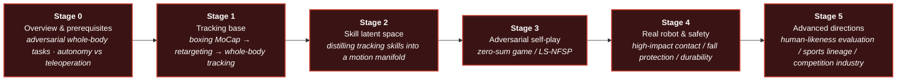

# Humanoid Boxing

**At a glance**:

- **Who it's for**: people who want two humanoid robots to spar in the ring like humans.
- **Path**: Stage 0–5 · overview and prerequisites → boxing MoCap tracking base → skill latent space → adversarial self-play → real robot and safety → advanced directions.
- **Depth roadmap**: a branch of the [Motion Control main roadmap](motion-control.md).

## Roadmap overview

## How to use this path

- The target reader has already worked with whole-body motion tracking or RL locomotion and wants to move into **adversarial whole-body tasks** (the opponent counters in real time, contact is unavoidable, and motions must still look human)
- Core mental model: boxing is not "locomotion that can throw punches"; the opponent is a **non-stationary environment**, and doing multi-agent RL directly in joint space is neither stable nor human-like; **first compress human-like skills into a latent space, then play the game in that latent space** is the current main line
- Each stage has prerequisites, core questions, what to do, what to read, and what you should be able to produce

**Relation to the main roadmap:**
- This roadmap is the adversarial-competition direction after main-roadmap L5.3 (imitation learning): the Stage 1 tracking base overlaps heavily with the DeepMimic lineage in the [Motion Retargeting depth roadmap](depth-motion-retargeting.md) and the [BFM depth roadmap](depth-bfm.md)
- Latent-space skill representation is the core object of the [BFM depth roadmap](depth-bfm.md); this roadmap focuses on "playing an adversarial game on this latent space"
- Competitive tasks against a ball rather than a person (chasing the ball, shooting, multi-robot coordination) are covered in the [Humanoid Soccer depth roadmap](depth-humanoid-soccer.md)

---

## Stage 0 Overview and prerequisites: adversarial whole-body tasks and two product routes

**First nail down the problem structure: boxing stacks three constraints at once (human-like motion, real-time adversarial play, and full contact), and there are two completely different technical routes, autonomy and teleoperation.**

### Prerequisites
- Level of main roadmap [L5.1 (RL basics)](motion-control.md#l5-1-rl-basics) and [L5.3 (imitation learning)](motion-control.md#l5-3-imitation-learning)
- [Imitation Learning depth roadmap](depth-imitation-learning.md) Stages 0–2: know how reference motions turn into trackable policies

### Core questions
- Why boxing is hard: the opponent constitutes a non-stationary environment, hard-hitting contact is unavoidable, and the audience also demands human-like motion
- The respective tech stacks and evaluation metrics of the autonomous route (two-agent RL sparring) and the teleoperation route (VR human pilot + motion mapping)
- Where the human-likeness gap lies: the Motion Turing Test shows that dynamic behaviors such as boxing/jumping/running are where humanoids are furthest from real humans

### What to do
- Read the RoboStriker (autonomous) and REK (teleoperation) pages side by side, and make a comparison table of "policy source / safety mechanism / evaluation metrics"
- Watch a recording of a REK or Unitree boxing demo, and mark which motions look like preset scripts and which look like real-time reactions

### What to read
- [RoboStriker](../../wiki/entities/paper-notebook-robostriker.md) — representative of hierarchical decision-making for autonomous humanoid boxing; the anchor paper of this roadmap
- [REK humanoid fighting league](../../wiki/entities/rek.md) — an industry example of VR-teleoperated full-contact fighting
- [URKL humanoid fighting league](../../wiki/entities/urkl.md) — EngineAI's **autonomous-algorithm** fighting league on a unified T800 (the official FAQ claims the code related to this season will be open-sourced)
- [Towards Motion Turing Test](../../wiki/entities/paper-notebook-towards-motion-turing-test.md) — quantifying the human-likeness gap of boxing-type dynamic behaviors
- [Teleoperation task page](../../wiki/tasks/teleoperation.md) — where competition-oriented whole-body teleoperation sits in the lineage

### What you should be able to produce
- Be able to explain that autonomous boxing and teleoperated fighting are two different problems, and where each gets stuck
- A clear problem map of how the three constraints "human-like, adversarial, contact" constrain one another

---

## Stage 1 Tracking base: boxing MoCap → retargeting → whole-body tracking

**Everything starts with data: first get a single robot to track human boxing motions (jabs, hooks, dodges, footwork) with high fidelity.**

### Prerequisites
- Stage 0 content
- Level of Stages 0–2 of the [Motion Retargeting depth roadmap](depth-motion-retargeting.md) (know how a GMR-style retargeting pipeline runs)

### Core questions
- What is special about boxing MoCap: fast punches, drastic center-of-mass shifts, strong upper/lower-limb coupling; retargeting errors directly destroy the kinetic chain
- How to train a whole-body tracking policy: tracking rewards and curriculum design from the DeepMimic lineage (RoboStriker retargets 46 clips, about 14 minutes, of Xsens data to G1 via GMR)
- The boundary between tracking and style: when an AMP-style style prior is needed to supplement frame-by-frame tracking

### What to do
- Find a public boxing MoCap clip (or reconstruct from video), retarget it via GMR to a G1-class humanoid, and train a tracking policy in simulation
- Compare the sense of power in punches between two training setups: "frame-by-frame tracking reward" and "tracking + AMP style"

### What to read
- [WBT depth](../../wiki/overview/hub-wbt.md) and [Whole-Body Tracking Pipeline](../../wiki/concepts/whole-body-tracking-pipeline.md)
- [GMR retargeting](../../wiki/methods/motion-retargeting-gmr.md) and [Motion Retargeting](../../wiki/concepts/motion-retargeting.md)
- [DeepMimic](../../wiki/methods/deepmimic.md) and [AMP](../../wiki/methods/amp-reward.md)
- [Query: Humanoid motion tracking method selection](../../wiki/queries/humanoid-motion-tracking-method-selection.md)

### What you should be able to produce
- A whole-body policy that can track boxing motion clips in simulation
- When a boxing motion is tracked poorly, be able to judge whether the problem is in retargeting, reward, or curriculum

---

## Stage 2 Skill latent space: distilling tracking skills into a motion manifold

**First compress human-like skills into a low-dimensional latent space, then let a high-level policy select skills, reducing the exploration difficulty of self-play directly in motor space.**

### Prerequisites
- Stage 1 content
- Basic concepts of variational autoencoders / adversarial distillation

### Core questions
- Why a latent space: the high-level game policy selects "motion intent" in the latent space, using learned skill priors to narrow the search range and improve motion style and training stability; a bounded latent by itself does not prove that motions are feasible under arbitrary states and contacts
- How to construct the latent space: the trade-offs of RoboStriker's unit-hypersphere manifold, PULSE's AMASS-pretrained latent, and ASE's adversarial skill embeddings
- The tension between skill coverage and manifold smoothness: are the dodges/footwork/combinations boxing needs all covered by the manifold
- The relationship of this layer to BFM: a boxing latent space is a specialized behavior foundation model

### What to do
- Distill the multiple tracking skills from Stage 1 into one latent space, and record fall rate, joint-limit violations, and torque-limit violations under random sampling and state perturbations; passing on finite samples does not mean all latents are safe
- Interpolate in the latent space and observe whether the transition motion between "jab → hook" is natural

### What to read
- [RoboStriker](../../wiki/entities/paper-notebook-robostriker.md) — the distillation approach for a hypersphere latent motion manifold
- [ASE](../../wiki/methods/ase.md) — adversarial skill embeddings
- [SMPLOlympics](../../wiki/entities/smplolympics.md) — a sports-task comparison using PULSE latents as the hierarchical RL action space
- [BFM depth roadmap](depth-bfm.md) — the expanded version of latent-space behavior priors

### What you should be able to produce
- A latent skill manifold covering punches/dodges/footwork, with feasibility checks under random sampling and interpolation
- Be able to explain the applicable scenarios of the three constructions: hypersphere manifold, PULSE latent, ASE embedding

---

## Stage 3 Adversarial self-play: two-player zero-sum games and LS-NFSP

**The core battlefield: model boxing as a two-player zero-sum Markov game, and use self-play in the latent space to force out offensive and defensive strategies.**

### Prerequisites
- Stage 2 content
- Game theory basics: intuition for Nash equilibrium and fictitious play

### Core questions
- Why naive self-play falls into cyclic counter-play (rock-paper-scissors-style oscillation), and how NFSP / average policies stabilize it
- LS-NFSP: after moving Neural Fictitious Self-Play into the latent space, how to preserve both training stability and motion quality
- The trade-off between alternating-freeze self-play (the approach for fencing/boxing in SMPLOlympics) and parallel NFSP
- Opponent modeling and curriculum: a progressive path from a fixed opponent, to a historical opponent pool, to full self-play
- Reward design: beyond hitting/being hit/losing balance, how to keep the policy from degenerating into "clinching" or "running away"

### What to do
- First run a three-phase curriculum "fixed opponent → historical opponent pool → self-play" in simulation, and record whether the policy exhibits cyclic counter-play
- Reproduce a simplified latent-space self-play (even with a simplified 2D model), and compare its convergence with self-play directly in joint space

### What to read
- [RoboStriker](../../wiki/entities/paper-notebook-robostriker.md) — the full LS-NFSP approach
- [SMPLOlympics](../../wiki/entities/smplolympics.md) — boxing/fencing alternating self-play baseline
- [MARL](../../wiki/methods/marl.md) — overview of multi-agent training paradigms
- Bansal et al., *Emergent Complexity via Multi-Agent Competition* — [arXiv:1710.03748](https://arxiv.org/abs/1710.03748): the starting point of MuJoCo humanoid adversarial self-play
- [PhysicsPingPong](../../wiki/methods/table-tennis-strategy-skill-learning.md) — a neighboring example of agent–agent rallies

### What you should be able to produce
- A two-agent boxing match in simulation that can switch between offense and defense
- Be able to explain what LS-NFSP solves relative to naive self-play, and at what cost

---

## Stage 4 Real robot and safety: high-impact contact, fall protection, and hardware durability

**Boxing is a deliberately full-contact task: being hit, losing balance, and falling are the norm rather than exceptions, and safety and durability design determine how many rounds can be fought.**

### Prerequisites
- Stage 3 content
- Level of main roadmap L6 (sim2real)

### Core questions
- High-impact sim2real: how to model in simulation the dynamics of glove contact and disturbances from being hit
- Fall protection: detect unavoidable falls and switch to a protective posture, reducing damage to sensors/actuators/structural parts
- Torque and velocity limiting, emergency stop: where to draw the line between competitive intensity and hardware safety
- Durability engineering: the structural and maintenance costs for electrically driven humanoids weighing tens of kg to withstand repeated strikes (operational experience from REK)

### What to do
- Add a hit-disturbance curriculum and fall-protection switching to the Stage 3 policy, and gather simulated damage metrics before real-robot deployment
- Following the safety monitoring structure on the REK page, draw a three-layer safety architecture diagram of "limiting / protection / shutdown" for your own system

### What to read
- [SafeFall](../../wiki/entities/paper-hrl-stack-41-safefall.md) — humanoid fall protection control
- [REK](../../wiki/entities/rek.md) — safety monitoring and hardware operations for full-contact fighting
- [Unitree G1](../../wiki/entities/unitree-g1.md) — hardware limits of the main fighting platform
- [Query: Reward design guide](../../wiki/queries/reward-design-guide.md) — how to put safety terms into the reward

### What you should be able to produce
- A deployment plan including fall protection and limiting/shutdown
- Be able to assess whether a boxing demo's safety design supports long-term real-robot sparring

---

## Stage 5 Advanced directions

### Prerequisites
- Stage 4 content

**Direction A: motion human-likeness evaluation**
- Boxing is one of the dynamic behaviors with the largest human-likeness gap: use a unified evaluation protocol to quantify "how human-like it is", feeding back into skill-manifold and reward design
- Keywords: [Towards Motion Turing Test](../../wiki/entities/paper-notebook-towards-motion-turing-test.md)

**Direction B: the sports lineage of interacting with fast-moving objects**
- From facing people (boxing) to facing objects (badminton, table tennis, soccer): sharing the methodology of "footwork + timing + whole-body force generation"
- Keywords: [Humanoid badminton whole-body control](../../wiki/entities/paper-notebook-humanoid-whole-body-badminton-via-multi-stage-re.md), [LHBS human-like badminton](../../wiki/entities/paper-notebook-learning-human-like-badminton-skills-for-humanoi.md), [ETH ANYmal quadruped badminton (Science Robotics)](../../wiki/entities/paper-coordinated-badminton-skills-anymal.md), [Humanoid Soccer depth roadmap](depth-humanoid-soccer.md)

**Direction C: competitions and industry**
- Productization of autonomous boxing and VR fighting leagues: ticketed events, robot rental, and the narrative of parallel fighting leagues in China and the US
- Keywords: [REK](../../wiki/entities/rek.md), [URKL](../../wiki/entities/urkl.md), [Unitree G1](../../wiki/entities/unitree-g1.md)

---

## Quick entry summary

| Stage | Core question | Knowledge page entry |
|------|---------|-----------|
| Stage 0 | Overview and the two routes | [RoboStriker](../../wiki/entities/paper-notebook-robostriker.md) |
| Stage 1 | Tracking base | [Whole-Body Tracking Pipeline](../../wiki/concepts/whole-body-tracking-pipeline.md) |
| Stage 2 | Skill latent space | [ASE](../../wiki/methods/ase.md) |
| Stage 3 | Adversarial self-play | [SMPLOlympics](../../wiki/entities/smplolympics.md) |
| Stage 4 | Real robot and safety | [SafeFall](../../wiki/entities/paper-hrl-stack-41-safefall.md) |
| Stage 5 | Advanced directions | [Towards Motion Turing Test](../../wiki/entities/paper-notebook-towards-motion-turing-test.md) |

## Relation to other pages

- Full growth roadmap reference: [Main roadmap: Motion control → full-stack physical intelligence growth roadmap](motion-control.md)
- Related depth roadmaps (ordered by topical proximity; for the full catalog see [Roadmap index](motion-control.md#depth-optional-index)):
  - [BFM](depth-bfm.md) — tracking and latent-space skill priors
  - [Motion retargeting](depth-motion-retargeting.md) — mapping MoCap/boxing motions onto the embodiment
  - [Humanoid soccer](depth-humanoid-soccer.md) — another class of adversarial whole-body task
  - [Teleoperation](depth-teleoperation.md) — the collection/sparring entry point for VR full-contact fighting
- Related knowledge pages:
  - [RoboStriker](../../wiki/entities/paper-notebook-robostriker.md)
  - [REK](../../wiki/entities/rek.md)
  - [SMPLOlympics](../../wiki/entities/smplolympics.md)
  - [Whole-Body Tracking Pipeline](../../wiki/concepts/whole-body-tracking-pipeline.md)
  - [MARL](../../wiki/methods/marl.md)

## References

- [RoboStriker](https://arxiv.org/html/2601.22517v1) (arXiv:2601.22517v1, §3.3, Table 2, Appendices A/B) — the hierarchical approach of tracking → latent space → LS-NFSP; the raw motor space is a worse-performing baseline, not untrainable, and priors/distillation and empirical stability do not replace constraint verification
- [REK official website](https://rek.com/) — VR-teleoperated full-contact fighting league
- [SMPLOlympics](https://arxiv.org/abs/2407.00187) (arXiv:2407.00187) — boxing/fencing alternating self-play baseline
- Bansal et al., *Emergent Complexity via Multi-Agent Competition* (2017, arXiv:1710.03748) — the starting point of MuJoCo humanoid adversarial self-play
- [Towards Motion Turing Test](https://arxiv.org/abs/2603.06181) — human-likeness gap of boxing-type dynamic behaviors
