# Humanoid Hardware Design

**At a glance**:

- **Who it's for**: people who want to go from task requirements to a complete humanoid robot that can power on, run control, and be delivered.
- **Path**: Stage 0–6 · specs and the three budgets → configuration and mechanical layout → detailed structural design → electrical and power distribution → EMC and board-level implementation → communication and timing → full-system integration and acceptance.
- **Depth roadmap**: the full-system hardware foundation branch of the [Motion Control main roadmap](motion-control.md); [Torque Motor Design depth](depth-torque-motor-design.md) delivers "a trustworthy joint", this roadmap delivers "a trustworthy machine".

## Roadmap overview

```mermaid
flowchart LR
  S0["<b>Stage 0</b><br/>Specs and the three budgets<br/><em>Mass / power / latency</em>"]
  S1["<b>Stage 1</b><br/>Configuration and mechanical layout<br/><em>DoF allocation / transmission placement / inertia</em>"]
  S2["<b>Stage 2</b><br/>Detailed structural design and verification<br/><em>Materials / FEA / tolerances and assembly</em>"]
  S3["<b>Stage 3</b><br/>Electrical architecture and power distribution<br/><em>Bus / DCDC / harness / safety circuit</em>"]
  S4["<b>Stage 4</b><br/>EMC, grounding and board implementation<br/><em>Shielding / return paths and equipotential bonding / PDU board</em>"]
  S5["<b>Stage 5</b><br/>Communication domains and timing<br/><em>Topology / synchronization / latency budget</em>"]
  S6["<b>Stage 6</b><br/>Full-system integration and acceptance<br/><em>bring-up / calibration / model delivery</em>"]

  S0 --> S1 --> S2 --> S3 --> S4 --> S5 --> S6
  S2 -.->|Insufficient modal frequency| S1
  S4 -.->|Noise over limit| S3
  S6 -.->|Measured inertia and latency| S0

  classDef stage fill:#142a3a,stroke:#16a085,stroke-width:2px,color:#fff
  class S0,S1,S2,S3,S4,S5,S6 stage
```

## How to use this path

- The target reader is the hardware lead / systems engineer / robot system architect who is **responsible for a complete robot** - not "pick a motor and mount it", nor "perfect the joint", but making **the mechanical, electrical and communication chains coexist on the same machine without fighting each other**
- Requires basic intuition for mechanics and circuits (statics, allowable material stresses, DC circuits, digital communication); FEA, EDA and real-time system tools are added stage by stage
- Each stage has prerequisites, core questions, what to read, what to do, and what you should be able to produce
- The knowledge entry points for the three design chains on this site are [Humanoid Mechanical Layout Design](../../wiki/concepts/humanoid-mechanical-layout-design.md), [Robot Power Distribution Architecture](../../wiki/concepts/robot-power-distribution-architecture.md), and [Robot Onboard Communication Architecture](../../wiki/concepts/robot-onboard-communication-architecture.md) - this roadmap is the **learning-order expansion** of those three pages: they answer "what each chain must design", this roadmap answers "in what order to learn the three chains until you can deliver a machine"

**Relation to the main roadmap:**
- This roadmap sits in the **full-system hardware foundation layer** below main roadmap L0–L2, and can be entered at any stage; it is recommended to enter around main roadmap L2 (dynamics), when "CoM height", "swing inertia" and "torque latency" have turned from abstract symbols into hardware specs
- It has a **parent-child relationship** with [Torque Motor Design depth](depth-torque-motor-design.md): that roadmap gets to "a joint module where commanding 1 Nm gives 1 Nm", this roadmap connects N modules into a complete robot that "can stand, be powered, stay synchronized and be maintained"; the power budget in Stage 3 and the latency budget in Stage 5 are exactly the full-system-side constraints on the Stage 6 deliverables of that roadmap
- [Sim2Real depth](depth-sim2real.md) consumes the Stage 6 deliverables of this roadmap: measured inertia, joint friction, bus latency and actuator models - hardware delivers not only the machine, but also its simulatable digital twin

---

## Stage 0 Full-system specs and the three budgets

### Prerequisites
- Rigid-body statics and basic power/energy conversions
- DC circuits (voltage, current, power, voltage drop)
- Able to do engineering budgets in spreadsheets (Excel / Python both work)

### Core questions
- How to work backward from the task (payload, walking speed, continuous operating time, operating environment) to the robot's height, mass, number of joints and endurance
- **Mass budget**: what a 60/80/100 kg robot each implies, and what share of mass the legs can take without falling into the mass-penalty spiral
- **Power budget**: how many times larger pulse loads are than average power, and how battery C-rate and bus voltage sag enter the specs
- **Latency budget**: how much total sensing-to-torque latency is allowed to support the target force-control/contact bandwidth
- How the three budgets trade against each other: how much mass and cost you gain by removing 2 degrees of freedom

### What to read
- [Humanoid Hardware 101: Technology Map of Seven Subsystems](../../wiki/overview/humanoid-hardware-101-technology-map.md) - first build the overall picture of components and costs
- [Actuator 102 · 01: Load and the Mass Spiral](../../wiki/overview/humanoid-actuator-102-load-and-mass-spiral.md) - why the mass budget is the first constraint
- [Query: Mainstream Humanoid Robot Hardware Comparison](../../wiki/queries/hardware-comparison.md) and [Query: Humanoid Hardware Selection Guide](../../wiki/queries/humanoid-hardware-selection.md) - calibrate your own specs against real robots
- [Control Loop Latency Modeling](../../wiki/formalizations/control-loop-latency-modeling.md) - the formal way to write a latency budget
- [Contact Force Loop Bandwidth](../../wiki/concepts/contact-force-loop-bandwidth.md) - the downstream consumer of the latency budget

### What to do
- Pick a complete robot with public specs (Unitree G1 / Berkeley Humanoid Lite / ODRI, etc., see [Open-Source Humanoid Hardware](../../wiki/entities/open-source-humanoid-hardware.md)), reverse-engineer its three budgets, and point out what it is optimizing for
- Write three one-page budget tables for your own target robot: mass allocation (by subsystem), power allocation (peak/continuous/simultaneity factor), latency allocation (by link segment)

### What you should be able to produce
- A **full-system specification**: height/mass/DoF/payload/endurance/dynamic class + the three budget tables
- For any robot's spec sheet, the ability to say "where in these three budgets it put its margin"

---

## Stage 1 Configuration and mechanical layout: translating specs into a skeleton

### Core questions
- Where to allocate degrees of freedom: legs 6, waist 1–3, arms 6–7, neck 2, hands 6–22 - what capability each buys, and how much cost and reliability it costs
- Where to place actuators: serial direct placement is simple and easy to calibrate; proximal concentration (linkages / tendons / [planetary roller screws](../../wiki/concepts/planetary-roller-screw-humanoid-leg-actuation.md)) gives low inertia but kinematic coupling
- How to set CoM height, fore-aft offset and swing-leg inertia, and how they enter the feasible regions of LIP/ZMP and DCM
- Cable routing channels, assembly/disassembly order, single-joint replaceability - why these must reserve space already at the layout stage

### What to read
- [Humanoid Mechanical Layout Design](../../wiki/concepts/humanoid-mechanical-layout-design.md) - the main knowledge page for this stage
- [Humanoid Parallel/Linkage Joint Kinematics](../../wiki/concepts/humanoid-parallel-joint-kinematics.md) and [Planetary Roller Screw Linear Actuation for Humanoid Legs](../../wiki/concepts/planetary-roller-screw-humanoid-leg-actuation.md)
- [Dynamics-Simulation-Driven Generative Design of Humanoid Lower Limbs](../../wiki/entities/paper-humanoid-leg-generative-design-dynamics.md) - a placement example of a hybrid electro-hydraulic 5-DoF leg + EHA/motor division of labor
- [Rigid-Soft Hybrid Link Humanoid](../../wiki/entities/paper-rigid-soft-hybrid-link-humanoid.md) - University of Tokyo research on a rigid-soft hybrid humanoid: flexible leg members described with PCS, combined with inverse kinematics and active compliance optimization; jumping/walking are validated in simulation, and experimental validation is limited to single- and double-support standing balance.
- [Actuator 102 · 02: Rotary-Linear Split Architecture](../../wiki/overview/humanoid-actuator-102-split-architecture.md)
- [Why Humanoid Knee/Leg Main Load Paths Usually Avoid Harmonic Drives](../../wiki/concepts/humanoid-knee-harmonic-drive-limits.md) - main load-bearing knee/ankle joints must first address the impact load spectrum, flexspline fatigue life, dynamic stiffness and distal inertia; a comparison of three common alternative routes: PRS linear / cycloidal RV / low-ratio QDD
- [LIP/ZMP](../../wiki/concepts/lip-zmp.md) and [Capture Point / DCM](../../wiki/concepts/capture-point-dcm.md) - in what form layout parameters appear in control
- [Link and Rotor Inertia](../../wiki/concepts/robot-link-and-rotor-inertia.md) and [URDF Robot Description](../../wiki/concepts/urdf-robot-description.md)

### What to do
- In any CAD (including [text-to-CAD](../../wiki/concepts/text-to-cad.md) tools for drafts), draw two single-leg layout options: all rotary joints vs proximal concentration, and compute each one's swing-leg inertia and leg mass share
- Take an open-source robot URDF, script statistics of each link's mass and inertia, plot the mass distribution along the chain, and see where it piles up weight
- Export your own layout to URDF, run a passive swing in MuJoCo/Isaac, and check whether the inertia is reasonable

### What you should be able to produce
- A **full-system layout proposal**: DoF table, actuator location diagram, mass distribution plot, swing-leg inertia and CoM height
- A URDF tied to the CAD version, so simulation and hardware share the same source from the start

---

## Stage 2 Detailed structural design and verification: strength, stiffness, tolerances

### Core questions
- How to choose materials: where to draw the lines between aluminum alloy frames, steel wear parts, and magnesium, titanium and composites for weight reduction
- How to build the three criteria tables: static strength (worst-case load case + safety factor), fatigue (millions of walking cycles), modal (lowest natural frequency vs target force-control bandwidth)
- How to close the tolerance chain: which surfaces affect kinematics and shaft alignment and must be tightened, which can be relaxed; how to leave zero-position calibration datums
- How to design for falls and impacts: not "never fall", but "after a fall, which parts are consumables"

### What to read
- [Hardware 101 · 01: Chassis and Materials](../../wiki/overview/humanoid-hardware-101-chassis-materials.md) and [Hardware 101 · 03: Linear Transmission and Bearings](../../wiki/overview/humanoid-hardware-101-linear-transmission-bearings.md)
- The L4 section of [Humanoid Mechanical Layout Design](../../wiki/concepts/humanoid-mechanical-layout-design.md) (the three criteria tables for stiffness/strength/tolerance)
- [Dynamics-Simulation-Driven Generative Design of Humanoid Lower Limbs](../../wiki/entities/paper-humanoid-leg-generative-design-dynamics.md) - jumping load case → generative linkage → FEA/fatigue/modal/re-simulation closed loop
- [Robot Structural Modal Analysis](../../wiki/concepts/robot-structural-modal-analysis.md) - the trio of natural frequency / mode shape / damping ratio: the low-order modes of serial cantilever configurations often fall around 10 Hz and drift with posture, choking trajectory accuracy and force-control bandwidth earlier than static strength; how to reconcile experimental FRF with simulation MAC, and how to separate excitation and modal frequencies at design time
- [Actuator 102 · 06: The Industrial Actuator Trap](../../wiki/overview/humanoid-actuator-102-industrial-actuator-trap.md) - the mechanical reasons off-the-shelf parts fail according to a square law
- ISO 1101 / ASME Y14.5 (geometric tolerancing), ISO 286 / ISO 2768 (fits and general tolerances) - [ISO search entry](https://www.iso.org/search.html?q=1101)

### What to do
- For one load-bearing part (thigh frame or ankle bracket), do the complete trio: static strength FEA, fatigue assessment, constrained modal analysis, and write the lowest-order frequency on the drawing
- Do a tolerance chain analysis for one leg: from the hip mounting surface to the sole, stack up machining and assembly errors, see how large the foot position error is, and how much calibration is needed to absorb it
- Assemble it once, record labor hours and assembly/disassembly difficulties, and feed that back into the layout

### What you should be able to produce
- A **manufacturable structural drawing package**: materials, key tolerances, surface treatments, fastening and anti-loosening schemes
- A structural verification report: safety factors, fatigue conclusions, lowest modal frequency and what it implies for force-control bandwidth

---

## Stage 3 Electrical architecture and power distribution: letting dozens of joints burst at once without voltage collapse

### Core questions
- How to arrange the energy chain: cells → BMS → precharge and main circuit → high-voltage bus (typically 48/60 V) → PDU branches → per-domain DC/DC → loads
- How to set power-up and power-down sequencing: inrush current, enable order, how joints avoid losing torque and falling freely at power-down
- How to tier protection: BMS level / bus level / branch level / board level, and how faults are isolated locally without shutting down the whole robot
- How to design harnesses: current capacity and temperature rise, voltage-drop budget, shielding and twisted pairs, bend life across joint segments
- How to build the safety circuit: from E-Stop to STO, and what IEC 60204-1 stop categories 0/1/2 mean for a biped platform

### What to read
- [Robot Power Distribution Architecture](../../wiki/concepts/robot-power-distribution-architecture.md) - the main knowledge page for this stage
- [Hardware 101 · 05: Power and Compute Electronics](../../wiki/overview/humanoid-hardware-101-power-compute-electronics.md)
- [Query: Humanoid Robot Battery and Thermal Management Guide](../../wiki/queries/humanoid-battery-thermal-management.md) - distribution losses and the full-system thermal chain
- [Robot Safety State Machine](../../wiki/concepts/robot-safety-state-machine.md) - the division of labor between hardware safety circuits and software degradation
- IEC 60204-1 (stop categories), ISO 13849-1 (PL), ISO 13482 (service robot safety) - [IEC search](https://webstore.iec.ch/) · [ISO search](https://www.iso.org/search.html?q=13849)

### What to do
- Draw a full-system power distribution schematic and protection selection table, marking the rated current, protection threshold and monitoring point of each branch
- Use the Stage 0 power budget to estimate bus voltage sag (battery internal resistance + wire resistance + capacitance), then re-measure on a test bench with synchronized multi-joint steps and reconcile
- Design and wire a safety circuit once: hit the E-Stop, measure the time to "torque reaches zero" and the robot's behavior, and confirm it is reproducible

### What you should be able to produce
- A **power distribution design package**: schematic, protection selection table, power-up timing diagram, harness wire-number table
- A set of electrical acceptance data: peak bus voltage sag, harness temperature rise, E-Stop response time

---

## Stage 4 EMC, grounding and board-level implementation: keeping sensors clean while joints run at full speed

### Core questions
- Where noise comes from: inverter PWM switching edges propagate along motor cables and the structure, with common mode as the main form
- How to plan grounding: distinguish power/signal return currents, chassis shielding and protective earth, and decide connections by frequency band, isolation boundaries and equipotential conditions; the relationship between the chassis structural ground and the bus negative must be globally consistent, and a single-point star connection cannot be treated as the universal answer for all links
- How to protect sensitive links: magnetic encoders, IMUs, force/torque and tactile sensors should have shield terminations chosen per interface and vendor requirements; EtherCAT/Ethernet use large-area low-impedance termination at both ends with circulating-current handling, and must not be uniformly replaced with single-ended grounding
- How to implement the PDU and adapter boards on your own boards: branch switches, current monitoring, connectors and heat dissipation
- How to verify: IEC 61000-4 series immunity, CISPR series emissions pre-tests, and the most practical criterion - does the sensor noise floor rise when joints run at full speed

### What to read
- The "EMC and grounding" section of [Robot Power Distribution Architecture](../../wiki/concepts/robot-power-distribution-architecture.md)
- [KiCad](../../wiki/entities/kicad.md) and [Altium Designer](../../wiki/entities/altium-designer.md) - the schematic → layout → manufacturing output toolchain
- [Torque Motor Design depth Stage 4](depth-torque-motor-design.md) - board-level details of the driver board power stage and sensing chain (this stage is its full-system-side dual)
- [Field-Oriented Control (FOC)](../../wiki/concepts/field-oriented-control.md) - understand the mechanism of the noise source
- [IPC standards (IPC-2221 / IPC-2152 current capacity and temperature rise)](https://www.ipc.org/)
- [Beckhoff · EtherCAT/Ethernet shielding notes](https://infosys.beckhoff.com/content/1033/ethernetcabling/1952414987.html) - an interface example of low-impedance termination at both ends, avoiding long pigtails, and equipotential/RC circulating-current handling; other sensors must go back to their own vendors' requirements

### What to do
- Draw the full-system grounding topology diagram, annotating each harness with its "power/signal/shield" attribute, termination location and method, isolation/equipotential conditions and vendor basis, then verify with noise and error counts
- Design your own PDU or sensor aggregation board and go through schematic → layout → prototype → bring-up
- Run a noise floor comparison experiment: stationary vs joints at full speed, recording IMU noise density, encoder jitter and CAN error counts

### What you should be able to produce
- A global **grounding and shielding convention diagram** that the team wires to, rather than each improvising
- An EMC status report: noise floor comparison data + a list of known sensitive links and mitigations

---

## Stage 5 Communication domains and timing budget: turning "it connects" into "it connects on time"

### Core questions
- How to split the three domains: hard real-time joint domain / high-bandwidth sensor domain / soft real-time operations and compute domain, each with its own deadlines and failure consequences
- Joint domain selection and topology: multiple [CAN-FD](../../wiki/concepts/can-fd.md) buses or a single [EtherCAT](../../wiki/concepts/ethercat-protocol.md) chain - what the risks of bus load and topology order are for each
- How to unify clocks: EtherCAT distributed clocks (sub-microsecond) / PTP (microsecond) / hardware triggering + timestamp calibration, and which layer each is used in
- How to segment and measure the end-to-end latency budget: how much more the jitter histogram and worst case matter than the mean
- How to degrade on communication faults: after N consecutive dropped frames, hold joints, perform a controlled crouch, or STO

### What to read
- [Robot Onboard Communication Architecture](../../wiki/concepts/robot-onboard-communication-architecture.md) - the main knowledge page for this stage
- [CAN vs EtherCAT Joint Bus Selection](../../wiki/comparisons/can-vs-ethercat-joint-bus.md) and [Overview of Motor Driver Firmware Communication Protocols](../../wiki/overview/motor-drive-firmware-bus-protocols.md)
- [Query: EtherCAT Master Optimization Guide](../../wiki/queries/ethercat-master-optimization.md) and [Query: Real-Time Control Middleware Configuration Guide](../../wiki/queries/real-time-control-middleware-guide.md)
- [Clock Synchronization Algorithms](../../wiki/concepts/clock-synchronization-algorithms.md) and [DDS Communication Mechanism](../../wiki/concepts/dds-communication.md)
- [RTOS and Real-Time Scheduling](../../wiki/concepts/rtos-realtime-scheduling.md) and [Control/Inference Frequency Decoupling](../../wiki/concepts/control-inference-frequency-decoupling.md)
- [Hardware Abstraction Layer Query](../../wiki/queries/hardware-abstraction-layer.md) - how communication details are encapsulated for the control layer

### What to do
- Draw a full-system communication domain diagram and topology diagram, compute joint-domain bandwidth usage (bidirectional) and sensor-domain bandwidth, and mark the clock source of each segment
- Build a real link (≥2 drivers + IMU), measure end-to-end latency with GPIO toggling + an oscilloscope, and collect tens of thousands of cycles to produce a jitter histogram and worst case
- Inject faults deliberately: unplug cables, add noise, overload the bus, and verify that the degradation strategy and diagnostic counters act as designed

### What you should be able to produce
- A **communication architecture document**: domain diagram, topology diagram, bandwidth table, latency budget table, degradation strategy table
- A set of measured data: end-to-end latency mean/P99/worst case, timestamp alignment error, bus error count baseline

---

## Stage 6 Full-system integration, bring-up and acceptance delivery

### Core questions
- In what order to do first power-up: current-limited power-up → single-joint enable → zero-position calibration of all joints → standing → walking - what is the abort criterion at each step
- How to chain calibrations: joint zero positions, link parameters, IMU mounting offset, foot force sensors, camera extrinsics
- What full-system acceptance tests: standing/walking/payload/endurance/thermal/continuous run time/recoverability after falls
- What exactly is delivered to the control and RL teams: the machine + a digital twin (URDF/MJCF, actuator models, latency parameters) + a list of known limits
- How to quantify reliability and maintainability: mean time between failures, labor hours for single-joint replacement, list of wear parts

### What to read
- [Motor Dynamometer](../../wiki/concepts/motor-dynamometer.md) and [Torque Motor Design depth Stage 6](depth-torque-motor-design.md) - how joint-level acceptance rolls up to the full system
- [Query: Field Robotics Troubleshooting](../../wiki/queries/field-robotics-troubleshooting.md) - the distribution of real-robot faults determines the priority of acceptance items
- [System Identification](../../wiki/concepts/system-identification.md) and [Actuator Network](../../wiki/methods/actuator-network.md), [Implicit/Explicit Actuator Modeling](../../wiki/concepts/implicit-explicit-actuator-modeling.md) - turning full-system measurements into simulatable models
- [Robot Systems Engineering depth](../../wiki/overview/hub-systems-engineering.md) - the full-system-side interfaces for deployment, observability and OTA
- GB/T 43200 (performance and test methods for robot integrated joints) - a primary source index
- [Humanoid Robot Mass Production Engineering](../../wiki/concepts/humanoid-mass-production-engineering.md) - the step after acceptance: process freeze for the three core components (harmonic / PRS / frameless torque motor), the yield S-curve and CPK thresholds, supply chain consistency and ISO/IEC reliability systems, and cross-industry transfer from automotive PPAP and 3C MES - prototypes and capital do not equal mass production

### What to do
- Write a bring-up checklist and actually walk through it once, recording the abort criterion at each step and the actual number of aborts
- Build a full-system test matrix: unloaded/loaded standing, constant-speed walking, up/down slopes, temperature and bus curves over 1 h of continuous operation
- Write measured inertia, joint friction and bus latency back into the simulation model, and reproduce the real robot's step response and gait in MuJoCo/Isaac

### What you should be able to produce
- A **full-system acceptance report**: measured vs target values for the three budgets, test matrix results, known limits and wear-part list
- A **digital twin** aligned with the hardware (URDF/MJCF + actuator and latency parameters), so sim2real starts from the same ground truth
- A bring-up SOP and maintenance manual - the second robot's assembly time being a fraction of the first's is the true maturity indicator of a hardware team

---

## Quick entry summary

| Stage | Core questions | Knowledge page entry |
|------|---------|-----------|
| Stage 0 | Specs and the three budgets of mass/power/latency | [Humanoid Hardware 101 Technology Map](../../wiki/overview/humanoid-hardware-101-technology-map.md) · [Control Loop Latency Modeling](../../wiki/formalizations/control-loop-latency-modeling.md) |
| Stage 1 | DoF allocation, actuator placement, inertia distribution | [Humanoid Mechanical Layout Design](../../wiki/concepts/humanoid-mechanical-layout-design.md) · [Robot Joint Scheme Selection](../../wiki/concepts/robot-joint-scheme-selection.md) |
| Stage 2 | Strength, fatigue, modes and tolerance chains | [Hardware 101 · Chassis and Materials](../../wiki/overview/humanoid-hardware-101-chassis-materials.md) · [Structural Tolerance Simulation Toolchain](../../wiki/concepts/structure-tolerance-simulation-toolchain.md) |
| Stage 3 | Bus, DC/DC, harness, safety circuit | [Robot Power Distribution Architecture](../../wiki/concepts/robot-power-distribution-architecture.md) · [Humanoid Wire Harness Types and Protection](../../wiki/concepts/humanoid-wire-harness-types-protection.md) |
| Stage 4 | EMC, grounding, PDU board implementation | [KiCad](../../wiki/entities/kicad.md) · [Torque Motor depth Stage 4](depth-torque-motor-design.md) |
| Stage 5 | Domains, topology, synchronization, latency budget | [Robot Onboard Communication Architecture](../../wiki/concepts/robot-onboard-communication-architecture.md) |
| Stage 6 | bring-up, calibration, acceptance and model delivery | [Motor Dynamometer](../../wiki/concepts/motor-dynamometer.md) · [Field Troubleshooting Query](../../wiki/queries/field-robotics-troubleshooting.md) |

## Relation to other pages

- Full growth roadmap reference: [Main roadmap: Motion Control → Full-Stack Physical Intelligence Growth Roadmap](motion-control.md)
- Main knowledge pages for the three design chains: [Mechanical layout](../../wiki/concepts/humanoid-mechanical-layout-design.md), [Power distribution architecture](../../wiki/concepts/robot-power-distribution-architecture.md), [Communication architecture](../../wiki/concepts/robot-onboard-communication-architecture.md); this roadmap is their learning-order expansion
- Related depth roadmaps (by topical proximity; for the full index see [Roadmap overview](motion-control.md#depth-optional-index)):
  - [Torque Motor Design](depth-torque-motor-design.md) - the joint-level foundation, the direct upstream of this roadmap
  - [Classical Model-Based Control](depth-classical-control.md) - consumes the CoM height and inertia parameters delivered by this roadmap
  - [Teleoperation](depth-teleoperation.md) - a downstream user of full-system communication latency and force-feedback interfaces
  - [Sim2Real](depth-sim2real.md) - how actuator and full-system parameters get into simulation
- Related knowledge pages:
  - [Humanoid Hardware 101: Technology Map of Seven Subsystems](../../wiki/overview/humanoid-hardware-101-technology-map.md)
  - [Humanoid Actuator 102: Eight-Chapter Technology Map](../../wiki/overview/humanoid-actuator-102-technology-map.md)
  - [Hardware Communication and Protocols depth](../../wiki/overview/hub-communication.md) · [Robot Systems Engineering depth](../../wiki/overview/hub-systems-engineering.md)
  - [Query: Humanoid Robot Hardware Selection Guide](../../wiki/queries/humanoid-hardware-selection.md) · [Query: Mainstream Humanoid Robot Hardware Comparison](../../wiki/queries/hardware-comparison.md)
  - [Open-Source Humanoid Robot Hardware](../../wiki/entities/open-source-humanoid-hardware.md)
  - [Cross-Disciplinary Knowledge Map for Humanoid Structural Design Engineers](../../wiki/overview/humanoid-structure-engineer-cross-discipline-map.md)

## References

- [Humanoid Mechanical Layout Design](../../wiki/concepts/humanoid-mechanical-layout-design.md), [Robot Power Distribution Architecture](../../wiki/concepts/robot-power-distribution-architecture.md), [Robot Onboard Communication Architecture](../../wiki/concepts/robot-onboard-communication-architecture.md)
- [Humanoid Hardware 101 series](../../wiki/overview/humanoid-hardware-101-technology-map.md) and [Humanoid Actuator 102 series](../../wiki/overview/humanoid-actuator-102-technology-map.md)
- GB/T 43200-2023 Performance and test methods for robot integrated joints
- Common motor dynamometer references: GB/T 43200, IEC 60034-2-1, Magtrol manuals, ODrive open-source back-to-back testing, AIP joint back-to-back testing
- IEC 60204-1 (electrical equipment of machines and stop categories), ISO 13849-1 (safety-related parts of control systems, PL), ISO 13482 (personal care robot safety), IEC 61000-4 series (EMC immunity)
- ISO 11898 series (CAN/CAN-FD), ETG.1000 series (EtherCAT and distributed clocks), IEEE 1588 (PTP)
- Kato et al., WABOT-1 (Waseda University, 1973) - the first full-scale humanoid full-system integration, the starting milestone of this direction
- Wensing et al., *Proprioceptive Actuator Design in the MIT Cheetah* (IEEE T-RO 2017) - the design paradigm of proximal concentrated layout and low-inertia legs
