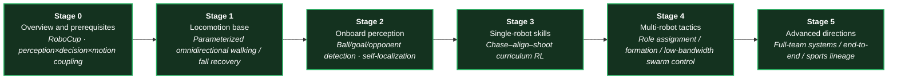

# Humanoid Soccer

**At a glance**:

- **Who it's for**: People who want humanoid robots to chase the ball, shoot, and play full matches.
- **Path**: Stage 0–5 · RoboCup overview → omnidirectional walking and fall recovery → onboard perception → curriculum RL for kicking skills → multi-robot tactics → advanced directions.
- **Depth roadmap**: A branch of the [motion control main roadmap](motion-control.md).

## Roadmap overview

## How to use this path

- The target reader can already train locomotion policies in simulation and wants to chain perception, single-robot skills, and multi-robot tactics together within **one match task**
- Core mental model: humanoid soccer is not a simple sum of "can walk + can kick"; the ball is rolling, opponents are moving, communication is rate-limited, and **perception–decision–motion must cooperate in real time within one closed loop**; latency or error at any layer is amplified by the match
- Each stage has prerequisites, core questions, what to do, what to read, and what you should be able to produce

**Relation to the main roadmap:**
- This roadmap is an application direction after main-roadmap L5 (RL / IL) leaning toward "integrated competitive tasks": the lower-body base depends on the [RL depth roadmap](depth-rl-locomotion.md), and closed-loop shooting is perception-in-the-loop skill learning, belonging to the same "perception into the policy" lineage as the [perceptive locomotion depth roadmap](depth-perceptive-locomotion.md)
- Single-robot adversarial play and self-play training are expanded in the [humanoid boxing depth roadmap](depth-humanoid-boxing.md); this roadmap focuses on "skills with the ball + cooperation with teammates"
- Perception engineering details such as visual detection selection can be filled in from Stages 0–1 of the [navigation depth roadmap](depth-navigation.md)

---

## Stage 0 Overview and prerequisites: RoboCup and perception–decision–motion coupling

**First build problem awareness: why soccer is treated as an integrated benchmark for humanoid autonomy, and across which layers the difficulties are distributed.**

### Prerequisites
- Main roadmap [L5.1 (RL basics)](motion-control.md#l5-1-rl-basics) level; [RL depth roadmap](depth-rl-locomotion.md) Stage 0–2, able to train locomotion policies in simulation
- Usage-level intuition for the paradigm differences between [reinforcement learning](../../wiki/methods/reinforcement-learning.md) and [imitation learning](../../wiki/methods/imitation-learning.md)

### Core questions
- Five layers of challenges in the soccer task: dynamic perception and localization, closed-loop kicking, parameterized omnidirectional walking, stability on complex ground, multi-robot cooperation (see the task page for details)
- How the rule constraints of each RoboCup league (Kid/Adult-Size, SPL) in turn shape technical routes
- What problems each of the three mainstream routes solves: end-to-end RL, hierarchical state machine + skill library, and multi-robot tactics

### What to do
- Read the task page, go through the five layers of challenges and three technical routes, and draw a layered map of "perception / single-robot skills / tactics"
- Watch a recording of a RoboCup Adult-Size final, and use the layered map to mark at which layer each mistake occurs

### What to read
- [Humanoid Soccer task page](../../wiki/tasks/humanoid-soccer.md) — task map and main entry for technical routes on this roadmap
- [Locomotion task page](../../wiki/tasks/locomotion.md) and [Humanoid multi-robot coordination](../../wiki/concepts/humanoid-multi-robot-coordination.md)
- [Booster RoboCup Demo](../../wiki/entities/booster-robocup-demo.md) — what a complete match software stack looks like

### What you should be able to produce
- Be able to explain why soccer is harder than single-skill locomotion / shooting, and at which layer the difficulty lies
- Given a new system, be able to judge whether it belongs to end-to-end RL, hierarchical state machine, or tactics-layer work

---

## Stage 1 Locomotion base: parameterized omnidirectional walking and fall recovery

**Matches require changing speed, frequency, and heading at any moment, and getting back up after collisions to keep playing.**

### Prerequisites
- Stage 0 content
- [RL depth roadmap](depth-rl-locomotion.md) Stage 2 level: have run a quadruped/humanoid locomotion training pipeline end to end

### Core questions
- Parameterized omnidirectional walking: how to design the speed/heading/step-frequency command space to support defending, intercepting, and dribbling past opponents
- Robustness curricula for uneven ground on grass/artificial turf and under adversarial collisions
- Switching between fall recovery (get-up) and walking policies: state machine switching or a unified policy
- Platform selection: soccer ecosystem differences between Booster T1/K1 and Unitree G1

### What to do
- Use an [HTWK-Gym](../../wiki/methods/htwk-gym.md)-style framework to train a parameterized omnidirectional walking policy, and test sudden stops, lateral stepping, and turning in place
- Add a push and collision disturbance curriculum to the walking policy, and record changes in the recovery rate from instability

### What to read
- [HTWK-Gym](../../wiki/methods/htwk-gym.md) — soccer-specific RL framework for the Booster T1/K1 platforms
- [Balance Recovery task page](../../wiki/tasks/balance-recovery.md) — fall recovery lineage
- [Unitree G1](../../wiki/entities/unitree-g1.md) — one of the main platforms for soccer research
- [WBC vs RL comparison](../../wiki/comparisons/wbc-vs-rl.md) — tradeoffs between the two routes for the locomotion base

### What you should be able to produce
- A walking base that accepts arbitrary speed/heading commands and can get back up after collisions
- Be able to explain the differences between "walking for soccer" and "general locomotion" in command space and curriculum design

---

## Stage 2 Onboard perception: ball, goal, opponents, and self-localization

**The robot must recognize a fast-rolling ball while moving quickly and update its own pose in real time; perception is the input to all upper-layer skills.**

### Prerequisites
- Stage 1 content
- Basic concepts of deep-learning object detection

### Core questions
- Model selection for ball/goal/sideline/opponent detection: the three-way tradeoff among accuracy, latency, and onboard compute
- Wide-area search strategy with coordinated head joints: where to look and when
- Onboard localization: how visual features + odometry stabilize pose on a field without external localization
- How to model perception noise into training so the policy is not broken by real detection jitter during sim2real

### What to do
- Get a ball detection model (YOLO family or RF-DETR) running under onboard compute constraints, and measure end-to-end latency
- Record a video of a real rolling ball, and compare how far detection results differ from the noise assumptions used in training

### What to read
- [Object Detection](../../wiki/methods/object-detection.md) — lineage of detection methods
- [Query: object detection model selection](../../wiki/queries/object-detection-model-selection.md) and [Query: perception backbone selection](../../wiki/queries/perception-backbone-selection.md)
- [Vision-Driven Reactive Soccer](../../wiki/entities/paper-hrl-stack-26-learning_vision_driven_reactive_socc.md) — vision-driven reactive soccer skills
- [Booster RoboCup Demo](../../wiki/entities/booster-robocup-demo.md) — where YOLOv8 perception sits in a full-team system

### What you should be able to produce
- An onboard detection + localization pipeline that meets the latency budget
- A mapping table of "perception noise → training domain randomization parameters"

---

## Stage 3 Single-robot skills: curriculum RL for chasing, aligning, and shooting

**The main battlefield of this roadmap: learn "catch up to the ball, align with the ball, kick the ball toward the target" as one closed-loop skill and transfer it to a real robot.**

### Prerequisites
- Stage 1–2 content
- [Imitation learning depth roadmap](depth-imitation-learning.md) Stage 0–1 level (know how reference motions enter RL)

### Core questions
- Closed-loop kicking vs pre-scripted trajectory kicking: the ball moves during the approach, so how are kick timing and force corrected online
- Tradeoffs between two representative routes: PAiD's progressive fusion of "motion tracking → perception fusion → physical alignment", and RoboNaldo's "single human reference scaffold + three-stage curriculum"
- Teacher–student distillation: the teacher uses ground-truth state and the student uses only noisy perception; which information can be distilled and which must be relearned
- How shooting accuracy and ball speed enter the reward without sacrificing gait stability

### What to do
- Reproduce a kicking curriculum: first learn directional kicking with ground-truth state, then distill into a student policy that uses only onboard perception
- Ablate item by item: remove the motion reference, remove noise modeling, remove curriculum stages, and record which component causes the biggest drop

### What to read
- [Query: humanoid soccer skill learning method selection](../../wiki/queries/humanoid-soccer-skill-learning-method-selection.md) — main entry for PAiD vs RoboNaldo selection
- [PAiD Framework](../../wiki/methods/paid-framework.md) and [Learning Soccer Skills for Humanoid Robots](../../wiki/entities/paper-notebook-learning-soccer-skills-for-humanoid-robots.md) — progressive perception–action fusion, 91.3% kicking success rate on a real G1
- [RoboNaldo](../../wiki/entities/paper-robonaldo-humanoid-soccer-shooting.md) — sub-meter targeted shooting and ball contact speeds on the order of 13 m/s
- [Learning Agile Striker Skills](../../wiki/entities/paper-notebook-learning-agile-striker-skills-for-humanoid-socce.md) — four-stage teacher–student distillation
- [Query: reward design guide](../../wiki/queries/reward-design-guide.md)

### What you should be able to produce
- A closed-loop skill that completes "chase the ball → align → directional shot" in simulation, including a teacher–student distilled version
- A cost-benefit judgment of the two routes, "progressive fusion" and "reference scaffold curriculum"

---

## Stage 4 Multi-robot tactics: role assignment, formation, and low-bandwidth swarm control

**A single robot that can shoot solves only half the problem: who goes to kick, who stays back, and how to avoid teammates clustering together are orthogonal capabilities at the tactics layer.**

### Prerequisites
- Stage 3 content
- Basic concepts of multi-agent RL (CTDE, communication constraints)

### Core questions
- The boundary between centralized behavior management (a behavior planner assigns roles) and decentralized swarms (ACO roles + flocking formation)
- With RoboCup communication quotas continually tightening, how to do extremely low-bandwidth coordination (market auctions, prediction in place of communication)
- Combining learned MARL with rule-based tactics: which layers are suited to learning and which to hand-writing
- The interface between the tactics layer and the single-robot skill layer: what granularity of command to send to the skill layer

### What to do
- Set up a 2v2 match in simulation: first run a baseline with rule-based role assignment, then switch to decentralized role negotiation, and compare goals scored and clustering rate
- Read ARTEMIS's behavior planner structure and draw the "perception → tactics → skills" information flow diagram

### What to read
- [Humanoid multi-robot coordination](../../wiki/concepts/humanoid-multi-robot-coordination.md) — overview of swarm control paradigms
- [ARTEMIS champion system](../../wiki/entities/paper-notebook-a-hierarchical-model-based-system-for-high-perfo.md) — centralized tactics layer, RoboCup 2024 Adult-Size champion
- [Swarm Intelligence humanoid soccer](../../wiki/entities/paper-humanoid-soccer-swarm-intelligence.md) — decentralized 4v4 counterpart
- [MARL](../../wiki/methods/marl.md) and [CTDE vs decentralized MARL](../../wiki/comparisons/ctde-vs-decentralized-marl.md)
- [SPL extremely low-bandwidth coordination](https://arxiv.org/abs/2401.15026)

### What you should be able to produce
- A role assignment + formation scheme that runs in a 2v2 simulated match
- Be able to explain the applicable ranges of centralized / decentralized / auction swarm control along the communication budget axis

---

## Stage 5 Advanced directions

### Prerequisites
- Stage 4 content

**Direction A: Full-team system stack and competition engineering**
- Chain perception, skills, tactics, and communication into an engineering system that can play a full match, handling referee signals, substitutions, and fault recovery
- Keywords: [Booster RoboCup Demo](../../wiki/entities/booster-robocup-demo.md), [ARTEMIS](../../wiki/entities/paper-notebook-a-hierarchical-model-based-system-for-high-perfo.md)

**Direction B: End-to-end and generative routes**
- Moving from hierarchical pipelines to end-to-end: diffusion models learn "perception → action" directly from match recordings
- Keywords: [SoccerDiffusion](../../wiki/entities/paper-notebook-soccerdiffusion-toward-learning-end-to-end-human.md), [HumanoidArena](../../wiki/entities/paper-humanoidarena.md) (Football task)

**Direction C: Simulated sports benchmarks and adversarial training**
- Do soccer 1v1/2v2 and alternating self-play on unified simulated humanoids, compared against PPO / AMP / PULSE baselines
- Keywords: [SMPLOlympics](../../wiki/entities/smplolympics.md), [humanoid boxing depth roadmap](depth-humanoid-boxing.md) (expanded version of adversarial self-play)

**Direction D: Competitive sports skill lineage**
- Fast-moving object interaction beyond soccer: badminton, table tennis, and tennis share the methodology of "footwork + hitting timing"
- Keywords: [Humanoid badminton whole-body control](../../wiki/entities/paper-notebook-humanoid-whole-body-badminton-via-multi-stage-re.md), [PhysicsPingPong](../../wiki/methods/table-tennis-strategy-skill-learning.md), [AdaPT](../../wiki/entities/paper-adapt.md) (humanoid tennis adaptive planning–tracking, broadcast video/MoCap-style data + MVAE rally planning, real G1 and Atom P3 robots, serve-tracking training open-sourced on GitHub)

---

## Quick entry summary

| Stage | Core question | Knowledge page entry |
|------|---------|-----------|
| Stage 0 | Task overview and coupling | [Humanoid Soccer task page](../../wiki/tasks/humanoid-soccer.md) |
| Stage 1 | Locomotion base | [HTWK-Gym](../../wiki/methods/htwk-gym.md) |
| Stage 2 | Onboard perception | [Object detection model selection](../../wiki/queries/object-detection-model-selection.md) |
| Stage 3 | Single-robot kicking skills | [Soccer skill learning method selection](../../wiki/queries/humanoid-soccer-skill-learning-method-selection.md) |
| Stage 4 | Multi-robot tactics | [Humanoid multi-robot coordination](../../wiki/concepts/humanoid-multi-robot-coordination.md) |
| Stage 5 | Advanced directions | [SMPLOlympics](../../wiki/entities/smplolympics.md) |

## Relation to other pages

- Full growth roadmap reference: [Main roadmap: motion control → physical intelligence full-stack growth roadmap](motion-control.md)
- Related depth roadmaps (by topical proximity; full catalog in the [roadmap overview](motion-control.md#depth-optional-index)):
  - [RL motion control](depth-rl-locomotion.md) — training foundation for omnidirectional walking and kicking skills
  - [Perceptive locomotion](depth-perceptive-locomotion.md) — terrain and vision while chasing the ball
  - [Swarm performance](depth-humanoid-swarm-performance.md) — another product line for multi-robot coordination
  - [Humanoid boxing](depth-humanoid-boxing.md) — adjacent scenario for adversarial whole-body skills
- Related knowledge pages:
  - [Humanoid Soccer task page](../../wiki/tasks/humanoid-soccer.md)
  - [Humanoid multi-robot coordination](../../wiki/concepts/humanoid-multi-robot-coordination.md)
  - [PAiD Framework](../../wiki/methods/paid-framework.md)
  - [HTWK-Gym](../../wiki/methods/htwk-gym.md)
  - [MARL](../../wiki/methods/marl.md)

## References

- [Humanoid Soccer task page](../../wiki/tasks/humanoid-soccer.md) and [Humanoid multi-robot coordination](../../wiki/concepts/humanoid-multi-robot-coordination.md)
- The first RoboCup (Nagoya, 1997) — the competition starting point for the humanoid soccer direction; the RoboCup 2050 goal is a full humanoid team playing against the human World Cup champions
- "RoboNaldo" (arXiv:2606.11092) — representative of shooting curriculum RL
- [PAiD / Learning Soccer Skills for Humanoid Robots](../../wiki/entities/paper-notebook-learning-soccer-skills-for-humanoid-robots.md) — representative of progressive perception–action fusion
- [ARTEMIS](../../wiki/entities/paper-notebook-a-hierarchical-model-based-system-for-high-perfo.md) (arXiv:2512.09431) — RoboCup 2024 Adult-Size champion system
