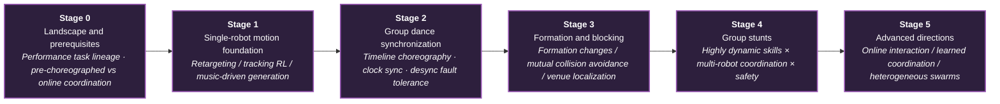

# Humanoid Swarm Performance

**At a glance**:

- **Who it's for**: people who want a group of humanoid robots to dance in unison on the same stage, change formations, and perform coordinated stunts.
- **Path**: Stage 0–5 · Performance lineage and the two paradigms → single-robot motion foundation → group dance synchronization → formation and blocking → group stunts → advanced directions.
- **Depth roadmap**: a branch of the [motion control main roadmap](motion-control.md); abbreviated HSP (Humanoid Swarm Performance).

## Roadmap overview

## How to use this path

- The target readers can already make a single humanoid track reference motions and want to build "many humanoids performing in coordination on the same stage" into a complete system
- Core mental model: swarm performance is not "single-robot dance × N copies". Multiple robots share one timeline, one venue, and one safety budget, and **synchronization error, formation conflicts, and a single robot falling out of sync are all magnified to the audience's naked eye**; in engineering terms you must upgrade "motion correctness" to "group correctness"
- Each stage has prerequisites, core questions, what to do, what to read, and what you should be able to produce

**Relation to the main roadmap:**
- This roadmap is an application direction after main-roadmap L5 (RL / IL) oriented toward "multi-robot performance systems": the single-robot motion foundation depends on the [motion retargeting depth roadmap](depth-motion-retargeting.md) and the [RL depth roadmap](depth-rl-locomotion.md), and choreography material production can connect to the [motion generation depth roadmap](depth-motion-generation.md)
- Also a multi-robot direction, Stage 4 of the [humanoid soccer depth roadmap](depth-humanoid-soccer.md) addresses **online tactical swarm control in adversarial environments**, whereas this roadmap focuses on **performance swarm control in cooperative environments**. The former wins on real-time response, the latter on millisecond-level synchronization and visual aesthetics; the two share much of their communication and coordination toolbox
- Training methods for highly dynamic single-robot stunts share the same motion-tracking lineage as the [humanoid boxing depth roadmap](depth-humanoid-boxing.md) and the [BFM depth roadmap](depth-bfm.md); robustness issues in real-robot deployment are covered in the [Sim2Real depth roadmap](depth-sim2real.md)

---

## Stage 0 Landscape and prerequisites: performance task lineage and the two paradigms

**First build problem awareness: what exactly swarm performance controls, and where the boundary between pre-choreography and online coordination lies.**

### Prerequisites
- Main-roadmap L3–L5 level: able to train and track a reference motion in simulation
- User-level intuition for [locomotion](../../wiki/tasks/locomotion.md) and [imitation learning](../../wiki/methods/imitation-learning.md)

### Core questions
- The three task types of swarm performance: **group dance** (millisecond-level motion synchronization), **blocking** (formation definition and transitions), and **stunts** (group choreography of highly dynamic skills), each with different requirements on synchronization accuracy, planning complexity, and safety budget
- Tradeoffs between the two paradigms: **pre-choreographed timeline** (offline choreography + distributed clock playback, the mainstream for stage performance) vs **online coordination** (real-time perception + role assignment, the mainstream for soccer/work scenarios). Performance swarm control mostly falls into the former, but blocking transitions and failure fallbacks cannot do without the latter
- Milestone evolution: the 2016 CCTV Spring Festival Gala **group dance of 540 Alpha 1S robots** (large-scale pre-choreographed playback) → 2020 Boston Dynamics "Do You Love Me" (highly dynamic choreography with one/few robots) → the 2025 CCTV Spring Festival Gala **16 Unitree H1 robots in "Yangko BOT"** (engineering integration of whole-body motion control + laser SLAM localization + fleet scheduling)
- The essential differences between performance swarm control and [humanoid multi-robot coordination](../../wiki/concepts/humanoid-multi-robot-coordination.md) (soccer swarm control): cooperative vs adversarial, timeline-driven vs event-driven, aesthetic metrics vs win/loss metrics

### What to do
- Watch the 2016 Alpha 1S group dance and the 2025 "Yangko BOT" recordings, and break down the difference in engineering content between the two in four columns: "single-robot motion / synchronization mechanism / blocking / safety"
- Draw a requirements matrix of the three tasks "group dance / blocking / stunts" against the three axes "synchronization accuracy / planning complexity / safety budget"

### What to read
- [Humanoid multi-robot coordination](../../wiki/concepts/humanoid-multi-robot-coordination.md) — an overview of multi-robot swarm control paradigms; its "common misconceptions" section is exactly the dividing line between this roadmap and soccer swarm control
- [Humanoid Soccer task page](../../wiki/tasks/humanoid-soccer.md) — the contrasting task for the online coordination paradigm
- [Unitree G1](../../wiki/entities/unitree-g1.md) — the workhorse platform for both performance and research

### What you should be able to produce
- Explain which parts of a robot group dance are pre-choreographed and which must be closed-loop online
- Given a swarm performance video, judge its level of technical content (playback / localized blocking / dynamic stunts)

---

## Stage 1 Single-robot motion foundation: retargeting, tracking RL, and music-driven generation

**The group's floor is set by the single robot: first get one humanoid to dance and perform stunts correctly and stably.**

### Prerequisites
- Stage 0 content
- At the level of Stages 0–2 of the [motion retargeting depth roadmap](depth-motion-retargeting.md): able to convert human mocap/video motion into robot reference trajectories

### Core questions
- The source pipeline for dance motion: mocap / video estimation → retargeting → physical feasibility; it differs from the general [motion retargeting](../../wiki/concepts/motion-retargeting.md) pipeline in **beat alignment** and **style preservation**
- How to choose tracking RL: what repertoire-library scale each suits—[DeepMimic](../../wiki/methods/deepmimic.md)-lineage single-clip tracking, [BeyondMimic](../../wiki/methods/beyondmimic.md) general tracking, and [SONIC](../../wiki/methods/sonic-motion-tracking.md) large-scale pretraining; music conditioning first generates a motion reference that is then fed to a tracker, and SONIC's motion token interface should not be equated with audio input
- Music/text-driven choreography material production: how generative models such as [GENMO](../../wiki/methods/genmo.md) and [HY-Motion](../../wiki/methods/hy-motion-1.md) plug into the "generate → retarget → track" pipeline
- Special constraints of performance motion: motion must "look good", not just "not fall"; balancing style rewards, motion amplitude, and safety margin

### What to do
- Pick a 10–20 s dance mocap clip, run the full "retargeting → tracking RL → simulation playback" pipeline end to end, and measure beat deviation
- Produce a candidate choreography with a music-driven generative model, and compare motion fidelity before and after making it physically feasible

### What to read
- [DeepMimic](../../wiki/methods/deepmimic.md) and [BeyondMimic](../../wiki/methods/beyondmimic.md) — representatives of two generations of motion tracking
- [SONIC](../../wiki/methods/sonic-motion-tracking.md) — a large-scale motion tracking backend
- [AHEADance](../../wiki/entities/paper-aheadance.md) — streaming music first generates a G1 reference, which SONIC then executes; the generator receives no robot state feedback, and a single-robot demo is not a multi-robot synchronization scheme; as of 2026-11-14 the official status is still Code soon
- [GENMO](../../wiki/methods/genmo.md) and [HY-Motion 1.0](../../wiki/methods/hy-motion-1.md) — music/text-driven motion generation
- [Comparison of humanoid reference motion datasets](../../wiki/comparisons/humanoid-reference-motion-datasets.md) — repertoire library selection
- [Disney Olaf character robot](../../wiki/methods/disney-olaf-character-robot.md) — an example of "looks first" performance-oriented control

### What you should be able to produce
- A pipeline that turns any dance mocap into an executable single-robot policy, with a beat error report
- A cost-benefit judgment on three tiers of solutions: "single-clip tracking / general tracking / generative choreography"

---

## Stage 2 Group dance synchronization: timeline choreography, clock sync, and desync fault tolerance

**The core of group dance is not motion difficulty, but getting dozens of robots' motions "in unison" at the millisecond scale.**

### Prerequisites
- Stage 1 content
- Intuition for basic networking concepts (multicast, packet loss, jitter)

### Core questions
- Representing the choreography timeline: motion segments + beat anchors + formation keyframes; how to design a "score" that is both human-editable and programmatically verifiable
- Distributed clock synchronization: how PTP / wireless time distribution bring the time base of dozens of machines to within a millisecond; see the master clock election + offset/drift estimation framework in [clock synchronization algorithms](../../wiki/concepts/clock-synchronization-algorithms.md)
- State broadcast and monitoring: how the director's console uses mechanisms like [UDP multicast](../../wiki/formalizations/udp-multicast-dynamics.md) to issue start/stop/correction commands and collect each robot's health status, and how to model packet loss and late arrival
- Desync fault tolerance: when a single robot is half a beat behind / falls / drops offline, whether to catch up in place, skip to an aligned segment, or exit the formation; contingency plans must be written into the timeline, not improvised on the spot

### What to do
- Spawn 8–16 humanoid instances in simulation, play back the same dance on a unified timeline, inject clock offset and random packet loss, and quantify the threshold of "unevenness visible to the audience"
- Add "skip-to-aligned-segment" fault-tolerance logic to the timeline, and test the recovery time for a single robot to rejoin the formation after falling

### What to read
- [Clock synchronization algorithms](../../wiki/concepts/clock-synchronization-algorithms.md) — a unified framework for PTP / distributed clocks
- [UDP multicast dynamics](../../wiki/formalizations/udp-multicast-dynamics.md) — four classes of random processes: loss, late arrival, reordering, inconsistency
- [Hardware communication and protocols depth](../../wiki/overview/hub-communication.md) — low-level data link selection
- [Balance Recovery task page](../../wiki/tasks/balance-recovery.md) — fall recovery is the foundation of desync fault tolerance

### What you should be able to produce
- An executable choreography timeline format definition + a simulation demo of synchronized multi-robot playback
- A quantitative comparison table of "clock offset / packet loss rate → synchronization quality" and a checklist of fault-tolerance contingency plans

---

## Stage 3 Formation and blocking: formation changes, mutual collision avoidance, and venue localization

**Blocking upgrades group dance from "in unison in place" to "still in unison while moving": the formation is the constraint, collision avoidance is the bottom line, and localization is the prerequisite.**

### Prerequisites
- Stage 2 content
- Trajectory planning basics (basic concepts of spline / optimization-based planning)

### Core questions
- Mathematical representation and transition of formations: keyframe formations + robot-to-slot assignment (Hungarian-algorithm-style assignment); how to make the total travel short and crossing-free when N robots change formation
- Mutual collision avoidance: which parts of the mature drone swarm toolbox ([Crazyswarm2](../../wiki/entities/crazyswarm2.md)'s trajectory upload + collision avoidance, [EGO-Planner Swarm](../../wiki/entities/ego-planner-swarm.md)'s B-spline local planning, the [MINCO swarm](../../wiki/entities/paper-swarm-micro-flying-robots-in-the-wild.md)'s joint spatiotemporal optimization) transfer to bipeds, and which are broken by "cannot change direction instantaneously + can fall over"
- Venue localization: the three tiers of mocap / UWB / laser SLAM in accuracy and deployment cost, and why stage scenarios often use "offline map + laser localization" (the "Yangko BOT" route)
- Coupling of blocking and dance steps: how the omnidirectional walking command space (velocity/heading/step frequency) simultaneously satisfies formation trajectories and beat constraints; this shares its origin with the parameterized omnidirectional walking in Stage 1 of the [humanoid soccer depth roadmap](depth-humanoid-soccer.md)

### What to do
- Implement a blocking planner of "two formation keyframes + assignment + trajectory generation", run a 16-robot formation change in simulation, and measure the minimum inter-robot distance
- Overlay the blocking trajectories onto the Stage 2 timeline, and verify how much synchronization quality degrades when "dancing while walking"

### What to read
- [Crazyswarm2](../../wiki/entities/crazyswarm2.md) — an engineering reference for large-scale real-robot formations (the full chain of localization → trajectory → monitoring)
- [EGO-Planner Swarm](../../wiki/entities/ego-planner-swarm.md) and [Swarm in the Wild](../../wiki/entities/paper-swarm-micro-flying-robots-in-the-wild.md) — two generations of decentralized mutual collision avoidance
- [Humanoid multi-robot coordination](../../wiki/concepts/humanoid-multi-robot-coordination.md) — humanoid-side constraints on formation/positioning
- [LiDAR SLAM / LIO / VIO selection](../../wiki/comparisons/lidar-slam-lio-vio-selection.md) — venue localization technology selection

### What you should be able to produce
- A blocking planner for N-robot formation changes, including assignment, collision avoidance, and beat alignment
- Be able to explain which three things must be redone when transferring drone swarm methods to humanoids (dynamics, stability, localization)

---

## Stage 4 Group stunts: highly dynamic skills × multi-robot coordination × safety boundaries

**The peak of this roadmap: choreographing single-robot extreme skills such as flips and martial arts into group acts, while keeping the risk caged.**

### Prerequisites
- Stage 1–3 content
- At the level of Stages 0–2 of the [Sim2Real depth roadmap](depth-sim2real.md): understand the domain-gap risk of highly dynamic motions on real robots

### Core questions
- How to train highly dynamic single-robot stunts: which link of the stunt chain is solved by [KungFuAthleteBot](../../wiki/entities/paper-kungfuathlete-humanoid-martial-arts-tracking.md)'s high-speed martial arts dataset + disturbance-robust tracking, [KungfuBot](../../wiki/entities/paper-notebook-kungfubot-physics-based-humanoid-whole-body-cont.md)'s physical feasibility, and [ASAP](../../wiki/entities/paper-notebook-asap-aligning-simulation-and-real-world-physics.md)'s sim-to-real dynamics alignment
- Group choreography of stunts: the gradient of synchronization and safety requirements across three choreography types: relay (a wave of sequential flips), mirror (symmetric martial arts formations), and cooperative (multi-robot lifting/tossing to each other)
- The frontier of multi-robot physical collaboration: [TeamHOI](../../wiki/entities/paper-amp-survey-17-teamhoi.md)'s decentralized multi-agent cooperative carrying and [TeamPlay](../../wiki/entities/paper-bfm-23-teamplay.md)'s cooperative behavior foundation; the leap from "each dancing on its own" to "mechanical coupling"
- Safety boundary engineering: how stunt failure radius, inter-robot safety distance, and audience exclusion zones turn from simulation statistics into on-site execution rules; fall detection and automatic takeover by [fall recovery](../../wiki/tasks/balance-recovery.md)

### What to do
- Choreograph a "relay flip" for 4 robots in simulation and measure failure propagation (the interference radius of one robot's mistake on its neighbors)
- Ablate a highly dynamic skill: how much the real-robot success rate drops without dynamics alignment (ASAP-style), and back out the minimum alignment requirement for putting the stunt on stage

### What to read
- [KungFuAthleteBot](../../wiki/entities/paper-kungfuathlete-humanoid-martial-arts-tracking.md) — highly dynamic martial arts tracking + disturbance recovery
- [KungfuBot](../../wiki/entities/paper-notebook-kungfubot-physics-based-humanoid-whole-body-cont.md) and [KungfuBot2](../../wiki/entities/paper-notebook-kungfubot-2.md) — physically feasible kung fu skills
- [ASAP](../../wiki/entities/paper-notebook-asap-aligning-simulation-and-real-world-physics.md) — sim-to-real alignment for highly dynamic skills
- [TeamHOI](../../wiki/entities/paper-amp-survey-17-teamhoi.md) and [TeamPlay](../../wiki/entities/paper-bfm-23-teamplay.md) — the frontier of multi-robot physical collaboration
- [SMPLOlympics](../../wiki/entities/smplolympics.md) — a simulation benchmark for highly dynamic skills

### What you should be able to produce
- A simulation demo of a group act with 4 or more robots including at least one highly dynamic skill, with a failure propagation analysis
- A "pre-stage stunt checklist" covering all three items: dynamics alignment, safety radius, and fault-tolerance contingency plans

---

## Stage 5 Advanced directions

### Prerequisites
- Stage 4 content

**Direction A: Online interactive performance**
- Moving from a fixed timeline to real-time driving by the audience/music: live music beat extraction → online choreography generation → group improvisation, bringing the Stage 1 generative models into the closed loop
- Keywords: [GENMO / GEM](../../wiki/methods/genmo.md) or [AHEADance](../../wiki/entities/paper-aheadance.md) (music → reference motion), [SONIC](../../wiki/methods/sonic-motion-tracking.md) (motion reference → robot tracking); beyond single-robot music-conditioned generation, the multi-robot timeline and synchronization from Stage 2 are still needed

**Direction B: Learned multi-robot coordination**
- Use [MARL](../../wiki/methods/marl.md) to learn blocking and cooperation, replacing hand-crafted assignment and rule-based fault tolerance; compare training topologies with [CTDE vs decentralized](../../wiki/comparisons/ctde-vs-decentralized-marl.md)
- Keywords: [MARL](../../wiki/methods/marl.md), [TeamPlay](../../wiki/entities/paper-bfm-23-teamplay.md)

**Direction C: Heterogeneous swarm performance**
- Humanoids + quadrupeds + drones on the same stage: cross-morphology timelines, cross-scale localization, and a unified safety budget
- Keywords: [Crazyswarm2](../../wiki/entities/crazyswarm2.md), [quad-swarm-rl](../../wiki/entities/quad-swarm-rl.md)

**Direction D: From performance swarm control to work swarm control**
- Transfer the synchronization, blocking, and fault-tolerance infrastructure honed in performances to multi-robot inspection, cooperative carrying, and factory fleet scheduling; for the adversarial-side sister roadmap see Stage 4 of the [humanoid soccer depth roadmap](depth-humanoid-soccer.md)
- Keywords: [Humanoid multi-robot coordination](../../wiki/concepts/humanoid-multi-robot-coordination.md), [TeamHOI](../../wiki/entities/paper-amp-survey-17-teamhoi.md)

---

## Quick entry summary

| Stage | Core question | Knowledge page entry |
|------|---------|-----------|
| Stage 0 | Task lineage and paradigms | [Humanoid multi-robot coordination](../../wiki/concepts/humanoid-multi-robot-coordination.md) |
| Stage 1 | Single-robot motion foundation | [BeyondMimic](../../wiki/methods/beyondmimic.md) |
| Stage 2 | Group dance synchronization | [Clock synchronization algorithms](../../wiki/concepts/clock-synchronization-algorithms.md) |
| Stage 3 | Formation and blocking | [Crazyswarm2](../../wiki/entities/crazyswarm2.md) |
| Stage 4 | Group stunts | [KungFuAthleteBot](../../wiki/entities/paper-kungfuathlete-humanoid-martial-arts-tracking.md) |
| Stage 5 | Advanced directions | [MARL](../../wiki/methods/marl.md) |

## Relation to other pages

- Full growth roadmap reference: [Main roadmap: motion control → physical intelligence full-stack growth roadmap](motion-control.md)
- Related depth roadmaps (by topical proximity; for the full index see [Roadmap overview](motion-control.md#depth-optional-index)):
  - [Motion generation](depth-motion-generation.md) — the motion source for group dance choreography
  - [Motion retargeting](depth-motion-retargeting.md) — mapping choreography onto multiple robot bodies
  - [Humanoid soccer](depth-humanoid-soccer.md) — the contrasting scenario of multi-robot tactical coordination
  - [Navigation](depth-navigation.md) — formation blocking and localization
- Related knowledge pages:
  - [Humanoid multi-robot coordination](../../wiki/concepts/humanoid-multi-robot-coordination.md)
  - [Clock synchronization algorithms](../../wiki/concepts/clock-synchronization-algorithms.md)
  - [UDP multicast dynamics](../../wiki/formalizations/udp-multicast-dynamics.md)
  - [BeyondMimic](../../wiki/methods/beyondmimic.md)
  - [MARL](../../wiki/methods/marl.md)

## References

- [Humanoid multi-robot coordination](../../wiki/concepts/humanoid-multi-robot-coordination.md) — swarm control paradigms and the dividing line between "pre-recorded timeline + distributed clock vs online tactics"
- The 2016 CCTV Spring Festival Gala group dance of 540 UBTECH Alpha 1S robots — a mainstream milestone for large-scale pre-choreographed playback (the starting point of this roadmap); the 2025 CCTV Spring Festival Gala 16 Unitree H1 robots in "Yangko BOT" — an engineering integration milestone of whole-body motion control + laser SLAM localization + fleet scheduling
- [KungFuAthleteBot](https://kungfuathletebot.github.io/) (arXiv:2602.13656) — highly dynamic martial arts tracking and disturbance recovery
- [Swarm in the Wild](../../wiki/entities/paper-swarm-micro-flying-robots-in-the-wild.md) (Science Robotics 2022) and [Crazyswarm2](../../wiki/entities/crazyswarm2.md) — transfer references for the drone swarm formation/collision avoidance toolbox
- [TeamHOI](../../wiki/entities/paper-amp-survey-17-teamhoi.md) (arXiv:2603.07988) — the frontier of decentralized policies for multi-robot physical collaboration
- [AHEADance official project](https://ihcr.github.io/AHEADance/) and [original paper III-E / V](https://arxiv.org/html/2611.13370v1) — the division of responsibility between streaming music generation and downstream whole-body tracking
- [SONIC official project · Multi-Modal Control](https://nvlabs.github.io/GEAR-SONIC/) — music/text first generates human motion via GEM, which is then tracked through the unified motion interface
