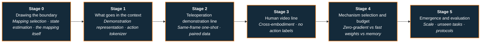

# Embodied In-Context Learning (ICL)

**At a glance**:

- **Who it's for**: people who want a robot to perform a new task after reading a single demonstration, without changing weights.
- **Path**: Stage 0–5 · Drawing the boundary → demonstration representation and action tokens → teleoperation demonstration line → human video line → mechanism selection and inference budget → scale emergence and evaluation.
- **Depth roadmap**: a branch of the [motion control main roadmap](motion-control.md); forms a sister roadmap pair with the [imitation learning depth roadmap](depth-imitation-learning.md): "learning at training time / learning at deployment time".

## Roadmap overview

## How to use this path

- The target readers can already train a BC / VLA policy and are starting to get stuck on "every new task means recollecting data and retraining"; the main battlefield is manipulation and mobile manipulation, and humanoid whole-body work is also moving toward this line
- ICL addresses **deployment-time adaptation**: without updating weights, it puts demonstration/interaction evidence into the context so that **the observation→action mapping itself** changes; it does not replace language semantic grounding (that is the [VLA depth roadmap](depth-vla.md)), nor does it replace forward-consequence modeling (that is the [WAM depth roadmap](depth-wam.md))
- **Read Stage 0 before reading papers**: in 2026 the word "context" simultaneously refers to metadata conditioning, history memory, fast-weight TTT, and true ICL; if you do not pin down the criterion first, the four kinds of mechanism get mixed into one pot
- Each stage has prerequisites, core questions, what to do, what to read, and what you should be able to produce

**Relation to the main roadmap:**
- This roadmap is a "deployment-time adaptation" advanced direction after main-roadmap L5 (RL and imitation learning); its starting point is the "read one demonstration and execute" lineage of One-Shot Imitation Learning (NeurIPS 2017)
- On the data side it depends heavily on the [teleoperation depth roadmap](depth-teleoperation.md) (how demonstrations are collected) and the [imitation learning depth roadmap](depth-imitation-learning.md) (how demonstrations are trained on)
- If the goal is "a tabletop VLA that understands instructions", first complete Stages 0–2 of the [VLA depth roadmap](depth-vla.md), then enter this roadmap at Stage 0

---

## Stage 0 Drawing the boundary: what counts as true ICL

**First pin down "which kind of uncertainty the context resolves" as a three-row table, then read papers; otherwise π0.7's metadata, MemoryVLA's history frames, and RoboTTT's fast weights all get labeled as ICL.**

### Prerequisites
- Fluent in Python + PyTorch, and have trained a behavior cloning or VLA policy
- At the level of Stages 0–1 of the [VLA depth roadmap](depth-vla.md) (know \(a_t=\pi(o_t,\ell)\) and action chunking)

### Core questions
- How the **Markov assumption** of a standard VLA breaks at deployment: multiple valid actions for the same image, camera/end-effector changes rewriting the pixel–kinematics relationship, the current frame not showing progress in multi-stage tasks
- What context resolves each of the three kinds of uncertainty: **mapping selection** (language / goal image / metadata), **state estimation** (history frames / memory tokens), **the mapping itself** (demonstrations / human video / system identification segments); only the third kind is true ICL
- Rule of thumb: after reading a **task demonstration**, "how to do it" changes → ICL; after reading **history frames**, you only know "which step you are at" → memory; after reading **metadata**, only the execution style changes → conditioned selection
- The "long context" in general-purpose LLMs controlling robots mostly comes from **short-horizon retries**, not from inducing a new mapping from demonstrations

### What to do
- Fill the 8–10 "in-context" papers you have collected one by one into the three-uncertainty table, noting what actually changes after reading the context
- Write one sentence for your own scenario: am I missing the mapping, the state, or the selection? If you are missing state, do not pile on demonstrations

### What to read
- [Robot In-Context Learning (concept taxonomy)](../../wiki/concepts/robot-in-context-learning.md) — the concept hub, with the three kinds of uncertainty and the rule of thumb
- [In-Context Learning for Robots survey](../../wiki/entities/paper-in-context-learning-robots-survey.md) — arXiv:2609.36012; four interface types + Acquire/Transfer/Retain evaluation axes
- [π0.7](../../wiki/methods/pi07-policy.md) — a positive example of mapping selection: metadata selects the mapping without changing the functional form
- [LLM control interfaces](../../wiki/concepts/llm-robotics-control-interfaces.md) · [Embody](../../wiki/entities/anthropic-embody.md) — the generational advantage of general-purpose LLMs controlling robots comes from short-horizon retries; truncating long-range context does not hurt most models' scores
- [Closing the loop on the embodied foundation model family taxonomy](../../wiki/queries/embodied-fm-taxonomy-loop.md) — ICL is a "deployment-time adaptation knob" on the VLA layer, not a new layer

### What you should be able to produce
- A three-uncertainty comparison table (context content × what changes after reading it × whether it is true ICL)
- Given a new paper, classify it in one sentence and state whether its cost is "longer inference" or "running gradients"

---

## Stage 1 What goes in the context: demonstration representation and action tokens

**The same demonstration can be a token sequence, graph nodes, keypoints, or a piece of structured text; the level of abstraction directly determines "easy to generalize" vs "complete information".**

### Prerequisites
- Stage 0 content
- Transformer sequence modeling + user-level intuition for diffusion / flow matching action heads

### Core questions
- The cost of each of five demonstration representations: image/state/action **interleaved token sequences** (ICRT), **graph diffusion** (Instant Policy), **keypoints + text** (KAT), **demonstration embedding + cross-attention** (BPP), **structured plan + subgoals + 2D/3D motion verbalization** (StellaVLA)
- **Abstraction tradeoff**: high abstraction makes generalization easy but loses contact and force information; low abstraction keeps full information but makes human–robot correspondence hard to establish
- Why the **smoothness of the action tokenizer** (e.g., LipVQ-VAE) directly determines whether the induced control can be executed: if adjacent actions jump in latent space, what is induced from demonstrations will also be jittery

### What to do
- Pick two representations (e.g., token sequence vs structured verbalization) and encode the same batch of demonstrations with each, comparing context length and information loss
- List for your own task the information that "must be kept / can be compressed into one token"; contact force usually goes in the first column

### What to read
- [StellaVLA](../../wiki/entities/paper-stellavla-structured-icl-vla.md) — an offline VLM converts raw demonstrations into structured in-context demonstrations; VLA-Arena overall 0.63, LIBERO 98.8%, LIBERO-Plus 85.1%; no runnable official code as of the ingest date
- [BPP (Behavior Prompting Policy)](../../wiki/entities/paper-behavior-prompting-policy.md) — a single human demonstration as a behavior prompt + cross-attention; training and deployment code are open-sourced
- [Robot ICL survey (Embodied AI Heart, 2026-08-25)](https://mp.weixin.qq.com/s/V_Dm8kHvB2YxtGY7qScjXA) — the representation lineage of ICRT / Instant Policy / KAT / SynthICL / RICL
- [Contact wrench closed loop](../../wiki/queries/contact-wrench-closed-loop.md) — where high-abstraction representations drop force and contact details

### What you should be able to produce
- A "demonstration representation selection note" with three columns: context length, generalization difficulty, lost information
- Be able to explain why your one-shot results "look right but won't insert"; usually it is a problem of abstraction level or the action tokenizer

---

## Stage 2 Teleoperation demonstration line: one-shot generalization in the same coordinate frame

**The cleanest line: demonstration and execution share the same embodiment and coordinate frame, so the difficulty reduces from "alignment" to "training objective and paired data".**

### Prerequisites
- Stage 1 content
- Able to collect a batch of multiple demonstrations of the same task via teleoperation or scripts (see the [teleoperation depth roadmap](depth-teleoperation.md))

### Core questions
- How to construct the training objective: "one demonstration + one query", optimizing **execution performance after reading the demonstration** rather than simply fitting actions
- Where paired data comes from: multiple demonstrations of the same task serve as prompt/query for each other; procedural generation in simulation (SynthICL)
- **Degeneration risk**: the most recent chunk in the context is highly correlated with the current action, so the model learns to "copy the most recent chunk"; Qwen-RobotManip uses **stochastic context sampling** to suppress this shortcut
- How to retrofit ICL onto an existing pretrained VLA: RICL-style methods do small-scale in-context post-training on π0-FAST, with no need to train from scratch

### What to do
- Do one round of in-context post-training with 20–50 demonstrations of the same task; the evaluation must hold out **unseen objects / unseen placements**
- Run a "copy shortcut" ablation: replace the context demonstration with another demonstration of the same task, one from an unrelated task, and an empty context; if the three success rates do not differ, the model is not reading the demonstration

### What to read
- [Imitation Learning](../../wiki/methods/imitation-learning.md) — the traditional route for one-shot / few-shot training objectives
- [Qwen-RobotManip](../../wiki/entities/qwen-robot-manip.md) — in-context adaptation + stochastic context sampling; >38,100 h of open-source pretraining
- [Foundation Policy](../../wiki/concepts/foundation-policy.md) — ICL is a deployment-time adaptation method and does not change the parent-class definition of "large-scale pretrained generalist policy"
- [RealAB 14-paper technology map](../../wiki/overview/realab-14-papers-technology-map-2026.md) — an index of in-context manipulation works such as BPP

### What you should be able to produce
- A reproducible in-context training recipe (pair construction + context sampling strategy + unseen-set split)
- A three-level ablation table of "empty context / wrong context / correct context"; this is the minimum evidence threshold for an ICL claim

---

## Stage 3 Human video line: cross-embodiment, no action labels

**Human video is cheap and diverse, but has no action labels and sits across an embodiment gap; all the engineering effort on this line lies in "how to turn video into demonstrations that can be generalized from".**

### Prerequisites
- Stage 2 content
- Understand motion retargeting and human–robot correspondence (at the level of Stages 0–1 of the [motion retargeting depth roadmap](depth-motion-retargeting.md))

### Core questions
- What to do without action labels: video–trajectory pairing + contrastive alignment (Vid2Robot), wrist pose retargeting (MimicDroid), semantic keypoints unifying human and robot observations (Point Policy)
- How to avoid "learning human-specific cues": MimicDroid uses **random patch masking** to reduce overfitting to human hand appearance
- How to avoid "shortcuts": Zero-WAM uses **in-context future chunk prediction (IFP)** to force the model to actually read the human video specification instead of guessing from the current frame
- Progress alignment: a single real human video must be mapped to "which step you are at"; HOST uses a **progress manifold + self-grounding cascade**; no weight changes, about 29 seconds per adaptation on average
- **Capability boundary**: intent-level imitation collapses at L3 (functional substitution); Imitator Game reports <13% zero-shot on unseen tasks

### What to do
- Run an open-source one-shot pipeline with 3–5 self-recorded human videos (HOST code and HF weights are open), and record the wall-clock time from "getting the video" to "the robot moving"
- Count failure samples in three categories: **alignment failure / retargeting failure / generalization failure**; the fixes for these three are completely different

### What to read
- [HOST](../../wiki/entities/paper-host-one-shot-human-video.md) — a single human video, 29 s on average, no weight changes; 62% on eight tasks, about 99% retention of already-mastered skills; code + HF weights are open-sourced
- [MimicDroid](../../wiki/entities/paper-notebook-mimicdroid-in-context-learning-for-humanoid-robo.md) — trains humanoid ICL using only human play videos: trajectory pairing + kinematic retargeting + patch masking; ships an open-source simulation benchmark, with nearly double the real-robot success rate
- [Zero-WAM](../../wiki/entities/paper-zero-wam.md) — human video as in-context task specification; HumanGen 74.2K pairs / 8.6K tasks; RoboTwin 2.0 unseen 46.95%
- [The Imitator Game](../../wiki/entities/paper-imitator-game.md) — an L0–L3 intent-level imitation benchmark; collapses at L3 functional substitution, drawing the capability upper bound of this line
- [Cross-embodiment knowledge chain](../../wiki/overview/hub-cross-embodiment.md) — mechanism differences among human video / simulation prompt→real robot, retargeting, and domain randomization

### What you should be able to produce
- A shortest working chain of "human video → robot execution", and be able to say which link is most fragile
- A capability boundary record for human-video ICL: what kinds of task variations it can generalize to, and what kinds it cannot

---

## Stage 4 Mechanism selection and inference budget: zero-gradient context vs fast-weight TTT vs memory augmentation

**The three mechanisms have overlapping goals and completely different costs; the cost of choosing wrong is usually not accuracy but the per-step budget of the control loop.**

### Prerequisites
- Stage 3 content
- Intuition for real-robot deployment latency and asynchronous action chunks (Stage 4 level of the [VLA depth roadmap](depth-vla.md) is better)

### Core questions
- **Zero-gradient context**: no weight changes, can be rolled back, but a longer context directly raises the **per-step inference cost**; the control loop must output actions at high frequency, so this is not the "first-token latency" problem of language models
- **Fast-weight TTT**: RoboTTT embeds TTT layers in GR00T N1.7, compressing context into fixed-size fast weights, extending to 8K steps (about 5 min) with inference latency that does not grow with context; the cost is running gradients, harder rollback, and higher online safety requirements
- **Direct comparison of different mechanisms on the same human video**: WAM-TTT achieves 46.2% avg progress on 9 tasks in New home scenes, significantly better than WAM-ICL's 7.1% (self-reported in the same paper); this number is the strongest single piece of evidence that "pure context is not enough", but it holds only in that setting
- **Memory augmentation is not ICL**: KEMO / EventVLA / Chronos / GMP address partial observability (which step you are at); reading the context does not change the observation→action function
- Numbers across papers are not directly comparable: the four routes know of each other but have no side-by-side experiments on the same backbone, so selection should follow the **drift axis** (scene / configuration / perturbation / task / duration) rather than rankings

### What to do
- Use the coordinate system of the [four-route comparison page](../../wiki/comparisons/wam-ttt-robottt-stellavla-zero-wam-embodied-icl.md) to locate your own scenario: choose the family that matches the axis on which drift occurs
- Do the arithmetic: context length × per-step inference time vs control frequency requirement; fix the budget first, then pick the method

### What to read
- [WAM-TTT × RoboTTT × StellaVLA × Zero-WAM four-route comparison](../../wiki/comparisons/wam-ttt-robottt-stellavla-zero-wam-embodied-icl.md) — a qualitative coordinate system of fast weights vs zero gradient (no performance ranking)
- [RoboTTT](../../wiki/entities/paper-robottt-test-time-training-vla-context.md) — fast weights extend context to 8K steps, reporting about +87% on long-horizon bimanual assembly
- [WAM-TTT](../../wiki/entities/paper-wam-ttt-human-video-test-time-steering.md) — human-video test-time steering on a frozen WAM; 46.2% vs WAM-ICL 7.1%
- The long-horizon memory augmentation subsection of [VLA](../../wiki/methods/vla.md) — read the memory routes of [KEMO](../../wiki/entities/paper-kemo-event-driven-keyframe-memory-vla.md) / [EventVLA](../../wiki/entities/paper-eventvla-visual-evidence-memory.md) / [GMP](../../wiki/entities/paper-gated-memory-policy.md) for comparison
- [WAM depth roadmap](depth-wam.md) Stage 4 — deployment-time "execute / correct / filter" interfaces, isomorphic to the selection in this stage

### What you should be able to produce
- A selection table of "which of zero-gradient context / fast-weight TTT / memory augmentation my stack should use", including a per-step budget column
- Be able to explain why you did not choose the other two; the reasons should rest on drift axes and budget, not leaderboard rankings

---

## Stage 5 Scale emergence, evaluation, and industry comparison

**Industry claims "emergent one-shot", academia shows that "explicit mechanisms are needed at affordable scale"; both are right, provided you do not treat closed-source self-reported numbers as reproducible conclusions.**

### Prerequisites
- Stage 4 content

### Core questions
- **Two opposite routes**: GEN-1.5 reports emergent physical prompting **without explicit ICL training** (3–12 s demonstrations, about 59% one-shot, about 83% with 10-step fine-tuning); S1 makes ICL **the pretraining objective itself** (tasks specified only via video demonstrations), claiming unseen tasks up to about 10 minutes long and 66% on unseen at the 100k h tier vs 9% for language VLA; both are **closed-source and self-reported** and need independent verification
- **Emergence conditions**: research on the world-model side treats "context and diversity" as prerequisite variables for ICL emergence; which data distribution / scale predictably yields emergence is still an open question
- **Evaluation protocol**: how to split unseen sets (unseen objects / unseen scenes / unseen tasks / unseen durations), how to report one-shot vs few-shot, how to control demonstration quality; numbers across papers are not directly comparable
- **Long-context scaling**: which information must be kept frame by frame and which can be compressed into one token remains unsettled; this directly determines whether ICL can enter a high-frequency control loop

### What to do
- Write a protocol for your own evaluation: unseen-set definitions, number and duration of demonstrations, random seeds, failure-mode taxonomy; this is where this direction is most easily challenged
- Annotate each claim of GEN-1.5 / S1 as "reproducible / closed-source self-reported / hypothetical explanation" to build your own habit of grading evidence

### What to read
- [GEN-1.5](../../wiki/entities/generalist-gen15-one-shot.md) — an industry sample of emergent one-shot (closed-source, self-reported)
- [S1 (Skild)](../../wiki/entities/skild-s1.md) — explicit ICL pretraining; unseen long-horizon manipulation (closed-source, self-reported)
- [ICL Emergence: Context and Diversity Matter](../../wiki/entities/paper-sa-2509-22353-icl-emergence-context-and-diversity-matter-the-e.md) — research on emergence conditions from the world-model side
- [Embodied scaling laws](../../wiki/concepts/embodied-scaling-laws.md) · [Data flywheel](../../wiki/concepts/data-flywheel.md) — background on scale and the data loop
- [Embodied model evaluation depth roadmap](depth-embodied-eval.md) — unseen-set splits and process metrics beyond success rate

### What you should be able to produce
- Your own ICL evaluation protocol document, ready to paste directly into a paper or technical report
- A one-sentence defense: which drift axis my method sits on, what mechanism it uses, what it costs, and what its evidence grade is

---

## Quick entry summary

| Stage | Core question | Knowledge page entry |
|------|---------|-----------|
| Stage 0 | What counts as true ICL | [Robot In-Context Learning](../../wiki/concepts/robot-in-context-learning.md) |
| Stage 1 | Demonstration representation and action tokens | [StellaVLA](../../wiki/entities/paper-stellavla-structured-icl-vla.md) |
| Stage 2 | Teleoperation demonstration line and paired data | [Qwen-RobotManip](../../wiki/entities/qwen-robot-manip.md) |
| Stage 3 | Human video line and cross-embodiment | [HOST](../../wiki/entities/paper-host-one-shot-human-video.md) |
| Stage 4 | Zero-gradient / fast-weight / memory selection | [Four-route comparison](../../wiki/comparisons/wam-ttt-robottt-stellavla-zero-wam-embodied-icl.md) |
| Stage 5 | Emergence, evaluation, and industry comparison | [GEN-1.5](../../wiki/entities/generalist-gen15-one-shot.md) · [S1](../../wiki/entities/skild-s1.md) |

## Relation to other pages

- Full growth roadmap reference: [Main roadmap: motion control → physical intelligence full-stack growth roadmap](motion-control.md)
- Related depth roadmaps (by topical proximity; for the full index see [Roadmap overview](motion-control.md#depth-optional-index)):
  - [Imitation learning](depth-imitation-learning.md) — the contrasting path with weight updates; this roadmap emphasizes acting right after reading a demonstration
  - [VLA](depth-vla.md) — context conditioning is often attached to a VLA backbone
  - [WAM](depth-wam.md) — explicitly anticipating consequences vs implicit adaptation in context
  - [Teleoperation](depth-teleoperation.md) — where a demonstration comes from
  - [Model architecture](depth-model-architecture.md) — a cross-cutting view: how context length and token budget enter the backbone

## References

- [Robot In-Context Learning concept page](../../wiki/concepts/robot-in-context-learning.md)
- [WAM-TTT × RoboTTT × StellaVLA × Zero-WAM four-route comparison](../../wiki/comparisons/wam-ttt-robottt-stellavla-zero-wam-embodied-icl.md)
- [Long read | GEN-1.5 is hot, but what exactly is robot "in-context learning" learning?](https://mp.weixin.qq.com/s/V_Dm8kHvB2YxtGY7qScjXA) — an ICL taxonomy survey (including the lineage starting from One-Shot Imitation Learning, NeurIPS 2017)
- [Must-read paper analysis: the closest current approaches to implementing embodied ICL](https://mp.weixin.qq.com/s/vIUalf3vZI3AV-HWSVruew) — a vertical and horizontal analysis of four verifiable papers
- [GEN-1.5: Embodied Foundation Models are One-Shot Learners](https://generalistai.com/blog/gen-1.5) · [Introducing S1: In-Context Learning for Robotics](https://www.skild.ai/blogs/s1) — industry-side one-shot claims (closed-source, self-reported)
