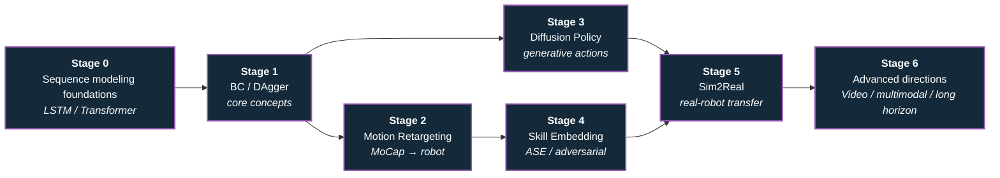

# Imitation Learning and Skill Transfer (Imitation Learning & Skill Transfer)

**At a glance**:

- **Who it's for**: people who want robots to learn skills from human demonstration data.
- **Path**: Stage 0–6 · sequence modeling foundations → BC / DAgger → branch electives (visual manipulation: Diffusion Policy; human skills: retargeting + adversarial skill learning) → deployment and transfer → advanced topics.
- **Depth roadmap**: a branch of the [motion control main roadmap](motion-control.md).

## Roadmap overview

## How to use this path

- The target reader has a deep learning background and wants to understand how robots learn skills from human demonstrations
- The focus is not theoretical proofs but the complete pipeline from data to policy
- Each stage has prerequisites, core questions, what to do, what to read, and what you should be able to produce
- **Branch by task**: for visual manipulation, go Stage 0 → 1 → 3; for human reference to whole-body skills, go Stage 0 → 1 → 2 → 4 and add [RL foundations](depth-rl-locomotion.md). In Stage 5, choose transfer or real-robot deployment checks according to the data source; you do not need to finish the other branch first.

**Relation to the main roadmap:**
- Imitation learning (IL) and reinforcement learning (RL) are combined in many real projects; it is not either-or
- This path and the [RL depth roadmap](depth-rl-locomotion.md) intersect a lot after Stage 3
- If you do not know which one to take, take the IL path first, because it more easily produces tangible results

---

## Stage 0 Deep learning and sequence modeling foundations

**If you are already proficient in PyTorch and have a background in sequence models, you can skip this.**

### Prerequisites
- Proficient in Python
- Understand MLPs, loss, and gradient backpropagation
- Know what supervised learning is

### Core questions
- How to model sequential data (joint angles, MoCap, actions) with neural networks
- What are the core differences among RNN / LSTM / Transformer in sequence modeling
- What role do diffusion models play in generative modeling

### What to do
- Run a demo in PyTorch where an LSTM predicts simple time-series data
- Compare the performance difference between an MLP and an LSTM on a sequential task

### What to read
- "Illustrated Guide to LSTM" (Google Blog)
- [Transformer](../../wiki/concepts/transformer.md) and [Diffusion Model](../../wiki/concepts/diffusion-model.md)
- Run an official Motion Transformer demo end to end (if accessible)

### What you should be able to produce
- Be able to explain why sequential data needs special modeling methods
- Be able to use an LSTM to make predictions on simple sequences

---

## Stage 1 Core concepts of imitation learning

### Prerequisites
- Stage 0 content
- Understand what supervised learning is

### Core questions
- What is the core idea of Behavior Cloning
- Why BC suffers from compounding error (accumulating errors)
- Why DAgger can mitigate compounding error
- What is the fundamental difference between imitation learning and reinforcement learning
- How inverse reinforcement learning (IRL) differs from BC: learning rewards vs learning actions

### What to do
- Use BC to train a simple robot arm to follow demonstrated trajectories
- Compare the effectiveness of BC and DAgger on long-horizon tasks

### What to read
- "A Reduction of Imitation Learning and Stochastic Gradient Descent to Online Learning" (Ross & Bagnell, 2010)
- [Imitation Learning](../../wiki/methods/imitation-learning.md)
- [Behavior Cloning](../../wiki/methods/behavior-cloning.md) and [DAgger](../../wiki/methods/dagger.md)
- [Inverse Reinforcement Learning](../../wiki/methods/inverse-reinforcement-learning.md) — demonstrations → reward → policy; GAIL only matches occupancy
- [RL vs IL comparison](../../wiki/comparisons/rl-vs-il.md)

### What you should be able to produce
- Be able to explain what compounding error is and why it occurs
- Be able to train a usable policy with BC on a simple task

---

## Stage 2 Motion Retargeting (motion transfer)

**This is the core technique of humanoid skill learning: from human motion to robot motion.**

### Prerequisites
- Stage 1 content
- Understand the basics of kinematics and inverse kinematics

### Core questions
- Why human joint angles cannot be mapped directly to the robot (different skeletal structures)
- How to do retargeting with IK or learning-based methods
- What are the pros and cons of the different sources of human motion data (MoCap, VRI, video)
- What post-processing retargeted data still needs (time alignment, resampling, posture constraints)

### What to do
- Take a set of MoCap data and transfer it to a humanoid robot model via IK or a retargeting method
- Observe the feasibility of the transferred motion (joint limits, self-collision, ground penetration)

### What to read
- [Motion Retargeting](../../wiki/concepts/motion-retargeting.md) and [Motion Retargeting Pipeline](../../wiki/concepts/motion-retargeting-pipeline.md)
- [Comparison of GMR vs NMR vs ReACTOR retargeting approaches](../../wiki/comparisons/gmr-vs-nmr-vs-reactor.md)
- [Comparison of humanoid reference motion datasets](../../wiki/comparisons/humanoid-reference-motion-datasets.md)
- "ASE: Adversarial Skill Embeddings" (Peng et al., 2022) — includes a description of the retargeting pipeline

### What you should be able to produce
- A segment of human walking data successfully retargeted onto a humanoid robot model
- First-hand intuition for the problems caused by differences in skeletal structure

---

## Stage 3 Diffusion Policy and generative actions

**Diffusion Policy is a behavior cloning policy that fits the distribution of demonstrated actions with a diffusion model; motion retargeting is not a general prerequisite for it.**

### Prerequisites
- Stage 1 content; if the demonstrations come from humans rather than the target robot, add Stage 2
- Understand the basic principles of diffusion models (you do not need to be able to write one, but you need to understand the denoising process)

### Core questions
- How Diffusion Policy differs from unimodal MSE-regression BC in its assumption about the action distribution
- Why diffusion models perform better in high-dimensional action spaces
- How to combine visual input into a diffusion policy
- How to deal with long diffusion sampling time

### What to do
- Run a simple task with an open-source Diffusion Policy implementation (e.g., RoboDiff, the official Diffusion Policy)
- Compare the effectiveness of diffusion policy and LSTM BC on the same task

### What to read
- "Diffusion Policy: Visuomotor Policy Learning via Action Diffusion" (Chi et al., 2023)
- [Diffusion Policy](../../wiki/methods/diffusion-policy.md)
- [Action Chunking](../../wiki/methods/action-chunking.md) and [BC with Transformer](../../wiki/methods/bc-with-transformer.md) — the core mechanisms of the ACT line
- [Why Action Chunking Improves BC](../../wiki/entities/paper-why-action-chunking-improves-bc.md) (CoRL 2026) — ablations debunk two common hypotheses, "temporal consistency / shorter horizon"; the main sources of chunking gains are delayed-observation conditioning + implicit ensembling; deploying the same policy with Randomized Delay Ensemble matches standard chunk execution, validated on three real-robot tasks
- [Seeker](../../wiki/entities/paper-seeker.md) — frozen DINOv3 + action-supervised ROI, approaching a privileged Oracle without gaze/affordance/stage hints (62.6 vs 64.2), and the same ROI can be reused across RGB/point-cloud modalities; MimicGen 62.6%, xArm real robot in-domain 76.7%/OOD 60.0%; open source under MIT
- [Revisiting Open-Loop Execution](../../wiki/entities/paper-revisiting-open-loop-action-chunking.md) (MIT/Berkeley) — a contrast with the previous entry: the main reason for long open-loop execution horizons is short-context imitation of non-Markovian experts; with enough context, closed-loop reactive execution is actually optimal; proposes a double encoder to stabilize long-context Diffusion Policy

### What you should be able to produce
- An action policy trained with Diffusion Policy
- Be able to explain the advantages of the diffusion process in robot action generation

---

## Stage 4 Skill embedding and adversarial learning

**Once a single skill is learned, how do you get the robot to master multiple skills at once and combine them in new scenarios?**

### Prerequisites
- Stage 1 content and [RL foundations](depth-rl-locomotion.md); add Stage 2 when using human motion capture, and read Stage 3's diffusion policy as needed

### Core questions
- What is skill embedding, and why compress skills into a latent space
- What is the difference between adversarial imitation learning (ASE / AMP) and ordinary BC; GAIL comes from occupancy matching in [IRL](../../wiki/methods/inverse-reinforcement-learning.md) and does not necessarily recover the task reward
- How to do skill interpolation and composition in a latent space
- What behavioral structure skill latents can compress, and why distribution shift and closed-loop error still need to be checked

### What to do
- Understand the method pipeline of ASE
- Run a two-skill interpolation experiment on whatever open-source code you can find

### What to read
- [ASE](../../wiki/methods/ase.md) and [AMP Reward](../../wiki/methods/amp-reward.md)
- [Inverse Reinforcement Learning](../../wiki/methods/inverse-reinforcement-learning.md) — MaxEnt / GAIL / AIRL, the theoretical predecessors of adversarial imitation
- [Learning from Play (LMP)](../../wiki/methods/learning-from-play-lmp.md)
- [Humanoid AMP / Motion Prior survey map](../../wiki/overview/humanoid-amp-motion-prior-survey.md) — a panorama of the AMP family
- [CMP](../../wiki/entities/paper-cmp.md) — uses relevance anchored by high-advantage rollouts + demos to softly reweight the task-agnostic priors of AMP/SMP into a context-conditioned adapter; both return and sample efficiency improve on five tasks, and under reference imbalance AMP drops 11.5% while CMP drops only 2.8%; no official code as of 2026-08-18
- "Learning Latent Plans from Play" (Lynch et al., 2020)

### What you should be able to produce
- Be able to explain the significance of skill embedding
- An intuitive understanding of the role of adversarial learning methods in robot skill learning

---

## Stage 5 Simulation-to-real transfer

**What problems does a policy trained with imitation learning encounter when transferred to a real robot?**

First confirm the data domain: a policy trained in simulation needs Sim2Real validation; a policy trained directly on demonstrations from the target real robot should focus on the deployment interface and generalization to held-out scenarios, without first going through a simulation transfer.

### Prerequisites
- Stage 3 or Stage 4 content, chosen according to the manipulation-policy / whole-body-skill branch
- Understand the basic concept of the sim2real gap

### Core questions
- How to handle the difference between IL training data and the real robot's action space
- How to handle observation space mismatch (camera angle, sensor noise)
- Whether online fine-tuning is useful for IL policies
- How to tell whether an IL policy has "really learned" or is "memorizing demonstrations"

### What to do
- Add action-space noise and observation noise to the policy trained in Stage 3 or Stage 4 and observe robustness; retargeted outputs from Stage 2 must first go through tracking training and cannot be deployed directly as a policy
- For the simulation-training branch, design a simple domain randomization experiment; for the real-robot demonstration branch, check the observation/action interface and latency, and evaluate on held-out objects or placements

### What to read
- [Sim2Real](../../wiki/concepts/sim2real.md)
- [Domain Randomization](../../wiki/concepts/domain-randomization.md)
- [SPD](../../wiki/entities/paper-spd.md) (CoRL 2026, Stanford/MIT/Scale AI) — pretrains a diffusion Transformer on 75 h of on-embodiment demonstrations collected via simulated VR teleoperation; a 56-DoF dual-arm dexterous-hand system needs only 1–2 h of real-robot fine-tuning per task, and beats from-scratch BC on all five tasks

### What you should be able to produce
- A deployment record that states the data domain: the simulation-training branch records the transfer gap, the real-robot demonstration branch records interface alignment and generalization to held-out scenarios
- Be able to design a targeted DR experiment for the simulation-training branch, and distinguish it from real-robot deployment evaluation

---

## Stage 6 Advanced directions

### Prerequisites
- Stage 5 content

**Direction A: Video-based IL**
- Do motion transfer from RGB video rather than MoCap
- Keywords: Pose estimation, Video imitation, [Mimic-Video](../../wiki/methods/mimic-video.md), [WiLoR](../../wiki/methods/wilor.md)

**Direction B: Multi-modal IL**
- Combine vision, touch, and force sensors for multimodal skill learning
- Keywords: multimodal, haptic, [Visuo-tactile fusion](../../wiki/concepts/visuo-tactile-fusion.md)

**Direction C: Long-horizon tasks / VLA**
- Chain multiple skills into a long sequence; drive skill composition with language instructions
- Keywords: task planning, skill chaining, [VLA](../../wiki/methods/vla.md), [π0](../../wiki/methods/π0-policy.md), [χ₀/kai0](../../wiki/entities/paper-kai0.md) (Model Arithmetic + Stage Advantage + Train-Deploy Alignment; π₀.₅ fine-tuned for dual-arm cooperative clothes folding/hanging, about +250% success rate relative to π₀.₅, 24 h of continuous autonomous operation, open source)

**Direction D: Humanoid whole-body motion tracking**
- Whole-body skill tracking such as walking, running, jumping, and balancing
- Keywords: [Whole-Body Tracking Pipeline](../../wiki/concepts/whole-body-tracking-pipeline.md), [BeyondMimic](../../wiki/methods/beyondmimic.md), [Sonic](../../wiki/methods/sonic-motion-tracking.md)
- Advanced policy editing: [RedirectMimic: local motion replacement for whole-body imitation policies](../../wiki/entities/paper-redirectmimic.md) — with the original reference still as input, lets a G1 policy replace a specified upper-limb segment by editing the target reward and resampling windows; validated in simulation only.
- Selection reference: [Query: humanoid motion tracking method selection](../../wiki/queries/humanoid-motion-tracking-method-selection.md)

---

## Quick entry summary

| Stage | Core question | Knowledge page entry |
|------|---------|-----------|
| Stage 0 | Sequence modeling foundations | [Transformer](../../wiki/concepts/transformer.md) |
| Stage 1 | BC / DAgger | [Behavior Cloning](../../wiki/methods/behavior-cloning.md) |
| Stage 2 | Motion Retargeting | [Motion Retargeting Pipeline](../../wiki/concepts/motion-retargeting-pipeline.md) |
| Stage 3 | Diffusion Policy | [Diffusion Policy](../../wiki/methods/diffusion-policy.md) |
| Stage 4 | Skill Embedding | [ASE](../../wiki/methods/ase.md) |
| Stage 5 | Sim2Real | [Sim2Real](../../wiki/concepts/sim2real.md) |

## Relation to other pages

- Full growth roadmap reference: [Main roadmap: motion control → full-stack physical intelligence growth roadmap](motion-control.md)
- Related depth roadmaps (by topical proximity; for the full directory see [Roadmap overview](motion-control.md#depth-optional-index)):
  - [Teleoperation](depth-teleoperation.md) — the main collection entry point for demonstration data
  - [VLA](depth-vla.md) — adding vision–language conditioning on top of an IL backbone
  - [Motion retargeting](depth-motion-retargeting.md) — turning human demonstrations into robot references
  - [Embodied data](depth-embodied-data.md) — cleaning, aggregating, and mixing demonstrations
  - [Contact manipulation](depth-contact-manipulation.md) — the main battleground of IL on fine contact tasks
  - [Model architecture](depth-model-architecture.md) — a cross-cutting view: action-head selection from single-step regression to chunks and diffusion

## References

- [Imitation Learning](../../wiki/methods/imitation-learning.md)
- [Behavior Cloning](../../wiki/methods/behavior-cloning.md)
- [DAgger](../../wiki/methods/dagger.md)
- [Motion Retargeting](../../wiki/concepts/motion-retargeting.md)
- "Diffusion Policy" (Chi et al., 2023)
- "ASE: Adversarial Skill Embeddings" (Peng et al., 2022)
