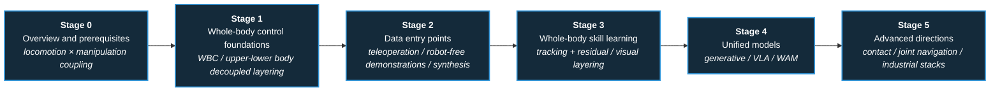

# Mobile Manipulation (Loco-Manipulation)

**At a glance**:

- **Who it's for**: people who want robots to use their hands while walking (carrying boxes, opening doors, holding trays).
- **Path**: Stage 0–5 · locomotion × manipulation coupling → whole-body control foundations → data entry points → whole-body skill learning → unified models (generative / VLA / WAM) → advanced directions.
- **Depth roadmap**: a branch of the [motion control main roadmap](motion-control.md).

## Roadmap overview

## How to use this path

- The target reader has already worked with locomotion and manipulation separately and wants to truly couple the two at the dynamics and control level
- Core mental model: mobile manipulation is not a simple superposition of "locomotion + manipulation" - arm motion disturbs center-of-mass balance, gait vibration disturbs manipulation precision, and the **whole-body coordination layer** is the real protagonist
- Each stage has prerequisites, core questions, what to do, what to read, and what you should be able to produce

**Relation to the main roadmap:**
- This roadmap is a comprehensive application direction after main roadmap L4 (WBC) and L5 (RL / IL), corresponding to the whole-body extension of the L7.3 manipulation layer
- Fine upper-limb contact problems are covered in the [contact manipulation depth roadmap](depth-contact-manipulation.md); this roadmap focuses on "manipulation while moving"
- The high-level semantic interface (understanding "carry the box to the kitchen") depends on the [VLA depth roadmap](depth-vla.md), and whole-body behavior priors depend on the [BFM depth roadmap](depth-bfm.md)

---

## Stage 0 Overview and prerequisites: the coupling of locomotion × manipulation

**First build awareness of the problem: why "optimizing locomotion and manipulation independently and then simply merging them" usually does not work.**

### Prerequisites
- Main roadmap L2–L4 level: understand the basic concepts of floating-base dynamics, centroidal dynamics, and WBC
- Have run a locomotion policy and a tabletop manipulation policy separately (simulation is fine)

### Core questions
- Whole-body dynamics coupling: how arm motion disturbs center-of-mass balance, and how gait disturbs end-effector precision
- Contact-rich and multi-constraint: how to concurrently manage foot–terrain contacts and end-effector–object contacts
- The mobile manipulation task spectrum: what capabilities household / sports / extreme environments / human–robot collaboration each test

### What to do
- In simulation, add a 2 kg handheld payload to a walking humanoid and observe the destabilization modes without compensation
- Go through the 2024–2026 technical routes (hierarchical / generative / VLA / residual / tactile-enhanced) on the task page, and draw your own classification table

### What to read
- [Loco-Manipulation task page](../../wiki/tasks/loco-manipulation.md) — the task map of this roadmap and the main entry point to its technical routes
- [Whole-Body Control](../../wiki/concepts/whole-body-control.md) and [Whole-Body Coordination](../../wiki/concepts/whole-body-coordination.md)
- [Manipulation task map](../../wiki/tasks/manipulation.md) and [Humanoid Locomotion](../../wiki/tasks/humanoid-locomotion.md)
- [ULTRA survey of unified mobile manipulation](../../wiki/tasks/ultra-survey.md)

### What you should be able to produce
- Be able to explain why mobile manipulation is harder than "locomotion + manipulation", and at which layer the difficulty lies
- Given a new paper, be able to judge whether it belongs to the hierarchical, generative, VLA, or residual route

---

## Stage 1 Whole-body control foundations: WBC and upper-lower body decoupled layering

**The most common first step in engineering: the lower body handles balance and walking, the upper body handles manipulation targets, decoupled by an interface in between.**

### Prerequisites
- Stage 0 content
- [RL depth roadmap](depth-rl-locomotion.md) Stage 0–2 level: able to train a locomotion policy in simulation

### Core questions
- Trade-offs between classic layering (HLC gives end-effector targets + LLC executes whole-body) and end-to-end whole-body policies
- The interface design of upper-lower body decoupling in the HOMIE / FALCON line: upper-body joint targets + lower-body velocity/posture commands
- How perception enters the low level: how elevation maps / depth let the LLC keep manipulation stable on stairs and unstructured terrain (PILOT)
- How to combine MPC and RL in force-interaction scenarios (pushing heavy objects, dragging)

### What to do
- Reproduce an open-source upper-lower body decoupled work (e.g., the HOMIE approach): lower-body RL walking + direct tracking of upper-body joints
- Compare the disturbance rejection of the lower-body policy under two curricula: "upper body fixed / upper body random motions"

### What to read
- [HOMIE](../../wiki/entities/paper-loco-manip-161-040-homie.md) and [FALCON](../../wiki/entities/paper-loco-manip-161-109-falcon.md) — anchors of upper-lower body decoupling
- [PILOT](../../wiki/entities/paper-pilot-perceptive-loco-manipulation.md) — a perception-unified low-level LLC
- [AGILE](../../wiki/entities/paper-agile-humanoid-loco-manipulation.md) — NVIDIA Isaac Lab + RSL-RL full-lifecycle workflow (Prepare→Train→Evaluate→Deploy), descriptor-driven Sim2Sim/real-robot I/O; validated on both G1 and Booster T1 across five skill classes including locomotion/recovery/motion imitation/loco-manipulation, with an upper-body expert fine-tuning GR00T N1.5 reaching 90% closed-loop pick&place in simulation; open source
- [Motion base and whole-body tracking (loco-manip 161 classification)](../../wiki/overview/loco-manip-161-category-01-motion-base-wbt.md) and [Upper-body interface](../../wiki/overview/loco-manip-161-category-02-upper-body-interface.md)
- [HTD decoupled WBC](../../wiki/entities/paper-humanoid-touch-dream.md) (CMU/UTA/Bosch, IROS 2026) — the lower-limb + waist controller implementation of [Humanoid Touch Dream](../../wiki/entities/paper-humanoid-touch-dream.md): trains a teacher on a single GPU in Isaac Lab, then distills a deployable student via BC→DAgger, tracking velocity and extreme torso postures and transferring zero-shot to G1; turns "upper-lower body decoupling" from an interface diagram into runnable code (open source under BSD-3-Clause), while VR teleoperation and the upper-level HTD policy are still pending release
- [MPC-WBC integration](../../wiki/concepts/mpc-wbc-integration.md)

### What you should be able to produce
- A hierarchical whole-body control demo of "lower-body walking + upper-body tracking"
- Be able to explain the expressiveness limits of each decoupling interface (joint / end effector / velocity command)

---

## Stage 2 Data entry points: teleoperation, robot-free demonstrations, and synthetic data

**Mobile manipulation data is an order of magnitude more expensive than tabletop manipulation data: whole-body teleoperation, wearable capture, and synthetic generation are the three main entry points.**

### Prerequisites
- Stage 1 content

### Core questions
- The spectrum of whole-body teleoperation schemes: exoskeleton / VR / motion capture, each with its own bandwidth and cost
- How robot-free demonstrations (the UMI line, wearable devices) bypass expensive real-robot collection
- Synthetic data routes: how a single demonstration expands into thousands of trajectories (HumanoidMimicGen), and how 3DGS synthesis replaces teleoperation (LEGS)
- What is still missing in mapping human videos (egocentric) to robot actions

### What to do
- Use a keyboard / VR to teleoperate a humanoid in simulation to "walk over + pick up a box", and feel the interface bandwidth bottleneck
- Read HumanoidMimicGen's skill-segment adaptation pipeline, and draw the data flow diagram of "1 demonstration → 1000 trajectories"

### What to read
- [Teleoperation task page](../../wiki/tasks/teleoperation.md)
- [Data and teleoperation (loco-manip 161 classification)](../../wiki/overview/loco-manip-161-category-07-data-teleop.md) and [Loco-Manip 8-paper data entry technology map](../../wiki/overview/loco-manip-8-papers-technology-map.md)
- [HumanoidMimicGen](../../wiki/entities/paper-humanoidmimicgen.md) and [LEGS](../../wiki/entities/paper-legs-embodied-gaussian-splatting-vla.md)
- [HALOMI](../../wiki/entities/paper-halomi-humanoid-loco-manipulation.md) — active perception + robot-free demonstrations

### What you should be able to produce
- Be able to choose a feasible data collection scheme for a given budget (with / without a real robot, with / without motion capture)
- A comparison note of data entry points for your own task (teleoperation / robot-free demonstrations / synthesis)

---

## Stage 3 Whole-body skill learning: tracking + residual and visual layering

**With data and foundations in place, how to actually learn whole-body skills such as "carrying boxes, opening doors" and transfer them to the real robot.**

### Prerequisites
- Stage 2 content
- [Imitation learning depth roadmap](depth-imitation-learning.md) Stage 2–3 level (retargeting and Diffusion Policy)

### Core questions
- Why a pretrained whole-body prior + object-conditioned residual (ResMimic) is more efficient than training a task policy from scratch
- Visually layered sim2real (VisualMimic): how to split a keypoint-tracking low level + a depth visuomotor high level
- How to adapt online to payload and dynamics changes (SplitAdapter's factorized latent)
- A data-side trick for whole-body imitation: what problem does a full upper-body library + curated lower-body library (CWI) solve

### What to do
- Add an object-conditioned residual task on top of an open-source whole-body tracking base (GMT / SONIC type), and get box carrying working in simulation
- Ablate one by one: remove the pretrained prior, remove the residual, remove object observations, and record which component causes the biggest drop

### What to read
- [ResMimic](../../wiki/entities/paper-resmimic.md) and [VisualMimic](../../wiki/entities/paper-notebook-visualmimic.md)
- [CWI](../../wiki/entities/paper-cwi-composite-humanoid-whole-body-imitation.md) and [CoorDex](../../wiki/entities/paper-coordex-dexterous-humanoid-loco-manipulation.md)
- [SplitAdapter](../../wiki/entities/paper-splitadapter-load-aware-loco-manipulation.md)
- [Whole-Body Tracking Pipeline](../../wiki/concepts/whole-body-tracking-pipeline.md)
- [SMPC-to-RL](../../wiki/entities/paper-smpc2rl-loco-manipulation.md) — simulated SMPC as an interactive expert data machine, sparse-reward offline-to-online FastTD3 on top of a frozen low level; deployable on real Spot box pushing/tire holding and G1 box pushing, with the policy faster than the teacher
- [FetchMan](../../wiki/entities/paper-fetchman.md) — scripted demonstrations from 150k MolmoSpaces scenes → BC → Flow-GRPO breaks through the BC ceiling; zero-shot real G1 loco-manip 73.3%; GitHub placeholder repo (code to be added before 2026-09-01)
- [OCLO](../../wiki/entities/paper-oclo-online-posture-compliant-loco-manipulation.md) — no human motion data: generates pelvis/torso posture online from dual end-effector targets, and achieves whole-body compliance through force-feedback reference offsets
- [ResGAC](../../wiki/entities/paper-resgac-precise-se3-end-effector-tracking.md) — an SE(3) end-effector tracking prior from geometric admittance control (GAC) + residual RL, coordinating arms/legs/waist on G1; 90% success on standing peg-in-hole
- [RoboDuet](../../wiki/entities/paper-roboduet-loco-manipulation.md) — two cooperative policies, locomotion and arm, control a quadruped with an arm, tracking the end-effector 6D pose while moving, and verify zero-shot transfer across similar quadruped platforms
- [WholeBodyMem](../../wiki/entities/paper-wholebodymem.md) — adds object-guided keyframe memory to a humanoid VLA, retaining events before the goal is reached, serving dynamic loco-manipulation

### What you should be able to produce
- A skill policy that can "approach + carry with whole-body contact" in simulation
- A cost–benefit judgment of the two routes "prior + residual" vs "end-to-end from scratch"

---

## Stage 4 Unified models: generative, VLA, and WAM

**The frontier battleground: put vision, language, and whole-body actions into one model, or use a world model to jointly predict the future and actions.**

### Prerequisites
- Stage 3 content
- [VLA depth roadmap](depth-vla.md) Stage 2 level (know the three-part structure of a VLA)

### Core questions
- Where the boundary lies between unified generative routes (diffusion / flow matching over whole-body sequences) and hierarchical routes
- How mobile manipulation WAMs couple "predicting the future" with "dual action heads for locomotion / manipulation" (ABot-M0.5, MotionWAM)
- Why unified whole-body motion tokens let the legs perform task-driven behaviors (pressing pedals, kicking balls)
- What is still missing to extend VLA to whole-body mobile manipulation (data, frequency, safety)

### What to do
- Read the architecture diagrams of MotionWAM / ABot-M0.5, and mark where the information flows of "world prediction" and "action generation" meet
- Run an evaluation of an open-source VLA on a mobile manipulation simulation benchmark (RoboCasa type), and record the failure modes

### What to read
- [VLA and world models (loco-manip 161 classification)](../../wiki/overview/loco-manip-161-category-09-vla-world-models.md)
- [MotionWAM](../../wiki/entities/paper-motionwam-humanoid-loco-manipulation-wam.md) and [ABot-M0.5](../../wiki/entities/paper-abot-m05-mobile-manipulation-wam.md)
- [ω-0](../../wiki/entities/paper-omega-0.md) — a humanoid concurrent loco-manipulation Joint WAM driven by latent-space future observation embeddings, Omni success rate 81.8% on 11 tasks on G1; code, data, and pretrained checkpoint entry points are public, but running it still depends on external model assets ([official README](https://github.com/gentlefress/Omega-0/tree/2ca35a3ff9363c54c9c206ca101cdf58028824cb))
- [Kimodo-Policy](../../wiki/entities/paper-kimodo-policy.md) — a VLA route where a kinematic generative backbone takes visual conditions and measured history, then SONIC executes; when comparing with WAM, first check whether it explicitly predicts world consequences, see [Motion generation Stage 4](depth-motion-generation.md)
- [World Action Models (WAM)](../../wiki/concepts/world-action-models.md) and [VLA](../../wiki/methods/vla.md)
- [Humanoid Loco-Manip 161-paper technology map](../../wiki/overview/humanoid-loco-manip-161-papers-technology-map.md) — a panorama of the order in which ten capability classes formed
- [RoboReact](../../wiki/entities/paper-roboreact.md) — generates human interaction videos from single-frame egocentric RGB-D + language and compiles them into object-centric keyframe skills; at test time it drops the VLM and relies on re-grounding + HOMIE execution; G1 long-horizon dual-arm manipulation averages 81.3% SR over four tasks
- [HAF](../../wiki/entities/paper-haf-humanoid-vla-adaptation.md) — a three-stage hierarchical action flow + SAC in a DCT spectral latent space, adapting a generalist flow-matching VLA to Tiangong whole-body loco-manipulation; average 70.5%, exceeding π₀.₅ (53.3%) and GR00T N1.7 (38.1%)
- [VioLA](../../wiki/entities/paper-viola-human-data-control.md) — paired human/robot action encoders build a shared latent space, the policy predicts body and hand motion latents, and frozen controllers execute them (G1 locomotion 100%, manipulation 88.6%)

### What you should be able to produce
- Be able to draw an architecture comparison diagram of the four routes "hierarchical / generative / VLA / WAM"
- A VLA evaluation and failure-mode analysis on a mobile manipulation benchmark

---

## Stage 5 Advanced directions

### Prerequisites
- Stage 4 content

**Direction A: contact-rich whole-body interaction**
- From "carrying regular boxes" to leaning, vaulting, and multi-point contact interaction
- Keywords: [Loco-Manip five-stage contact chain technology map](../../wiki/overview/loco-manip-contact-technology-map.md), [Contact manipulation depth roadmap](depth-contact-manipulation.md)

**Direction B: joint navigation–manipulation**
- Open-vocabulary mobile manipulation (OVMM): where to navigate to and in what posture to arrive directly determine manipulation success
- Keywords: [3D-IC](../../wiki/entities/paper-3d-ic-joint-navigation-manipulation-planning.md), [Navigation depth roadmap](depth-navigation.md)

**Direction C: tactile and force enhancement**
- Bring contact signals into whole-body policies instead of relying only on vision and proprioception
- Keywords: [Humanoid Transformer with Touch Dreaming](../../wiki/methods/humanoid-transformer-touch-dreaming.md), [Visuo-tactile fusion](../../wiki/concepts/visuo-tactile-fusion.md)

**Direction D: industrial-grade long-horizon autonomy stacks**
- Follow full-system solutions in industry that chain mobile manipulation into long-horizon tasks
- Keywords: [Flexion Reflect v1.0](../../wiki/entities/flexion-reflect-v1.md), [Curr-0](../../wiki/entities/current-robotics-curr0.md)

---

## Quick entry summary

| Stage | Core question | Knowledge page entry |
|------|---------|-----------|
| Stage 0 | Locomotion × manipulation coupling | [Loco-Manipulation task page](../../wiki/tasks/loco-manipulation.md) |
| Stage 1 | Whole-body control foundations | [HOMIE](../../wiki/entities/paper-loco-manip-161-040-homie.md) |
| Stage 2 | Data entry points | [Loco-Manip 8-paper data entry technology map](../../wiki/overview/loco-manip-8-papers-technology-map.md) |
| Stage 3 | Whole-body skill learning | [ResMimic](../../wiki/entities/paper-resmimic.md) |
| Stage 4 | Unified models | [Humanoid Loco-Manip 161-paper technology map](../../wiki/overview/humanoid-loco-manip-161-papers-technology-map.md) |
| Stage 5 | Advanced directions | [Loco-Manip five-stage contact chain technology map](../../wiki/overview/loco-manip-contact-technology-map.md) |

## Relation to other pages

- Full growth roadmap reference: [Main roadmap: motion control → full-stack physical intelligence growth roadmap](motion-control.md)
- Related depth roadmaps (by topical proximity; for the full directory see [Roadmap overview](motion-control.md#depth-optional-index)):
  - [RL locomotion](depth-rl-locomotion.md) — the walking foundation
  - [Contact manipulation](depth-contact-manipulation.md) — contact forces and IL on the manipulation side
  - [Teleoperation](depth-teleoperation.md) — a common entry point for upper-lower body decoupled data collection
  - [Navigation](depth-navigation.md) — the boundary between point-to-point movement and whole-body coordination

## References

- [Loco-Manipulation task page](../../wiki/tasks/loco-manipulation.md) and [Humanoid Loco-Manip 161-paper technology map](../../wiki/overview/humanoid-loco-manip-161-papers-technology-map.md)
- "Coordinating Locomotion and Manipulation of a Mobile Manipulator" (Yamamoto & Yun, 1994) — the starting point of coordinated control for mobile manipulation
- "HOMIE: Humanoid Loco-Manipulation with Isomorphic Exoskeleton Cockpit" (2025) — representative of upper-lower body decoupling and teleoperation data entry
- "ResMimic: Residual Learning for Whole-Body Loco-Manipulation" (2025, arXiv:2510.05070) — representative of the prior + residual route
