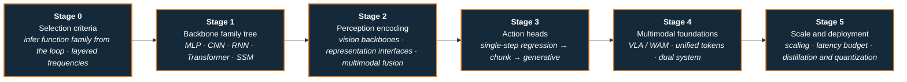

# Model Architecture (Model Architecture)

**At a glance**:

- **Who it's for**: people who want to know what network a robot policy should use, how wide and deep it should be, and how actions are produced.
- **Path**: Stage 0–5 · selection criteria → backbone family tree → perception encoding → action heads → multimodal foundations → scale and deployment.
- **Depth roadmap**: a branch of the [motion control main roadmap](motion-control.md); together with the [embodied data depth roadmap](depth-embodied-data.md) it forms a sister pair of "what to feed / what to hold it in".

## Roadmap overview

## How to use this path

- The target reader can already train a policy, but every time they read the "network architecture" paragraph in a paper's Method section, they can only copy it verbatim - this roadmap strings together the architecture knowledge scattered across concept pages, method pages, and comparison pages into a chain you can make selections from
- This roadmap answers **"what function family should hold this mapping"**; it does not answer "what data to feed" (that is the [embodied data depth roadmap](depth-embodied-data.md)), "what objective to train with" (that is the [RL locomotion](depth-rl-locomotion.md) and [imitation learning](depth-imitation-learning.md) depth roadmaps), or "how to prove it is better" (that is the [embodied evaluation depth roadmap](depth-embodied-eval.md))
- **The most common mistake is treating architecture as the main bottleneck**: the strongest low-level policies on real humanoids are still often MLPs with 2–3 layers and widths of 256–512; the bottlenecks are in observations, latency, actuators, and transfer. Stage 0 nails down this judgment first, so the later Stages do not turn into "chasing the newest backbone"
- Architecture choices are almost always constrained in reverse by **control frequency and latency budget**: in the same stack, the slow semantic layer can be a VLM with billions of parameters, while the fast tracking layer must finish within milliseconds
- Each stage has prerequisites, core questions, what to do, what to read, and what you should be able to produce

**Relation to the main roadmap:**
- This roadmap cuts across main roadmap L5 (RL and imitation learning) through L7 (exit layer): before L5, first close the loop with a small MLP, and reading Stage 0–1 is enough; go through Stage 2–4 when you get to manipulation, language conditioning, and foundation models
- The starting point is **backpropagation (Rumelhart et al., Nature 1986)** - only once multi-layer networks became trainable did "which function family to choose" first become an engineering problem
- The relation to the three depth roadmaps [VLA](depth-vla.md), [BFM](depth-bfm.md), and [WAM](depth-wam.md) is "cross-cutting vs in-depth": those three cover what problems a class of models solves, while this roadmap covers how the structural components inside these models are chosen, assembled, and squeezed into the latency budget

---

## Stage 0 Selection criteria: infer the function family from the control loop

**First write down "which layer this network sits in, how often it is called, and whether its inputs are available at deployment", then talk about backbones; do it in reverse and you get a beautiful model that cannot fit into the control loop.**

### Prerequisites
- Python + PyTorch, able to run a training and inference pass end to end
- Know what the closed loop of an RL / IL policy looks like (observation → network → action → environment)
- Have an intuition for the difference between PD control, joint targets, and torque commands

### Core questions
- Which of the three layers does this network belong to: **brain (what to do) / cerebellum (how to do it) / spinal cord (staying safe)**? Latency budgets differ by two to three orders of magnitude between layers
- Which inputs are **available at deployment**, and which are **privileged information available only in training**? The latter decides whether you need a teacher–student two-network structure
- Is the output a single-step joint target, an action chunk, or a token sequence? Once the action representation changes, the backbone and decoder all have to change with it
- Why "bigger models are stronger" has long not held for humanoid low-level control - the bottleneck is more often in observations, rewards, actuators, and sim2real

### What to do
- Draw a **layered frequency table** for the task at hand: each layer's call period, input sources, allowed worst-case inference latency, and fallback action on failure
- Take 3 papers in this direction, read only the architecture paragraphs of the Method sections, and copy layers / width / activation / history length / action horizon into a comparison table

### What to read
- [Network architectures for humanoid and legged policies](../../wiki/concepts/humanoid-policy-network-architecture.md) — the master outline of this roadmap: a generational comparison table from shallow MLPs, AMP discriminators, and MoE to Transformer/Diffusion chunks and VLA/WAM
- [Observation inputs for humanoid locomotion policies](../../wiki/concepts/humanoid-policy-observation-inputs.md) — five classes of inputs classified by "available at deployment or not", which determines the input-side design of the architecture
- [Embodied three-layer control architecture](../../wiki/concepts/embodied-three-layer-control-architecture.md) — latency budgets and failure fallbacks for brain / cerebellum / spinal cord
- [Decoupling control frequency and inference frequency](../../wiki/concepts/control-inference-frequency-decoupling.md) — three classes of interfaces between a low-frequency policy and a high-frequency execution loop
- [Neural feedback controller](../../wiki/concepts/neural-feedback-controller.md) — read the policy as a state-feedback law $\pi(x)$ and build intuition for inference compute
- [Deep learning foundations](../../wiki/concepts/deep-learning-foundations.md) · [Backpropagation](../../wiki/concepts/backpropagation.md) — the foundation of function approximation and differentiable computation graphs

### What you should be able to produce
- A layered frequency table for your own scenario (layer × period × inputs × latency ceiling × fallback)
- A one-sentence judgment: is the real bottleneck of this task architectural expressiveness, or observations / rewards / transfer

---

## Stage 1 Backbone family tree: MLP / CNN / RNN / Transformer / SSM

**The differences among the four backbone classes can be compressed into three dimensions - inductive bias, long-range dependencies, and inference complexity; selection means matching the task and latency budget along these three dimensions.**

### Prerequisites
- Stage 0 content
- Able to hand-write an MLP policy and train it to convergence

### Core questions
- Trading inductive bias for compute: the locality and weight sharing of CNNs still win on small data / edge deployment; the weak bias of attention has to be paid back with data volume
- Four ways to handle long-range dependencies: RNN recurrence, deep CNN stacking, direct interaction via attention, and selective SSM state compression; at fixed width, RNN/SSM scanning a whole sequence is usually near-linear in length $n$, while dense full-sequence attention grows as $n^2$. Deployment must also distinguish full recomputation from cached incremental inference; whole-sequence complexity cannot be taken directly as the cost of a single control step
- How should historical observations enter the network: frame stacking, GRU/LSTM hidden states, or a context window? This directly determines the complexity of state management at deployment
- Why winning a benchmark does not mean winning onboard - operator maturity, memory bandwidth, and quantization friendliness are real constraints

### What to do
- Using the four-dimension table in [RNN vs CNN vs Transformer vs Mamba](../../wiki/comparisons/rnn-cnn-transformer-mamba.md), pick a backbone for each of your two scenarios (high-frequency proprioceptive control, manipulation with images) and write down the reasons
- On the same task, train one version each of a "frame-stacked MLP" and a "small Transformer", and compare sample efficiency and per-step inference time

### What to read
- [RNN vs CNN vs Transformer vs Mamba](../../wiki/comparisons/rnn-cnn-transformer-mamba.md) — a comparison of the four backbone classes on long range / parallelism / complexity / inductive bias
- [Transformer](../../wiki/concepts/transformer.md) · [Multi-head attention](../../wiki/concepts/multi-head-attention.md) — the general foundation of modern backbones and their core interaction operator
- [Positional encoding: absolute, RoPE, NoPE, and relative bias](../../wiki/concepts/positional-encoding.md) — compare GPT-2, sinusoidal encoding, RoPE rotation, and modern hybrid layers to understand long-sequence order modeling, implementation details, and extrapolation limits
- [Convolutional neural networks](../../wiki/concepts/convolutional-neural-network.md) · [Channel and spatial attention](../../wiki/methods/channel-spatial-attention.md) — the convolutional route and attention enhancements before Transformers
- [State space models (SSM)](../../wiki/concepts/state-space-model-ssm.md) — how selective SSMs obtain long-range capability at near-linear complexity
- [U-Net](../../wiki/methods/unet.md) — encoder–decoder + skip connections, later a common denoising backbone for diffusion policies
- [Comparison of deep learning optimizers](../../wiki/comparisons/deep-learning-optimizers.md) — switching backbones often requires switching the optimizer and learning-rate schedule as well

### What you should be able to produce
- A four-dimension selection table of "inductive bias × long range × parallelism × inference complexity" that you can fill in directly for a new backbone
- A set of latency numbers you measured yourself: per-step time of an MLP / small Transformer on the target hardware at the same input dimension

---

## Stage 2 Perception encoding: vision backbones and representation interfaces

**There are two architectural decisions on the perception side: which backbone to extract features with, and in what form those features are handed to the policy - the latter often matters more for success than the former.**

### Prerequisites
- Stage 1 content
- Have run image classification / detection or segmentation training once, and know the division of labor between backbone and head

### Core questions
- CNN or ViT: small data and high-throughput onboard deployment vs large-scale data and global attention; the criteria are data volume, resolution throughput, and the downstream task
- Three routes for the representation interface: end-to-end joint training, a frozen pretrained backbone, and robot-specific pretrained representations (R3M / VC-1 / DINOv2) - a three-way trade-off between sample efficiency and domain gap
- The representation a policy really needs is often unreadable: in perceptive locomotion, the encoder outputs a terrain summary vector, not a visualizable height map
- How to merge multiple modalities: semantic alignment for vision + language and spatiotemporal alignment for vision + touch each have different fusion positions (early fusion / late fusion / cross-attention)
- Token count is a hidden latency knob: resolution, patch size, and number of views all multiply directly into attention cost

### What to do
- On the same manipulation task, compare "frozen DINOv2 features + small policy head" against "end-to-end small CNN", recording sample efficiency and overfitting behavior
- Count the token budget of your vision stack: number of views × number of patches × number of history frames, and compute the theoretical cost of the attention part

### What to read
- [Vision backbones](../../wiki/concepts/vision-backbones.md) · [Vision Transformer](../../wiki/concepts/vision-transformer.md) · [CNN vs ViT backbone selection](../../wiki/comparisons/cnn-vs-vit-backbones.md)
- [Visual representations for policies](../../wiki/concepts/visual-representation-for-policy.md) — trade-offs among the three routes: end-to-end / frozen backbone / robot-specific representations
- [Segment Anything](../../wiki/entities/paper-segment-anything.md) — use promptable masks to understand the output interface of vision foundation models, and distinguish prompt latency after caching the image encoding from the whole perception chain.
- [OV-SAM3D](../../wiki/entities/ov-sam3d.md) · [OVO](../../wiki/entities/ovo-semantic-mapping.md) · [2D→3D semantic lifting gap](../../wiki/concepts/2d-to-3d-semantic-lifting-gap.md) — compare offline multi-view lifting with online semantic maps, and check how pose, identity association, and asynchronous updates change the policy input.
- [Terrain latent representation](../../wiki/concepts/terrain-latent-representation.md) — the encoder output need not be readable, it only has to support correct foot placement
- [Generative vision pretraining](../../wiki/concepts/generative-vision-pretraining.md) · [Trends in vision foundation models](../../wiki/concepts/visual-foundation-model-trends.md)
- [Multimodality basics](../../wiki/concepts/multimodality-basics.md) · [Vision–language feature fusion](../../wiki/concepts/vision-language-feature-fusion.md) · [Visuo-tactile fusion](../../wiki/concepts/visuo-tactile-fusion.md)
- [Six spatial representations in embodied perception](../../wiki/concepts/embodied-perception-six-spatial-representations.md) — what question each of 2D / depth / point cloud / occupancy / semantic / implicit answers
- [Vision backbone knowledge-chain hub](../../wiki/overview/hub-vision-backbone.md) — the full chain from backbone → detection/segmentation head → policy input
- [VisionHOPE](../../wiki/entities/paper-visionhope.md) — VisionHOPE builds the vision backbone as a self-modifying learning system so that memory and update rules co-evolve, and uses stability control and four-directional scanning on 2D feature maps.

### What you should be able to produce
- A perception-side selection record: backbone, frozen or not, feature dimension, token budget, and measured throughput
- Be able to state what representation your policy actually "sees", and where it breaks first under domain shift

---

## Stage 3 Action heads: from single-step regression to action chunks and generative policies

**The structure of the output side determines behavior more than the input side: a single-step Gaussian regression averages multimodal demonstrations into a middle value, and action chunks and generative heads exist to solve exactly this.**

### Prerequisites
- Stage 2 content
- Have trained behavior cloning once and seen the phenomenon "the demonstrations contain two ways of moving, and the policy learns the one in between"

### Core questions
- Why single-step deterministic / unimodal Gaussian heads collapse on human demonstrations, and how diffusion and flow-matching heads express multimodal action distributions
- The two things action chunking solves: long-horizon error accumulation, and the temporal mismatch between slow inference and fast control
- Two semantics of rolling execution that must not be confused: predicting a segment, executing only a prefix, and then replanning (receding horizon), versus temporally ensembling overlapping action sequences (ACT's temporal ensemble)
- Training-time architecture ≠ deployment-time architecture: teacher–student and asymmetric actor–critic make privileged information appear only on the training side
- How to hold multiple skills: multi-expert / MoE gating is a readable skill-decomposition baseline, and it is a different route from "one large backbone + conditional input"

### What to do
- On a task with multimodal demonstrations, swap the action head from single-step regression to a diffusion head (or flow-matching head), and compare success rate and action smoothness
- Sweep chunk length and executed-prefix ratio, plot three curves of "success rate / latency / jitter", and determine the operating point for your scenario

### What to read
- [Behavior cloning](../../wiki/methods/behavior-cloning.md) · [Transformer behavior cloning](../../wiki/methods/bc-with-transformer.md) — the first jump from MLP heads to sequence backbones
- [Action Chunking](../../wiki/methods/action-chunking.md) — a mechanistic breakdown of outputting multiple steps at once: delayed-observation conditioning and implicit ensembling
- [StarVLA-α](../../wiki/entities/paper-starvla-alpha.md) — with backbone, data, and training budget fixed, compares MLP, discrete autoregressive, and continuous generative heads to judge the benefit of extra action-head structure.
- [Rolling execution](../../wiki/concepts/receding-horizon-policy-execution.md) — the difference between receding horizon and temporal ensemble
- [Diffusion models](../../wiki/concepts/diffusion-model.md) · [Diffusion Policy](../../wiki/methods/diffusion-policy.md) — the expressiveness and cost of generating action sequences by multi-step denoising
- [Privileged training](../../wiki/concepts/privileged-training.md) · [Teacher–Student and DAgger training](../../wiki/methods/teacher-student-dagger-training.md) — two-network structures and distillation
- [AMP reward](../../wiki/methods/amp-reward.md) — the discriminator is also a network to be designed: it takes state transitions as input, and width/depth are strongly tied to stability
- The multi-expert / MoE section of [Network architectures for humanoid and legged policies](../../wiki/concepts/humanoid-policy-network-architecture.md)

### What you should be able to produce
- An action-head decision record: action representation, chunk length, executed prefix, number of inference steps, and measured control bandwidth
- Be able to explain which layer your policy's jitter comes from: the action-head distribution, chunk stitching, or the downstream tracker

---

## Stage 4 Multimodal foundations: VLA / WAM structural components and dual systems

**At this layer, the architecture question becomes "how to connect a pretrained VLM to a robot": the tokenization scheme, the form of the action head, and how slow and fast models divide the work.**

### Prerequisites
- Stage 3 content
- Understand the input/output form of a VLM (image patch tokens + text tokens → autoregressive decoding)

### Core questions
- Unified tokenization: visual patches, language tokens, and discretized actions are encoded into the same embedding space, buying the simplicity of pure sequence modeling at the cost of action discretization precision and sequence length
- Two routes for the action head: autoregressive decoding of discrete action tokens vs continuous flow / diffusion action heads; the former reuses the VLM's decoding stack, the latter gives better action precision and smoothness
- Backbone strength vs head complexity: a strong VLM base with a simple MLP action head can also achieve very strong control performance, suggesting that a "fancy head" is not necessarily where the gains come from
- Readout heads and cross-embodiment adaptation: block-wise attention + independent readout heads allow new cameras and new action spaces to be plugged in few-shot
- Dual system / slow–fast layering: low-frequency semantic reasoning + high-frequency tracking execution; is the interface between the two models an action chunk, a subgoal, or a residual
- WAM merges future prediction into the backbone: an extra stream of video / latent-space supervision during training; whether it still generates the future at inference time is the watershed for latency

### What to do
- Pick 3 open-source VLAs (e.g., the RT series, Octo, the π₀ family), and draw a four-part structure diagram for each: "input token composition → backbone → action head → output frequency"
- Write an integration judgment table for your platform: can it tolerate a 5–10 Hz semantic layer, and who provides the low-level tracker

### What to read
- [VLA](../../wiki/methods/vla.md) · [Robotics Transformer (RT series)](../../wiki/methods/robotics-transformer-rt-series.md) — the baseline lineage from language-conditioned sequence prediction to VLM integration
- [Unified multimodal tokens](../../wiki/methods/unified-multimodal-tokens.md) — the architectural trend of encoding vision / language / action into the same space
- [Octo](../../wiki/methods/octo-model.md) — block-wise attention Transformer + independent readout heads, few-shot adaptation to new cameras and action spaces
- [π₀](../../wiki/methods/π0-policy.md) · [π₀.₇](../../wiki/methods/pi07-policy.md) — flow-matching action heads and multimodal prompts for aligning heterogeneous data
- [StarVLA method entry](../../wiki/methods/star-vla.md) · [Framework paper](../../wiki/entities/paper-starvla-framework.md) — decouples backbone, action head, data adaptation, and evaluation serving; read separately from the α controlled baseline in Stage 3.
- [Foundation Policy](../../wiki/concepts/foundation-policy.md) · [Behavior foundation model (BFM)](../../wiki/concepts/behavior-foundation-model.md) — two classes of foundations: manipulation-oriented and whole-body-control-oriented
- [World Action Models](../../wiki/concepts/world-action-models.md) · [Latent imagination](../../wiki/concepts/latent-imagination.md) — structural changes once future prediction enters the backbone
- [Taxonomy of VLM / VLN / VLA / VLX / world models](../../wiki/comparisons/vlm-vln-vla-vlx-world-model-taxonomy.md) · [Embodied foundation model selection loop hub](../../wiki/overview/hub-embodied-foundation-model.md)

### What you should be able to produce
- Structural breakdown diagrams of three mainstream VLAs, able to point out each one's token budget and latency sources
- A layered plan for your own platform: semantic-layer model size and frequency, low-level tracker interface, and fallback path on failure

---

## Stage 5 Scale, efficiency, and deployment: keeping the structure alive within the latency budget

**The final test of an architecture is not in the paper's tables but on the onboard chip: parameter count, token count, and denoising steps all ultimately convert into a control bandwidth.**

### Prerequisites
- Stage 4 content
- Have deployed a model to an onboard device once (any of the ONNX / TensorRT / MNN paths)

### Core questions
- Where to add scale: parameters, data, or embodiment diversity? The range over which power laws hold on embodied data, and known counterexamples
- The reachable boundary of real-time ↔ generalization: model size, multimodal span, and world-model rollout horizon jointly determine inference latency, which in turn determines control bandwidth
- The compression toolkit of four: distillation, quantization, operator substitution, and asynchronous execution - what each sacrifices (precision / smoothness / worst-case latency)
- Deployment stack selection: ONNX as the format contract, ORT / TensorRT / MNN chosen by hardware and operator coverage; quantization friendliness in turn influences backbone choice
- Adapt rather than retrain: how low-rank adaptation such as LoRA modifies dynamics-sensitive modules with a tiny number of parameters
- Architecture is not only in the policy: an actuator network stuffs motor nonlinearities into a small network, a typical place for "using a network to compensate for model error"
- After going live: release weights and firmware on separate channels, sign and verify, A/B and roll back - treat the model as a versioned artifact that can be reverted

### What to do
- Do a latency attribution for your stack: how many milliseconds each of perception encoding / backbone forward pass / action-head denoising / communication takes, and find the real big-ticket item
- Pick one compression path (distillation or quantization) and run an A/B: record success rate, action smoothness, and worst-case latency, rather than only average latency

### What to read
- [AIInfraGuide: full-stack AI Infra learning guide](../../wiki/entities/aiinfraguide.md) — a layered profiling route from single-GPU kernels, memory, and multi-GPU communication to inference scheduling, used to add performance evidence to architecture selection
- [Embodied scaling laws](../../wiki/concepts/embodied-scaling-laws.md) — power-law relationships among data / parameters / generalization and their limits
- [Real-time vs generalization trade-off](../../wiki/concepts/embodied-fm-latency-generalization-tradeoff.md) — how scale and rollout horizon squeeze control bandwidth
- [ONNX Runtime vs MNN vs TensorRT](../../wiki/comparisons/onnxruntime-vs-mnn-vs-tensorrt.md) — onboard inference stack selection
- [LoRA](../../wiki/concepts/lora.md) — low-rank adaptation for low-cost module-level fine-tuning of large models
- [Actuator network](../../wiki/methods/actuator-network.md) — another place where networks land on the sim2real chain
- [Embodied foundation models and embodiment co-design](../../wiki/concepts/embodied-foundation-model-hardware-codesign.md) — layered frequencies and the authority to define the embodiment
- [Edge–cloud collaboration](../../wiki/concepts/edge-cloud-robotics.md) · [Model versioning and OTA](../../wiki/concepts/model-versioning-ota.md) — engineering constraints on the go-live and rollback side

### What you should be able to produce
- A latency attribution report and a three-metric comparison before and after compression (success rate / smoothness / worst-case latency)
- A one-sentence conclusion: on the current hardware, what determines the architectural ceiling of this stack - memory, bandwidth, denoising steps, or communication

---

## Quick entry summary

| Stage | Core question | Knowledge page entry |
|------|---------|-----------|
| Stage 0 | Infer the function family from the control loop | [Network architectures for humanoid and legged policies](../../wiki/concepts/humanoid-policy-network-architecture.md) |
| Stage 1 | Backbone family tree and three-dimension selection | [RNN vs CNN vs Transformer vs Mamba](../../wiki/comparisons/rnn-cnn-transformer-mamba.md) |
| Stage 2 | Perception encoding and representation interfaces | [Visual representations for policies](../../wiki/concepts/visual-representation-for-policy.md) |
| Stage 3 | Action heads and action chunks | [Action Chunking](../../wiki/methods/action-chunking.md) · [Diffusion Policy](../../wiki/methods/diffusion-policy.md) |
| Stage 4 | Structural components of multimodal foundations | [Unified multimodal tokens](../../wiki/methods/unified-multimodal-tokens.md) · [VLA](../../wiki/methods/vla.md) |
| Stage 5 | Scale, latency, and deployment | [Real-time vs generalization trade-off](../../wiki/concepts/embodied-fm-latency-generalization-tradeoff.md) |

## Relation to other pages

- Full growth roadmap reference: [Main roadmap: motion control → full-stack physical intelligence growth roadmap](motion-control.md)
- Related depth roadmaps (by topical proximity; for the full directory see [Roadmap overview](motion-control.md#depth-optional-index)):
  - [VLA](depth-vla.md) — the full expansion of this roadmap's Stage 4 structural components in the semantic-policy direction
  - [WAM](depth-wam.md) — the two main structural lines, Cascaded / Joint, after merging future prediction into the backbone
  - [BFM](depth-bfm.md) — backbone and skill-space design for whole-body-control foundations
  - [Imitation learning](depth-imitation-learning.md) — how action heads pair with data forms
  - [Embodied data](depth-embodied-data.md) — architectural capacity must be backed by data supply; each caps the other
  - [Embodied evaluation](depth-embodied-eval.md) — architectural changes must be falsified by layered evaluation, not just a single success rate

## References

- [Network architectures for humanoid and legged policies](../../wiki/concepts/humanoid-policy-network-architecture.md) — the generational evolution table and the judgment that "the low level is still a small MLP"
- [RNN vs CNN vs Transformer vs Mamba](../../wiki/comparisons/rnn-cnn-transformer-mamba.md) — three-dimension backbone comparison
- [Visual representations for policies](../../wiki/concepts/visual-representation-for-policy.md) and [Vision backbone knowledge-chain hub](../../wiki/overview/hub-vision-backbone.md) — perception-side interfaces
- [Action Chunking](../../wiki/methods/action-chunking.md) and [Rolling execution](../../wiki/concepts/receding-horizon-policy-execution.md) — output-side structure
- [Unified multimodal tokens](../../wiki/methods/unified-multimodal-tokens.md) and [Embodied foundation model selection loop hub](../../wiki/overview/hub-embodied-foundation-model.md) — multimodal foundations
- [Real-time vs generalization trade-off](../../wiki/concepts/embodied-fm-latency-generalization-tradeoff.md) and [Embodied scaling laws](../../wiki/concepts/embodied-scaling-laws.md) — scale and latency limits
- Rumelhart, Hinton & Williams, *Learning representations by back-propagating errors*, Nature 1986 — the starting milestone of this roadmap ([archive](../../sources/papers/rumelhart_backprop_learning_representations_nature_1986.md))
