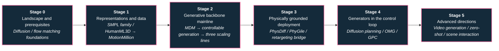

# Motion Generation

**At a glance**:

- **Who it's for**: people who want to use generative models to create human and humanoid motion from text / multimodal inputs.
- **Path**: Stage 0–5 · Generative model foundations → motion representations and datasets → generative backbones (MDM → three scaling lines) → physically grounded deployment → generators inside the control loop → advanced directions.
- **Depth roadmap**: a branch of the [motion control main roadmap](motion-control.md); forms a sister roadmap pair with the [motion retargeting depth roadmap](depth-motion-retargeting.md): "creating motion / landing it on the robot".

## Roadmap overview

## How to use this path

- The target readers have a deep learning background and want to "turn a piece of text/video/constraints into a motion"; this covers both human motion synthesis and producing reference motions and online plans for humanoid robots
- Motion generation addresses **where reference motions come from**: mocap cannot capture everything and is costly, so generative models change the supply of reference motions from "use only what you recorded" to "make whatever you need"; but keep the hard constraint in mind: **generated output is at the kinematic level and is not the same as physically feasible robot commands**
- Each stage has prerequisites, core questions, what to do, what to read, and what you should be able to produce

**Relation to the main roadmap:**
- This roadmap is a "data and planning side" advanced direction after main-roadmap L5 (RL and imitation learning); generated outputs reach real robots only via the [motion retargeting depth roadmap](depth-motion-retargeting.md) and trackers (the SONIC / BeyondMimic line)
- It complements the [BFM depth roadmap](depth-bfm.md) on "motion priors": BFM compresses behavior priors into policy weights, while motion generation places behavior priors in an explicit kinematic trajectory layer
- If the ultimate goal is "language instruction → full humanoid execution", Stages 3–4 of this roadmap and the hierarchical interface design in the [VLA depth roadmap](depth-vla.md) corroborate each other

---

## Stage 0 Generative model foundations and the motion generation landscape

**First set up the mathematical skeleton of diffusion and flow matching, then move into the method lineage; otherwise every paper's "new sampler" will look like a new paradigm.**

### Prerequisites
- Fluent in Python + PyTorch
- Understand probability basics and neural network training

### Core questions
- What the denoising process and training objective of diffusion models are, and why they suit multimodal motion data
- The relationship between flow matching and diffusion: what deterministic ODE sampling buys you
- Where motion generation sits in the robot stack: offline data engine vs online reference planner

### What to do
- Hand-write a minimal diffusion model on a 2D toy distribution and observe the denoising trajectories
- Read the probability flow formalization page and derive the "SDE → probability flow ODE" equivalence

### What to read
- [Diffusion Model](../../wiki/concepts/diffusion-model.md) — the main entry point for generative foundations
- [Probability Flow](../../wiki/formalizations/probability-flow.md) — the mathematical skeleton of flow matching
- [Diffusion-based Motion Generation](../../wiki/methods/diffusion-motion-generation.md) — the motion generation overview page
- [Awesome Text-to-Motion](../../wiki/entities/awesome-text-to-motion-zilize.md) — a paper map of the field

### What you should be able to produce
- Derive the diffusion training objective and sampling process
- Explain the difference in technical requirements between the two uses, "offline data engine" and "online planner"

---

## Stage 1 Motion representations and datasets

**Representation sets the ceiling: every choice of SMPL-family parameters, joint rotations, and contact labels propagates to generation quality and downstream usability.**

### Prerequisites
- Stage 0 content
- Know human skeletons and rotation representations (see Stage 1 of the [motion retargeting depth roadmap](depth-motion-retargeting.md))

### Core questions
- The differences among the SMPL / SMPL-H / SMPL-X representation family, and why it became the de facto standard for text-motion data
- What the HumanML3D 263-dim representation contains, and why HY-Motion deliberately abandons it
- The lineage of text-motion datasets: how scale and annotation evolved from KIT-ML → HumanML3D → BABEL → Motion-X → MotionMillion
- The effect of foot contact labels and root trajectory representation on generation quality

### What to do
- Load one HumanML3D sample and parse the 263-dim representation segment by segment into root trajectory / joint positions / contact labels
- Compare the text annotation styles of two datasets, and think about why an "LLM rewriter" has become a standard part of generation pipelines

### What to read
- [HumanML3D](../../wiki/entities/dataset-bfm-humanml3d.md), [KIT-ML](../../wiki/entities/dataset-bfm-kit-ml.md), [BABEL](../../wiki/entities/dataset-bfm-babel.md) — the text-motion data foundation
- [Motion-X](../../wiki/entities/dataset-bfm-motion-x.md) and [PoseScript](../../wiki/entities/dataset-bfm-posescript.md) — extensions in scale and fine-grained annotation
- [Go to Zero / MotionMillion](../../wiki/entities/paper-notebook-go-to-zero-towards-zero-shot-motion-generation-w.md) — million-scale data and zero-shot evaluation
- [Human Motion paper category page](../../wiki/overview/paper-notebook-category-14-human-motion.md)

### What you should be able to produce
- Read and write SMPL-family motion data and parse the mainstream representation formats
- A dataset selection table (scale / annotation / license / retargeting readiness)

---

## Stage 2 Generative backbone mainline: from MDM to three scaling lines

**One mainline: diffusion brought text-to-motion generation into the mainstream, and controllability and scaling pushed it toward engineering usability.**

### Prerequisites
- Stage 1 content

### Core questions
- How MDM-style motion diffusion applies the denoising process to skeleton sequences
- The mechanism family of controllable generation: GMD's guided diffusion, OmniControl's arbitrary-joint spatiotemporal constraints, keyframe completion via in-betweening
- Tradeoffs among the three scaling lines: HY-Motion (billion-scale flow matching DiT + DPO/Flow-GRPO alignment), GENMO (unified dual-mode estimation and generation), Kimodo (two-stage root/body denoising + strongly constrained controllability); for the **interactive real-time tier** see also [ARDY](../../wiki/entities/ardy.md) (autoregressive hybrid-representation diffusion + streaming text and long-horizon waypoints)
- What problems alignment and post-training (DPO / Flow-GRPO) solve in motion generation

### What to do
- Run an inference demo of an open-source text-to-motion model (HY-Motion or the MDM family) end to end, and observe the diversity for the same prompt
- Study the three-line comparison page closely, and for each of three scenarios, "data engine / video-driven / director-style editing", pick a backbone and justify the choice

### What to read
- [HY-Motion 1.0](../../wiki/methods/hy-motion-1.md), [GENMO](../../wiki/methods/genmo.md), [Kimodo](../../wiki/entities/kimodo.md) — the three scaling lines
- [Cartwheel Swing Choreo](../../wiki/entities/cartwheel-swing-choreo.md) — Swing Choreo is Cartwheel's commercial text-to-human-motion generation model, good at generating compound actions in sequence, finger and facial performance, and multi-person interaction; it can be used in animation workflows via Performance Generation/API, and the model weights and inference implementation are not public.
- [MotionSpaceFlow](../../wiki/entities/paper-motionspaceflow.md) — full-resolution motion-space flow matching without a motion codec; validated on HumanML3D / SnapMoGen for text generation and zero-shot joint/frame constraints
- [ARDY](../../wiki/entities/ardy.md) — interactive autoregressive diffusion + long-horizon constraints (SIGGRAPH 2026)
- [HY-Motion vs GENMO vs Kimodo selection comparison](../../wiki/comparisons/hy-motion-vs-genmo-vs-kimodo.md) — the main entry point for the lineage
- [Guided Motion Diffusion](../../wiki/entities/paper-notebook-guided-motion-diffusion-for-controllable-human-m.md) and [OmniControl](../../wiki/entities/paper-notebook-omnicontrol-control-any-joint-at-any-time-for-hu.md) — controllable generation mechanisms
- [Flexible Motion In-betweening](../../wiki/entities/paper-notebook-flexible-motion-in-betweening-with-diffusion-mod.md) — keyframe completion

### What you should be able to produce
- A working text-to-motion generation demo and qualitative criteria for judging generation quality
- Explain for the three scaling routes "what conditions they consume, what narrative they bet on, and where they differ"

---

## Stage 3 Physically grounded deployment: from kinematic output to robot-executable

**Generated motions float, slide, and interpenetrate: physical grounding is a required course for bringing motion generation into the robot stack.**

### Prerequisites
- Stage 2 content
- At the level of Stages 0–3 of the [motion retargeting depth roadmap](depth-motion-retargeting.md) (know what retargeting solves)

### Core questions
- Where the physical artifacts in generated output come from: the training data is at the kinematic level, and the loss contains no dynamics
- Three physical grounding routes: physics-guided sampling (PhysDiff), robot-native generation + tracker co-training (PhyGile), and the three-stage generate → retarget → track bridge (Gen2Humanoid)
- The pipeline and failure modes for feeding generated outputs into tracking training
- The tradeoff between retargeting human priors and generating directly in the robot skeleton space

### What to do
- Use Gen2Humanoid to turn a text prompt into humanoid joint trajectories, and inspect retargeting artifacts in viser
- Feed the generated trajectories to an open-source tracker (SONIC / BeyondMimic family) and measure the trackable fraction

### What to read
- [PhysDiff](../../wiki/entities/paper-notebook-physdiff-physics-guided-human-motion-diffusion-m.md) — physics-guided diffusion
- [PhyGile](../../wiki/entities/paper-phygile.md) — robot-native generation + GMT closed loop
- [Gen2Humanoid](../../wiki/entities/gen2humanoid.md) — an end-to-end generate → retarget pipeline
- [SONIC](../../wiki/methods/sonic-motion-tracking.md) and [Whole-Body Tracking Pipeline](../../wiki/concepts/whole-body-tracking-pipeline.md) — consumers on the tracking side
- [Synthetic video humanoid task generation (NCKU)](../../wiki/entities/paper-synthetic-video-humanoid-tasks.md) — text prompt → Veo-generated video → SMPL-X/GMR retargeting → motion stitching → DeepMimic-style RL tracking; learns diverse humanoid tasks in simulation with no real robot and no MoCap demonstrations at any point; confirmed not open-sourced
- [GenTrack](../../wiki/entities/paper-gentrack.md) (AAAI 2027) — online mutual training of generator and tracker breaks the coupling bottleneck of "one-way pipelines where the frozen side quickly goes stale"; post-trains from ProtoMotions/SONIC checkpoints rather than training from scratch, with a KL anchor + rehearsal to keep the generator from collapsing into slow motion; LAFAN1 tracking SR 85→90 on the SONIC branch; confirmed not open-sourced

### What you should be able to produce
- An end-to-end pipeline of "text → generation → retargeting → tracking verification"
- Experiment-based judgments on which scenarios each of the three physical grounding routes suits

---

## Stage 4 Generators in the control loop: from data engine to online planning

**Creating data offline is only the entry point: putting the generator inside the control loop is the frontier form of current humanoid systems.**

### Prerequisites
- Stage 3 content
- At the level of Stages 0–2 of the [RL depth roadmap](depth-rl-locomotion.md) (able to train tracking policies in simulation)

### Core questions
- The distribution shift problem when a generator enters the control loop: why closed-loop fine-tuning is necessary
- How to compress inference latency: few-step denoising, TensorRT, receding-horizon asynchronous replanning
- Choosing where generative middleware sits: terrain-conditioned planner (ETH G1), recovery middle layer (Heracles), multimodal interface (OMG), real-time body API (MotionBricks)
- The paradigm difference between tokenized generative controllers (GPC) and trajectory-level diffusion generation

### What to do
- Study the three-stage coupling of ETH G1 closely (data augmentation → offline pretraining → closed-loop fine-tuning with a frozen generator) and draw the data flow diagram
- Compare reported success rates of "fixed reference tracking" vs "online generated reference" in OOD scenarios, and understand what online generation buys you

### What to read
- [Diffusion-based Motion Generation](../../wiki/methods/diffusion-motion-generation.md) — overview of generators in the control loop
- [Learning Whole-Body Humanoid Locomotion](../../wiki/entities/paper-hrl-stack-27-learning_whole_body_humanoid_locomot.md) and [Heracles](../../wiki/entities/paper-heracles-humanoid-diffusion.md) — diffusion planning and recovery middleware
- [OMG](../../wiki/entities/paper-omg-omni-modal-humanoid-control.md) and [MotionBricks](../../wiki/methods/motionbricks.md) — multimodal interface and real-time primitives
- [GPC](../../wiki/entities/paper-gpc-generative-pretrained-controllers.md) — tokenized generative controller
- [Kimodo-Policy](../../wiki/entities/paper-kimodo-policy.md) — freezes Kimodo-G1 and replans segment by segment using a visual ControlNet, HandNet, and measured motion history, then tracks with SONIC; read it separately from Kimodo, which only outputs kinematic references
- [From generated whole-body motion to the humanoid closed loop](../../wiki/comparisons/generative-motion-to-humanoid-closed-loop.md) — aligns the interfaces and evidence across generation, tracking, visual adaptation, and closed-loop execution, so as not to mistake the generation frame rate for the full-robot control frequency
- [Muninn](../../wiki/entities/paper-muninn-trajectory-diffusion-acceleration.md) — training-free trajectory diffusion cache acceleration: probe stability + conformal-calibrated deviation budget, up to about 4.6× wall-clock speedup with a provable trajectory deviation bound; can be stacked directly on existing diffusion planners / Diffusion Policy

### What you should be able to produce
- Design training and deployment plans (including a latency budget) for a coupled "generator + tracker" system
- Task-based judgment on "which layer of the stack the generator should sit in"

---

## Stage 5 Advanced directions

### Prerequisites
- Stage 4 content

**Direction A: Video generation → robot trajectories**
- Use the motion priors of video generation models to feed back into robots: generate human motion videos, then estimate and physically ground them
- Keywords: [From Generated Human Videos to Physically Plausible Robot Trajectories](../../wiki/entities/paper-hrl-stack-04-from_generated_human_videos_to_physi.md), [Mimic-Video](../../wiki/methods/mimic-video.md)

**Direction B: Zero-shot and scaling**
- Million-scale data + billion-scale parameters push text-to-motion toward zero-shot generalization
- Keywords: [Go to Zero / MotionMillion](../../wiki/entities/paper-notebook-go-to-zero-towards-zero-shot-motion-generation-w.md), [GPC](../../wiki/entities/paper-gpc-generative-pretrained-controllers.md), [HY-Motion 1.0](../../wiki/methods/hy-motion-1.md)

**Direction C: Motion generation × behavior foundation models**
- Generators supply behavior priors to BFMs, and BFMs provide the physical execution foundation for generators
- Keywords: [Kimodo](../../wiki/entities/kimodo.md) (G1 reference motion generation), [Kimodo-Policy](../../wiki/entities/paper-kimodo-policy.md) (vision-conditioned closed-loop policy), [BFM depth roadmap](depth-bfm.md)

**Direction D: Scene- and interaction-aware generation**
- Moving from "generation in an empty space" to "generation that hugs the scene and objects"
- Keywords: [DIMOS](../../wiki/entities/paper-dimos-human-scene-motion-synthesis.md), [Loco-Manipulation](../../wiki/tasks/loco-manipulation.md), [Loco-Manipulation depth roadmap](depth-loco-manipulation.md)

---

## Quick entry summary

| Stage | Core question | Knowledge page entry |
|------|---------|-----------|
| Stage 0 | Diffusion / flow matching foundations | [Diffusion Model](../../wiki/concepts/diffusion-model.md) |
| Stage 1 | Representations and datasets | [HumanML3D](../../wiki/entities/dataset-bfm-humanml3d.md) |
| Stage 2 | Generative backbone selection | [HY-Motion vs GENMO vs Kimodo](../../wiki/comparisons/hy-motion-vs-genmo-vs-kimodo.md) |
| Stage 3 | Physically grounded deployment | [Gen2Humanoid](../../wiki/entities/gen2humanoid.md) |
| Stage 4 | Generators in the control loop | [Diffusion-based Motion Generation](../../wiki/methods/diffusion-motion-generation.md) |
| Stage 5 | Advanced directions | [Awesome Text-to-Motion](../../wiki/entities/awesome-text-to-motion-zilize.md) |

## Relation to other pages

- Full growth roadmap reference: [Main roadmap: motion control → physical intelligence full-stack growth roadmap](motion-control.md)
- Related depth roadmaps (by topical proximity; for the full index see [Roadmap overview](motion-control.md#depth-optional-index)):
  - [Motion retargeting](depth-motion-retargeting.md) — mapping generated motion onto an executable robot body
  - [BFM](depth-bfm.md) — generated references entering tracking/behavior models
  - [VLA](depth-vla.md) — another action outlet conditioned on text/multimodal inputs
  - [Swarm performance](depth-humanoid-swarm-performance.md) — the product-oriented extension into choreography and group dance
  - [Model architecture](depth-model-architecture.md) — a cross-cutting view: the cost of diffusion / flow matching denoising backbones and sampling steps

## References

- [Diffusion-based Motion Generation](../../wiki/methods/diffusion-motion-generation.md) and [HY-Motion vs GENMO vs Kimodo selection comparison](../../wiki/comparisons/hy-motion-vs-genmo-vs-kimodo.md)
- "Human Motion Diffusion Model" (Tevet et al., 2022, MDM) — established the text-driven motion diffusion generation paradigm
- "HY-Motion 1.0" (Tencent Hunyuan, arXiv:2512.23464) — representative of scaled flow matching DiT
- "Learning Whole-Body Humanoid Locomotion via Motion Generation and Motion Tracking" (ETH, arXiv:2604.17335) — representative of diffusion generators inside the control loop
