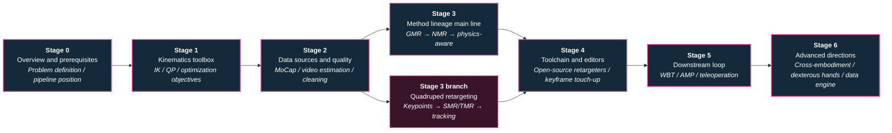

# Motion Retargeting

**At a glance**:

- **Who it's for**: People who want to turn human / animal motion capture, video, or generated motion into reference trajectories a robot can execute.
- **Path**: Stage 0–6 · Overview and prerequisites → kinematic optimization toolbox → data sources and quality control → method lineage (GMR → physics-aware) → toolchain and trajectory editors → downstream loop → advanced directions.
- **Depth roadmap**: A branch of the [motion control main roadmap](motion-control.md); upstream it connects to the [motion generation depth roadmap](depth-motion-generation.md), downstream it supplies training data for the [BFM](depth-bfm.md) and [imitation learning](depth-imitation-learning.md) depth roadmaps.

## Roadmap overview

## How to use this path

- The target reader is someone building a "human reference motion → robot-executable trajectory" data pipeline; training data for imitation learning, whole-body tracking (WBT), and AMP-style priors almost always has to pass through this gate
- Motion retargeting solves **cross-skeleton mapping**: the source (human/animal) and target (robot) differ in skeleton topology, limb proportions, joint limits, and mass distribution, so copying joint angles directly produces artifacts such as foot sliding, interpenetration, and limit violations
- This roadmap contains two parallel morphology lines: the **humanoid main line** (human MoCap/video → humanoid whole-body reference) and the **quadruped branch** (animal MoCap/video keypoints → quadruped reference, see the end of Stage 3). Both lines share the problem definition, optimization toolbox, and data quality criteria of Stages 0–2, and both feed into the "reference trajectory → RL tracking policy" downstream loop in Stage 5; the differences concentrate on fewer leg DoF, frequently missing base trajectories, and the need to retarget gait phase and the time axis together
- Each stage has prerequisites, core questions, what to do, what to read, and what you should be able to produce

**Relation to the main roadmap:**
- This roadmap expands [L5.4 Motion Retargeting](motion-control.md#l54-motion-retargeting) of the main roadmap: [FK/IK in L1](motion-control.md#l1-robotics-backbone) is the direct prerequisite for Stage 1, and imitation learning in L5.3 is the downstream consumer
- Stage 2 of the [imitation learning depth roadmap](depth-imitation-learning.md) and Stage 1 of the [BFM depth roadmap](depth-bfm.md) each give retargeting only one stage; this roadmap expands that step into a full lineage
- If you care about the upstream question of "where reference motions come from" (text/multimodal motion generation), take the [motion generation depth roadmap](depth-motion-generation.md)

---

## Stage 0 Retargeting overview and prerequisites

**First distinguish the evaluation criteria of "animation retargeting" versus "robot retargeting", then look at methods; otherwise you will use the wrong metric to pick the wrong route.**

### Prerequisites
- Fluent in Python, able to read rotation representations (quaternion / rotation matrix / 6D)
- Understand the concept of forward kinematics (FK) (see [L1](motion-control.md#l1-robotics-backbone) in the main roadmap)

### Core questions
- What retargeting actually solves: preserving motion semantics and style while satisfying executability on the target skeleton
- Why the evaluation lines differ between the animation community (does it look right) and the robotics community (can it be tracked)
- Where retargeting sits in the training data pipeline: capture → cleaning → retargeting → tracking training
- Different target morphologies have different difficulties: humanoids are "isomorphic but with different proportions/limits", quadrupeds are "heterogeneous skeleton + fewer leg DoF", and the latter often requires inferring even the global base trajectory of the source data

### What to do
- Read the depth hub page and go through the five layers of entry points: "concepts / pipeline / selection / data / downstream"
- Find a clip of public motion capture data, copy human joint angles directly onto a humanoid model, and observe foot sliding and interpenetration to build first-hand intuition for "why retargeting is necessary"

### What to read
- [Motion Retargeting](../../wiki/concepts/motion-retargeting.md) — main concept entry
- [Motion retargeting knowledge-chain hub](../../wiki/overview/hub-motion-retargeting.md)
- [Character Animation vs Robotics](../../wiki/concepts/character-animation-vs-robotics.md) — differences in evaluation criteria between the two communities
- [Kinematic vs dynamic feasibility](../../wiki/concepts/kinematic-vs-dynamic-feasibility.md) — "can strike the pose" ≠ "can stay upright and keep up"; same root as this page's animation/robotics evaluation-line difference
- [Motion Retargeting Pipeline](../../wiki/concepts/motion-retargeting-pipeline.md) — pipeline position
- [Quadruped robot](../../wiki/entities/quadruped-robot.md) — target platform characteristics for the quadruped branch: support region, gaits, control frequency

### What you should be able to produce
- Be able to say in one sentence what retargeting solves and why it cannot be skipped
- Be able to draw the "capture → retargeting → training" data pipeline and mark the error sources
- Be able to judge whether your task falls on the humanoid main line or the quadruped branch, and which segments the two share

---

## Stage 1 Kinematic fundamentals and optimization toolbox

**The classic form of retargeting is a constrained optimization problem: the objective function, constraints, and solver must all be in place first.**

### Prerequisites
- Stage 0 content
- Linear algebra and least squares

### Core questions
- How to write the retargeting objective: the mathematical forms of end-effector position constraints, joint limits, smoothness terms, and contact constraints
- The family of numerical IK solvers: what scale Gauss–Newton / Levenberg–Marquardt / quasi-Newton each suit
- The tradeoff between direct joint-space mapping (scale + offset) and task-space IK

### What to do
- Use Pinocchio or MuJoCo to hand-write an end-effector-constrained IK for a humanoid model, and verify joint-limit handling
- Retarget the same motion with both joint-space mapping and task-space IK, and compare end-effector errors

### What to read
- [Motion Retargeting Objective](../../wiki/formalizations/motion-retargeting-objective.md) — formalization of the optimization objective
- [Gauss–Newton](../../wiki/methods/gauss-newton.md), [Levenberg–Marquardt](../../wiki/methods/levenberg-marquardt.md), [L-BFGS](../../wiki/methods/l-bfgs.md) — solver family
- The "Main methods" section of [Motion Retargeting](../../wiki/concepts/motion-retargeting.md)

### What you should be able to produce
- A working end-effector-constrained IK retargeting script
- Be able to write a reasonable retargeting objective function and constraint set for a given task

---

## Stage 2 Reference motion data sources and quality control

**Garbage in, garbage out: the ceiling of a retargeting pipeline is set by the quality and coverage of the reference data.**

### Prerequisites
- Stage 1 content

### Core questions
- Tradeoffs among three classes of data sources: optical motion capture (AMASS / LAFAN1), video estimation (GVHMR / SAM 3D Body), low-cost solutions (FreeMoCap)
- Why SMPL-family representations became the de facto standard, and what normalization is needed before retargeting
- Data quality dimensions: how to quantify and filter foot sliding, drift, penetration, and jitter
- How to assess a dataset's "retargeting readiness"
- Why data sources for the quadruped branch are "dirtier": animal optical motion capture is scarce and mostly private, so in practice one relies on **video keypoint estimation** and **animation skeletons** (e.g., the LaFAN1 dog set); noise, missing frames, and no global base trajectory are the norm, and there is no unified parametric model like SMPL to rely on

### What to do
- Download one AMASS clip and one video-estimated (GVHMR) clip, and compare their foot-contact quality
- Add a quality filter to your pipeline (foot-sliding velocity threshold + joint velocity cap) and measure the filtered fraction
- Quadruped direction: take an animal clip (e.g., `dog_pace` / `dog_trot` shipped with motion_imitation) and check whether foot contact phases and base velocity are self-consistent; inconsistent clips are exactly the source of foot sliding in quadruped retargeting

### What to read
- [AMASS](../../wiki/entities/amass.md) and [LAFAN1](../../wiki/entities/lafan1-dataset.md) — motion capture data foundation
- [HiPHI](../../wiki/entities/paper-hiphi.md) — 90 Hz / 55-joint BVH with synchronized object CSV/OBJ; first unify centimeters/meters, Y-up, and time, then do joint human–object retargeting; data is gated, Viewer is open
- [Comparison of humanoid reference motion datasets](../../wiki/comparisons/humanoid-reference-motion-datasets.md) — main selection entry
- [GVHMR](../../wiki/entities/gvhmr.md), [SAM 3D Body](../../wiki/entities/sam-3d-body.md), [FreeMoCap](../../wiki/entities/freemocap.md) — video/low-cost capture
- [EgoMo3R](../../wiki/entities/paper-egomo3r.md) — egocentric video → unified scene and SMPL-X whole-body motion; can serve as a reference motion data source before retargeting; does not itself perform robot retargeting
- [MacroHands](../../wiki/entities/macrohands.md) — upstream data quality for egocentric mono/stereo 3D hands + camera pose; read Cam-MPJPE, Action MPJPE, and misidentification rate; **not** a robot retargeter (official code not yet released)
- [FMPose3D](../../wiki/entities/paper-fmpose3d-monocular-3d-pose-flow-matching.md) — conditional Flow Matching monocular 2D→3D pose lifting, 3-step ODE multi-hypothesis + RPEA aggregation; can serve as a lightweight upstream for video → sparse 3D skeleton
- [PEAR](../../wiki/entities/paper-pear-pixel-aligned-expressive-hmr.md) and [ViDiHand](../../wiki/entities/paper-vidihand.md) — frontier of expressive data sources: single-image SMPL-X body/face/hands recovery in real time at >100 FPS (SIGGRAPH 2026) and egocentric bimanual 4D video-diffusion estimation
- [Motion Data Quality](../../wiki/concepts/motion-data-quality.md) and [LiMMT / GQS motion data curation](../../wiki/methods/limmt-gqs-motion-curation.md) — quality quantification
- [motion_imitation (quadruped)](../../wiki/entities/motion-imitation-quadruped.md) — the animal clips in `data/motions/` are the easiest starter data for quadruped retargeting
- [LaFAN1](../../wiki/entities/lafan1-dataset.md) and [PAN Motion Retargeting](../../wiki/entities/pan-motion-retargeting.md) — animation-side quadruped skeleton data (dog set) and a human↔dog bidirectional mapping demo

### What you should be able to produce
- A data source selection table for your direction (three columns: cost / quality / coverage)
- A reference motion preprocessing script with quality filtering

---

## Stage 3 Method lineage main line: from GMR to physics-aware retargeting

**Around "does it look right" and "can it be tracked", three classes of routes are clearly distinct: kinematic optimization, learned mapping, and physics-aware optimization.**

### Prerequisites
- Stage 2 content
- Understand basic RL concepts (used by the physics-aware route)

### Core questions
- GMR's kinematic IK/QP route: why "geometric alignment first, physics left to downstream" covers most scenarios
- NMR's learned whole-sequence mapping: how simulation-anchored paired data is built, and what non-autoregressive inference buys
- The physics-aware route: at which layer ReActor's bi-level RL, SPIDER's sampling-based optimization, and DynaRetarget's incremental SBTO each place physical constraints
- Why the OmniRetarget line emphasizes "interaction preservation" (spatial relations among human, object, and terrain)
- Three extra difficulties of the quadruped branch: leg DoF (mostly 3 DoF/leg) are far fewer than the animal's, source data often lacks the global base trajectory, and gait phase and the time axis are themselves quantities to be retargeted

### What to do
- Use the GMR open-source implementation to retarget a set of AMASS data onto a target model such as Unitree G1, and check joint limits and interpenetration
- Read the GMR vs NMR vs ReActor comparison page closely, pick a main route for your scenario (offline data production / real-time teleoperation / highly dynamic skills), and state your reasons
- Quadruped direction: first do spatial retargeting (foot + base keypoints, scaled by leg-length ratio), check whether trot / pace contact phases are preserved, then use time scaling to bring peak joint velocities back into the robot's executable range; walk through STMR's SMR/TMR decomposition by hand

### What to read
- [GMR](../../wiki/methods/motion-retargeting-gmr.md), [NMR](../../wiki/methods/neural-motion-retargeting-nmr.md), [ReActor](../../wiki/methods/reactor-physics-aware-motion-retargeting.md) — three representative routes
- [GMR vs NMR vs ReActor selection comparison](../../wiki/comparisons/gmr-vs-nmr-vs-reactor.md) — main lineage entry
- [DynaRetarget / SBTO](../../wiki/methods/dynaretarget-sbto-motion-retargeting.md) and [SPIDER](../../wiki/methods/spider-physics-informed-dexterous-retargeting.md) — physics-aware extensions
- [Contact-Anchored Retargeting](../../wiki/entities/paper-contact-anchored-retargeting-residual-dexterous.md) — first uses physics residual learning to complete contacts in human demonstrations, then retargets to the robot hand by contact location and order, and finally repairs dynamic feasibility.
- [KDMR](../../wiki/entities/paper-kdmr.md) — GRF-anchored multi-contact whole-body trajectory optimization (CasADi + Pinocchio), writing the heel–toe contact schedule together with dynamics/no-slip constraints into the NLP; relative to GMR, downstream tracking error drops by about 27–47% (Walk/Twister), zero-shot deployment on G1; claimed open-source at publication, but no official code as of the ingest date
- [SPARK](../../wiki/entities/paper-spark-skeleton-aligned-retargeting.md) — first calibrates the human URDF skeleton then does IK, then adds torque supervision via progressive KTO→ID→KDTO trajectory optimization; multi-robot IK error drops 65–83% relative to GMR, and on the G1 side flip KDTO+T markedly speeds up BeyondMimic convergence; not open-source
- [Shooting for Contact / DSMS](../../wiki/entities/paper-shooting-for-contact.md) — contact-implicit direct simulation multiple shooting; refines kinematic references into dynamically feasible trajectories without a preset contact schedule; backflip landing success rate on par with DynaRetarget (98.7%), an order of magnitude higher than OmniRetarget (9.3%), zero-shot crawling/180° jump-turn on G1; trajopt/MPC is open-source
- [CoRe](../../wiki/entities/paper-core.md) and [RMR](../../wiki/entities/paper-rmr.md) (Humanoids 2025 / IROS 2025) — CoRe uses a three-stage division of labor "geometric mapping → contact-aware refinement → RL tracking" to treat foot sliding/floating/over-acceleration as reference-layer problems; RMR provides an upstream two-stage scheme of "unify the source skeleton first, then map", supporting real-time closed loop from RGB video, and its implementation is merged into the DMR module of CoRe v0.1.0; the software [core-retarget v0.1.0](../../wiki/entities/paper-core.md) is partially open-source (Apache-2.0, retargeting + refinement runnable; T2M and RL training not released in the repo)
- [OmniRetarget](../../wiki/entities/paper-hrl-stack-03-omniretarget.md) and [Retargeting Matters](../../wiki/entities/paper-hrl-stack-01-retargeting_matters.md) — interaction preservation and the impact of retargeting quality on downstream
- [WARP](../../wiki/entities/paper-warp-whole-body-retargeting.md) (Georgia Tech) — closed-form c-SEW + lazy mobile-base, converting offline Meta Quest human whole-body demonstrations into precise, consistent motions that can be replayed open-loop, supporting zero-shot whole-body mobile manipulation BC on RB-Y1; code not listed
- [UMR](../../wiki/entities/paper-umr-unified-motion-retargeting.md) (HKUST-GZ / Noitom / Hanyang University) — changes the human–robot correspondence from a "hand-written keypoint table" to dense point-cloud index correspondences learned on a canonical T-pose; the same set of point pairs transfers both surface pose and contact vectors, so switching source or robot mainly reuses the correspondence instead of redrawing the mapping; global body-segment error on LAFAN1 is lower than GMR, contact-task joint error is about −40–56% relative to OmniRetarget, real-robot spinning kick/ball pickup/stair climbing on G1; code to be released
- [STMR quadruped spatio-temporal retargeting](../../wiki/entities/stmr-quadruped-retargeting.md) — main entry for the quadruped branch, see next section
- [STR](../../wiki/entities/paper-str-spatiotemporal-retargeting.md) — spatio-temporal retargeting: concentrates retargeting accuracy on task keyframes, key body parts, and object contacts, then trains contact-aware humanoid control

### Quadruped branch: animal / video keypoints → quadruped reference

The humanoid main line assumes "both source and target are bipedal humanoid skeletons"; switching to quadrupeds changes the problem's boundary conditions across the board:

| Difference | Humanoid main line | Quadruped branch |
|--------|---------|---------|
| Source data | Human MoCap; SMPL family is the de facto standard | Animal MoCap / video keypoints / animation skeletons; no unified parametric model |
| Skeleton correspondence | Isomorphic; align joint by joint then fix proportions | Heterogeneous: animal legs vs robot 3-DoF legs; in practice only foot and base keypoints can be matched |
| Base trajectory | MoCap usually includes a global root | Often missing in video/keypoints; base velocity must be inferred from the "stance feet do not slip" constraint |
| Time axis | Usually played at original speed | Animal speeds often exceed robot torque/bandwidth; **time scaling is part of retargeting** |
| Contact semantics | Biped stance/swing phases | Quadruped gait phases (trot / pace / bound / gallop) and duty factor must be preserved as a whole |

Representative works form three steps:

1. **[motion_imitation](../../wiki/entities/motion-imitation-quadruped.md) (Peng et al., RSS 2020)** — Historical anchor: uses IK to map foot and base keypoints of animal MoCap onto a quadruped, then does RL imitation in PyBullet. The retargeting step is coupled to the environment with no standalone module, but the problem shape of "heterogeneous-skeleton keypoint mapping + trackability" is already complete.
2. **[STMR](../../wiki/entities/stmr-quadruped-retargeting.md) (IEEE T-RO 2025)** — Explicitly splits the problem into two layers: **SMR (spatial motion retargeting)** generates whole-body configurations from keypoints at the kinematic layer, suppresses foot sliding and ground penetration, and can handle inputs without a global base trajectory; **TMR (temporal motion retargeting)** uses model-based control at the dynamics layer to search for feasible timing parameters, so that skills with flight phases such as jumps and backflips remain trackable on real robots. Downstream it connects to legged_gym-style RL; the paper reports real-robot experiments on Go1 / Aliengo / B2.
3. **[PAN](../../wiki/entities/pan-motion-retargeting.md) (TVCG 2023) and [ReActor](../../wiki/methods/reactor-physics-aware-motion-retargeting.md)** — The cross-morphology side: PAN uses a body-part attention network for biped↔quadruped bidirectional mapping (output leans toward animation BVH and still needs physical screening before going to a robot); ReActor uses bounded parameterization + bi-level RL to uniformly generate low-artifact trackable references on strongly heterogeneous humanoids and quadrupeds.

Engineering deployment sample: `retarget_motion.py` in [Go2 Motion Imitation](../../wiki/entities/go2-motion-imitation.md) is the shortest reproducible script for the "source format → specific robot state" step, suitable as a template for a pipeline customized to your own robot.

> Selection experience: for **offline batch production of quadruped references**, prefer the SMR/TMR-style two-layer decomposition (fix foot sliding and timing infeasibility in separate layers); to **just get one skill running quickly**, use the motion_imitation / Go2 script-level pipeline; to **reuse the same set of references across humanoids and quadrupeds**, move up to cross-morphology methods like PAN / ReActor (see Stage 6 Direction A).

### What you should be able to produce
- A working "AMASS → target humanoid" retargeting pipeline
- Be able to explain the tradeoffs of the three classes of routes in terms of "where the data comes from, where errors are fixed, how large the inference budget is"
- If taking the quadruped branch: a minimal "animal clip → quadruped reference" pipeline, and be able to explain at which layer each of the three artifact types (foot sliding, missing base, infeasible time axis) is fixed

---

## Stage 4 Engineering toolchain and trajectory editors

**Once a method is chosen, iteration speed is decided by "which open-source retargeter runs the batches" and "which editor fixes bad frames"; fixing the long-tail artifacts of retargeting once is usually cheaper than retraining once.**

### Prerequisites
- Stage 3 content (already able to run a retargeting pipeline on your own)
- Able to read URDF / MJCF, and clear about the data format your downstream consumes

### Core questions
- **Open-source retargeters come in four tiers**, with maturity and modifiability trading off against each other: script-level (quick to modify, serves a single robot only), library-level (has IK/contact/scaling modules, can be embedded in your own pipeline), workbench-level (drag-and-drop, batch, cross-robot), framework-built-in (in the same repo as training code, saves format conversion)
- **The data exchange format is the real interface of the toolchain**: Unitree / Seed-style CSV, MuJoCo `qpos` (joblib + LZ4), NPZ (`joint_pos` / `base_pos_w` / `base_quat_w`), BVH / SMPL; **picking the wrong format usually costs more than picking the wrong algorithm**, because it decides which tools can be chained together
- **Why a manual touch-up step must be kept**: residual artifacts of automatic retargeting (interpenetration in individual frames, foot sliding, hitting joint limits) are long-tail distributed; suppressing them by tuning optimization weights has a high global cost, and editing keyframes frame by frame is often cheaper
- **Should the editor include physics**: kinematics-only visualization (CoM + support polygon projection) is enough to judge "pose feasible", but not "trackable"; an editor with MuJoCo stepping and QP IK can screen out untrackable frames at edit time, at the cost of needing an MJCF first
- **Deployment form and data egress**: the differences among pure static browser tools (no upload, works offline), local backend services, and pip CLIs in terms of team collaboration and data compliance

### Tool form lineage

| Form | Representative implementations (first-hand repos) | Input → output | When to choose it |
|------|----------------------|-------------|--------------|
| **Script-level** | [mocap_retarget](../../wiki/entities/mocap-retarget.md), the AMASS→robot scripts in [human2humanoid](../../wiki/entities/human2humanoid.md) | Motion capture archives → joint trajectories for a single robot | Working with only one robot and wanting to understand every line of geometric retargeting |
| **Library-level** | [SOMA Retargeter](../../wiki/entities/soma-retargeter.md) (GPU IK), [robot_retargeter](../../wiki/entities/robot-retargeter.md) (mink + MuJoCo IK) | BVH / SMPL-X / source-robot CSV → multi-robot trajectories; includes link scaling, contact detection, foot-slide suppression | Need to embed into your own batch pipeline and need contact and limit handling |
| **Workbench-level** | [human-humanoid-tools (hhtools)](../../wiki/entities/human-humanoid-tools.md) | Mainstream dataset formats → any standard URDF; dual Newton IK / Interaction-Mesh backends, supports R2R | Frequently switching datasets or robots, and retargeting itself is not the research subject |
| **Framework-built-in** | [MimicKit](../../wiki/entities/mimickit.md) | Reference motion → directly into DeepMimic / AMP-family imitation training | Downstream is that framework and you want to skip format conversion |
| **Editor-level** | See the three editing chains in the next section | Existing trajectory → manual touch-up → re-export | Automatic output is "mostly right but has bad frames" |

### Trajectory and keyframe editors: three first-hand chains

[Robot keyframe and motion editing tools (selection entry)](../../wiki/entities/robot-motion-keyframe-editors.md) collects three public repositories. They solve the same problem (**existing trajectory → manual correction → re-export**), but the simulation stack they are tied to, their exchange formats, and their runtime forms are completely different:

1. **[cyoahs/robot_motion_editor](https://github.com/cyoahs/robot_motion_editor) (MIT, pure browser)** — Three.js + `urdf-loader`, dual viewports comparing the original and edited results, residual keyframes + Bézier curve editing, real-time CoM and support polygon projection (kinematic level, not physics simulation); imports and exports Unitree / Seed CSV and resamples to a target FPS; the README emphasizes that **parsing and editing are all local, with no server upload**. Suitable when you already have Unitree-style logs and do not want data to leave your machine.
2. **[Stanford-TML/robot_keyframe_kit](https://github.com/Stanford-TML/robot_keyframe_kit) (MIT, `pip install robot-keyframe-kit` → `keyframe-editor`)** — Targets any MJCF: automatic mechanism detection (differential/gear/parallel), mirrored joints, root-to-ground snapping, end-effector site tracking, **Mink QP IK**, and can **step full MuJoCo** to try tracking on the spot; motions are stored as LZ4-compressed joblib containing `qpos`, velocities, body/site poses, and `timed_sequence`. The default choice when the workflow is already anchored in MuJoCo / Menagerie.
3. **[project-instinct/robot-motion-editor](https://github.com/project-instinct/robot-motion-editor) (Flask + Three.js)** — Loads URDF and `.npz` (`joint_pos` `(T, n_joints)`, `base_pos_w` `(T, 3)`, `base_quat_w` `(T, 4)` **wxyz**), drag keyframes per channel, scrub the timeline, apply moving-average smoothing, then write back to NPZ; parsing and saving rely on a local Flask backend. The shortest path when policy/retargeting outputs are already NPZ.

> **Pitfall warning**: the most common silent bugs when moving data across tools are **quaternion order** (the NPZ convention is `wxyz`, while Unitree CSV commonly uses `xyzw`) and **FPS resampling** (changing FPS on export interpolates, so velocity-type supervision quantities change with it). Before plugging back into the training pipeline, always run a round-trip consistency check with a known motion.

### What to do
- Use an open-source retargeter (e.g., `robot_retargeter` or hhtools) to retarget the same Stage 2 data onto the target robot, and compare end-effector error and limit-violation rate frame by frame against the output of your Stage 1 hand-written IK, to decide between "write it yourself" and "use it directly"
- Pick the 10 worst frames in the automatic output, edit the keyframes with an editor, re-export, and quantify how much foot-sliding velocity and limit violations drop; script this touch-up loop
- Do a **format round-trip test**: original → editor export → re-import, and check that quaternion order, FPS, and joint name order are fully restored

### What to read
- [Robot keyframe and motion editing tools (selection entry)](../../wiki/entities/robot-motion-keyframe-editors.md) — side-by-side runtime form / description format / exchange format / physics and IK for the three editing chains
- [human-humanoid-tools (hhtools)](../../wiki/entities/human-humanoid-tools.md) — workbench-level retargeting: dual backends, Any Motion / Any URDF, R2R robot-to-robot conversion
- [SOMA Retargeter](../../wiki/entities/soma-retargeter.md), [robot_retargeter](../../wiki/entities/robot-retargeter.md), [mocap_retarget](../../wiki/entities/mocap-retarget.md) — first-hand implementations of library-level and script-level retargeters
- [human2humanoid](../../wiki/entities/human2humanoid.md) and [MimicKit](../../wiki/entities/mimickit.md) — retargeting entry points living in the same repo as a teleoperation stack / imitation training framework
- [fairmotion](../../wiki/entities/fairmotion.md) — upstream data infrastructure for BVH / AMASS IO and FK (archived, still a reference implementation for format conversion)
- [Blender](../../wiki/entities/blender.md) and [Robot Viewer](../../wiki/entities/robot-viewer.md) — general DCC-side skeleton editing and quick multi-format (URDF/MJCF/USD) viewing
- [Generative Motion Rig (Disney)](../../wiki/entities/generative-motion-rig.md) — closed-source counterpart for artist-side generative keyframing; see how far "editor connected to a generative model" can go
- [Foot-locking IK (Orange Duck recipe)](../../wiki/methods/foot-locking-ik-orangeduck.md) and [GenoView-InverseKinematics](../../wiki/entities/genoview-inverse-kinematics.md) — reference implementations of the same problem on the animation side (existing trajectory → manual touch-up → re-export): two-bone IK + inertialized foot locking + toe-velocity contact heuristic + offline PBD-style global foot-slide correction; treats "foot sliding" as a velocity error rather than a friction model, and can be compared against the three robot retargeting editing chains above
- [Motion Retargeting Pipeline](../../wiki/concepts/motion-retargeting-pipeline.md) and [Motion Data Quality](../../wiki/concepts/motion-data-quality.md) — where manual touch-up sits in the pipeline and its acceptance metrics

### What you should be able to produce
- Your own toolchain selection table: retargeter form / editor / exchange format / whether physics is included / whether data must leave your machine
- A reproducible "automatic retargeting → manual frame fixing → back to training format" loop, with a round-trip consistency check

---

## Stage 5 Downstream loop: how retargeting outputs enter training and teleoperation

**Retargeting is not the end: its outputs must withstand the test of whole-body tracking training and real-time teleoperation.**

### Prerequisites
- Stage 3 and Stage 4 content (you have a pipeline that produces clean trajectories)
- [RL depth roadmap](depth-rl-locomotion.md) Stage 0–2 level (able to train policies in simulation)

### Core questions
- The full chain by which retargeted trajectories enter WBT training: reference trajectory → imitation reward → tracking policy
- "Looks like it is learning, but is actually chasing infeasible trajectories": how retargeting artifacts drag down downstream training
- Additional requirements real-time teleoperation places on retargeting: latency budget, sliding-window inference, safety clamping
- The difference in sensitivity to retargeting quality between AMP-style priors and frame-by-frame tracking
- The quadruped-side downstream is likewise "reference → RL tracking", but the ecosystem differs: legged_gym / Genesis + AMP-style priors are more common than humanoid WBT stacks, and evaluation leans more toward gait stability and real-robot executability than whole-body pose error

### What to do
- Feed the Stage 3 retargeting outputs into an open-source WBT training pipeline (e.g., BeyondMimic), and observe tracking errors and failed clips
- Run two training groups on the same data, "with/without quality filtering", and compare convergence speed to verify the conclusion of Retargeting Matters
- Quadruped direction: reproduce an "animal clip → tracking policy" pipeline on legged_gym / Genesis, and compare the tracking success rate of the same motion before and after time scaling; this is the most direct experiment for whether TMR helps

### What to read
- [Whole-Body Tracking Pipeline](../../wiki/concepts/whole-body-tracking-pipeline.md) and [WBT depth hub](../../wiki/overview/hub-wbt.md)
- [SONIC](../../wiki/methods/sonic-motion-tracking.md) and [BeyondMimic](../../wiki/methods/beyondmimic.md) — tracking-side consumers
- [Query: humanoid motion tracking method selection](../../wiki/queries/humanoid-motion-tracking-method-selection.md)
- [Teleoperation](../../wiki/tasks/teleoperation.md) — the application surface of real-time retargeting
- [legged_gym](../../wiki/entities/legged-gym.md), [AMP reward design](../../wiki/methods/amp-reward.md), and [Locomotion](../../wiki/tasks/locomotion.md) — the tracking-training side and task-level landing point of the quadruped branch

### What you should be able to produce
- An end-to-end pipeline from reference motion to a trackable policy
- Experiment-level understanding of the causal chain "retargeting quality ↔ downstream training effect"

---

## Stage 6 Advanced directions

### Prerequisites
- Stage 5 content

**Direction A: Cross-embodiment retargeting**
- Map the same set of reference motions onto heterogeneous morphologies (quadrupeds, heterogeneous humanoids, robot arms); the Stage 3 branch solves "animal motion → one specific quadruped", while this direction goes further to "one reference → reuse across multiple robots", including humanoid↔quadruped bidirectional mapping
- Keywords: [STMR quadruped retargeting](../../wiki/entities/stmr-quadruped-retargeting.md), [PAN Motion Retargeting](../../wiki/entities/pan-motion-retargeting.md), [X-Morph](../../wiki/entities/paper-xmorph.md) (human motion via a G1 intermediate representation → cross-morphology retargeting to quadrupeds/hexapods/quadrupeds with arms + physics-aware correction + privileged tracking distillation; on Go2, foot sliding drops 27.2% and ground penetration drops 46.9%; not open-source), [Any2Any cross-embodiment WBT](../../wiki/entities/paper-any2any-cross-embodiment-wbt.md), [cross-embodiment depth hub](../../wiki/overview/hub-cross-embodiment.md), [Query: cross-embodiment transfer strategy](../../wiki/queries/cross-embodiment-transfer-strategy.md)

**Direction B: Dexterous hands and interaction-preserving retargeting**
- Topology preservation of hand–object contact: refining from whole-body skeleton-level mapping to contact-level mapping
- Keywords: [TopoRetarget](../../wiki/methods/toporetarget-interaction-preserving-dexterous-retargeting.md), [SPIDER](../../wiki/methods/spider-physics-informed-dexterous-retargeting.md), [DynaRetarget vs TopoRetarget comparison](../../wiki/comparisons/dynaretarget-vs-toporetarget-retargeting.md)

**Direction C: Retargeting generated motion**
- Reference motions no longer come from motion capture but from text/multimodal generative models; retargeting becomes the middle layer of "generation → execution"
- Keywords: [Gen2Humanoid](../../wiki/entities/gen2humanoid.md), [motion generation depth roadmap](depth-motion-generation.md)

**Direction D: Retargeting as a data engine**
- Large-scale retargeting pipelines batch-produce training data for BFM / whole-body tracking foundations
- Keywords: [OmniRetarget dataset](../../wiki/entities/omniretarget-dataset.md), [Query: humanoid training data pipeline](../../wiki/queries/humanoid-training-data-pipeline.md), [BFM depth roadmap](depth-bfm.md)

---

## Quick entry summary

| Stage | Core question | Knowledge page entry |
|------|---------|-----------|
| Stage 0 | Problem definition and pipeline position | [Motion Retargeting](../../wiki/concepts/motion-retargeting.md) |
| Stage 1 | IK / optimization objective | [Motion Retargeting Objective](../../wiki/formalizations/motion-retargeting-objective.md) |
| Stage 2 | Data sources and quality | [Comparison of humanoid reference motion datasets](../../wiki/comparisons/humanoid-reference-motion-datasets.md) |
| Stage 3 | Method lineage selection | [GMR vs NMR vs ReActor](../../wiki/comparisons/gmr-vs-nmr-vs-reactor.md) |
| Stage 3 branch | Animal/keypoints → quadruped reference | [STMR quadruped spatio-temporal retargeting](../../wiki/entities/stmr-quadruped-retargeting.md) |
| Stage 4 | Toolchain and trajectory editors | [Robot keyframe and motion editing tools](../../wiki/entities/robot-motion-keyframe-editors.md) |
| Stage 5 | Downstream tracking loop | [Whole-Body Tracking Pipeline](../../wiki/concepts/whole-body-tracking-pipeline.md) |
| Stage 6 | Advanced directions | [Motion retargeting knowledge-chain hub](../../wiki/overview/hub-motion-retargeting.md) |

## Relation to other pages

- Full growth roadmap reference: [Main roadmap: motion control → physical intelligence full-stack growth roadmap](motion-control.md)
- Related depth roadmaps (by topical proximity; full catalog in the [roadmap overview](motion-control.md#depth-optional-index)):
  - [Teleoperation](depth-teleoperation.md) — real-time, in-the-loop consumer of retargeting
  - [Imitation learning](depth-imitation-learning.md) — downstream of human demonstration → robot reference
  - [Motion generation](depth-motion-generation.md) — synthesized motions then converted onto the embodiment
  - [BFM](depth-bfm.md) — tracking and behavior priors depend on retargeting quality
  - [Embodied data](depth-embodied-data.md) — the "human → embodiment" conversion segment of the data pyramid

## References

- [Motion Retargeting](../../wiki/concepts/motion-retargeting.md) and [Motion retargeting knowledge-chain hub](../../wiki/overview/hub-motion-retargeting.md)
- [GMR vs NMR vs ReActor selection comparison](../../wiki/comparisons/gmr-vs-nmr-vs-reactor.md)
- [STMR quadruped spatio-temporal retargeting](../../wiki/entities/stmr-quadruped-retargeting.md), [motion_imitation (quadruped)](../../wiki/entities/motion-imitation-quadruped.md), [Go2 Motion Imitation](../../wiki/entities/go2-motion-imitation.md), [PAN Motion Retargeting](../../wiki/entities/pan-motion-retargeting.md) — sources for the quadruped branch
- [Robot keyframe and motion editing tools](../../wiki/entities/robot-motion-keyframe-editors.md), [human-humanoid-tools](../../wiki/entities/human-humanoid-tools.md), [SOMA Retargeter](../../wiki/entities/soma-retargeter.md), [robot_retargeter](../../wiki/entities/robot-retargeter.md), [mocap_retarget](../../wiki/entities/mocap-retarget.md) — sources for the Stage 4 toolchain
- First-hand repo READMEs: [cyoahs/robot_motion_editor](https://github.com/cyoahs/robot_motion_editor), [Stanford-TML/robot_keyframe_kit](https://github.com/Stanford-TML/robot_keyframe_kit), [project-instinct/robot-motion-editor](https://github.com/project-instinct/robot-motion-editor) — format and feature details of trajectory/keyframe editors
- "Retargetting Motion to New Characters" (Gleicher, SIGGRAPH 1998) — foundational work on the motion retargeting problem
- "Retargeting Matters: General Motion Retargeting for Humanoid Motion Tracking" (GMR, arXiv:2505.02833) — impact of retargeting quality on downstream tracking
- "Spatio-Temporal Motion Retargeting for Quadruped Robots" (STMR, IEEE T-RO 2025, arXiv:2404.11557) — explicit spatial/temporal decomposition of quadruped retargeting
- "Learning Agile Robotic Locomotion Skills by Imitating Animals" (Peng et al., RSS 2020) — historical anchor for animal MoCap → quadruped reference
- "Pose-aware Attention Network for Flexible Motion Retargeting by Body Part" (PAN, TVCG 2023, arXiv:2306.08006) — biped↔quadruped cross-structure mapping
