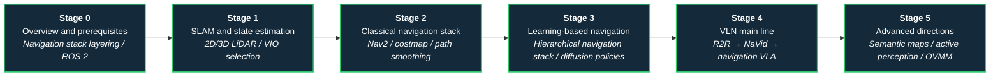

# Navigation

**At a glance**:

- **Who it's for**: people who want robots to know where they are and where they should go.
- **Path**: Stage 0–5 · navigation stack layering and ROS 2 → SLAM and state estimation → Nav2 and path planning → learning-based navigation → VLN to navigation VLA → advanced directions.
- **Depth roadmap**: a branch of the [Motion Control main roadmap](motion-control.md).

## Roadmap overview

## How to use this path

- The target reader is someone who wants a robot (wheeled base, quadruped or humanoid) to autonomously get from point A to point B - all the way from "walk to coordinates on a known map" to "understand language instructions and find targets"
- Core mental model: navigation is a layered closed loop of **localization—mapping—planning—execution**; the classical stack solves "where to go", while learning-based methods and VLN solve "semantic goals" and "unstructured terrain"
- Each stage has prerequisites, core questions, what to do, what to read, and what you should be able to produce

**Relation to the main roadmap:**
- The main roadmap focuses on joint-level motion control; this roadmap occupies the **task planning and spatial intelligence layer** above it, outputting velocity commands or waypoints to the lower layers for execution
- Local obstacle traversal for legged platforms is covered in [Perceptive Locomotion depth](depth-perceptive-locomotion.md); this roadmap focuses on global navigation and semantic grounding
- "What to do with your hands once you've arrived" is the topic of [Loco-Manipulation depth](depth-loco-manipulation.md); the OVMM direction in Stage 5 is where the two roadmaps meet

---

## Stage 0 Overview and prerequisites: navigation stack layering and ROS 2

**First build intuition for the layering: which layer the semantic goal, global path, local motion and low-level execution each live in, and who commands whom.**

### Prerequisites
- Python / C++ basics
- Basic concepts of coordinate transforms (rotation matrices, quaternions, TF trees)

### Core questions
- Why the navigation stack is layered: what semantic / global / local / execution each solve, and what the interfaces are (`cmd_vel`, waypoints, joint commands)
- What role ROS 2 plays in a navigation system (nodes, topics, TF, lifecycle)
- At which layer the navigation stacks of wheeled / quadruped / humanoid platforms mainly differ

### What to do
- Use PythonRobotics to run the teaching examples of EKF localization, A* / RRT* planning and DWA local obstacle avoidance, to build algorithmic intuition
- Set up a ROS 2 workspace and use turtlebot simulation to run the "mapping → localization → point-to-point navigation" loop end to end

### What to read
- [Overview of Open-Source Navigation · SLAM · Autonomous Driving Stacks](../../wiki/overview/navigation-slam-autonomy-stack.md) - the main entry point to the open-source stack map for this roadmap
- [ROS 2 Basics](../../wiki/concepts/ros2-basics.md)
- [PythonRobotics](../../wiki/entities/python-robotics.md) - an introductory collection of algorithm-level examples
- [Hierarchical Quadruped Navigation Stack](../../wiki/concepts/hierarchical-quadruped-navigation-stack.md) - a layering reference for legged platforms

### What you should be able to produce
- Able to draw a four-layer navigation stack block diagram and mark the inputs and outputs of each layer
- A working ROS 2 mapping + navigation simulation demo

---

## Stage 1 SLAM and state estimation

**"Where am I" is the precondition for all navigation: 2D/3D LiDAR, vision and inertial sensing each have a mature toolchain.**

### Prerequisites
- Stage 0 content
- Understand the basic ideas of Bayesian filtering / least squares

### Core questions
- Which scenarios 2D LiDAR SLAM (slam_toolbox / Cartographer) and 3D LIO (FAST-LIO / LIO-SAM) are each suited for
- How the failure modes of visual SLAM (ORB-SLAM3 / VINS) differ from the LiDAR route (low texture, dynamic objects, lighting)
- How to trade off odometry drift, loop closure detection and global consistency
- How state estimation and sensor fusion provide stable poses to downstream consumers

### What to do
- Build a 2D map in simulation with slam_toolbox, then relocalize with AMCL
- Run FAST-LIO and ORB-SLAM3 on a public dataset, and record the drift and failure scenarios of each

### What to read
- [Open-Source LiDAR / LIO / VIO Selection Comparison](../../wiki/comparisons/lidar-slam-lio-vio-selection.md) - the main selection entry point
- [SLAM Toolbox](../../wiki/entities/slam-toolbox.md), [Cartographer](../../wiki/entities/cartographer.md), [FAST-LIO](../../wiki/entities/fast-lio.md), [ORB-SLAM3](../../wiki/entities/orb-slam3.md)
- [State Estimation](../../wiki/concepts/state-estimation.md) and [Sensor Fusion](../../wiki/concepts/sensor-fusion.md)
- [Ultra-Fusion](../../wiki/entities/paper-ultra-fusion-multi-sensor-slam.md) - the frontier of resilient multi-sensor fusion
- [CO-Calib](../../wiki/entities/paper-co-calib-multi-fisheye-calibration.md) - failure-oriented analysis of multi-fisheye calibration: observability-guided frame selection raises the success rate of Kalibr-style pipelines from 68.1% to 99.3%; a prerequisite tool for extrinsic calibration in multi-camera VIO/SLAM
- [SLAMFormer-∞](../../wiki/entities/paper-slamformer-infinity.md) - a memory-conditioned geometric Transformer unifying a streaming front end and a PGGO joint back end for unbounded long-range monocular dense SLAM; improves ATE and dense geometry over VGGT-Long on KITTI/Waymo, and demonstrates consistent maps over >17 km of urban driving; the official repo is a placeholder, inference code pending release
- [KILVO](../../wiki/entities/paper-kilvo.md) - humanoid kinematic–inertial–LiDAR–visual odometry with an asynchronous–sequential hybrid ESIKF + contact estimation without extra sensors + adaptation to modality failures; real-robot end-to-end mean 0.0145 m, 1 kHz output; code repo is a placeholder pending release
- [ABot-Recon](../../wiki/entities/paper-abot-recon.md) - from Alibaba AMap CV Lab, streaming 3D reconstruction of long monocular RGB videos with a fixed 12-frame local context, whose state does not grow with sequence length; Oxford Spires ATE 4.35 m (about −40%), belonging with SLAMFormer-∞ to the frontier of monocular dense streaming SLAM; open-sourced (GitHub + HF weights)

### What you should be able to produce
- Able to choose a reasonable SLAM configuration for a given platform (indoor AMR / outdoor quadruped / handheld mapping)
- First-hand records of the failure modes of the LiDAR / visual routes

---

## Stage 2 Classical navigation stack: Nav2 and path planning

**The navigation hub of the ROS 2 era: assembling maps, localization, global planning and local control into a reliable closed loop.**

### Prerequisites
- Stage 1 content

### Core questions
- Nav2's behavior tree architecture: how global planners, controllers and recovery behaviors cooperate
- Costmap layering (static / obstacle / inflation) and common pitfalls in parameter tuning
- Why a global path still needs smoothing: how to optimize a curvature-continuous, trackable trajectory
- When connecting quadrupeds / humanoids to Nav2, the adaptation issues between the `cmd_vel` interface and gait execution

### What to do
- Fully tune Nav2 once in simulation: swap global planners, adjust the costmap inflation radius, and observe the pass rate through narrow passages
- Add smoothing optimization (minimizing jerk / curvature) to an A* path and compare tracking errors

### What to read
- [Navigation2 (Nav2)](../../wiki/entities/navigation2.md)
- [Smooth Navigation Path Generation](../../wiki/methods/smooth-navigation-path-generation.md)
- [RoamerX (Zhishen Quadruped Navigation Stack)](../../wiki/entities/roamerx-navigation.md) - an enhanced practice of Nav2 on quadrupeds
- [Isaac ROS Visual SLAM](../../wiki/entities/isaac-ros-visual-slam.md) - a GPU-accelerated perception and mapping option

### What you should be able to produce
- A working Nav2 simulation system that reliably goes point to point in environments with obstacles
- Your own costmap / planner tuning notes

---

## Stage 3 Learning-based navigation

**The classical stack hits a ceiling in unstructured environments and "no prior map" scenarios: learning-based methods take over from here.**

### Prerequisites
- Stage 2 content
- Understand the basic concepts of RL and imitation learning (at the level of Stage 0–1 of [RL depth](depth-rl-locomotion.md) / [Imitation Learning depth](depth-imitation-learning.md))

### Core questions
- Hierarchical learned navigation: how semantic goal → global path → local policy are trained and composed in layers
- How map-free navigation (HiPAN) makes decisions in narrow passages / dead ends relying only on onboard depth
- Why diffusion-policy navigation (NoMaD / NavDP) suits the multimodal "where to go" distribution
- How humanoid egocentric navigation (EgoNav / LookOut / FocusNav) differs from wheeled platforms

### What to do
- Reproduce training or inference in simulation for an open-source learning-based navigation work (NoMaD / NavDP-style)
- Plug a learned local policy under the global planner from Stage 2 and run long-distance hybrid tasks

### What to read
- [Hierarchical Quadruped Navigation Stack](../../wiki/concepts/hierarchical-quadruped-navigation-stack.md) and [HiPAN](../../wiki/methods/hipan.md)
- [NoMaD](../../wiki/entities/paper-notebook-nomad-goal-masked-diffusion-policies-for-navigat.md), [NavDP](../../wiki/entities/paper-notebook-navdp-learning-sim-to-real-navigation-diffusion.md) and [OccPlanner](../../wiki/entities/paper-occplanner-2608-14160.md) - from goal-conditioned diffusion policies to occupancy-conditioned PixelGoal planning
- [EgoNav](../../wiki/entities/paper-notebook-egonav.md), [LookOut](../../wiki/entities/paper-notebook-lookout.md), [FocusNav](../../wiki/entities/paper-notebook-focusnav.md) - deep-reading anchors for humanoid navigation
- [RAVEN](../../wiki/entities/paper-raven-rl-adaptive-visibility-graph-mpc.md) - humanoid hybrid navigation where RL only adjusts visibility-graph obstacle inflation and cf-MPC enforces constraints (Booster T1; not open-sourced)
- [SRU](../../wiki/entities/paper-sru-spatially-enhanced-recurrent-memory.md) - a recurrent unit that adds spatial registration capability to RNNs, for end-to-end RL map-free navigation; zero-shot 50–120 m long-range goal navigation on a real Unitree B2W
- [iCrowdNav](../../wiki/entities/paper-icrowdnav.md) - crowd navigation PPO with RGB-D **BEV + I²Former pose intent**; improves personal-space compliance over DWA/DRL-VO, zero-shot on the real robot (code pending release)
- [SPLC](../../wiki/entities/paper-splc.md) - learns Offline RL rewards from **automatic social preference criteria** and plugs into IQL/CQL/TD3BC; improves success rate in simulation over hand-tuned/human-preference baselines, validated on a real TurtleBot4 (code coming soon)
- [CommNav](../../wiki/entities/paper-commnav.md) - social navigation that **actively asks passersby** for spatiotemporal clues about the goal (Habitat 3.0c + COMM; ES +10 pp; code pending release)
- [RoamFlow](../../wiki/entities/paper-roamflow.md) - MeanFlow one-step (few-step) trajectory generation + IL→RL task alignment + trajectory evaluator filtering; Habitat Gibson SR 68.7%/19.6 ms, beating NoMaD/NavDP across the board, real Go2 + Orin NX 20 runs SR 1.00; confirmed not open-sourced
- [X-NavDP](../../wiki/entities/paper-x-navdp.md) - NavDP + GQRM cross-embodiment RL post-training (Isaac Lab); simulation SR 84.28%, real-robot hard cases ~65%; **open-sourced** `NavDP/baselines/x-navdp` + HF weights (arXiv:2607.28560)
- [HUMEMBR](../../wiki/entities/paper-humembr.md) - **identity-aware multi-day memory** + LLM tool retrieval for PersonEQA / routine person finding on Spot (code open-sourced; COBD data currently private)
- [Approach–Safe Following](../../wiki/entities/paper-nav-ps-balance.md) (IROS 2026) - splits crowd following into a sparse reward + an independent cost threshold (PPO-Lagrangian + DtACI), no longer cramming close following and collision avoidance into the same reward; ID success rate 78.08%, code open-sourced
- [Paper Notebooks · Navigation category](../../wiki/overview/paper-notebook-category-08-navigation.md) - the overview entry point for deep-read papers |

### What you should be able to produce
- A hybrid "classical global + learned local" navigation demo
- Able to judge whether a given scenario should use the classical stack, a learning-based approach or a hybrid scheme

---

## Stage 4 VLN main line: from R2R to navigation VLA

**Semantic grounding takes the stage: getting the robot to understand "go through the living room and stop to the left of the fridge".**

### Prerequisites
- Stage 3 content
- User-level intuition for VLMs / LLMs (at the level of Stage 0 of [VLA depth](depth-vla.md))

### Core questions
- VLN task definition and evaluation: language–vision grounding, path efficiency, discrete action graphs vs continuous environments (R2R → VLN-CE)
- The "lightening the load" main thread of seven years of evolution: pretraining, topological mapping, large-scale data generation, up to video VLA (NaVid)
- The engineering barriers of each of the four reproducible paradigms (modular maps / LLM reasoning / end-to-end diffusion / navigation VLA)
- How legged platforms plug into VLN (NaVILA's layering of "language → mid-level commands → locomotion policy")

### What to do
- Run a VLN baseline on Habitat / Matterport3D end to end and submit one standard evaluation
- Pick one of the four paradigm paths to reproduce (starting from the modular VLFM family is recommended), and record the engineering pitfalls at each step

### What to read
- [Vision-Language Navigation (VLN) task page](../../wiki/tasks/vision-language-navigation.md) - the main-line index page
- [VLN 10-Paper Technology Map](../../wiki/overview/vln-10-papers-technology-map.md) and [Four Paradigms for Open-Source VLN Reproduction](../../wiki/overview/vln-open-source-repro-paradigms.md)
- [Matterport3D Simulator](../../wiki/entities/matterport3d-simulator.md) and [Habitat-Sim](../../wiki/entities/habitat-sim.md)
- [NaVILA](../../wiki/entities/paper-notebook-navila-legged-robot-vision-language-action-model.md) and [Qwen-RobotNav](../../wiki/entities/qwen-robot-nav.md) - anchors for legged / generalist navigation VLA
- [HumanoidVLN](../../wiki/entities/paper-humanoidvln.md) - the first humanoid physical VLN platform and benchmark in Isaac Sim, four embodiments with RL+PD/MPC, 87 scenes ≥100 m²; JanusVLN average SR 43.55%, G1 DualVLN over 20 episodes sim–real r=0.935
- [NavVerse](../../wiki/entities/paper-navverse.md) - from UMich CURLY, an Isaac Sim indoor–outdoor connected navigation benchmark with 10k episodes (ObjNav/PlaceNav/VLN) + SR/SPL/CE/safety metrics; zero-shot VLA has the highest completion rate and modular methods are the safest; specifically tests transition failures of "can it still navigate after going outdoors"
- [VTInstructor](../../wiki/entities/paper-vtinstructor.md) - compresses egocentric trajectories into navigation keyframes and injects path/turn/endpoint hints to generate VLN instructions, validating downstream effect with a frozen follower
- [Embodied-Navigator / TAMP-Nav](../../wiki/entities/paper-embodied-navigator-tamp-nav.md) - a VLN policy with pixel-to-3D waypoints + selective CoT / anchor memory + two-level GRPO
- [SuperNav](../../wiki/entities/paper-supernav-agentic-navigation.md) - equips a pretrained MLLM with an agent harness (Tools / Skills / task progress / context management), connecting high-level decisions to swappable motion back ends via visual point goals
- [NavMCP](../../wiki/entities/paper-navmcp-long-horizon-navigation.md) - vision-language reasoning agent + navigation foundation model executor + cross-call evidence memory, supporting long-horizon embodied exploration and question answering
- [EvolvingNav](../../wiki/entities/paper-evolvingnav.md) - turns timestamped 3D history into a predictive 4D belief of the world "at arrival time", with an action → evidence → belief revision → memory update closed loop (DEEP Robotics + Zhejiang University)

### What you should be able to produce
- A reproduction and evaluation record on a standard VLN benchmark
- Able to lay out the evidence on both sides of the selection question "should navigation be merged into a unified VLA"

---

## Stage 5 Advanced directions

### Prerequisites
- Stage 4 content

**Direction A: semantic maps and 3D scene graphs**
- From occupancy grids to map representations that "know what that is"
- Keywords: [vS-Graphs](../../wiki/entities/paper-vs-graphs-visual-slam-scene-graph.md), [3D Spatial VQA](../../wiki/concepts/3d-spatial-vqa.md)

**Direction B: active perception and map-free navigation**
- Planning "acting in order to see" when the field of view is limited
- Keywords: [FLAP](../../wiki/entities/paper-flap-fov-active-perception-3d-navigation.md), [HiPAN](../../wiki/methods/hipan.md)

**Direction C: joint navigation–manipulation (OVMM)**
- The navigation end pose directly determines manipulation success; how to close the loop on mismatches in staged pipelines
- Keywords: [3D-IC](../../wiki/entities/paper-3d-ic-joint-navigation-manipulation-planning.md), [REALM](../../wiki/entities/paper-realm-last-3-meter-vln-grounding.md), [Loco-Manipulation depth roadmap](depth-loco-manipulation.md)

**Direction D: navigation world models and new platforms**
- Using WAM to jointly predict future observations and actions; new settings such as aerial VLN
- Keywords: [NavWAM](../../wiki/entities/paper-navwam-goal-conditioned-visual-navigation-wam.md), [WorldVLN](../../wiki/entities/paper-worldvln-aerial-vln-wam.md), [PanoWorld (controllable real-world panoramic generation)](../../wiki/entities/paper-panoworld-real-world-panoramic-generation.md), [Social navigation](../../wiki/entities/paper-notebook-learning-social-navigation-from-positive-and-neg.md), [iCrowdNav](../../wiki/entities/paper-icrowdnav.md), [SPLC](../../wiki/entities/paper-splc.md), [CommNav](../../wiki/entities/paper-commnav.md)

---

## Quick entry summary

| Stage | Core questions | Knowledge page entry |
|------|---------|-----------|
| Stage 0 | Navigation stack layering | [Overview of Open-Source Navigation · SLAM · Autonomous Driving Stacks](../../wiki/overview/navigation-slam-autonomy-stack.md) |
| Stage 1 | SLAM and state estimation | [LiDAR / LIO / VIO Selection Comparison](../../wiki/comparisons/lidar-slam-lio-vio-selection.md) |
| Stage 2 | Classical navigation stack | [Navigation2 (Nav2)](../../wiki/entities/navigation2.md) |
| Stage 3 | Learning-based navigation | [Hierarchical Quadruped Navigation Stack](../../wiki/concepts/hierarchical-quadruped-navigation-stack.md) |
| Stage 4 | VLN main line | [Vision-Language Navigation (VLN)](../../wiki/tasks/vision-language-navigation.md) |
| Stage 5 | Advanced directions | [3D-IC](../../wiki/entities/paper-3d-ic-joint-navigation-manipulation-planning.md) |

## Relation to other pages

- Full growth roadmap reference: [Main roadmap: Motion Control → Full-Stack Physical Intelligence Growth Roadmap](motion-control.md)
- Related depth roadmaps (by topical proximity; for the full index see [Roadmap overview](motion-control.md#depth-optional-index)):
  - [Perceptive Locomotion](depth-perceptive-locomotion.md) - the boundary between "where to step" and "where to go" on legged platforms
  - [VLA](depth-vla.md) - the model-side expansion of navigation VLA / VLN
  - [Loco-Manipulation](depth-loco-manipulation.md) - after arriving, you still need to use your hands
  - [WAM](depth-wam.md) - anticipating how the scene will change before acting

## References

- [Overview of Open-Source Navigation · SLAM · Autonomous Driving Stacks](../../wiki/overview/navigation-slam-autonomy-stack.md) and [VLN 10-Paper Technology Map](../../wiki/overview/vln-10-papers-technology-map.md)
- "On the Representation and Estimation of Spatial Uncertainty" (Smith & Cheeseman, 1986) - the starting point of probabilistic SLAM
- "Vision-and-Language Navigation: Interpreting Visually-Grounded Navigation Instructions in Real Environments" (Anderson et al., 2018) - established the R2R task
- "NaVILA: Legged Robot Vision-Language-Action Model for Navigation" (2024) - representative legged navigation VLA
