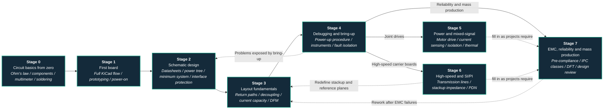

# PCB Design

**At a glance**:

- **Who it's for**: people who have never designed a circuit board and want to reach the point of independently delivering robot driver boards / sensor boards / main-controller carrier boards.
- **Path**: Stage 0–7 · circuit basics from zero → first board (KiCad) → schematic → layout → debugging and bring-up → project-driven electives (power and mixed-signal / high-speed SI/PI / EMC and mass production).
- **Depth roadmap**: the board-level foundation shared by [Torque Motor Design depth](depth-torque-motor-design.md) and Stage 4 of [Full-System Hardware Design depth](depth-humanoid-hardware-design.md).

## Roadmap overview

## How to use this path

- Target readers: people from software / algorithm / mechanical backgrounds who have **never designed a board at all**, and people who can design simple boards but want to build motor drivers, high-speed interfaces and production boards; no circuit knowledge is assumed - Stage 0 starts from Ohm's law
- **Stages 0–4 are the common trunk** ("able to build a working board independently") that everyone should complete; **Stages 5–7 are the mastery segment** and can be reordered by project: for joint drives do Stage 5 first, for main-controller / camera carrier boards do Stage 6 first, and when preparing for mass production do Stage 7 first
- Each stage has prerequisites, core questions, what to read, what to do, and what you should be able to produce; the boards under "what to do" are chosen, as far as possible, to be ones actually used on robots
- The default tool is [KiCad](../../wiki/entities/kicad.md) (free and open source, project files can go into Git); if your company uses [Altium Designer](../../wiki/entities/altium-designer.md), the concepts and workflow map one-to-one - only the menus differ
- **Primary sources first**: IPC design / acceptance standards, chip vendor application notes (TI / ADI), original textbook text and the official KiCad manual; forum posts and videos are only leads, and conclusions should be checked against primary sources
- One thing that runs through the whole path: maintain **your own pre-fabrication checklist**, and at the end of each Stage add the new pitfalls you hit - the thickness of the checklist is the thickness of your experience

**Relation to the main roadmap and other depth roadmaps:**
- This roadmap sits in the **board-level hardware foundation layer** below main roadmap L0–L2; you can enter at any stage, and no control or learning background is required
- With [Torque Motor Design depth](depth-torque-motor-design.md): Stage 4 "Driver PCB design" of that roadmap assumes you can already design boards; Stages 0–5 of this roadmap are its prerequisite and expansion
- With [Full-System Hardware Design depth](depth-humanoid-hardware-design.md): the EMC, grounding and PDU board implementation in Stage 4 of that roadmap, and the bus physical layer in Stage 5, must all be realized on boards; Stages 3 / 6 / 7 of this roadmap provide the board-level practice
- Once a board is done it must run firmware: for the protocol semantics of buses and interfaces see [Overview of Motor Driver Firmware Communication Protocols](../../wiki/overview/motor-drive-firmware-bus-protocols.md); this roadmap only covers "electrically connected, and cleanly connected"

---

## Stage 0 Circuit basics from zero: first learn to read, measure and solder

### Prerequisites
- Middle-school physics concepts of voltage and current are enough; no programming required

### Core questions
- How voltage, current, resistance and power relate: Ohm's law \(V = IR\), power \(P = VI\), and Kirchhoff's current law (currents at a node sum to zero) and voltage law (voltages around a loop sum to zero)
- What capacitors, inductors, diodes, bipolar transistors (BJT) and MOSFETs each "do in a circuit" - build behavioral intuition first, device physics can come later
- RC charging/discharging and the time constant \(\tau = RC\): why it simultaneously determines filtering, button debouncing, reset and power-up timing
- How schematic symbols map to real components: SMD package size codes (0603 / 0805, etc.), polarity markings, pin numbering
- Using a multimeter correctly: voltage in parallel, current in series, power off before measuring resistance and continuity - the wrong range setting is the number-one reason beginners blow up their meters
- Soldering: temperature-controlled iron, flux, hand-soldering through-hole and SMD parts; safety (burns, flux fumes, lithium battery short circuits)

### What to read
- Horowitz & Hill, *The Art of Electronics* (3rd ed., Cambridge University Press, 2015) Chapter 1 - the classic textbook on circuit fundamentals; read the sections on DC circuits, voltage dividers and RC circuits first
- [Tinkercad](../../wiki/entities/tinkercad.md) and [Wokwi](../../wiki/entities/wokwi.md) - build circuits in the browser first and observe them in simulation, with no fear of burning parts
- [TTL Serial Logic Levels](../../wiki/concepts/ttl-serial-logic-level.md) - the first time you understand "3.3 V and 5 V devices cannot simply be connected directly"
- [UKMARSBOT](../../wiki/entities/ukmarsbot.md) and [Micromouse](../../wiki/concepts/micromouse.md) - open-source starter robots with complete Gerber / BOM, suitable as your first complete circuit to "solder by following and read by following"
- IPC J-STD-001 (Requirements for Soldered Electrical and Electronic Assemblies) and IPC-A-610 (Acceptability of Electronic Assemblies) - the industry criteria for whether a solder joint "passes"; at this stage just compare against the illustrations to see what acceptable / unacceptable joints look like

### What to do
- Build three circuits on a breadboard and verify your hand calculations with a multimeter: a voltage divider, an LED current-limiting resistor, and an RC-delayed LED
- On a soldering practice board, solder 20 through-hole parts + 20 0805 SMD parts, and self-assess the joints against the IPC-A-610 illustrations
- In Tinkercad / Wokwi, use an MCU to read a button and drive an LED, and work out why the pull-up resistor exists

### What you should be able to produce
- Able to read a simple schematic with a dozen or so components and state the role of each component
- A usable personal toolkit: multimeter, temperature-controlled soldering iron, tweezers, flux (add an adjustable current-limited power supply if you can)
- A one-page hand-calculation note: one worked example each for Ohm's law, voltage division and the RC time constant, with breadboard measurements alongside for comparison

---

## Stage 1 First board: run through "schematic → PCB → prototype → power-on" with KiCad

### Prerequisites
- Stage 0; can install software and manage files (knowing Git is better, but you can start without it)

### Core questions
- The EDA data chain: symbol → netlist → footprint → placement and routing → rule checks → manufacturing files; why every step needs a "does it match" check (ERC checks the schematic, DRC checks the PCB)
- Why symbols and footprints are two separate things: when pin numbers don't match, the board can still be manufactured, but the chip is "wired backwards"
- The basic makeup of a two-layer board: top / bottom copper, vias, solder mask, silkscreen, board outline
- How a fab's process capabilities (minimum trace width and spacing, minimum hole size, copper thickness) become DRC rules
- What's in a manufacturing package: Gerbers, drill files, BOM, pick-and-place coordinates; why you should go through every layer again in a Gerber viewer before ordering

### What to read
- [KiCad](../../wiki/entities/kicad.md) and the "Getting Started in KiCad" chapter of the [official KiCad 10.0 Chinese documentation](https://docs.kicad.org/10.0/zh/) - follow the official getting-started guide and take your first project from schematic to Gerbers
- [Altium Designer](../../wiki/entities/altium-designer.md) - learn the same workflow in commercial EDA, so you know what to expect at a company
- Any prototype fab's public process-capability page - copy the minimum trace width / spacing / hole size into your own DRC rules
- IPC-2221 (Generic Standard on Printed Board Design) - for now only read the terminology and electrical clearance sections, so you know where "clearance rules" come from

### What to do
- Design a two-layer board no larger than 50 × 50 mm: USB power + LDO regulator + one LED + one button + one pin header, using only ready-made symbols and footprints from the library
- Run ERC and DRC, export Gerbers / drill / BOM, inspect layer by layer in a Gerber viewer, then order prototypes
- When the boards arrive, hand-solder and power them on; write down "the first thing that went wrong" (there almost always will be one)

### What you should be able to produce
- A complete KiCad project (in Git) + a set of manufacturing files + a physical board that powers on
- Pre-fabrication checklist v0: footprint matching, polarity, board outline, hole sizes, silkscreen orientation

---

## Stage 2 Schematic design: from "connected" to "designed correctly"

### Prerequisites
- Stage 1; can read an MCU pin definition table

### Core questions
- How to read a datasheet: absolute maximum ratings vs recommended operating conditions, typical application circuit, layout recommendations - why the "typical application circuit" is the best starting point for a design
- The power tree: input protection (reverse polarity, TVS, fuse) → switching step-down (buck) → linear regulator (LDO); the trade-offs between LDO and buck in efficiency, noise and heat, and the power-up sequence of each rail
- MCU minimum system: power and decoupling capacitors, clock (crystal and load capacitors), reset, boot-mode pins, debug port (SWD / JTAG) - get the minimum system right and half of the later problems never appear
- The electrical layer of peripheral interfaces: UART / I2C / SPI levels and pull-ups, CAN / RS-485 transceivers and termination resistors, ESD protection for USB ports
- Component selection and BOM: whether the package is easy to solder, availability and alternates, derating (don't let parts operate at their rated limits long-term)
- When to simulate first: use SPICE to verify your intuition about filters, op-amp amplifier circuits and power-supply load steps

### What to read
- The official hardware design guide from your chosen MCU vendor (STM32 / ESP32 / RP2040, etc. all have one) - the primary source for the minimum system, more authoritative than any tutorial
- The chapters of *The Art of Electronics* on voltage regulation and power conversion - understand the respective costs of LDOs and switching supplies
- [UART Serial Communication](../../wiki/concepts/uart-serial-communication.md), [RS-485 Serial Bus](../../wiki/concepts/rs-485-serial-bus.md), [RS-232 Serial Interface](../../wiki/concepts/rs-232-serial-interface.md), [CAN FD](../../wiki/concepts/can-fd.md) - the most common board-to-board interfaces in robots; each page covers the key physical-layer points
- [Qucs-S](../../wiki/entities/qucs-s.md) - an open-source SPICE simulation front end; KiCad schematics also have built-in ngspice simulation
- [Part-DB](../../wiki/entities/part-db.md) - component inventory and parameter management; build library-management habits starting from personal projects
- [atopile](../../wiki/entities/atopile.md) / [tscircuit](../../wiki/entities/tscircuit.md) - a new approach of describing circuits in code, useful as a reference for "module reuse" thinking, but not a substitute for fundamentals

### What to do
- Design the schematic of a **robot sensor node board**: two-stage buck + LDO power, STM32 or ESP32 minimum system, IMU on SPI, CAN transceiver + termination resistor, SWD debug port, reverse-polarity and ESD protection
- Make a table for the power tree: voltage, maximum current, power-up sequence and ripple requirement for each rail; use SPICE to simulate the input filter and the LDO load-step response
- Ask an experienced person to do a schematic review; if that isn't possible, go through your own checklist item by item, and check every chip pin by pin against its datasheet

### What you should be able to produce
- A reviewable schematic + power tree table + BOM with alternates
- Pre-fabrication checklist v1: add "check every chip pin by pin against the datasheet's typical circuit" and "every interface has protection"

---

## Stage 3 Layout fundamentals: current flows in loops, not wires

### Prerequisites
- Stage 2; understand that current must form a closed loop

### Core questions
- **Placement before routing**: place parts by signal flow and functional partitions (power entry → conversion → load; connectors at the edges, crystal right next to the MCU); placement determines most of the outcome
- **Return paths**: signal current returns to the source through the reference plane, hugging the area directly beneath the signal trace more tightly as frequency rises - why a solid ground plane works better than "drawing the ground trace thicker", and why signals crossing a plane split cause problems
- **Decoupling**: why capacitors must sit right next to the power pins with vias dropped straight to the ground plane; a capacitor's ESR / ESL determines which frequency band it is effective in
- **Current capacity and temperature rise**: how to estimate trace width, copper thickness and via count per IPC-2152; high-current copper pours and thermal pads
- **Four-layer stackup** (e.g. signal / ground / power / signal): why it is much easier to lay out than a two-layer board, and what it costs
- **Switching power supply layout**: why minimizing the area of the high-frequency loop formed by input capacitor–switch–ground is the first priority
- **Design for manufacturability (DFM) and design for assembly (DFA)**: land patterns (IPC-7351), component spacing, test points, panelization and rails, silkscreen and polarity markings

### What to read
- Analog Devices, [MT-031: Grounding Data Converters and Solving the Mystery of "AGND" and "DGND"](https://www.analog.com/media/en/training-seminars/tutorials/MT-031.pdf) and MT-101 *Decoupling Techniques* - vendor primary tutorials on grounding and decoupling
- TI, [AN-1149 *Layout Guidelines for Switching Power Supplies* (SNVA021)](https://www.ti.com/lit/snva021) - a classic short note on switching power supply layout, with good / bad layout comparisons
- Henry W. Ott, *Electromagnetic Compatibility Engineering* (Wiley, 2009), chapters on grounding, decoupling and PCB layout - a systematic treatment of return paths and planes
- IPC-2221 (generic design), IPC-2152 (current-carrying capacity), IPC-7351 (surface-mount land patterns) - the primary sources of the rules; KiCad's PCB calculator can do rough trace width / via estimates
- [Robot Power Distribution Architecture](../../wiki/concepts/robot-power-distribution-architecture.md) - see what high-current boards connect to within the full system

### What to do
- Lay out the Stage 2 sensor node board as a **four-layer board**, make two placement versions (casual placement vs planned by signal flow and return paths), and write down the reasoning behind each trade-off
- For every high-current trace, estimate temperature rise using the IPC-2152 method (or the KiCad calculator) and annotate it on the drawing
- Prototype and solder it, compare with the Stage 1 board, and record where assembly was hard to solder and where the silkscreen was hard to read

### What you should be able to produce
- A four-layer board + layout notes (partition diagram, stackup, critical loops, current-capacity estimates)
- Pre-fabrication checklist v2: add decoupling placement, switching loops, plane splits, test points, DFM items

---

## Stage 4 Debugging and bring-up: make the board talk

### Prerequisites
- Stage 3; have in hand a board you designed yourself that is not yet fully verified

### Core questions
- **First power-up procedure**: visual inspection and short-circuit check → power up rail by rail with a current-limited supply → measure every rail voltage → touch for temperature / thermal imaging → then flash firmware; what the abort criterion is at each step
- **Using instruments correctly**: oscilloscope bandwidth and probe compensation; why a long ground lead "creates" ringing that isn't really there (use a short ground spring when measuring switch nodes and ripple); decoding UART / I2C / SPI / CAN with a logic analyzer
- **Fault isolation methods**: segment isolation (reserved 0 Ω resistors / jumpers), point-by-point measurement against the schematic, part-swap comparison, thermal imaging to find shorts
- **Rework and revisions**: bodge wires, cutting traces, hot-air desoldering; write each problem up as an ECO (engineering change order) record and close the loop in the next revision
- **Firmware bring-up**: first write minimal test firmware (blink an LED, serial echo, read peripheral IDs) to verify peripherals one by one; don't jump straight to running the full application

### What to read
- Tektronix, [*ABCs of Probes*](https://www.tek.com/en/documents/whitepaper/abcs-probes-primer) - a vendor primary introduction to oscilloscope probe principles, compensation and grounding errors
- [Serial Studio](../../wiki/entities/serial-studio.md) - serial telemetry visualization, for watching sensor data in real time during bring-up
- [Wokwi](../../wiki/entities/wokwi.md) - write test firmware in simulation before the boards arrive
- [Humanoid Robot Testing Workflow](../../wiki/concepts/humanoid-testing-workflow.md) - shift testing left: board-level problems should surface at the component level, not wait until the full robot is assembled
- [Field Robotics Troubleshooting Query](../../wiki/queries/field-robotics-troubleshooting.md) - a substantial share of real-robot faults originate in contacts, power supply and interference

### What to do
- Write a bring-up checklist for the Stage 3 board and follow it strictly, recording measured values at each step
- Deliberately create three faults (cold solder joint, power short, missing I2C pull-up) and have a partner troubleshoot them blind, to practice the fault-isolation workflow
- Measure the buck output ripple twice: long ground lead vs ground spring; compare the readings and explain the difference

### What you should be able to produce
- Bring-up checklist + measurement records + ECO list (changes for the next revision)
- A board with "all peripherals verified", plus the accompanying minimal test firmware

---

## Stage 5 Power and mixed-signal: motor driver boards are the main battlefield of robot PCBs

### Prerequisites
- Stages 0–4; it is recommended to read Stages 0–3 of [Torque Motor Design depth](depth-torque-motor-design.md) in parallel, so you know what FOC requires of the hardware

### Core questions
- **Three-phase inverter power stage**: MOSFET selection (voltage rating, on-resistance, gate charge), half bridges and gate drivers, bootstrap supply, dead time
- **Power loop layout**: minimizing the area of the commutation loop formed by bus capacitor–high/low-side switches–ground; the relationship between switch-node copper area and dv/dt noise
- **Current sensing**: low-side / inline shunt resistors, Kelvin (four-wire) connections, differential amplification, synchronizing ADC sampling instants with PWM; why the sensing traces are the most interference-sensitive part of the whole board
- **Analog and digital coexistence**: partition the layout by function rather than splitting ground arbitrarily; ADC reference and filtering; protection for encoder and sensor interfaces
- **Isolation**: digital isolators, isolated power supplies; when isolation is mandatory (high-voltage bus, long-cable communication, safety requirements)
- **Thermal and protection**: copper thickness, thermal vias, the device thermal resistance chain; hardware shutdown via overcurrent comparator, bus overvoltage / undervoltage, temperature sensing

### What to read
- TI, [*Best Practices for Board Layout of Motor Drivers* (SLVA959)](https://www.ti.com/lit/slva959) - a vendor primary guide to grounding, thermal design, capacitor placement, high-current loops and gate routing
- [Torque Motor Design depth Stage 4](depth-torque-motor-design.md) - the specs a driver board must meet inside a joint
- [Field-Oriented Control (FOC)](../../wiki/concepts/field-oriented-control.md) - why current sampling instants must be aligned with PWM
- Open-source driver boards for comparative study: [moteus](../../wiki/entities/moteus.md), [VESC](../../wiki/entities/vesc.md) (KiCad hardware), [SimpleFOC](../../wiki/entities/simplefoc.md) reference boards, [Tinymovr](../../wiki/entities/tinymovr.md) (note the version boundary of its open-source snapshot)
- [Joint Module Electromagnetic Isolation](../../wiki/concepts/joint-module-electromagnetic-isolation.md) - layered isolation when high-power and low-power electronics share space
- [Joint Encoder Selection](../../wiki/concepts/joint-encoder-selection.md) - the electrical requirements of the encoder interface on a driver board
- [Actuator Drive Chain Hub](../../wiki/overview/hub-actuator-drive-chain.md) and [Drive Chain Selection Loop Query](../../wiki/queries/actuator-drive-chain-selection-loop.md) - a full-chain view of EDA → firmware → actuator modeling → bus integration
- [pcb-motor](../../wiki/entities/pcb-motor.md) - the special case of making the PCB itself into the motor stator; learn the extreme use of multilayer copper thickness and current capacity

### What to do
- Pick an open-source driver board (moteus or VESC), read the schematic and layout page by page, mark the power loop, sensing traces, gate-drive traces and how ground is connected, and write one page on "why it is laid out this way"
- Design your own low-voltage three-phase FOC driver board: gate driver IC + shunt sensing + MCU + CAN; bring it up first at low voltage with current limiting
- Use an oscilloscope to measure the switch-node waveform and phase-current sensing noise, comparing before and after layout changes

### What you should be able to produce
- A driver board that can drive a brushless motor in closed loop + notes on the power loop / sensing chain / thermal design
- A set of measurements: switch-node ringing, sensing noise, full-load temperature rise

---

## Stage 6 High-speed and SI/PI: when traces become transmission lines

### Prerequisites
- Stages 3–4; understand how capacitor and inductor impedance varies with frequency

### Core questions
- When a trace must be treated as a transmission line: it depends on comparing the signal **rise time** with the trace length, not just the clock frequency
- **Controlled impedance**: how microstrip / stripline, stackup and dielectric parameters determine characteristic impedance; stackup and impedance tolerance must be settled together with the fab
- Reflections and termination, crosstalk and spacing, differential pairs (length matching, coupling, symmetry), via stubs
- **Reference planes**: how return current flows when changing layers (return ground vias, stitching capacitors); why crossing a split is both an SI problem and an EMC problem
- **Power integrity (PDN)**: the target-impedance idea, decoupling capacitor combinations, plane capacitance and package inductance
- Routing constraints for common high-speed interfaces (USB, Ethernet, MIPI, DDR) - look at the chip vendor's layout guide first
- Simulation and measurement: field solvers to compute impedance, the concepts of TDR and eye diagrams, open-source FDTD structural simulation

### What to read
- Eric Bogatin, *Signal and Power Integrity — Simplified* (3rd ed., Pearson, 2018) - the main textbook for this stage, emphasizing intuition and engineering methods over derivations
- Howard Johnson & Martin Graham, *High-Speed Digital Design: A Handbook of Black Magic* (Prentice Hall, 1993) - the classic on ringing, crosstalk and radiated noise
- IPC-2141A (Design Guide for High-Speed Controlled Impedance Circuit Boards) - impedance design rules, crosstalk and test structures
- TI, [*High-Speed Interface Layout Guidelines* (SPRAAR7)](https://www.ti.com/lit/spraar7) - vendor rules on differential pair spacing, symmetry, vias and reference planes
- [openEMS](https://openems.de) - an open-source FDTD electromagnetic field solver; the community has KiCad → openEMS conversion tools, but they are not officially supported by KiCad, so port setup must be verified yourself
- [EtherCAT Protocol](../../wiki/concepts/ethercat-protocol.md) and [Robot Onboard Communication Architecture](../../wiki/concepts/robot-onboard-communication-architecture.md) - where the most common "high-speed lines" are in a robot and how reliable they need to be

### What to do
- Confirm a four- or six-layer stackup with the fab, and use a field solver (the KiCad calculator or the fab's tool) to compute trace width and spacing for 50 Ω single-ended and USB 90 Ω differential
- Design a main-controller / adapter board with USB 2.0 High-Speed or 100 Mbps Ethernet, route strictly per the chip's layout guide, and verify link speed and bit error rate
- Run a controlled experiment: route the same signal over a "solid reference plane" and "across a plane split", and compare waveforms and radiation with an oscilloscope or near-field probe

### What you should be able to produce
- A stackup and impedance table (fab-confirmed version) + a high-speed net routing constraint table
- A board whose high-speed interface works stably + test records

---

## Stage 7 EMC, reliability and mass production: from "it works" to "it sells and lasts" (mastery)

### Prerequisites
- Stages 3–4; have delivered at least one complete multilayer board; for power boards add Stage 5, for high-speed boards add Stage 6 - you don't need to finish both branches

### Core questions
- **The three elements of EMC**: noise sources (switching supplies, clocks, motor drives), coupling paths (conducted / radiated), and susceptible circuits; at board level, separate the three using loop area, filtering, shielding and grounding
- **Standards and pre-compliance**: depending on product category, emissions fall under CISPR 11 (industrial, scientific and medical equipment) or CISPR 32 (multimedia equipment), etc., and immunity under the IEC 61000-4 series (e.g. -2 electrostatic discharge); before formal certification, pre-test with near-field probes and a spectrum analyzer
- **Interface protection**: ESD, surge and connectors; TVS placement, handling of chassis / shield ground
- **Reliability classes**: the different requirements of IPC-6012 Class 1 / 2 / 3 (general electronics / dedicated service equipment / high reliability) on hole copper, annular ring and inspection; IPC-A-600 (bare board acceptance) and IPC-A-610 (assembly acceptance)
- **Flex and rigid-flex boards** (IPC-2223): bend life and stackup for routing through joints, fingers and tactile skins
- **Design for testability (DFT) and production lines**: test points, ICT / FCT fixtures, programming and calibration stations, serial numbers and traceability
- **Engineering system**: design review checklists, component library and part-number management, versions and ECOs, project files in Git with automatic exports via CI
- **AI and code-based EDA**: can be used to speed things up, but the electrical and manufacturing conclusions of generated results still need engineer review and sign-off

### What to read
- Henry W. Ott, *Electromagnetic Compatibility Engineering* (Wiley, 2009) - the main EMC design textbook
- IEC 61000-4-2 (electrostatic discharge immunity), CISPR 11 / CISPR 32 (emissions) - search on the [IEC Webstore](https://webstore.iec.ch/); which one applies depends on product category and target market
- IPC-6012, IPC-A-600, IPC-A-610, IPC-2223 - see the [IPC design standards overview](https://www.ipc.org/ipc-design-standards)
- The "EMC and grounding" section of [Robot Power Distribution Architecture](../../wiki/concepts/robot-power-distribution-architecture.md) and [Full-System Hardware Design depth Stage 4](depth-humanoid-hardware-design.md) - board-level EMC must follow the full system's grounding conventions
- [Humanoid Robot Wire Harness Types and Protection](../../wiki/concepts/humanoid-wire-harness-types-protection.md) - off-board harnesses are the other half of EMC and reliability problems
- [Humanoid Robot Mass Production Engineering](../../wiki/concepts/humanoid-mass-production-engineering.md) - yield, consistency and supply chain
- [OpenTac](../../wiki/entities/opentac.md) - an open-source example of a flexible-PCB tactile skin
- [KiCad](../../wiki/entities/kicad.md)'s kicad-cli, [Konnect](../../wiki/entities/konnect.md), [HeyPCB](../../wiki/entities/heypcb.md) - the current state and limits of automated export and AI-assisted design

### What to do
- Run an EMC pre-test on a completed sensor board, driver board or high-speed carrier board: scan with a near-field probe to find hot spots, change one thing (add filtering / shrink a loop / change grounding), then retest and compare
- If possible, run electrostatic discharge tests on interfaces following the approach of IEC 61000-4-2, record the failure behavior and improve the protection
- Turn one board into a "production-ready version": complete test points, panelization, alternates and an FCT test specification, and state the IPC class and acceptance requirements
- In a Git repository, configure kicad-cli to automatically export Gerbers / BOM and run DRC as a gate for every revision

### What you should be able to produce
- An EMC pre-test report (before / after spectrum comparison)
- A production delivery package: manufacturing files, IPC class and acceptance requirements, test specification, BOM and alternates, revision history
- A design review checklist your team can reuse - being able to turn the pitfalls you've hit into rules so others don't hit them is the mark of "mastery"

---

## Quick entry summary

| Stage | Core questions | Knowledge page / primary source entry |
|------|---------|-----------|
| Stage 0 | Ohm's law, component intuition, multimeter, soldering | [Tinkercad](../../wiki/entities/tinkercad.md) · [Wokwi](../../wiki/entities/wokwi.md) · *The Art of Electronics* Chapter 1 |
| Stage 1 | Full KiCad flow, DRC, manufacturing files | [KiCad](../../wiki/entities/kicad.md) · [KiCad 10.0 Chinese documentation](https://docs.kicad.org/10.0/zh/) |
| Stage 2 | Datasheets, power tree, minimum system, interface protection | [UART](../../wiki/concepts/uart-serial-communication.md) · [CAN FD](../../wiki/concepts/can-fd.md) · [Qucs-S](../../wiki/entities/qucs-s.md) |
| Stage 3 | Return paths, decoupling, current capacity, DFM | ADI MT-031 / MT-101 · TI AN-1149 · IPC-2152 / IPC-7351 |
| Stage 4 | Power-up procedure, instruments, fault isolation, ECO | Tektronix *ABCs of Probes* · [Humanoid testing workflow](../../wiki/concepts/humanoid-testing-workflow.md) |
| Stage 5 | Power stage, current sensing, isolation, thermal | TI SLVA959 · [moteus](../../wiki/entities/moteus.md) · [VESC](../../wiki/entities/vesc.md) · [Torque Motor depth Stage 4](depth-torque-motor-design.md) |
| Stage 6 | Transmission lines, controlled impedance, PDN | Bogatin *SI/PI Simplified* · IPC-2141A · TI SPRAAR7 |
| Stage 7 | EMC pre-compliance, IPC classes, DFT, review system | Ott *EMC Engineering* · IEC 61000-4-2 · IPC-6012 / IPC-A-610 |

## Relation to other pages

- Full growth roadmap reference: [Main roadmap: Motion Control → Full-Stack Physical Intelligence Growth Roadmap](motion-control.md)
- Related depth roadmaps (by topical proximity; for the full index see [Roadmap overview](motion-control.md#depth-optional-index)):
  - [Torque Motor Design](depth-torque-motor-design.md) - its Stage 4 driver PCB is the application scenario for Stage 5 of this roadmap
  - [Humanoid Full-System Hardware Design](depth-humanoid-hardware-design.md) - the power distribution, EMC and communication in its Stages 3–5 must be realized on the boards of this roadmap
  - [Teleoperation](depth-teleoperation.md) - data gloves and force-feedback devices are likewise sensing + communication boards
- Related knowledge pages:
  - EDA tools: [KiCad](../../wiki/entities/kicad.md) · [Altium Designer](../../wiki/entities/altium-designer.md) · [atopile](../../wiki/entities/atopile.md) · [tscircuit](../../wiki/entities/tscircuit.md) · [Qucs-S](../../wiki/entities/qucs-s.md) · [Part-DB](../../wiki/entities/part-db.md)
  - Interfaces and buses: [UART](../../wiki/concepts/uart-serial-communication.md) · [TTL levels](../../wiki/concepts/ttl-serial-logic-level.md) · [RS-485](../../wiki/concepts/rs-485-serial-bus.md) · [CAN FD](../../wiki/concepts/can-fd.md) · [EtherCAT](../../wiki/concepts/ethercat-protocol.md) · [Hardware Communication and Protocols Hub](../../wiki/overview/hub-communication.md)
  - Robot board-level scenarios: [Humanoid Hardware 101 · 05 Power and Compute Electronics](../../wiki/overview/humanoid-hardware-101-power-compute-electronics.md) · [Actuator Drive Chain Hub](../../wiki/overview/hub-actuator-drive-chain.md) · [Joint Module Electromagnetic Isolation](../../wiki/concepts/joint-module-electromagnetic-isolation.md)
  - Open-source hardware for comparison: [moteus](../../wiki/entities/moteus.md) · [VESC](../../wiki/entities/vesc.md) · [SimpleFOC](../../wiki/entities/simplefoc.md) · [WolfieMouse](../../wiki/entities/wolfiemouse.md) · [UKMARSBOT](../../wiki/entities/ukmarsbot.md) · [Open-Source Humanoid Robot Hardware](../../wiki/entities/open-source-humanoid-hardware.md)

## References

- Starting milestone: Paul Eisler's printed circuit - he filed the first related patent in the UK in 1936, filed the key patent application in 1943, and built a radio using printed wiring in the early 1940s (multiple PCB histories state the years differently; here we adopt the common account of "1936 first patent / 1943 key patent")
- Textbooks: Horowitz & Hill, *The Art of Electronics* (3rd ed., Cambridge University Press, 2015); Bogatin, *Signal and Power Integrity — Simplified* (3rd ed., Pearson, 2018); Johnson & Graham, *High-Speed Digital Design: A Handbook of Black Magic* (Prentice Hall, 1993); Ott, *Electromagnetic Compatibility Engineering* (Wiley, 2009)
- IPC standards: IPC-2221 (Generic Standard on Printed Board Design), IPC-2152 (current-carrying capacity), IPC-7351 (surface-mount land patterns), IPC-2141A (high-speed controlled impedance design guide), IPC-2223 (flex / rigid-flex board design), IPC-6012 (rigid board qualification and performance, Class 1/2/3), IPC-A-600 (bare board acceptability), IPC-A-610 (assembly acceptability), J-STD-001 (soldering requirements); the currently valid IPC revisions take precedence
- EMC standards: IEC 61000-4-2 (electrostatic discharge immunity) and the IEC 61000-4 series, CISPR 11 (industrial / scientific / medical equipment emissions), CISPR 32 (multimedia equipment emissions)
- Vendor application notes: TI SLVA959 (motor driver board layout), TI SNVA021 / AN-1149 (switching power supply layout), TI SPRAAR7 (high-speed interface layout), ADI MT-031 (data converter grounding), ADI MT-101 (decoupling techniques), Tektronix *ABCs of Probes*
- Tool documentation: [Official KiCad 10.0 documentation](https://docs.kicad.org/10.0/zh/), [openEMS](https://openems.de)
- Knowledge pages in this repo: [KiCad](../../wiki/entities/kicad.md), [Altium Designer](../../wiki/entities/altium-designer.md), [Robot Power Distribution Architecture](../../wiki/concepts/robot-power-distribution-architecture.md), [Joint Module Electromagnetic Isolation](../../wiki/concepts/joint-module-electromagnetic-isolation.md)
