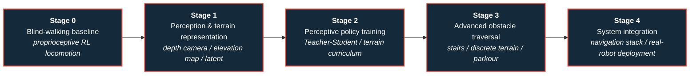

# Perceptive Locomotion

**At a glance**:

- **Who it's for**: people who want robots to look at the terrain and climb stairs, step over obstacles, and do parkour.
- **Path**: Stage 0–4 · blind-walking baseline → perception and terrain representation → perceptive policy training → advanced obstacle traversal → navigation stack and real-robot integration.
- **Depth roadmap**: a branch of the [Motion Control main roadmap](motion-control.md).

## Roadmap overview

## How to use this path

- The target reader can already train an RL locomotion policy on flat ground and wants the robot to cross complex terrain "with eyes"
- The prerequisite is the level of Stages 0–2 of the [RL depth roadmap](depth-rl-locomotion.md): able to train a blind-walking policy in simulation
- Each stage has prerequisites, core questions, what to do, and what you should be able to produce

**Relation to the main roadmap:**
- Perceptive locomotion is one of the most mainstream advanced directions after main-roadmap L5 (RL locomotion), corresponding to putting the L7.1 perception layer into practice
- The training side heavily reuses the sim2real experience of the [RL depth roadmap](depth-rl-locomotion.md) (DR, latency, state estimation)
- The foothold logic for stairs/discrete terrain comes from the same lineage as footstep planning in the [Classical Model-Based Control depth roadmap](depth-classical-control.md)

---

## Stage 0 Blind-walking baseline (proprioceptive locomotion)

**"Blind locomotion" refers to policies that use only joint encoders + IMU and do not look at the terrain. Almost all perceptive policies use it as their baseline and fallback.**

### Prerequisites
- [RL depth roadmap](depth-rl-locomotion.md) Stages 0–2: PPO, reward design, able to train locomotion in simulation
- Understand the [legged_gym](../../wiki/entities/legged-gym.md) or Isaac Lab training pipeline

### Core questions
- How a blind-walking policy "perceives" terrain (implicitly estimating contact and slope from proprioceptive history)
- Where the capability boundary of blind walking lies: why stairs, large steps, and gaps require exteroception
- How privileged training lets a policy learn deployable estimates from simulation ground truth

### What to read
- [Terrain Adaptation](../../wiki/concepts/terrain-adaptation.md)
- [Privileged Training](../../wiki/concepts/privileged-training.md)
- [Curriculum Learning](../../wiki/concepts/curriculum-learning.md)
- [ANYmal](../../wiki/entities/anymal.md) — RSL's line of work on blind walking and in-the-wild walking
- [DreamWaQ](../../wiki/methods/dreamwaq.md) — CENet imagines implicit terrain from proprioceptive history and estimates body velocity; a single-stage PPO blind-walking baseline without exteroception

### What to do
- Use curriculum learning in legged_gym / Isaac Lab to train a blind-walking policy that can cross rough terrain
- Remove the ground-truth terrain heights from the policy input and compare the performance gap with/without privileged information

### What you should be able to produce
- A blind-walking policy that walks stably on randomized rough terrain
- Be able to explain on which types of terrain blind walking inevitably fails, and why

---

## Stage 1 Perception and terrain representation

### Core questions
- Which scenarios depth cameras and LiDAR each suit (field of view, accuracy, power consumption, failure modes with window screens/reflections)
- The trade-offs between elevation maps and end-to-end depth input
- Why terrain latent representations are easier to train with than raw point clouds/depth images

### What to read
- [Terrain Latent Representation](../../wiki/concepts/terrain-latent-representation.md)
- [AME: attention-based elevation map encoding](../../wiki/entities/paper-ame-attention-based-map-encoding.md) and [AME-2 deep-reading notes](../../wiki/entities/paper-notebook-ame-2-agile-and-generalized-legged-locomotion-vi.md) — CNN + proprioception-conditioned MHA focuses on the feasible region for the next foothold; validates sparse-terrain generalization and interpretable attention on ANYmal-D and GR-1
- [Attention-based foothold optimization](../../wiki/methods/attention-foot-placement.md) — method topic page on using attention over perceived terrain representations to select walkable regions; AME is its representative implementation
- [Sensor Fusion](../../wiki/concepts/sensor-fusion.md)
- [State Estimation](../../wiki/concepts/state-estimation.md)
- [LiDAR SLAM / LIO / VIO selection](../../wiki/comparisons/lidar-slam-lio-vio-selection.md)
- [Query: Perception backbone selection](../../wiki/queries/perception-backbone-selection.md)

### What to do
- Mount a depth camera on the robot in simulation and project the depth image into a robot-frame elevation map
- Compare the training convergence speed of two observation types: "elevation map input" and "direct depth image input"

### What you should be able to produce
- Be able to explain the failure sources at each step of the elevation-map pipeline (point cloud → grid → hole filling → robot-frame transform)
- Be able to choose a reasonable perception configuration for a given platform (humanoid/quadruped, indoor/outdoor)

---

## Stage 2 Perceptive policy training (Teacher-Student / terrain curriculum)

### Core questions
- Why perceptive policies mainly use teacher-student: the teacher sees ground-truth simulated terrain, while the student only sees noisy camera/elevation maps
- How to design a terrain curriculum (difficulty progression, mix of terrain types, reset strategy)
- How to model perception noise in simulation (depth noise, occlusion, latency, self-occlusion)

### What to read
- [Privileged Training](../../wiki/concepts/privileged-training.md)
- [Procedural Terrain Generation](../../wiki/concepts/procedural-terrain-generation.md)
- [InfiniteDiffusion / Terrain Diffusion](../../wiki/entities/paper-infinite-diffusion-terrain-diffusion.md) — a new generation-side tool for learned procedural terrain (SIGGRAPH 2026, unbounded streaming generation)
- [Domain Randomization](../../wiki/concepts/domain-randomization.md)
- [DreamWaQ++](../../wiki/entities/dreamwaq-plus.md)
- [PIE: single-stage perceptive robust walking](../../wiki/methods/pie-perceptive-locomotion.md) — a single-stage visual parkour framework where depth images + proprioception pass through a multi-head estimator to output an explicit height map and an implicit environment representation; contrasts with the two-stage teacher-student route
- [Teacher-Student and DAgger training](../../wiki/methods/teacher-student-dagger-training.md) — the general paradigm of distilling a deployable student from a privileged teacher; the method page for this Stage's teacher-student perceptive policy route
- [P³](../../wiki/entities/paper-p3.md) — identifies the root cause of convergence difficulty in mainstream VAE-PPO perceptive policy training such as DreamWaQ/PIE as single-sample likelihood mistaking a component Gaussian for the marginal policy; after correcting with multi-sample marginalization (MM), the training-diagnostic retention rate goes from 64.6%→100%, convergence takes 20%+ fewer steps than the strongest MC-only, and it is best on both MuJoCo and the real G1; the official repo open-sources Isaac Lab + rl_p3 training/evaluation scripts
- Miki et al., *Learning Robust Perceptive Locomotion for Quadrupedal Robots in the Wild* (2022)

### What to do
- Upgrade the Stage 0 blind-walking policy to teacher-student: the teacher uses ground-truth terrain height samples, and the student is distilled using noisy elevation maps
- Use procedural terrain generation to build a stairs + steps + gaps curriculum, and observe how curriculum order affects success rate

### What you should be able to produce
- A student policy that can climb stairs by looking at the elevation map in simulation
- First-hand intuition for perception noise modeling and curriculum design

---

## Stage 3 Advanced obstacle traversal (stairs / discrete terrain / parkour)

### Core questions
- Why stairs and discrete terrain (stepping stones, gaps) are an order of magnitude harder than slopes (footholds are hard constraints)
- How parkour-type works implicitly fold "foothold selection" into end-to-end policies (Extreme Parkour's inner-product reward, waypoint guidance)
- What problems **planning-guided** (DCM/foothold supervision in the reward) and **end-to-end perceptive policies** each solve, and what each retains on the deployment side
- Differences between humanoids and quadrupeds in perceptive locomotion (high center of mass, blind spots in the field of view, small bipedal support region)

### What to read
- [Stair and obstacle perceptive locomotion task hub](../../wiki/tasks/stair-obstacle-perceptive-locomotion.md) — panoramic entry point to papers in this direction
- [FastStair](../../wiki/entities/paper-faststair-humanoid-stair-ascent.md) — onboard elevation map + GPU-parallel DCM footholds as training supervision; humanoid **high-speed stair climbing** (LimX Oli ~1.65 m/s); planning guidance + speed-specific expert LoRA fusion
- [Explicit Stair Geometry](../../wiki/entities/paper-explicit-stair-geometry-humanoid-locomotion.md) — contrasted with FastStair: BEV point cloud → low-dimensional geometry tokens conditioning PPO, emphasizing OOD risers and long outdoor stairs on G1
- [Capture Point / DCM](../../wiki/concepts/capture-point-dcm.md) — dynamics and discrete-search intuition for planning-guided routes such as FastStair
- [Multi-Expert Distillation](../../wiki/methods/multi-expert-distillation.md) — per-terrain/per-skill RL experts → DAgger aggregation → optional RLFT; see sources for the primary-source index
- [Parkour in the Wild (IJRR 2026)](../../wiki/entities/paper-parkour-in-the-wild.md) — 9-expert MED + four-depth LSTM + RLFT; ANYmal D deployed in the wild; training code not open-sourced
- [Robot Parkour Learning](../../wiki/entities/paper-robot-parkour-learning.md) — CoRL 2023 precedent of five-skill DAgger distillation (**open-sourced**)
- [Extreme Parkour](../../wiki/entities/extreme-parkour.md)
- [ANYmal Parkour deep-reading notes](../../wiki/entities/paper-notebook-anymal-parkour-robust-perceptive-locomotion.md)
- [Humanoid Parkour Learning deep-reading notes](../../wiki/entities/paper-notebook-humanoid-parkour-learning.md)
- [Footstep Planning](../../wiki/concepts/footstep-planning.md) — contrast with model-based foothold methods
- [Go2 perceptive OCS2 NMPC: elevation-map convex decomposition and foothold geometric constraints](../../wiki/entities/ocs2-perceptive-mpc-go2.md) — **model-based control contrast route**: elevation map → convex tread surfaces/SDF → NMPC → WBC; note that this Go2 implementation disables foot-region constraints by default, so the green regions in RViz cannot be taken to mean full stairs are feasible
- [Light-Loco-Parkour](../../wiki/entities/paper-light-loco-parkour.md) — expands sparse human motion seeds via Real2Sim2Real into terrain families + multi-expert DAgger/transfer RL/depth GRU distillation into a single depth policy with no skill labels; Lightbot 0 climbs up to 0.83H, stepping stones 99.9%, 50 Hz on Orin Nano edge compute; code not open-sourced
- [ParkourFormer](../../wiki/entities/paper-parkourformer.md) — a Transformer queries history with the current state, supervises AMP states two steps ahead, and conditions actions on them; single policy averages 93.85% traversal across nine terrain types on G1; removing MSE collapses stair descent to 9.50%; code not open-sourced
- [TRAMP](../../wiki/entities/paper-tramp-vision-assisted-bipedal-locomotion.md) (SJTU, IEEE RA-L 2026) — single-stage vision-assisted RL: hierarchical feature extraction + MoE actor + terrain-dependent AMP, with low-cost onboard depth; real-robot validation on slopes/stairs/high platforms/wide trenches and cluttered outdoor scenes; code not open-sourced
- [CMoE](../../wiki/entities/paper-cmoe.md) (Fudan, ICRA 2026) — single-stage PPO + elevation-map MoE, using SwAV-style terrain contrastive learning to fix the uniform gating activation of vanilla MoE; real G1 on 20 cm steps and 80 cm trenches; official Isaac Gym code open-sourced
- [CReF](../../wiki/entities/paper-cref.md) (Zhejiang University/Shandong University) — single-stage forward depth + proprioception fused via cross-attention and a GRU highway, without 2.5D mapping or geometric auxiliary objectives; AgiBot X2 Ultra zero-shot on stairs/40 cm platforms/80 cm trenches; training code not open-sourced

### What to do
- Reproduce the training of an open-source parkour work (Extreme Parkour / humanoid parkour) in simulation
- Compare **end-to-end depth policies** with **planning-guided RL** (e.g., FastStair's foothold-tracking pretraining): ablate the elevation-map input, the planning supervision, and the speed-specific experts, and see which component loses the most on stairs
- Ablate item by item: remove depth input, remove the curriculum, remove waypoint guidance, and record which component causes the biggest drop

### What you should be able to produce
- A perceptive policy that can cross stairs + at least one type of discrete obstacle in simulation
- For a new perceptive locomotion paper, be able to quickly locate whether its contribution lies in perception, curriculum, or reward design

---

## Stage 4 System integration (navigation stack / real-robot deployment)

### Core questions
- How to connect a local obstacle-traversal policy to global navigation (where waypoints come from, how semantic goals are issued)
- How to handle perception latency, odometry drift, and extrinsic calibration errors on the real robot
- When to fall back to blind-walking mode (perception failure detection and degradation strategy)

### What to read
- [Hierarchical quadruped navigation stack](../../wiki/concepts/hierarchical-quadruped-navigation-stack.md)
- [Smooth navigation path generation](../../wiki/methods/smooth-navigation-path-generation.md)
- [Sim2Real](../../wiki/concepts/sim2real.md)
- [Query: Locomotion failure modes](../../wiki/queries/locomotion-failure-modes.md)
- [VB-Com](../../wiki/entities/paper-notebook-vb-com-learning-vision-blind-composite-humanoid.md) (ICRA 2026) — frames "perception failure" as a switchable control problem rather than adding more training noise: a return estimator that consumes only proprioceptive history judges whether the elevation map is still reliable, and if not, hands control to a blind policy that has learned contact recovery; validated on both G1/H1 for degradation and recovery under fast oncoming pedestrians and zero-elevation input; project page says Code coming soon

### What to do
- Plug the Stage 3 policy into a hierarchical "goal point → path → local obstacle traversal" stack and run long-distance tasks in simulation
- Inject latency and drift into the perception chain and verify the switching logic for degrading to blind walking

### What you should be able to produce
- A complete simulated system chain of "perception → obstacle-traversal policy → navigation stack"
- A pre-deployment checklist for the real robot: calibration, latency, failure degradation

---

## Quick entry summary

| Stage | Core question | Knowledge page entry |
|------|---------|-----------|
| Stage 0 | Blind-walking baseline | [Terrain Adaptation](../../wiki/concepts/terrain-adaptation.md) |
| Stage 1 | Terrain representation | [Terrain Latent Representation](../../wiki/concepts/terrain-latent-representation.md) |
| Stage 2 | Perceptive policy training | [Privileged Training](../../wiki/concepts/privileged-training.md) |
| Stage 3 | Stairs / parkour | [Stair and obstacle perceptive locomotion hub](../../wiki/tasks/stair-obstacle-perceptive-locomotion.md); for high-speed humanoid stair climbing see [FastStair](../../wiki/entities/paper-faststair-humanoid-stair-ascent.md) |
| Stage 4 | Navigation stack integration | [Hierarchical quadruped navigation stack](../../wiki/concepts/hierarchical-quadruped-navigation-stack.md) |

## Relation to other pages

- Full growth roadmap reference: [Main roadmap: Motion control → full-stack physical intelligence growth roadmap](motion-control.md)
- Related depth roadmaps (ordered by topical proximity; for the full catalog see [Roadmap index](motion-control.md#depth-optional-index)):
  - [RL locomotion](depth-rl-locomotion.md) — blind-walking baseline and training pipeline
  - [Navigation](depth-navigation.md) — large-scale "where to go" vs foothold-level "where to step"
  - [Loco-Manipulation](depth-loco-manipulation.md) — after traversing obstacles, there is still manipulation
  - [Sim2Real](depth-sim2real.md) — the domain gap in taking perceptive policies to the real robot
  - [Model architecture](depth-model-architecture.md) — a cross-cutting view: architecture choices for terrain encoders and policy networks
- Related knowledge pages:
  - [Stair and obstacle perceptive locomotion task hub](../../wiki/tasks/stair-obstacle-perceptive-locomotion.md)
  - [FastStair](../../wiki/entities/paper-faststair-humanoid-stair-ascent.md) — Stage 3 high-speed humanoid stair climbing · planning-guided RL
  - [Terrain Adaptation](../../wiki/concepts/terrain-adaptation.md)
  - [Terrain Latent Representation](../../wiki/concepts/terrain-latent-representation.md)
  - [Privileged Training](../../wiki/concepts/privileged-training.md)
  - [Procedural Terrain Generation](../../wiki/concepts/procedural-terrain-generation.md)
  - [Capture Point / DCM](../../wiki/concepts/capture-point-dcm.md)
  - [Footstep Planning](../../wiki/concepts/footstep-planning.md)
  - [Extreme Parkour](../../wiki/entities/extreme-parkour.md)

## References

- [Stair and obstacle perceptive locomotion task hub](../../wiki/tasks/stair-obstacle-perceptive-locomotion.md)
- [FastStair](https://arxiv.org/abs/2601.10365) (arXiv:2601.10365)
- [Terrain Adaptation](../../wiki/concepts/terrain-adaptation.md)
- [Privileged Training](../../wiki/concepts/privileged-training.md)
- [ANYmal Parkour deep-reading notes](../../wiki/entities/paper-notebook-anymal-parkour-robust-perceptive-locomotion.md)
- Miki et al., *Learning Robust Perceptive Locomotion for Quadrupedal Robots in the Wild* (2022)
- Cheng et al., *Extreme Parkour with Legged Robots* (2023)
