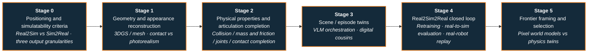

# Real-to-Sim (Real2Sim)

**At a glance**:

- **Who it's for**: people who want to turn the real world into assets that can be used for training and evaluation in simulation.
- **Path**: Stage 0–5 · "simulatable" criteria → geometry and appearance reconstruction → physical properties and articulation completion → scene / episode twins → Real2Sim2Real closed loop → frontier and selection.
- **Depth roadmap**: the reverse complement of [Sim2Real depth](depth-sim2real.md); also the expanded version of the simulation-asset and evaluation stages of L6/L7 in the [Motion Control main roadmap](motion-control.md).

## Roadmap overview

## How to use this path

- The target reader is someone who "has real-robot / real-scene images, videos, point clouds or interaction recordings, and wants to turn them into assets for training policies in simulation, generating data at scale, or running reproducible evaluation" - the main battlegrounds are manipulation scene twins, human–scene interaction reconstruction, trainable visual environments, and simulation evaluation infrastructure
- Real2Sim addresses **"where simulation-side assets come from"**: it is not responsible for training the policy (that is the topic of [RL depth](depth-rl-locomotion.md) and [Imitation Learning depth](depth-imitation-learning.md)), nor for moving the policy onto the real robot (that is the topic of [Sim2Real depth](depth-sim2real.md)); it is responsible for **compressing the real world into physically credible, replayable, augmentable simulation assets**
- Each stage has prerequisites, core questions, what to do, what to read, and what you should be able to produce

**Relation to the main roadmap:**
- This roadmap is the expanded version of the "simulation assets and evaluation" part of main roadmap **L6 (integrated practice · sim2real closed loop) and L7 (evaluation / data infrastructure)**; you can enter it on its own without finishing L6 first - all you need to start is the ability to load and roll out a scene in one physics engine
- Stage 1's contact geometry shares the "contact credibility" criteria with [Contact Manipulation depth](depth-contact-manipulation.md); Stage 3's human–scene interaction shares the "human motion into scenes" representation with [Motion Retargeting depth](depth-motion-retargeting.md) and [Motion Generation depth](depth-motion-generation.md)
- This roadmap and [Sim2Real depth](depth-sim2real.md) are **two ends of the same gap spectrum**: Real2Sim first shrinks the gap on the simulation side, and Sim2Real residual adaptation then absorbs the remaining residual on the real-robot side - orthogonal and complementary, and in engineering usually chained rather than either-or (see [Sim2Real Residual Adaptation vs Real2Sim Real-Robot Replay Comparison](../../wiki/comparisons/sim2real-vs-real2sim-fine-tuning.md))

---

## Stage 0 Positioning and "simulatable" criteria: first pin down what "simulatable" means

**The first lesson of Real2Sim is not reconstruction but first separating "looks right" from "runs in simulation" - many reconstructions stop at a nice-looking dense mesh that, once put into a contact solver, penetrates, jitters or floats.**

### Prerequisites
- Able to load and roll out a scene in a physics engine ([MuJoCo](../../wiki/entities/mujoco.md) or [Isaac Lab](../../wiki/entities/isaac-gym-isaac-lab.md))
- Understand the domain gap concept of [Sim2Real](../../wiki/concepts/sim2real.md) (this roadmap is its asset-side upstream)

### Core questions
- **Division of labor between Real2Sim and Sim2Real**: Sim2Real transfers **policies**, Real2Sim constructs **assets**; the two are orthogonal and complementary, and what Real2Sim shrinks is exactly the amount that Sim2Real residual adaptation would otherwise have to absorb on the real robot
- **Criteria for "simulation-ready"**: collidable, no self-penetration, has mass/friction, joints movable, can be rolled out by a policy - the evaluation framing should include **tracking failure rate / simulation throughput / real-to-sim correlation**, not just rendering realism
- **Three output granularities**: object/asset twin → scene twin → **episode twin** (including actuators, trajectories, contacts and task semantics); the larger the granularity, the closer it gets to the "replay / evaluation / policy learning" narrative
- **Layering of the physical root causes of the gap**: geometry/URDF → rigid-body dynamics → contact/friction → actuators, four layers; asset reconstruction usually focuses on the first three layers, but episode twins can also identify actuators and control responses. Calibration results are shared with [Sim2Real Stage 1](depth-sim2real.md), and actuators must not be excluded from Real2Sim by taxonomy

### What to do
- Take a dense mesh / point cloud you reconstructed yourself, drop it into a physics engine for 10 seconds, and record one by one the "looks right, useless in simulation" failures such as penetration, jitter and floating, forming a "simulatability criteria checklist"
- Decide the output granularity your target task needs (object / scene / episode), and write down which physical quantities each must preserve

### What to read
- [Sim2Real](../../wiki/concepts/sim2real.md) - the conceptual hub for the overall map of Real2Sim assets and transfer
- [Sim2Real Residual Adaptation vs Real2Sim Real-Robot Replay vs Direct Real-Robot Fine-Tuning](../../wiki/comparisons/sim2real-vs-real2sim-fine-tuning.md) - places Real2Sim in the three-way spectrum of "where the gap is absorbed"
- [Physics Fidelity ↔ sim2real gap](../../wiki/concepts/physics-fidelity-sim2real-gap.md) - the four-layer causality of geometry/rigid body/contact/actuator
- [CRISP (Contact-guided Real2Sim)](../../wiki/methods/crisp-real2sim.md) - a representative source of "simulatable rather than pretty" criteria (tracking failure rate 55.2%→6.9%)

### What you should be able to produce
- A "simulatability criteria × common failures" comparison table
- Able to state in one sentence which side Real2Sim and Sim2Real each change, and why they are orthogonal and complementary

---

## Stage 1 Geometry and appearance reconstruction: contact dynamics vs photorealism

**"Real" has two orthogonal dimensions: credible contact dynamics (can stand, can sit, no penetration) and photorealistic appearance (shrinking the visual domain gap); first work out which dimension is the bottleneck, then choose the representation.**

### Prerequisites
- Stage 0 content
- Understand the basic representational differences between point clouds / meshes / NeRF / 3D Gaussian Splatting (3DGS)

### Core questions
- **Choosing between the two "real" dimensions**: [CRISP](../../wiki/methods/crisp-real2sim.md) uses **convex planar primitives** to pursue credible contact dynamics (foot–ground and hip–chair without penetration, roll-out-able); [GS-Playground](../../wiki/entities/gs-playground.md) uses batched **3DGS** to pursue photorealistic appearance (visual observations at up to about 10⁴ FPS); the two are not competitors but two stages that can be chained
- **Monocular vs multi-view input**: CRISP consumes internet-style monocular RGB video; 3DGS reconstruction and 360° scanning pipelines need multiple views / a camera array
- **Hybrid representation**: splat background + collidable mesh foreground ([SimFoundry](../../wiki/entities/paper-simfoundry-real2sim-scene-generation.md)'s scene representation), achieving both "looks real" and "collides properly"
- **Web large-scene 3DGS rendering stack**: bringing reconstructed assets into the browser for visualization and debugging ([Spark](../../wiki/entities/spark-3dgs-renderer.md) / [Aholo Viewer](../../wiki/entities/aholo-viewer.md))

### What to do
- For the same scene, make one version "contact-first" (planar primitives/collision mesh) and one "appearance-first" (3DGS), compare rollout stability and visual realism, and attribute the bottleneck to the contact gap or the visual gap
- Reproduce a public end-to-end "scan → digital twin → simulation training" pipeline, and record how reconstruction quality affects the downstream policy

### What to read
- [CRISP vs GS-Playground: Real2Sim Route Selection (Contact Dynamics vs Photorealism)](../../wiki/comparisons/crisp-vs-gs-playground-real2sim.md) - the core selection page for this stage
- [CRISP (Contact-guided Real2Sim)](../../wiki/methods/crisp-real2sim.md) · [GS-Playground](../../wiki/entities/gs-playground.md) - representative implementations of the two dimensions
- [Flexion × Niantic × NVIDIA RGB Sim2Real Pipeline](../../wiki/entities/flexion-niantic-nvidia-rgb-sim2real-pipeline.md) - 360° scan → NuRec digital twin with 3DGS + collision mesh → zero-shot real-robot Isaac Lab RGB navigation
- [NVIDIA Omniverse NuRec](../../wiki/entities/nvidia-nurec.md) - the official USDZ volume and the two reconstruction entry points for Isaac / AV
- [Instant NuRec](../../wiki/entities/paper-instant-nurec.md) - single-forward-pass 3DGS from driving logs (~1.5 s), used as a per-scene NuRec seed; do not apply this CLI to office scans
- [i3dGS](../../wiki/entities/paper-i3dgs-immediate-3dgs-unordered.md) - **immediate** 3DGS reconstruction from unordered RGB photo streams + global loop closure (SIGGRAPH 2026; official GraphDeco code is open source); upstream of roaming capture / mixed capture with supplementary shots, no collision mesh
- [Skyfall-GS](../../wiki/entities/paper-skyfall-gs.md) - **satellite imagery** → walkable city-block 3DGS (ECCV 2026; Stage 1 pseudo-depth + Stage 2 IDU/FlowEdit; open-sourced under Apache 2.0); remote anchoring of urban geometry, not street-view COLMAP
- [Spark vs Aholo: Web Large-Scene 3DGS Renderer Selection](../../wiki/comparisons/spark-vs-aholo-web-3dgs-renderers.md) - the browser visualization stack for reconstructed assets

### What you should be able to produce
- A record of the "contact dimension / appearance dimension" bottleneck determination and representation choice for your scene
- Able to explain why the remedies for the contact geometry gap and the visual appearance gap cannot substitute for each other

---

## Stage 2 Physical properties, contact and articulation completion: from "visible" to "collidable"

**Geometry is only the skeleton; to be simulatable you also need to add collision bodies, mass and friction, and joint degrees of freedom, and fill back in the support surfaces missing at occlusions - this layer determines whether an asset "can be touched by a policy".**

### Prerequisites
- Stage 1 content
- Understand the basic concepts of collision approximation (convex decomposition), 6D pose estimation and articulation modeling

### Core questions
- **From geometry to physics**: collision decomposition (e.g. CoACD), mass/friction annotation (VLM queries), 6D pose refinement (FoundationPose-style), penetration resolution before export (e.g. resolved inside PyBullet) - the Generation stage of [SimFoundry](../../wiki/entities/paper-simfoundry-real2sim-scene-generation.md) is a complete reference
- **Articulation inference**: cabinets/drawers/doors etc. require inferring **joint axes and limits**, turning a static mesh into an articulated asset that can open and close
- **Contact-guided occlusion completion**: much structure is invisible during interaction (e.g. a chair seat blocked by a person); [CRISP](../../wiki/methods/crisp-real2sim.md) uses **human–scene contact** to infer occluded support surfaces, avoiding "looks right, but floats/penetrates in simulation"
- **Sim-ready asset generation (rather than hand-crafting piece by piece)**: [PhysX-Omni](../../wiki/entities/physx-omni.md) generates rigid/deformable/articulated sim-ready assets in a unified way; [Articraft](../../wiki/entities/articraft.md) uses an agentic procedural loop + compile/verify feedback to generate objects with joint limits and PBR
- **Physical consistency as a filter**: CRISP uses an [RL](../../wiki/methods/reinforcement-learning.md) humanoid controller to push "human + scene" into the physically feasible region, binding geometry and control together; physically infeasible reconstructions are exposed during rollout

### What to do
- For one reconstructed object, complete the four-piece set of "collision body + mass + friction + joint limits", and verify in a physics engine that grasping/opening does not penetrate
- Reproduce one contact-guided completion (e.g. inferring a chair seat from a sitting pose), and compare before and after completion "whether it can sit stably/stand up"

### What to read
- [SimFoundry (Modular Real2Sim Scene Generation)](../../wiki/entities/paper-simfoundry-real2sim-scene-generation.md) - three stages of Extraction/Generation/Augmentation, a complete engineering reference for physical properties and articulation
- [CRISP (Contact-guided Real2Sim)](../../wiki/methods/crisp-real2sim.md) - contact-guided occlusion completion + RL physical-consistency closed loop
- [PhysX-Omni](../../wiki/entities/physx-omni.md) · [Articraft](../../wiki/entities/articraft.md) - the generative and agentic-procedural routes to sim-ready assets
- [Lightwheel SimReady](../../wiki/entities/lightwheel-simready.md) - an OpenUSD physically accurate simulation asset system and asset library (self-reported 2,000+ items, partly open-sourced under CC BY-NC)
- [Contact Manipulation depth](depth-contact-manipulation.md) - the task-side neighboring roadmap for "contact credibility" criteria

### What you should be able to produce
- A "physical property/articulation completion checklist" for upgrading reconstructed geometry into simulatable assets
- Able to explain why "putting a dense mesh straight into the engine" often produces spurious collisions, and what contact completion solves

---

## Stage 3 Scene / episode twins and digital cousins: from single objects to replayable interaction

**A single collidable object is not yet a task; either assemble it into a full scene, or reproduce real-robot interaction recordings as replayable episodes, and augment along semantics into thousands of "digital cousins" to feed training.**

### Prerequisites
- Stage 2 content
- Understand [the difference between VLM and VLA](../../wiki/comparisons/vlm-vln-vla-vlx-world-model-taxonomy.md), and the role of VLMs in scene understanding/physical property annotation/task proposal

### Core questions
- **Scene twin vs episode twin**: [SimFoundry](../../wiki/entities/paper-simfoundry-real2sim-scene-generation.md) reconstructs **sim-ready scenes** from a single video; [Agentic Real2Sim](../../wiki/entities/paper-agentic-real2sim.md) reproduces real-robot interaction recordings as **MuJoCo episode twins** (including actuators/trajectories/contacts/tasks)
- **Single-image compositional scene generation**: [DistScene](../../wiki/entities/paper-distscene.md) jointly generates the environment and independent objects, and shows examples imported into a navigation simulator; the paper's evaluation focuses on geometric quality, code / checkpoints / datasets are still pending release, and physical usability needs separate verification
- **Decoupled design of VLM-agent orchestration**: the agent only makes **schema-constrained decisions** such as object discovery, keyframes, and mask/tracking critics, while geometry and grasp sweeps go through **deterministic tools** - hence an open-source 31B model achieves replay success close to closed-source large models at roughly an order of magnitude lower cost
- **Digital cousins as controllable domain randomization**: object/scene/task cousins are **affordance-preserving semantic variants**, not simple pose noise; SimFoundry reports average task success gains of about +17%/+21%/+40% respectively - expanding Real2Sim from "replicating one scene" to "mass-producing trainable scenes"
- **Generation vs reconstruction of human–scene interaction**: [CRISP](../../wiki/methods/crisp-real2sim.md) **backward-reconstructs** simulatable humanoid motion from video; [COINS](../../wiki/entities/paper-coins-compositional-human-scene-interaction.md) **forward-synthesizes** static interactions by semantics; [DIMOS](../../wiki/entities/paper-dimos-human-scene-motion-synthesis.md) forward-synthesizes indoor sitting/lying/walking in an RL latent space - complementary "reconstruction vs generation"

### What to do
- Starting from a real-robot manipulation recording, run through "object discovery → segmentation/pose → physical properties → scene loading → in-simulation grasp repair" and produce a replayable episode
- Use object/scene/task cousins to do one controlled augmentation of a base scene, and verify generalization on held-out objects/layouts

### What to read
- [Agentic Real2Sim (Physics Real2Sim Orchestrated by VLM Agents)](../../wiki/entities/paper-agentic-real2sim.md) - episode twins + swappable VLM backends + decoupling via deterministic tools
- [SimFoundry](../../wiki/entities/paper-simfoundry-real2sim-scene-generation.md) - a complete augmentation pipeline with scene twins + three kinds of digital cousins
- [SceneAgent](../../wiki/entities/paper-sceneagent-real2sim-capture-physics.md) - 3DGS/photogrammetry/LiDAR → predicted physics USD + **digital sisters** + demonstration factory (Harvard; code pending release)
- [COINS](../../wiki/entities/paper-coins-compositional-human-scene-interaction.md) · [DIMOS](../../wiki/entities/paper-dimos-human-scene-motion-synthesis.md) - forward-synthesis counterparts for human–scene interaction
- [Motion Generation depth](depth-motion-generation.md) · [Motion Retargeting depth](depth-motion-retargeting.md) - neighboring roadmaps for the "human motion into scenes" representation

### What you should be able to produce
- A replayable episode reproduced from a real-robot recording, or a set of scenes with digital cousins
- Able to explain the difference in physical quantities preserved by scene twins vs episode twins, and why it is enough for the agent to make only schema decisions

---

## Stage 4 Real2Sim2Real closed loop: retraining, real-to-sim evaluation and real-robot replay

**The value of reconstructed assets lies in "being used back in simulation" - for training transferable policies, for reproducible evaluation, or as a data source for correcting the simulator; each of the three downstream uses closes its own loop.**

### Prerequisites
- Stage 3 content
- Understand the basic loop of training a policy in simulation and then transferring it to the real robot (you can first read [Sim2Real depth](depth-sim2real.md) Stages 0–2)

### Core questions
- **Use A · train policies back in simulation, then transfer to the real robot**: train on reconstructed scenes/digital cousins and deploy zero-shot - RGB navigation in the [Flexion pipeline](../../wiki/entities/flexion-niantic-nvidia-rgb-sim2real-pipeline.md), visual loco-manipulation in [VIRAL](../../wiki/entities/paper-viral-humanoid-visual-sim2real.md), SimFoundry's sim-to-real manipulation training (YAM/DROID near 99–100%); [PRISM](../../wiki/entities/paper-prism-real2sim2real.md) uses **V2V counterfactual + contact-anchored Real2Sim** to expand 4 human videos into G1 **depth + joystick** pick–carry–drop (arXiv:2609.38172)
- **Use B · real-to-sim policy evaluation infrastructure**: treat a credible simulator as **scalable closed-loop evaluation**, using real-to-sim correlation to turn model iteration from a wall-clock bottleneck into a compute bottleneck ([Simulation Evaluation Infrastructure](../../wiki/concepts/simulation-evaluation-infrastructure.md)); SimFoundry reports sim↔real mean **Pearson 0.911 / MMRV 0.018**; the framing must be clear about the "reproducibility ↔ representativeness" trade-off ([Sim vs Real Evaluation Gap](../../wiki/concepts/sim-vs-real-eval-gap.md)); for an industry reference see [Genesis World 1.0](../../wiki/entities/genesis-world-10.md)
- **Use C · Real2Sim real-robot replay as a "last mile" fine-tuning route**: instead of training on the real robot, use real-robot data to correct the simulator and then retrain the policy, with zero exploration risk on the real robot ([Sim2Real Residual Adaptation vs Real2Sim Real-Robot Replay Comparison](../../wiki/comparisons/sim2real-vs-real2sim-fine-tuning.md))
- **Closed-loop view**: Real2Sim first shrinks the gap on the simulation side → retrain in simulation → Sim2Real residual adaptation absorbs the remaining residual on the real-robot side; the three form a continuous spectrum along the axis of "where the gap is absorbed"

### What to do
- Train a pure-RGB policy on a reconstructed scene and do one zero-shot real-robot (or cross-simulator sim2sim) validation, recording how reconstruction quality affects success rate
- Recompute a real-to-sim evaluation: compute Pearson/MMRV between the simulation success rates and real-robot results of several checkpoints, and judge whether "screening checkpoints in sim first" is trustworthy

### What to read
- [Simulation Evaluation Infrastructure](../../wiki/concepts/simulation-evaluation-infrastructure.md) · [Sim vs Real Evaluation Gap](../../wiki/concepts/sim-vs-real-eval-gap.md) - methods and framing for real-to-sim evaluation
- [SIMPLER / SimplerEnv](../../wiki/entities/paper-simplerenv-real2sim-eval.md) - established the real-to-sim evaluation paradigm: after aligning control and visual gaps, no digital twin needs to be built, and simulation success rates correlate strongly with real Google Robot / Bridge WidowX results
- [SimFoundry](../../wiki/entities/paper-simfoundry-real2sim-scene-generation.md) - a closed-loop example where the same set of assets is used for both evaluation and training
- [Flexion RGB Sim2Real Pipeline](../../wiki/entities/flexion-niantic-nvidia-rgb-sim2real-pipeline.md) · [VIRAL](../../wiki/entities/paper-viral-humanoid-visual-sim2real.md) - zero-shot real-world deployment of visual policies trained in reconstructed/rendered scenes
- [Embodied Foundation Model Evaluation Benchmark Selection Loop](../../wiki/queries/embodied-eval-benchmark-selection-loop.md) - where real-to-sim evaluation sits in the full benchmark stack

### What you should be able to produce
- A selection record for the three uses of "reconstructed assets → training / evaluation / replay"
- Able to determine whether an evaluation conclusion can be extrapolated to the real robot (whether the evaluation gap is a reproducibility cost or reconstruction distortion)

---

## Stage 5 Frontier, framing and selection: pixel world models vs physics twins

### Prerequisites
- Stage 4 content

**Direction A: pixel world models vs physics-engine twins**
- [Video-as-Simulation](../../wiki/concepts/video-as-simulation.md) uses interactive video predictors instead of rigid-body engines for pixel-level counterfactual rehearsal, a different paradigm from this roadmap's **physics-engine twins**; the output of [Agentic Real2Sim](../../wiki/entities/paper-agentic-real2sim.md) is a **physics-engine episode**, not a pixel rollout - do not conflate them

**Direction B: three core selection pairs**
- Contact dynamics vs photorealism: [CRISP vs GS-Playground](../../wiki/comparisons/crisp-vs-gs-playground-real2sim.md) (can be chained)
- Scene twin vs episode twin: [SimFoundry](../../wiki/entities/paper-simfoundry-real2sim-scene-generation.md) (scene + cousins + Pearson/MMRV) vs [Agentic Real2Sim](../../wiki/entities/paper-agentic-real2sim.md) (episode twin + VLM orchestration + replay success)
- Whether the gap is absorbed on the simulation side or the real-robot side: [Real2Sim Real-Robot Replay vs Residual Adaptation vs Direct Fine-Tuning](../../wiki/comparisons/sim2real-vs-real2sim-fine-tuning.md)

**Direction C: maturity and open-source boundaries**
- Many works are still **code coming soon** (e.g. Agentic Real2Sim). [SimFoundry](../../wiki/entities/paper-simfoundry-real2sim-scene-generation.md) is **partially open-sourced** ([NVlabs/SimFoundry](https://github.com/NVlabs/SimFoundry): A/B reconstruction and cousins are runnable, paper-level training/evaluation is not in the repo). [CRISP](../../wiki/methods/crisp-real2sim.md) / [Articraft](../../wiki/entities/articraft.md) / [PhysX-Omni](../../wiki/entities/physx-omni.md) have public code or data - before selecting, always check open-source status and reproducibility boundaries first

**Direction D: converging with the full-system stack**
- Where Real2Sim assets/evaluation sit in [VLA depth](depth-vla.md), [BFM depth](depth-bfm.md), [WAM depth](depth-wam.md) and [Sim2Real depth](depth-sim2real.md); reconstructed trainable environments are one piece of the puzzle in the data and evaluation layer of the full-system stack

---

## Quick entry summary

| Stage | Core questions | Knowledge page entry |
|------|---------|-----------|
| Stage 0 | Positioning and simulatability criteria | [Sim2Real Residual Adaptation vs Real2Sim Real-Robot Replay](../../wiki/comparisons/sim2real-vs-real2sim-fine-tuning.md) |
| Stage 1 | Geometry and appearance reconstruction | [CRISP vs GS-Playground (Real2Sim)](../../wiki/comparisons/crisp-vs-gs-playground-real2sim.md) |
| Stage 2 | Physical properties and articulation completion | [SimFoundry](../../wiki/entities/paper-simfoundry-real2sim-scene-generation.md) |
| Stage 3 | Scene / episode twins and digital cousins | [Agentic Real2Sim](../../wiki/entities/paper-agentic-real2sim.md) |
| Stage 4 | Real2Sim2Real closed loop and evaluation | [Simulation Evaluation Infrastructure](../../wiki/concepts/simulation-evaluation-infrastructure.md) |
| Stage 5 | Frontier framing and selection | [Video-as-Simulation](../../wiki/concepts/video-as-simulation.md) |

## Relation to other pages

- Full growth roadmap reference: [Main roadmap: Motion Control → Full-Stack Physical Intelligence Growth Roadmap](motion-control.md) (this roadmap is the expanded version of the L6/L7 simulation-asset and evaluation stages)
- Sister roadmap: [Sim2Real (domain gap profiling → actuator alignment → robust training → real-robot deployment)](depth-sim2real.md) - the **reverse complement** of this roadmap; Real2Sim fixes simulation-side assets, Sim2Real transfers to the real robot, and in engineering they are usually chained
- Related depth roadmaps (by topical proximity; for the full index see [Roadmap overview](motion-control.md#depth-optional-index)):
  - [Sim2Real](depth-sim2real.md) - reverse complement; usually chained in engineering
  - [Embodied Data](depth-embodied-data.md) - simulation-side asset supply, converging at the augmentation stage
  - [Embodied Evaluation](depth-embodied-eval.md) - twin scenes used for retraining and evaluation
  - [Contact Manipulation](depth-contact-manipulation.md) - the task side of the "contact credibility" criteria

## References

- [CRISP (Real2Sim method page)](../../wiki/methods/crisp-real2sim.md) and [the CRISP (ICLR 2026) paper](https://arxiv.org/abs/2512.14696)
- [SimFoundry](../../wiki/entities/paper-simfoundry-real2sim-scene-generation.md) and [SimFoundry: Modular and Automated Scene Generation for Policy Learning and Evaluation](https://arxiv.org/abs/2606.28276)
- [Agentic Real2Sim](../../wiki/entities/paper-agentic-real2sim.md) and [Agentic Real2Sim: Physics-based World Modeling with Vision-Language Agents](https://arxiv.org/abs/2607.19190)
- [CRISP vs GS-Playground (Real2Sim)](../../wiki/comparisons/crisp-vs-gs-playground-real2sim.md) and [the gs_playground.md repository](https://github.com/discoverse-dev/gs_playground)
- [Sim2Real Residual Adaptation vs Real2Sim Real-Robot Replay Comparison](../../wiki/comparisons/sim2real-vs-real2sim-fine-tuning.md)
- [Flexion × Niantic × NVIDIA RGB Sim2Real Pipeline](../../wiki/entities/flexion-niantic-nvidia-rgb-sim2real-pipeline.md) and [Niantic Spatial, Flexion, and NVIDIA: Closing the Sim2Real Gap for Humanoids](https://flexion.ai/news/niantic-spatial-flexion-and-nvidia-closing-the-sim2real-gap-for-humanoids)
- [Simulation Evaluation Infrastructure](../../wiki/concepts/simulation-evaluation-infrastructure.md) and [Sim vs Real Evaluation Gap](../../wiki/concepts/sim-vs-real-eval-gap.md)
