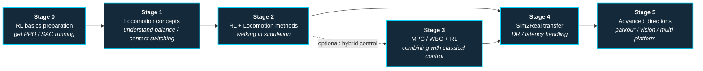

# Humanoid RL Locomotion

**At a glance**:

- **Who it's for**: people who want to get started quickly with humanoid locomotion using reinforcement learning.
- **Path**: Stage 0–5 · RL basics → locomotion concepts → RL + Locomotion methods → Sim2Real → advanced; MPC / WBC + RL is an optional branch.
- **Depth roadmap**: a branch of the [Motion Control main roadmap](motion-control.md).

## Roadmap overview

## How to use this path

- The target reader has programming experience and wants to quickly connect RL with humanoid locomotion
- You do not need to learn all of control theory from scratch, but RL basics and locomotion concepts are required
- Each stage has prerequisites, core questions, what to do, what to read, and what you should be able to produce
- The shortest deployment path is **Stage 0 → 1 → 2 → 4**; Stage 3 is optional reading for hybrid control schemes that need explicit planning/constraints, and motion imitation continues into Stage 5 Direction B.

**Relation to the main roadmap:**
- This path is the "fast-branch version" of the main roadmap
- If you hit a theoretical sticking point at some stage, go back to [Main roadmap: Motion control → full-stack physical intelligence growth roadmap](motion-control.md) and look up the corresponding section

---

## Stage 0 RL basics preparation

**If you already have an RL background, you can skip this stage.**

### Prerequisites
- Proficient in Python
- Deep learning basics (know what an MLP, a loss, and gradient backpropagation are)
- Some intuition for probability and statistics

### Core questions
- What problem RL solves
- What the core difference between policy gradient and Q-learning is
- Why PPO is currently the most mainstream robot RL algorithm

### What to do
- Use Stable-Baselines3 or Spinning Up to run an inverted pendulum or HalfCheetah environment
- Compare the training curves of on-policy (PPO) and off-policy (SAC)

### What to read
- [Hands-on Reinforcement Learning (the "Mushroom Book")](../../wiki/entities/hands-on-rl-book.md) — in Chinese: MDP → PPO/SAC chapters + [hrl.boyuai.com](https://hrl.boyuai.com/chapter) online notebooks; with the accompanying [Boyu free video course](https://www.boyuai.com/elites/course/xVqhU42F5IDky94x)
- Spinning Up (OpenAI) — Part 1: Key Concepts
- [Reinforcement Learning](../../wiki/methods/reinforcement-learning.md)
- [History of reinforcement learning (convergence of three threads: trial-and-error learning / optimal control / temporal difference)](../../wiki/concepts/reinforcement-learning-history.md) — Sutton & Barto §1.6; understanding the lineage helps distinguish RL from supervised learning and model-based control
- [PPO](../../wiki/methods/ppo.md) · [SAC](../../wiki/methods/sac.md)
- [Query: How to choose between PPO and SAC for robot tasks](../../wiki/queries/ppo-vs-sac-for-robots.md)

### What you should be able to produce
- Be able to explain what an MDP, policy, value function, and return are
- Be able to train a usable policy with PPO in a simple environment

---

## Stage 1 Humanoid locomotion concept basics

**Even humanoid RL that does not do model-based control needs to understand what problem locomotion is solving.**

### Prerequisites
- Stage 0 content
- Basic intuition for rigid-body dynamics (force, torque, acceleration)

### Core questions
- What the core challenges facing humanoid robots in locomotion are
- Why balance, contact switching, and high-dimensional action spaces are hard problems
- What RL can and cannot solve in locomotion

### What to do
- Read the related work / introduction of 2-3 recent humanoid RL papers (no need to understand everything; just get a rough idea of what problems people are solving)
- Get a humanoid environment running in Isaac Lab or MuJoCo; Isaac Gym / legged_gym are mainly for reproducing work that depends on older versions

### What to read
- [Locomotion](../../wiki/tasks/locomotion.md)
- [WBC vs RL](../../wiki/comparisons/wbc-vs-rl.md)

### What you should be able to produce
- Be able to explain why RL is suited to locomotion
- Be able to make a humanoid model stand up and walk a few steps in simulation

---

## Stage 2 RL + Locomotion core methods

### Prerequisites
- Stage 0 + Stage 1 content
- Understand reward shaping, termination conditions, and observation space design

### Core questions
- How to design rewards for humanoid RL (balance reward + forward-progress reward + smoothness reward)
- How to construct the observation space (joint angles, angular velocities, IMU, contact states)
- Whether the action space is position, velocity, or torque
- What causes training instability (sparse reward, early termination, exploration)

### What to do
- Design a simple humanoid RL reward yourself and train it in Isaac Lab or MuJoCo Humanoid
- Compare training results under different action spaces (position / velocity / torque)
- Tweak the reward weights and see their effect on the gait

### What to read
- "Emergence of Locomotion Behaviours in Rich Environments" (Heess et al., 2017)
- [legged_gym](../../wiki/entities/legged-gym.md) and [Isaac Lab](../../wiki/entities/isaac-lab.md) (entity pages + official code)
- [RSL-RL](../../wiki/entities/rsl-rl.md) (ETH RSL × NVIDIA) — the GPU PPO implementation that is the default backend of legged_gym / Isaac Lab / mjlab, with PPO and distillation sharing the same runner abstraction; read it to know what those few lines of runner config in the training script actually do; optional BF16 autocast gives 2.39× per update and −33% GPU memory; open-sourced under BSD-3-Clause
- [Reward Design](../../wiki/concepts/reward-design.md)
- [Query: Locomotion reward design guide](../../wiki/queries/locomotion-reward-design-guide.md)
- [Query: Humanoid RL Cookbook](../../wiki/queries/humanoid-rl-cookbook.md) — quick reference for observation/action spaces, hyperparameters, and training tricks
- [FDDC](../../wiki/entities/paper-fddc.md) — rewrites the capture point as a support-foot-relative, onboard-reconstructable dynamic CoM observation fed directly to the actor, paired with human-science rewards (MoS/TTB/ankle→knee rate); on a single-leg balance benchmark Perfect 95.6%, while eight general SOTA methods (including SONIC) all score 0%, and removing the dynamic CoM observation drops it by 40 pt; deployed on G1 without distillation; claims to be open source, but no URL as of the ingest date
- [SGS (Success-Guided Sampling)](../../wiki/entities/paper-sgs-2610-12465.md) — an outer loop around PPO that adaptively samples resets by each configuration's recent success rate, focusing on the frontier of policy capability (quadruped multi-terrain)
- [HuMBLE](../../wiki/entities/paper-humble-human-motion-driven-behavior.md) — distills human gait into a proprioceptive + SE(2) velocity-command policy, then extends it to omnidirectional controllability via two-task RL; validated on Atlas / G1
- [Push the Limit](../../wiki/entities/paper-push-the-limit-humanoid-sprinting.md) — high-speed humanoid running: causal multi-head attention + heading-direction reward + skill-conditioned Multi-AMP to address temporal estimation, turning reward, and skill collapse (CoRL 2026)

### What you should be able to produce
- A humanoid RL policy that walks stably on flat ground (in simulation)
- First-hand intuition for reward design

---

## Stage 3 MPC / WBC + RL combined frameworks

**This stage is an optional branch: when explicit planning, constraints, or predictable responses are needed, compare hybrid control against direct policies; not every RL deployment needs MPC/WBC.**

### Prerequisites
- Stage 2 content
- Understand what MPC and WBC are (no need to be able to write them, but you need the basic ideas)

### Core questions
- How RL policies and MPC / WBC are combined
- Common frameworks: MPC sends commands to a low-level RL policy, RL tunes MPC parameters, or a residual is learned on top of a nominal controller; first draw clearly who outputs what
- When to use RL and when to use MPC

### What to do
- Compare two combinations: RL tuning MPC weights (rl-mpc-locomotion) and MPC commanding a frozen RL policy (ReCo), marking the training-time/deployment-time modules and control quantities
- On an existing simulation baseline, compare direct policies and hybrid control in terms of error, constraint violations, and end-to-end latency; do not extrapolate quadruped results directly as humanoid validation

### What to read
- [rl-mpc-locomotion](../../wiki/entities/rl-mpc-locomotion.md) — an open-source quadruped example of high-level RL tuning low-level MPC weights; the repo contains no real-robot transfer code
- [ReCo](../../wiki/entities/paper-reco.md) — after shaping and identifying the policy's response, MPC jointly plans base commands and arm velocities; a Go2 + arm example
- [Residual Policy Learning](../../wiki/methods/residual-policy-learning.md) — another interface: nominal controller + learned residual
- [Whole-Body Control](../../wiki/concepts/whole-body-control.md)
- [Model Predictive Control (MPC)](../../wiki/methods/model-predictive-control.md)
- [Query: When to use WBC and when to use RL](../../wiki/queries/when-to-use-wbc-vs-rl.md)

### What you should be able to produce
- Be able to explain the respective applicable scenarios of RL and MPC / WBC
- Be able to judge whether a new problem is better solved with RL or MPC

---

## Stage 4 Sim2Real transfer

**Running in simulation is a prerequisite for real-robot deployment, but not the whole story.**

### Prerequisites
- Stage 2 content; only hybrid control schemes need Stage 3 completed first
- Understand the principle of Domain Randomization

### Core questions
- Why the sim2real gap exists (inaccurate physical parameters, execution latency, sensor noise)
- The right way to use Domain Randomization (which parameters to randomize, how to set the ranges)
- How to handle action latency
- When online fine-tuning helps and when it does not

### What to do
- Add DR to the policy trained in Stage 2, then transfer it zero-shot to harder simulated terrain
- Adjust the DR ranges and observe how policy robustness changes

### What to read
- [Sim2Real](../../wiki/concepts/sim2real.md)
- [Domain Randomization](../../wiki/concepts/domain-randomization.md)
- [System Identification](../../wiki/concepts/system-identification.md)
- [Actuator Network](../../wiki/methods/actuator-network.md) and [Implicit vs Explicit actuator modeling](../../wiki/concepts/implicit-explicit-actuator-modeling.md) — the actuator gap is the number-one pitfall of sim2real
- [Fault-Tolerant Locomotion](../../wiki/entities/paper-fault-tolerant-locomotion.md) — asymmetric actor–critic + learnable gait frequency under actuator power loss; KYON 68 kg real robot on flat ground (not open-sourced)
- [FlashSAC](../../wiki/methods/flashsac.md) — scaling-style off-policy SAC improvement: fewer updates + larger model + norm constraints, cutting G1 blind-walking sim2real training from hours to about 20 minutes
- [PACE (systematic Sim2Real for legged robots)](../../wiki/entities/paper-pace-sim2real-legged-robots.md) — identifies compact joint-dynamics parameters from chirp data with the robot suspended + four physical-energy rewards, enabling zero-shot deployment without dynamics domain randomization
- [Query: Sim2Real deployment checklist](../../wiki/queries/sim2real-checklist.md)
- [Query: PD gain setting for legged/humanoid RL](../../wiki/queries/legged-humanoid-rl-pd-gain-setting.md)

### What you should be able to produce
- An experiment record that marks the validation level: cross-terrain counts as simulation generalization, cross-simulator counts as sim2sim; only real-robot trials are recorded as sim2real
- Intuition for DR parameter settings

---

## Stage 5 Advanced directions

### Prerequisites
- Stage 4 content

Pick one to go deeper based on your research direction:

**Direction A: more complex locomotion / perceptive obstacle traversal**
- Running, jumping, stairs, rough terrain; perceptive policies with depth cameras/LiDAR
- Keywords: [Extreme Parkour](../../wiki/entities/extreme-parkour.md), [DreamWaQ++](../../wiki/entities/dreamwaq-plus.md), [GaitSpan (skill growth from walking to running)](../../wiki/entities/paper-gaitspan-humanoid-locomotion-walking-running.md), teacher-student
- Standalone roadmap page: [Perceptive Locomotion depth roadmap](depth-perceptive-locomotion.md)

**Direction B: imitation learning initialization / motion tracking**
- Initialize RL policies with MoCap data, or whole-body motion tracking
- Keywords: ASE, CALM, [DeepMimic](../../wiki/methods/deepmimic.md), [BeyondMimic](../../wiki/methods/beyondmimic.md), [Sonic](../../wiki/methods/sonic-motion-tracking.md)
- Standalone roadmap page: [Imitation Learning depth roadmap](depth-imitation-learning.md)

**Direction C: vision + locomotion**
- End-to-end visual policies
- Keywords: perception, terrain mapping, learning-based navigation

**Direction D: cross-embodiment adaptation**
- Transferring one policy to different robot morphologies
- Keywords: domain randomization, meta-learning, multi-task RL
- Selection reference: [Query: Cross-embodiment transfer strategy](../../wiki/queries/cross-embodiment-transfer-strategy.md)

### What to read
- Each of these four directions has its own depth page: see the main roadmap's [optional depth index](motion-control.md#depth-optional-index)

---

## Quick entry summary

| Stage | Core question | Knowledge page entry |
|------|---------|-----------|
| Stage 0 | RL basics | [Reinforcement Learning](../../wiki/methods/reinforcement-learning.md) |
| Stage 1 | Locomotion concepts | [Locomotion](../../wiki/tasks/locomotion.md) |
| Stage 2 | RL + locomotion methods | [Reinforcement Learning](../../wiki/methods/reinforcement-learning.md) |
| Stage 3 | RL + control combinations | [Whole-Body Control](../../wiki/concepts/whole-body-control.md) |
| Stage 4 | Sim2Real | [Sim2Real](../../wiki/concepts/sim2real.md) |

## Relation to other pages

- Full growth roadmap reference: [Main roadmap: Motion control → full-stack physical intelligence growth roadmap](motion-control.md)
- Related depth roadmaps (ordered by topical proximity; for the full catalog see [Roadmap index](motion-control.md#depth-optional-index)):
  - [Sim2Real](depth-sim2real.md) — the full expansion of Stage 4 of this roadmap
  - [Perceptive locomotion](depth-perceptive-locomotion.md) — exteroception on top of the blind-walking baseline
  - [Loco-Manipulation](depth-loco-manipulation.md) — connecting walking policies to manipulation
  - [Classical model-based control](depth-classical-control.md) — combining and contrasting WBC/MPC with RL
  - [BFM](depth-bfm.md) — tracking/skill priors, often used as the motion base for RL
  - [Model architecture](depth-model-architecture.md) — a cross-cutting view: why low-level high-frequency policies are still often small MLPs

## References

- [Reinforcement Learning](../../wiki/methods/reinforcement-learning.md)
- [Locomotion](../../wiki/tasks/locomotion.md)
- [WBC vs RL comparison](../../wiki/comparisons/wbc-vs-rl.md)
- [Sim2Real](../../wiki/concepts/sim2real.md)
- [Quadruped robot open-source project technology map (36 GitHub projects)](../../wiki/overview/quadruped-open-source-projects-technology-map.md) — reproducible quadruped/wheel-legged RL and MPC starter projects: [rl-mpc-locomotion](../../wiki/entities/rl-mpc-locomotion.md) · [Wheel-Legged-Gym](../../wiki/entities/wheel-legged-gym.md)
- [ABS (Agile But Safe)](../../wiki/entities/abs-agile-but-safe.md) · [SuperMimic Parkour](../../wiki/entities/supermimic-parkour.md) — RL locomotion examples of safe agility and parkour tracking
- [AMP official project](https://xbpeng.github.io/projects/AMP/) and [DeepMimic official project](https://xbpeng.github.io/projects/DeepMimic/) — motion imitation/style rewards, belonging to Stage 5 Direction B, not evidence for MPC/WBC combinations
- [rl-mpc-locomotion official README](https://github.com/silvery107/rl-mpc-locomotion) — the actual interface between the high-level weight policy and low-level MPC
