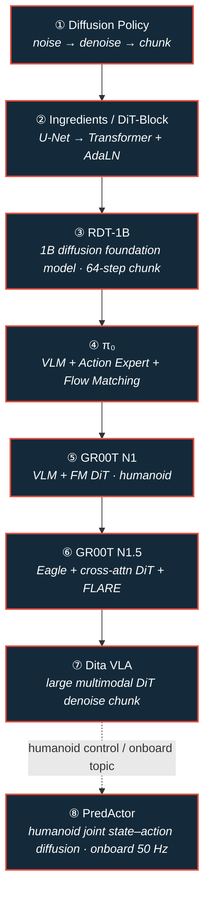
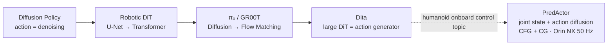

# Diffusion & Flow Matching Policies

**At a glance**:

- **Who it's for**: people who already know BC / ACT and want to read the eight representative diffusion and flow-matching policy papers in depth.
- **Path**: Stage 1–8 · Diffusion Policy → DiT recipe → RDT-1B → π₀ → GR00T N1 / N1.5 → Dita → PredActor.
- **Depth roadmap**: topical roadmap; overlaps with [VLA depth](depth-vla.md) Stages 1–2, but ordered by the evolution of action-generation mechanisms.

## Roadmap overview

## How to use this path

- **Recommendation (curated)**: ①②④⑤⑥⑧ are ★★★★★; ③⑦ are ★★★★☆. ③ is good for understanding the **billion-scale Robotics Diffusion Transformer**; ⑦ complements ②'s IL recipe and leans toward **OXE generalist VLA**.
- For each paper, first pin down the **action chunk** and the **inference-time horizon** (receding horizon / asynchronous execution), then the **conditioning injection** (CNN/U-Net, adaLN, cross-attn VLM, flow velocity field).
- If [Imitation Learning depth](depth-imitation-learning.md) Stage 3 has already covered the DP concepts, you can **skip the repetition** and enter at Stage ②.
- **Optional prerequisite (does not take one of the 8 representative-paper slots):** [MIT 6.S184: Flow Matching & Diffusion Models (2026)](../../wiki/overview/mit-flow-matching-diffusion-2026.md) with the official Labs 1–3, covering ODE/SDE, conditional probability paths, CFG, through DiT/VAE. Finish Labs 1–2 before reading ① Diffusion Policy / ④ π₀ so you can use the source code to tell velocity-field integration apart from denoising sampling; the course itself does not study robot action control.
- Arrows in the figure indicate a suggested comparison order, not that a later work directly inherits from an earlier one; **diffusion / flow matching are training and sampling mechanisms, DiT is a backbone architecture**, and the two axes can be combined. FM still requires integration; few-step / single-step quality must be confirmed by the specific model and experiments.

**Name disambiguation**

| Short name | What it refers to | Entity page |
|------|--------|--------|
| Image DiT | ImageNet class-conditional generation (Peebles & Xie) | [paper-dit-scalable-diffusion-transformers](../../wiki/entities/paper-dit-scalable-diffusion-transformers.md) |
| DiT-Block Policy | 2410.10088 robot IL recipe | [paper-robotic-dit-ingredients-dit-block-policy](../../wiki/entities/paper-robotic-dit-ingredients-dit-block-policy.md) |
| ScaleDP | 2409.14411 DP-T scaling (optional side read) | [paper-scaledp-scaling-diffusion-transformer-policy](../../wiki/entities/paper-scaledp-scaling-diffusion-transformer-policy.md) |
| Dita | 2503.19757 generalist VLA (predecessor 2410.15959) | [paper-dita-scaling-diffusion-transformer-vla](../../wiki/entities/paper-dita-scaling-diffusion-transformer-vla.md) |

**Code evolution note:** ⑦'s early repo [zhihou7/dit_policy_vla](https://github.com/zhihou7/dit_policy_vla) and project page [dit_policy_vla](https://zhihou7.github.io/dit_policy_vla/) have evolved into the canonical **[RoboDita/Dita](https://github.com/RoboDita/Dita)** + [robodita.github.io](https://robodita.github.io/).

---

## Stage 1 · Diffusion Policy (① ★★★★★ · read first)

### Core questions

- How does **noise action → denoise → action chunk** close the loop?
- What do **receding horizon** and **action horizon / execution horizon** each mean?

### What to read

- [Diffusion Policy entity](../../wiki/entities/paper-diffusion-policy.md) · [method page](../../wiki/methods/diffusion-policy.md) · [receding horizon](../../wiki/concepts/receding-horizon-policy-execution.md)
- Project: <https://diffusion-policy.cs.columbia.edu/> · Code: <https://github.com/real-stanford/diffusion_policy> · arXiv: <https://arxiv.org/abs/2303.04137>

### What you should be able to produce

- Draw the DDPM training/inference loop and explain why U-Net became the default denoising backbone.

---

## Stage 2 · The Ingredients for Robotic Diffusion Transformers (② ★★★★★)

### Core questions

- **Why can DP's U-Net be replaced by a Transformer**?
- How do **DiT Block, Attention, AdaLN, action chunk, Transformer depth** together stabilise training?

### What to read

- [DiT-Block Policy entity](../../wiki/entities/paper-robotic-dit-ingredients-dit-block-policy.md)
- Project: <https://dit-policy.github.io/> · Code: <https://github.com/SudeepDasari/dit-policy> · arXiv: <https://arxiv.org/abs/2410.10088>

### What you should be able to produce

- Explain how **adaLN-Zero** relates to the DP paper's observation that **cross-attn Transformers are hard to train**.

---

## Stage 3 · RDT-1B (③ ★★★★☆)

### Core questions

- How do **language + multi-camera RGB + robot state** enter a **1B diffusion Transformer**?
- Why output a chunk of **the next 64 actions**?

### What to read

- [RDT-1B entity](../../wiki/entities/paper-rdt-1b.md)
- Project: <https://rdt-robotics.github.io/rdt-robotics/> · Code: <https://github.com/thu-ml/RoboticsDiffusionTransformer> · HF: <https://huggingface.co/robotics-diffusion-transformer/rdt-1b> · arXiv: <https://arxiv.org/abs/2410.07864>

### What you should be able to produce

- Distinguish the data and compute assumptions of an **IL recipe paper (②)** from **foundation-scale pretraining (③)**.

---

## Stage 4 · π₀ (④ ★★★★★ · intro to Flow Matching for robots)

### Core questions

- How does **VLM + Action Expert + Flow Matching + action chunk** change the training objective and the sampler? Why doesn't FM by itself guarantee one-step generation or low latency?
- How does it differ from the Octo / OpenVLA action heads?

### What to read

- [π₀ entity](../../wiki/entities/paper-pi0.md)
- Blog: <https://www.physicalintelligence.company/blog/pi0> · Code: <https://github.com/Physical-Intelligence/openpi> · arXiv: <https://arxiv.org/abs/2410.24164>

### What you should be able to produce

- Explain the intuitive correspondence between the **flow-matching velocity field** and **diffusion noise prediction** as training objectives.

---

## Stage 5 · GR00T N1 (⑤ ★★★★★ · humanoid / NVIDIA)

### Core questions

- How is work split in the dual system **Vision + Language → VLM → DiT Action Head → Flow Matching → action chunk**?

### What to read

- [GR00T N1 entity](../../wiki/entities/paper-hrl-stack-34-gr00t_n1.md) · [Isaac GR00T platform](../../wiki/entities/isaac-gr00t.md)
- GEAR · Code: <https://github.com/NVIDIA/Isaac-GR00T> · arXiv: <https://arxiv.org/abs/2503.14734>

### What you should be able to produce

- Compare the **embodiment interface** and **data pyramid** of π₀ and GR00T.

---

## Stage 6 · GR00T N1.5 (⑥ ★★★★★ · directly after N1)

### Core questions

- What does **Eagle VLM → cross-attention → DiT → state + noisy actions → FM velocity → chunk** change relative to N1?
- Why does **FLARE** let human videos enter post-training?

### What to read

- [GR00T N1.5 entity](../../wiki/entities/paper-gr00t-n1-5.md)
- Project: <https://research.nvidia.com/labs/gear/gr00t-n1_5/> · HF: <https://huggingface.co/nvidia/GR00T-N1.5-3B>

### What you should be able to produce

- Cite the **language-following rate / few-shot RoboCasa** numbers on the GEAR page to explain the N1→N1.5 gains.

---

## Stage 7 · Diffusion Transformer Policy / Dita (⑦ ★★★★☆)

### Core questions

- Why stop using a **small diffusion action head** and instead have a **large multimodal DiT** denoise the entire **action chunk**?
- Compared with Octo's small MLP **diffusion denoising head** and OpenVLA's discrete action tokens, how do conditioning injection and output distribution differ?

### What to read

- [Dita entity](../../wiki/entities/paper-dita-scaling-diffusion-transformer-vla.md)
- Project: <https://robodita.github.io/> · Code: <https://github.com/RoboDita/Dita> · arXiv: <https://arxiv.org/abs/2503.19757> (predecessor <https://arxiv.org/abs/2410.15959>)

### What you should be able to produce

- Explain the boundary between an **in-context diffusion Transformer VLA** and ②'s single-task IL recipe.

---

## Mechanism evolution (one diagram to remember)

## Quick-entry summary

| # | Paper | /wiki entity |
|------|------|-----------|
| ① | Diffusion Policy | [paper-diffusion-policy](../../wiki/entities/paper-diffusion-policy.md) |
| ② | Ingredients / DiT-Block | [paper-robotic-dit-ingredients-dit-block-policy](../../wiki/entities/paper-robotic-dit-ingredients-dit-block-policy.md) |
| ③ | RDT-1B | [paper-rdt-1b](../../wiki/entities/paper-rdt-1b.md) |
| ④ | π₀ | [paper-pi0](../../wiki/entities/paper-pi0.md) |
| ⑤ | GR00T N1 | [paper-hrl-stack-34-gr00t_n1](../../wiki/entities/paper-hrl-stack-34-gr00t_n1.md) |
| ⑥ | GR00T N1.5 | [paper-gr00t-n1-5](../../wiki/entities/paper-gr00t-n1-5.md) |
| ⑦ | Dita | [paper-dita-scaling-diffusion-transformer-vla](../../wiki/entities/paper-dita-scaling-diffusion-transformer-vla.md) |
| ⑧ | PredActor (humanoid onboard control topic) | [paper-predactor](../../wiki/entities/paper-predactor.md) |

## Stage 8 · PredActor (⑧ ★★★★★ · humanoid diffusion-policy onboard control topic)

### Core questions

- When jointly predicting future states and actions, how can the future states serve only as an **internal steering surface** while the actions go directly to the robot?
- How do **classifier guidance (CG) + classifier-free guidance (CFG)** support both goal guidance and text behavior conditioning within the same policy?
- How do rolling denoising and runtime optimizations meet a **50 Hz control period on a Jetson Orin NX**?

### What to read

- [PredActor entity](../../wiki/entities/paper-predactor.md)
- Project page: <https://masteryip.github.io/predactor.github.io/> · Official release repo: <https://github.com/MasterYip/PredActor> · arXiv: <https://arxiv.org/abs/2609.24840>
- **Reproduction boundary (2026-10-08):** the public repo provides a Python 3.10 / uv MuJoCo evaluation path, and HF has released the PDP051 and G1 MotionCLIP checkpoints; training/data collection, DAgger, and real-robot deployment are still not open. See the [entity page](../../wiki/entities/paper-predactor.md) and the [evaluation code](https://github.com/MasterYip/PredActor).

### What you should be able to produce

- Explain the difference between joint state–action diffusion and action-only diffusion, and judge whether the p95 of the full callback fits within a 20 ms budget.

## Relation to other pages

- General VLA deployment and data: [VLA depth](depth-vla.md)
- DP's place in the IL roadmap: [Imitation Learning depth](depth-imitation-learning.md) Stage 3
- Whole-humanoid stack: [BFM depth](depth-bfm.md) Stage 4 (high-level VLA + low-level WBC)
- Backbone family tree: [Model Architecture depth](depth-model-architecture.md)

## References

- The original papers and official project entry points for each Stage; the [official Octo description](https://github.com/octo-models/octo) explicitly states it is a Transformer-based diffusion policy, so its small MLP denoising head must not be misread as an ordinary single-pass regression head.
- [Flow Matching paper §4](https://arxiv.org/html/2210.02747v2) — both diffusion paths and conditional OT paths can be used for FM; conditional straight-line paths do not guarantee that the marginal field is an optimal-transport solution.
