# Rocket Landing Control

**At a glance**:

- **Who it's for**: people who want a rocket to fly itself back and land upright and stable at a designated point.
- **Path**: Stage 0–6 · dynamics fundamentals → classical guidance → lossless convexification (3-DoF) → 6-DoF successive convexification → attitude and thrust vectoring → navigation and onboard solving → full-profile recovery.
- **Depth roadmap**: mathematically shares its roots with L3 optimization and L4.3 trajectory optimization / MPC of the [Motion Control main roadmap](motion-control.md), but with a plant whose constraints are harder and whose failures are more costly.

## Roadmap overview

```mermaid
flowchart LR
  S0["<b>Stage 0</b><br/>Problem map & dynamics<br/><em>variable-mass rigid body / GNC layering</em>"]
  S1["<b>Stage 1</b><br/>Classical guidance & optimal control<br/><em>Apollo / maximum principle</em>"]
  S2["<b>Stage 2</b><br/>Lossless convexification<br/><em>LCvx / SOCP / G-FOLD</em>"]
  S3["<b>Stage 3</b><br/>6-DoF successive convexification<br/><em>SCvx / free final time</em>"]
  S4["<b>Stage 4</b><br/>Attitude & thrust vectoring<br/><em>TVC inner loop / slosh & bending / tracking</em>"]
  S5["<b>Stage 5</b><br/>Navigation & onboard solving<br/><em>TRN·lidar / embedded solvers</em>"]
  S6["<b>Stage 6</b><br/>Full-profile recovery & learning<br/><em>boostback·reentry·landing / RL</em>"]

  S0 --> S1 --> S2 --> S3 --> S4 --> S5 --> S6
  S4 -.->|inner-loop bandwidth sets the outer-loop model| S3
  S5 -.->|boundaries exposed by Monte Carlo| S2

  classDef stage fill:#142a3a,stroke:#16a085,stroke-width:2px,color:#fff
  class S0,S1,S2,S3,S4,S5,S6 stage
```

## How to use this path

- The target readers are control / robotics engineers who want to work on **GNC for reusable rockets, VTOL vehicles, or planetary landers**; it also suits people who want to master convex optimization and trajectory optimization through a canonical "hard constraints + real-time replanning" problem
- Requires linear algebra, ordinary differential equations, basic control (PID, state space), and Python; convex optimization and optimal control are filled in along the way
- Each stage has core questions, what to read, what to do, and what you should be able to produce; the papers and open-source code of Stages 2–3 can all be reproduced on a laptop
- **Source boundaries**: the flight-control algorithms of SpaceX and Blue Origin are not public. Industrial facts cited in this roadmap come only from official pages and public articles by the engineers involved; any claim of the form "industry probably does it this way" is marked "speculation"

**Relation to the main roadmap:**
- This roadmap is easiest to enter after main-roadmap **L3 (control fundamentals and optimization)**: optimal control, convex optimization, and LQR turn directly into guidance laws here
- Stages 2–3 are the aerospace version of main-roadmap [L4.3 trajectory optimization / MPC](motion-control.md): likewise "discretize → convex subproblem → re-solve online", except the constraints change from friction cones to thrust cones, glide slopes, and gimbal angles
- Stages 4–5 share the concerns of "constraint guarantees" and "simulation to real hardware" with the [Safe Control depth roadmap](depth-safe-control.md) and the [Sim2Real depth roadmap](depth-sim2real.md)

---

## Stage 0 Problem map and dynamics fundamentals

### Prerequisites
- Newtonian mechanics and basic concepts of rigid-body rotation
- Linear algebra (matrices, vector norms) and numerical integration of ordinary differential equations
- Python + NumPy, able to write a simple simulation loop

### Core questions
- What are the terminal conditions of the landing problem: Blackmore 2016 states that velocity must reach zero when altitude reaches zero; if velocity reaches zero first the rocket climbs again, and if it decelerates too late it hits the ground
- Why is a rocket a "variable-mass" system: \(\dot m=-\alpha\|T\|\), \(\alpha=1/(I_{sp}g_0)\); the larger the thrust, the faster mass is lost
- When is 3-DoF (center-of-mass translation only) enough, and when is 6-DoF (mass, position, velocity, quaternion, angular velocity: a 14-dimensional state) needed
- Why guidance (computing a flyable trajectory), navigation (estimating the current state), and control (making the vehicle follow the trajectory) should be layered

### What to read
- [Powered Descent Guidance](../../wiki/concepts/powered-descent-guidance.md) — the overview page of this roadmap; read it through first
- [Blackmore: Autonomous Precision Landing of Space Rockets](../../sources/papers/blackmore_autonomous_precision_landing_space_rockets.md) — an overview of the F9R return profile and its difficulties, written by a SpaceX landing engineer
- [Unit quaternions and SO(3)](../../wiki/formalizations/unit-quaternion-so3.md) and [Comparison of SO(3) rotation representations](../../wiki/comparisons/so3-rotation-representations.md) — 6-DoF attitude representation
- [Lie groups and rigid-body motion](../../wiki/formalizations/lie-group-rigid-body-motions.md) — a unified formulation of rigid-body kinematics
- [Modeling and solving for control](../../wiki/concepts/modeling-and-solving-for-control.md) — the overall framework of "model first, then choose a solver"

### What to do
- Write a 1-D vertical descent simulation (with mass depletion and upper/lower thrust limits), compute by hand "from which altitude to ignite at full thrust to stop exactly at the ground", then verify with the simulation
- Extend the 1-D case to a 2-D planar rocket (position, velocity, pitch angle, angular velocity + gimbal deflection angle), and first use an open-loop thrust profile to get a feel for the coupling between attitude and translation

### What you should be able to produce
- A 2-D rocket simulator with mass depletion, on which every later Stage hangs its guidance and controllers
- Be able to explain with one diagram the inputs, outputs, and update rates of each of the three GNC layers

---

## Stage 1 Classical guidance and the structure of optimal control

### Core questions
- How did the Apollo lunar module do powered descent: onboard programs controlled attitude and descent-engine throttling, the ground precomputed guidance targets, and astronauts could redesignate the landing site and control the descent rate in the final phase (Klumpp abstract)
- What is the "optimal thrust structure" given by the maximum principle: the Gymnasium LunarLander documentation states "it is optimal to fire the engine at full throttle or turn it off"; in the Mars landing example with a thrust lower bound, the optimal thrust rides the lower bound for a segment of about 40–70 s (Malyuta et al. Part III), i.e., thrust switches between the upper and lower bounds
- Why closed-form guidance laws are not enough: Blackmore 2010 classifies these methods as "ignore constraints, solve in closed form", so thrust upper/lower bounds and glide slopes cannot be explicitly guaranteed

### What to read
- [Klumpp: Apollo Lunar Descent Guidance (1974)](../../sources/papers/klumpp_1974_apollo_lunar_descent_guidance.md) — the historical starting point of this roadmap (only the NTRS abstract has been checked so far)
- [Optimal Control](../../wiki/concepts/optimal-control.md) and [HJB equation](../../wiki/formalizations/hjb.md) — cost, constraints, maximum principle
- [LQR](../../wiki/formalizations/lqr.md) and [LQR / iLQR](../../wiki/methods/lqr-ilqr.md) — closed-form solution of the unconstrained quadratic problem, used later as the tracking controller
- [CMU optimal control course](../../wiki/entities/cmu-optimal-control-curriculum.md) — Lecture 22 "Convex Relaxation and Landing Rockets" is the best bridge from Stage 1 to Stage 2 of this roadmap

### What to do
- On the 1-D model from Stage 0, compare the fuel of three thrust profiles: constant thrust, "off then full thrust", and "full–minimum–full", and get a feel for the switching structure predicted by the maximum principle
- Write the simplest closed-form guidance (e.g., computing the required acceleration from time-to-go), deliberately give it a thrust upper limit, and observe from which initial conditions it violates the constraints

### What you should be able to produce
- Be able to state the thrust structure of fuel-optimal landing and why it makes the problem hard (the thrust lower bound is a nonconvex constraint)
- An experiment record of "from which initial conditions closed-form guidance fails", as the motivation for Stage 2

---

## Stage 2 Lossless convexification and 3-DoF fuel-optimal guidance

### Core questions
- Why is the thrust lower bound \(\|T\|\ge\rho_1\) nonconvex, how does the slack variable \(\Gamma\) fill it in as a convex cone, and why is "relaxing it the same as not relaxing it"
- How does the change of variables \(\sigma=\Gamma/m,\ u=T/m,\ z=\ln m\) make the dynamics linear and the problem an SOCP
- How to handle the time of flight \(t_f\) (outer golden-section search), and what to do when the target is unreachable (first minimize the landing error, then minimize fuel subject to that error)
- Why convexification is the key to "getting onto the flight computer": interior-point methods have deterministic stopping criteria and polynomial complexity

### What to read
- [Lossless Convexification](../../wiki/methods/lossless-convexification.md) — the method page of this Stage
- [Blackmore, Açıkmeşe, Scharf (JGCD 2010)](../../sources/papers/blackmore_2010_minimum_landing_error_pdg.md) — the full problem, theorems, and numerical results; must-read original
- [Malyuta et al. tutorial](../../sources/papers/malyuta_2021_convex_trajectory_generation_tutorial.md) Part I — general conditions and applicability boundaries of LCvx
- [JPL G-FOLD × Masten Xombie flight tests](../../sources/sites/jpl_gfold_xombie_flight_tests.md) — official record of the 2013 real-time divert of about 0.8 km
- [Convex functions](../../wiki/formalizations/convex-functions.md) and [Convex relaxation in robotics](../../wiki/methods/convex-relaxation-robotics.md) — convex optimization fundamentals and the contrast that "general relaxations are not lossless"

### What to do
- Use [CVXPY](https://www.cvxpy.org/) with the parameters from Blackmore 2010 §V (dry/wet mass 1505/1905 kg, thrust 4972–13260 N, 55 nodes) to reproduce the fuel-optimal trajectory, and check the magnitudes of 399.4 kg and 78.4 s
- Check whether the computed thrust magnitude is ≥ \(\rho_1\) everywhere (numerical verification of losslessness), and plot the "full–low–full" thrust structure
- Change the initial velocity so the target is unreachable, implement the two-step method, and reproduce the behavior of "landing a few hundred meters from the target, using up the fuel"

### What you should be able to produce
- A 3-DoF fuel-optimal guidance solver that solves in seconds on a laptop, with a losslessness check
- Be able to explain the preconditions of the LCvx theorem (the trajectory touches the state-constraint boundary at most at one point, etc.), and which added constraints would break it

---

## Stage 3 6-DoF successive convexification

### Core questions
- What the 6-DoF model adds: quaternion attitude, rigid-body Euler equations, thrust torques, and gimbal-angle, tilt-angle, and angular-velocity constraints
- How to handle free final time: normalized time + a dilation factor \(\sigma\) as a decision variable, no longer doing an outer line search
- How each convex subproblem is constructed: first-order linearization → FOH discretization (integrating the state transition matrix) → virtual control to prevent artificial infeasibility → trust region to limit step size
- What SCvx can and cannot guarantee: convergence to a stationary point rather than the global optimum; sensitive to scaling, initial guess, and penalty weights

### What to read
- [Successive Convexification (SCvx)](../../wiki/methods/successive-convexification.md) — the method page of this Stage
- [Szmuk & Açıkmeşe (2018) 6-DoF free final time](../../sources/papers/szmuk_2018_scvx_6dof_free_final_time.md) — model, discretization, and algorithm details
- [Szmuk, Reynolds, Açıkmeşe (2018) real-time 6-DoF + state-triggered constraints](../../sources/papers/szmuk_2018_scvx_realtime_state_triggered.md) — free ignition time, lift/drag aerodynamics, constraints "applied only when a condition holds"; MATLAB + ECOS at most 0.682 s
- [Malyuta et al. tutorial](../../sources/papers/malyuta_2021_convex_trajectory_generation_tutorial.md) Part II — comparison of SCvx and GuSTO, and tuning experience
- [Trajectory optimization](../../wiki/methods/trajectory-optimization.md) and [Trajectory optimization vs RL](../../wiki/comparisons/trajectory-opt-vs-rl.md)

### What to do
- Get PythonRobotics' `rocket_powered_landing` running (single-file 6-DoF SCvx, see [archive](../../sources/repos/python_robotics.md)), then read the free-final-time version in [EmbersArc/SCvx](../../sources/repos/scvx_embersarc.md)
- Successively tighten the gimbal-angle limit, tilt-angle limit, and glide-slope angle, recording iteration count, virtual-control residual, and whether it converges
- Deliberately remove variable scaling and reproduce what Malyuta et al. call "a very hard time converging"
- Advanced: read the `starship_flip` example in [SCPToolbox.jl](../../sources/repos/scptoolbox_jl.md) to understand how "flip + landing" maneuvers are written as SCP

### What you should be able to produce
- A 6-DoF landing trajectory generator, plus an experiment table of "constraint tightness → iteration count / convergence rate"
- Be able to judge whether a landing problem should use LCvx (3-DoF, suitable constraint structure) or SCvx (6-DoF, aerodynamics, complex constraints)

---

## Stage 4 Attitude control, thrust vectoring, and trajectory tracking

### Core questions
- Guidance provides a reference trajectory, so who tracks it: thrust vector control (engine gimbaling) generates attitude torques, and the attitude inner loop must be much faster than the translational outer loop; this is precisely the precondition for 3-DoF guidance to hold
- Which dynamics must be modeled for launch-vehicle attitude control: Greensite's (NASA CR-820) small-perturbation equations account for center-of-mass offset, elastic bending, propellant slosh, and engine inertia
- How to control attitude in the atmosphere: Falcon 9's four grid fins "orient the rocket during reentry by moving the center of pressure"
- How to choose the tracking controller: the respective model and compute requirements of gain-scheduled PID, LQR, and MPC

### What to read
- [Greensite: NASA CR-820 Short Period Dynamics](../../sources/papers/greensite_1967_nasa_cr820_short_period_dynamics.md) — a classic report on launch-vehicle attitude control modeling (the same series also has volumes such as Attitude Control During Launch and Load Relief)
- [PID control](../../wiki/methods/pid-control.md) and [Bode plots](../../wiki/concepts/bode-plots.md) — stability-margin analysis of the attitude loop
- [LQR](../../wiki/formalizations/lqr.md) and [Model Predictive Control (MPC)](../../wiki/methods/model-predictive-control.md) — the two mainstream approaches to trajectory tracking
- [Nonlinear MPC](../../wiki/methods/nonlinear-model-predictive-control.md) and [MPC tuning guide](../../wiki/queries/mpc-tuning-guide.md)
- [Control loop latency modeling](../../wiki/formalizations/control-loop-latency-modeling.md) — budgeting gimbal actuator latency and sampling latency
- [Robust control paradigm](../../wiki/overview/robot-control-paradigm-robust-control.md) and [H∞ control](../../wiki/methods/h-infinity-control.md) — robustness under unmodeled dynamics such as slosh and bending
- [Multirotor simulation–planning–control open-source stack](../../wiki/overview/multirotor-simulation-planning-control-stack.md) — also a "thrust + attitude inner loop" vehicle; the open-source stack's layered structure is worth borrowing

### What to do
- On the 2-D rocket from Stage 0, implement the inner loop of gimbal deflection → pitch torque → attitude (with deflection-angle and deflection-rate saturation), sweep gains, plot Bode plots, and check the phase margin
- Add a simple slosh pendulum model to the vehicle and observe whether the previously tuned attitude loop starts oscillating
- Use LQR (linearized along the reference trajectory) or linear MPC to track the trajectory generated in Stage 3, and measure terminal position / velocity / attitude errors

### What you should be able to produce
- A complete closed-loop simulation of "SCvx trajectory + attitude inner loop + tracking outer loop"
- Be able to explain how inner-loop bandwidth, actuator saturation, and slosh modes each limit how aggressive a trajectory the outer loop can use

---

## Stage 5 Navigation, onboard solving, and real-time verification

### Core questions
- Where navigation comes from: IMU inertial dead reckoning + fusion of external measurements; NASA SPLICE tested terrain relative navigation (IMU + camera matching against a preloaded map) and navigation Doppler lidar (measuring velocity and altitude) on New Shepard NS-13 (2020-10-13)
- How solvers get onto the flight computer: Blackmore 2016 states that SpaceX uses CVXGEN to generate custom onboard convex optimization code; the SCvx papers use embedded interior-point methods such as ECOS to solve subproblems
- Replanning frequency and failure handling: in the 2013 G-FOLD flight, the new trajectory "was first calculated only one second earlier"; what to fall back to when the solver fails
- How to show "it very likely won't go wrong": Monte Carlo dispersions (initial conditions, thrust deviations, wind, navigation errors) and processor-in-the-loop testing

### What to read
- [NASA SPLICE × New Shepard](../../sources/sites/nasa_splice_new_shepard.md) — flight tests of precision landing sensors, algorithms, and computers
- [JPL G-FOLD × Masten Xombie](../../sources/sites/jpl_gfold_xombie_flight_tests.md) — official record of onboard real-time divert
- [State estimation](../../wiki/concepts/state-estimation.md), [Kalman filter](../../wiki/formalizations/kalman-filter.md), [EKF](../../wiki/formalizations/ekf.md), [Sensor fusion](../../wiki/concepts/sensor-fusion.md)
- [IMU principles, algorithms, and camera synchronization](../../wiki/concepts/imu-principles-algorithms-camera-sync.md) — fundamentals of inertial navigation errors and visual aiding
- [MPC solver selection](../../wiki/queries/mpc-solver-selection.md), [OSQP](../../wiki/entities/osqp.md), [acados](../../wiki/entities/acados.md) — how to think about choosing embedded optimization solvers (ECOS for SOCP: <https://github.com/embotech/ecos>; CVXGEN: <https://cvxgen.com/>)
- [Processor-in-the-loop Sim2Real](../../wiki/concepts/processor-in-the-loop-sim2real.md) — put the solver on the target processor to measure latency

### What to do
- Add IMU + altitude / velocity measurements with noise and bias to the Stage 4 closed loop, estimate the state with an EKF, and compare the landing-point dispersion of "true-state guidance" vs "estimated-state guidance"
- Solve the Stage 2 SOCP directly with ECOS or Clarabel, and gather the solve-time distribution and failure rate over 1000 random initial conditions
- Run a Monte Carlo of ≥500 runs: randomize initial position / velocity, thrust deviation, and wind disturbance, and output the distributions of landing-point error and fuel margin

### What you should be able to produce
- A **landing GNC acceptance report**: landing-point error distribution, fuel margin, P99 solve latency, solver failure rate
- Be able to say how much landing accuracy is eaten up by navigation error, solve latency, and execution error respectively

---

## Stage 6 Full-profile recovery and learning-based methods

### Core questions
- Booster recovery is not just the last few tens of seconds: separation → boostback burn → reentry (attitude adjustment with grid fins) → landing burn → touching down on landing legs or being caught by the tower arms (Starship's fifth flight test on 2024-10-13 achieved the first tower-arm catch; before the catch "Thousands of distinct vehicle and pad criteria" had to be met)
- Why errors should be compressed as much as possible in the earlier phases: the divert capability left for the landing burn is limited (Blackmore 2016)
- What learning-based landing can achieve: Gaudet et al. use PPO to directly output commands for four thrusters, with meter-level landing error over 10,000 test runs and inference <1 ms, but the authors acknowledge there is no optimality or stability guarantee; Sánchez-Sánchez & Izzo use supervised learning to fit optimal trajectories from indirect methods
- How learning methods and convex optimization methods can be combined (speculation): use learning to provide SCvx with an initial guess or warm start, or for fault detection, while convex optimization retains the constraint guarantees; Malyuta et al.'s references already include work on learning-based warm-starting of SCP

### What to read
- [SpaceX official pages: Falcon 9 recovery hardware and Starship's fifth flight test](../../sources/sites/spacex_reusable_booster_pages.md)
- [Blackmore: Autonomous Precision Landing of Space Rockets](../../sources/papers/blackmore_autonomous_precision_landing_space_rockets.md) — the idea of converging errors over the full profile
- [Gaudet et al.: DRL 6-DoF Powered Descent (2018)](../../sources/papers/gaudet_2018_drl_6dof_powered_descent.md) and [Sánchez-Sánchez & Izzo (2016)](../../sources/papers/sanchez_izzo_2016_dnn_optimal_landing.md)
- [Gymnasium LunarLander](../../sources/sites/gymnasium_lunar_lander.md) — a planar introductory environment with no mass change
- [PPO](../../wiki/methods/ppo.md), [Domain randomization](../../wiki/concepts/domain-randomization.md), [MPC vs RL](../../wiki/comparisons/mpc-vs-rl.md)
- [Control Barrier Function (CBF)](../../wiki/concepts/control-barrier-function.md) — one way to add a safety filter layer to a learned policy

### What to do
- Train PPO on `LunarLander-v3` (`continuous=True`, wind disturbance on), recording the number of steps needed to reach a score of 200 and the failure modes
- Train PPO on your own 2-D rocket (with mass depletion and a thrust lower bound), and compare it against "SCvx + LQR tracking" on the same set of Monte Carlo initial conditions in terms of landing-point error, fuel, and number of constraint violations
- Simplify boostback / reentry into a ballistic segment + an aerodynamic deceleration segment, chain it with the landing segment of Stages 3–5, and run one full-profile simulation

### What you should be able to produce
- A comparison table of "optimization-based vs learning-based landing": landing accuracy, fuel, constraint violations, inference latency, provability
- Be able to draw the full booster recovery profile, and point out who is responsible for each segment and how errors pass to the next segment

---

## Quick entry summary

| Stage | Core question | Knowledge page entry |
|------|---------|-----------|
| Stage 0 | Variable-mass dynamics and GNC layering | [Powered descent guidance](../../wiki/concepts/powered-descent-guidance.md) |
| Stage 1 | Classical guidance and optimal thrust structure | [Optimal control](../../wiki/concepts/optimal-control.md) |
| Stage 2 | Lossless convexification of the thrust lower bound | [Lossless convexification](../../wiki/methods/lossless-convexification.md) |
| Stage 3 | Iterative convexification of the 6-DoF nonconvex problem | [Successive convexification](../../wiki/methods/successive-convexification.md) |
| Stage 4 | Thrust-vector attitude inner loop and tracking | [Model predictive control](../../wiki/methods/model-predictive-control.md) · [PID](../../wiki/methods/pid-control.md) |
| Stage 5 | Navigation fusion and onboard solving | [State estimation](../../wiki/concepts/state-estimation.md) · [MPC solver selection](../../wiki/queries/mpc-solver-selection.md) |
| Stage 6 | Full-profile recovery and learning-based landing | [PPO](../../wiki/methods/ppo.md) · [MPC vs RL](../../wiki/comparisons/mpc-vs-rl.md) |

## Relation to other pages

- Full growth roadmap reference: [Main roadmap: Motion control → full-stack physical intelligence growth roadmap](motion-control.md)
- Related depth roadmaps (ordered by topical proximity; for the full catalog see [Roadmap index](motion-control.md#depth-optional-index)):
  - [Classical model-based control](depth-classical-control.md) — the same MPC / trajectory optimization toolset, with the plant switched to a humanoid
  - [Safe control](depth-safe-control.md) — CBF / CLF add provable constraints to controllers; compare with the constraint guarantees of convex-optimization guidance
  - [Sim2Real](depth-sim2real.md) — simulation to real hardware, Monte Carlo, and actuator modeling
  - [RL locomotion](depth-rl-locomotion.md) — general background for the learning-based methods of Stage 6
- Related knowledge pages:
  - [Powered descent guidance](../../wiki/concepts/powered-descent-guidance.md) · [Lossless convexification](../../wiki/methods/lossless-convexification.md) · [Successive convexification](../../wiki/methods/successive-convexification.md)
  - [Trajectory optimization](../../wiki/methods/trajectory-optimization.md) · [Convex relaxation in robotics](../../wiki/methods/convex-relaxation-robotics.md) · [Modeling and solving for control](../../wiki/concepts/modeling-and-solving-for-control.md)

## References

- [Klumpp, Apollo Lunar Descent Guidance, *Automatica* 10(2), 1974](../../sources/papers/klumpp_1974_apollo_lunar_descent_guidance.md)
- [Blackmore, Açıkmeşe, Scharf, Minimum-Landing-Error Powered-Descent Guidance for Mars Landing Using Convex Optimization, *JGCD* 33(4), 2010](../../sources/papers/blackmore_2010_minimum_landing_error_pdg.md)
- [Blackmore, Autonomous Precision Landing of Space Rockets, 2016](../../sources/papers/blackmore_autonomous_precision_landing_space_rockets.md)
- [Szmuk & Açıkmeşe, Successive Convexification for 6-DoF Mars Rocket Powered Landing with Free-Final-Time, 2018](../../sources/papers/szmuk_2018_scvx_6dof_free_final_time.md)
- [Szmuk, Reynolds, Açıkmeşe, Successive Convexification for Real-Time 6-DoF Powered Descent Guidance with State-Triggered Constraints, 2018](../../sources/papers/szmuk_2018_scvx_realtime_state_triggered.md)
- [Malyuta et al., Convex Optimization for Trajectory Generation, 2021 (arXiv) / 2022 (IEEE CSM)](../../sources/papers/malyuta_2021_convex_trajectory_generation_tutorial.md)
- [Greensite, NASA CR-820 Short Period Dynamics, 1967](../../sources/papers/greensite_1967_nasa_cr820_short_period_dynamics.md)
- [Gaudet, Linares, Furfaro, DRL for 6-DoF Planetary Powered Descent and Landing, 2018](../../sources/papers/gaudet_2018_drl_6dof_powered_descent.md)
- [Sánchez-Sánchez & Izzo, Real-Time Optimal Control via DNN: Landing Problems, 2016](../../sources/papers/sanchez_izzo_2016_dnn_optimal_landing.md)
- [JPL G-FOLD × Masten Xombie official page](../../sources/sites/jpl_gfold_xombie_flight_tests.md) · [NASA SPLICE × New Shepard](../../sources/sites/nasa_splice_new_shepard.md) · [SpaceX official pages](../../sources/sites/spacex_reusable_booster_pages.md) · [Gymnasium LunarLander](../../sources/sites/gymnasium_lunar_lander.md)
- Open-source code: [SCPToolbox.jl](../../sources/repos/scptoolbox_jl.md) · [EmbersArc/SCvx](../../sources/repos/scvx_embersarc.md) · [PythonRobotics](../../sources/repos/python_robotics.md)
- Starting-point milestone: NASA Apollo 11 mission page <https://www.nasa.gov/mission/apollo-11/> (July 1969, powered descent and landing of the lunar module Eagle)
