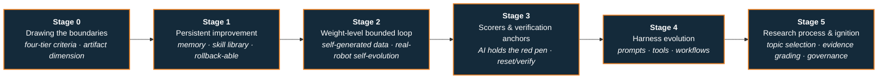

# Recursive Self-Improvement (RSI)

**At a glance**:

- **Who it's for**: people who want the R&D loop to make itself stronger and apply it to robots.
- **Path**: Stage 0–5 · drawing the boundaries → memory and skill libraries → weight-level loops → scorers and verification anchors → harness evolution → research process and governance.
- **Depth roadmap**: a branch of the [Motion Control main roadmap](motion-control.md); together with the [Embodied Data depth roadmap](depth-embodied-data.md) it forms a sister pair of "changing the data / changing the improvement mechanism itself".

## Roadmap overview

## How to use this path

- The target reader already uses a coding agent to modify training scripts / control programs and is starting to wonder "can this loop run by itself": the main battlefield is the R&D process itself, and on the robot side the landing point is self-improvement of real-robot policies and control programs
- RSI does not ask "can AI help me build better AI", but **whether the improved system is better at carrying out the next improvement**; it does not replace data supply (that is the [Embodied Data depth roadmap](depth-embodied-data.md)), nor deployment-time context adaptation (that is the [ICL depth roadmap](depth-icl.md))
- **Read Stage 0 before the papers**: in 2026, "self-evolution", "agent self-improvement", and "R&D acceleration" simultaneously refer to four completely different things (memory retention, weight updates, harness search, and research execution); unless you first nail down the four-tier criteria and the artifact dimension, news and papers get mixed into one pot
- Most core methods in this roadmap are on the agent / LLM side, and robot-side evidence is sparse and mostly closed-source self-reports: **every stage requires one round of evidence grading**, which is where this direction most easily goes wrong
- Each stage has prerequisites, core questions, what to do, what to read, and what you should be able to produce

**Relation to the main roadmap:**
- This roadmap hangs at a meta level outside main-roadmap L7 (exit layer: engineering and R&D efficiency): what it changes is "how you do robotics research", not any particular controller
- The starting point is the prehistory of "programs modifying their own heuristics", namely EURISKO (Lenat, 1983); the genuinely usable layer begins with agent self-evolution work after 2023
- On the robot side it depends heavily on the [Embodied Model Evaluation depth roadmap](depth-embodied-eval.md) (no credible evaluation means no accept gate) and the [Sim2Real depth roadmap](depth-sim2real.md) (whether self-evolution gains in simulation carry over to real robots)

**Embodied case supplement:** reports on [WorldScape R²SI](../../wiki/entities/manifold-worldscape-r2si.md) show a Skill / WSP update loop between an inner execution Agent and an outer improvement Agent; the RoboDojo ranking and experimental numbers have not yet been independently verified; see the entity page.

---

## Stage 0 Drawing the boundaries: four-tier criteria and the artifact dimension

**First nail down "what is being changed (artifact)" and "which tier it has reached (1–4)" as two orthogonal coordinates before reading papers; otherwise Reflexion's memory, STaR's weights, and DGM's harness all get labeled RSI together.**

### Prerequisites
- Can use a coding agent to run a complete task (read code → modify → run tests → commit)
- Have user-level intuition for the training–evaluation loop of RL / imitation learning

### Core questions
- **Four-tier criteria**: ① persistent improvement (does getting better stick) → ② bounded RSI (multiple propose–eval–accept rounds within fixed bounds) → ③ ignition (is the new version better at improving) → ④ robust and controllable (gains are transferable and auditable); the 2026 judgment in the text is that 1–2 have fairly direct evidence, 3 does not yet have sufficient public evidence, and 4 is far from solved
- **Artifact dimension**: which of **memory / weights / scorer / harness / research process** is being changed; this determines whether gains can transfer (harness score going up ≠ base model getting stronger)
- **Able to self-improve ≠ able to self-accelerate**: the OpenAI RSI Index (GPT-5.6 Sol 57.9%) measures R&D capability for "participating in improving AI", not proof of ignition
- Common misreadings: reading "R&D acceleration", "training on self-generated data", or "agent self-evolution" directly as RSI having been achieved

### What to do
- Fill the 8–10 "self-improving / self-evolution" works you have bookmarked into an **artifact × tier** two-dimensional table, noting what each changes and who guards the accept gate
- Write one sentence for your own setting: what I want to automate is **execution** or **judgment**? If you want to automate judgment, go back to Stage 0 and reread the four gates

### What to read
- [RSI four-tier criteria and five boundary pushes](../../wiki/queries/rsi-four-tier-five-pushes.md) — the discriminative foundation of this roadmap: the four-tier table, the five pushes, and how to read 2026 signals
- [Full-spectrum RSI survey (arXiv:2607.07663)](../../wiki/entities/paper-rsi-survey-2607-07663.md) — a two-axis taxonomy of **improvement target × degree of closed loop** over 1,250 papers, separating bounded self-refinement from open-ended RSI; corpus and scripts are open-sourced
- [Recursive self-improvement (macro view)](../../wiki/concepts/recursive-self-improvement.md) — Anthropic's full RSI definition, internal productivity numbers, and three scenarios; includes the "embodiment follows" hypothesis
- [Awesome RSI](../../wiki/entities/awesome-rsi.md) — 50+ methods / 29 benchmarks curated by **artifact × mode**; the index entry point for checking classifications
- [AI Auto-Research](../../wiki/concepts/ai-auto-research.md) — automation of the full research lifecycle: a problem setting adjacent to but distinct from RSI
- [The Last AI Built by Humans (five levels of improvement autonomy + HCI)](../../wiki/entities/paper-last-ai-built-by-humans-rsi.md) — arXiv:2609.11873, uses the Headroom-Closed Index to judge whether a system has moved from executing improvements to recursive meta-improvement (conceptual framework)

### What you should be able to produce
- An artifact × tier lookup table into which you can slot a new paper in one sentence
- A distinction you can explain to colleagues: which tier we are working at, and who holds the accept gate

---

## Stage 1 Persistent improvement: making improvements stick (memory and skill libraries)

**The only requirement of the first tier is this: getting better this time must carry over to next time; a better single CoT that is not persisted does not count as improvement.**

### Prerequisites
- Stage 0 content
- Can write agent tool calls and external state storage (any of files / vector store / skill library)

### Core questions
- **Memory-level self-improvement**: Reflexion writes failure reflections into cross-task episodic memory (HumanEval pass@1 91%), but **parameters stay unchanged**: remove the memory and it reverts, which is its capability boundary
- **The skill library is the robot-side counterpart**: ASPIRE distills verified and repaired control programs into an extensible skill library, so later tasks adapt faster with in-context skills; experience is retained as **code** rather than weights
- **Rollback-ability**: program / memory-level improvements are naturally diffable and revertible, which is their biggest engineering advantage over weight-level loops
- **Retaining failures is worth more than retaining successes**: what can be reused is "which consequences are bad", not a single successful trajectory

### What to do
- Add a minimal persistence layer to your agent: persist the result of every propose–eval (including failure reasons), run 10 rounds, and see whether round 10 is clearly better than round 1
- On the robot side, run one skill-library experiment: store a working control program in parameterized form, switch to a neighboring task, and measure whether tokens and trial-and-error counts go down

### What to read
- [ASPIRE](../../wiki/methods/aspire.md) — per-primitive multimodal traces + evolutionary search + skill-library distillation; beats CaP-Agent0 and VLA baselines on LIBERO-Pro / Robosuite / BEHAVIOR-1K
- [RSI four-tier criteria and five boundary pushes](../../wiki/queries/rsi-four-tier-five-pushes.md) first push — the Reflexion lineage and the "parameters unchanged" boundary
- [karpathy/autoresearch](../../wiki/entities/karpathy-autoresearch.md) — a three-file minimal loop: keep/discard under a fixed budget + fixed metric, with humans iterating program.md as a readable skill layer
- [Data flywheel](../../wiki/concepts/data-flywheel.md) — the data-side isomorphic mechanism of experience retention

### What you should be able to produce
- A runnable minimal propose–eval–persist loop (revertible, logged)
- A one-sentence defense: where my improvement is stored, how to roll it back, and what level the system falls back to if it is deleted

---

## Stage 2 Weight-level bounded loop: self-generated data and real-robot self-evolution

**From this tier on, what is changed is parameters: the system makes its own data and updates its own weights, but the boundaries (task distribution, evaluator, safety limits) are still frozen by humans.**

### Prerequisites
- Stage 1 content
- Have trained a BC / VLA policy or done one round of RL post-training (mid-level of the [Imitation Learning depth roadmap](depth-imitation-learning.md) or the [RL Locomotion depth roadmap](depth-rl-locomotion.md))

### Core questions
- **Self-generated data → weights** (STaR / SPIN lineage): the target distribution and filtering rules are still set by humans, so it is **bounded RSI** rather than open-ended
- **Model collapse risk**: a narrowing self-training data distribution silently degrades capability, so external data or an external anchor must be checked periodically
- **Robot-side bounded weight loop**: Motus2 puts policy / simulator / evaluator into one set of shared parameters and uses DiffusionNFT + Best-of-N to close "imagine consequences → score → change policy"; MBRL + Planning raises the macro average on Put Phone / Multi-Finger from **65% → 75%**, but the simulator / evaluator are **frozen** in the MBRL stage
- **Fleet-level continual improvement**: LWD uses DIVL + QAM to turn successful / failed / human-intervened trajectories from deployment into offline-to-online post-training of a single generalist VLA; this is the real-robot version of "deployment is not the end of training"
- **Do not read this tier as recursive acceleration**: a loop running a few net-positive turns ≠ the next turn running faster because of the previous one

### What to do
- Run one bounded loop on your own task: fix the evaluator and task set, let the agent change only the training config, and record the **per-round gain** curve rather than only the final value
- Do one collapse check: put the round-N model back on the original held-out set and see whether "self-score rises, external score falls" appears

### What to read
- [Motus2](../../wiki/entities/paper-motus2.md) — representative of a real-robot weight-level bounded loop; five-task macro average 84%, MBRL+Planning 75%; not open-sourced as of the ingest date
- [LWD](../../wiki/methods/lwd.md) — fleet-level offline-to-online: heterogeneous deployment experience → continual improvement of a single general policy
- [Cortex: consolidating context into parameters](../../wiki/entities/paper-cortex-parametric-memory.md) — reference material on FFN parametric memory, prospective queries, and CR/RR evaluation; the paper mainly studies text LLMs and is **not** real-robot self-improvement or a complete RSI loop
- [RSI four-tier criteria and five boundary pushes](../../wiki/queries/rsi-four-tier-five-pushes.md) second push — STaR / SPIN and the "target distribution still human-set" boundary
- [Embodied scaling laws](../../wiki/concepts/embodied-scaling-laws.md) · [Bitter Lesson](../../wiki/concepts/bitter-lesson.md) — background reading on the scale vs structure debate

### What you should be able to produce
- A bounded-loop experiment record: boundary definition (who froze what) + per-round gain + collapse-check conclusion
- Be able to say at which round your loop stalls and why it stops improving

---

## Stage 3 Scorers and verification anchors: who decides "this improvement counts"

**The success or failure of RSI lies almost entirely in the accept step: when a system is both improver and judge, the metric will drift.**

### Prerequisites
- Stage 2 content
- Basic alertness to evaluation protocols, held-out splits, and reward hacking (better at the level of Stages 0–2 of the [Embodied Model Evaluation depth roadmap](depth-embodied-eval.md))

### Core questions
- **The "AI holds the red pen" lineage**: CAI (humans write principles, AI scores against them) → Self-Rewarding → Meta-Rewarding; the shared problem is that **judge and answerer share blind spots**, and Meta-Rewarding also degrades in later rounds
- **External anchors must be unmodifiable**: hidden test sets, compilers, provers, real sensors; EURISKO altering its "credit ledger" and Meta-Rewarding's high-score bias are both consequences of the anchor being internalized
- **On the robot side the anchor is physics**: without automatic **reset / verify**, you simply cannot assemble the eval of propose–eval–accept on a real robot; ENPIRE's EN step (automatic reset/verify environment) is the entry ticket for this line, and AutoEnvBench and MRU/MTU give fleet scaling metrics
- **Separate public scores / hidden scores**: self-evolution results that report only public scores should by default be read as "possibly overfitting the question bank"
- **Real-robot eval is expensive**: the rollout budget and parallel fleet determine loop speed; this is an engineering problem, not an algorithmic one

### What to do
- Hard-code accept rules for your loop: which set, how many seeds, what threshold, who has veto power; if you cannot write it down, you have not yet reached tier two
- Set up a **public score / hidden score** dual-track evaluation, run a full 5 rounds, then compare whether the two curves diverge
- Real-robot side: pick one task, fully automate reset and verify, and measure the wall-clock time and number of human interventions per eval

### What to read
- [Self-Rewarding Language Models](../../wiki/entities/paper-self-rewarding-language-models.md) — ICML 2024, M1→M3 use their own scores to construct preference pairs and iterate DPO; used to distinguish evidence that "self-evaluation also gets stronger" from the risk of lacking an independent verification anchor
- [ENPIRE](../../wiki/methods/enpire.md) — EN–PI–R–E loop: automatic reset/verify, multi-paradigm policy improvement, parallel rollouts; reports about 99% pass@8 on dexterous tasks
- [Real-robot policy autoresearch harness guide](../../wiki/queries/real-robot-policy-autoresearch-harness.md) — practical selection for the environment side, paradigm choice, rollout budget, and fleet scaling
- [RSI four-tier criteria and five boundary pushes](../../wiki/queries/rsi-four-tier-five-pushes.md) "four gates" subsection — verifier anchor, out-of-distribution, recursive gain, capability–control synchronization
- [Full-spectrum RSI survey](../../wiki/entities/paper-rsi-survey-2607-07663.md) — lists self-evaluation as a separate fourth technical category: the evaluator design space is the shared ceiling for the whole field
- [Embodied Model Evaluation depth roadmap](depth-embodied-eval.md) — expanded version of unseen-set splits and process metrics

### What you should be able to produce
- An accept protocol document (set / seed / threshold / veto power) that can be pasted directly into the project README
- A dual-track curve of public vs hidden scores, plus an explanation of any divergence

---

## Stage 4 Harness evolution: changing prompts, tools, and workflows

**The most active and most easily overestimated tier of 2026: harnesses are far cheaper than weights, but a rising harness score does not mean the base model got stronger.**

### Prerequisites
- Stage 3 content
- Have hand-written agent prompts / tools / workflow orchestration and know what else is affected when you change one thing

### Core questions
- **The harness is a first-class object**: prompts, tools, workflows, permissions, and runtime orchestration can be searched programmatically; this is the OPRO / ADAS / AFlow / Self-Harness / DGM / AgentX line (DGM reports 20% → 50% on SWE-bench Verified)
- **Turning the harness into inheritable configuration**: RSI-Harness carries this with an inherit-by-default Genome patch layer of 12 components, and MetaRSI-v1 further schedules three operators, **Data-RSI / Harness-RSI / Model-RSI**, on the same loop kernel
- **Gating is a necessity**: HarnessBank uses a semantic Harness Gene Bank + gated screening to do trustworthy self-evolution with a frozen model (Test Pass@1 +5.1%–15.4% across seven benchmarks); without gating, harness search is just overfitting the question bank
- **Save first, then scale**: SoL-Pi screens four efficiency extensions through a 152 → 4 auto-research loop, retaining about 94% of the EdgeBench score while token / cost drops significantly; "efficiency for efficiency" is the precondition for keeping the loop running longer
- **Transferability check**: does the evolved harness still hold under a different task distribution or a different base model? If not, it is only a locally optimal configuration
- **Regularizing the search trajectory**: [RRSI](../../wiki/entities/paper-rrsi-2609-24972.md) constrains both proposal and selection: edit-budget annealing, history-deduplicated exploration, a leakage critic, noise thresholds, token-cost rules, and pruning of ineffective components; check whether gains transfer to held-out benchmarks

### What to do
- Choose a fixed task set, let the agent change only the harness (not the weights), run 10 rounds of search, then accept-test on **another set of tasks**: however much the gain drops is how much it overfit
- Version and gate the harness: every accept must come with two columns, the passing hidden-set score and the cost (tokens / wall-clock)
- Robot side: treat "changing the control program" as a harness search once, and compare against ASPIRE's evolutionary search setup

### What to read
- [Darwin Gödel Machine (DGM)](../../wiki/entities/paper-darwin-godel-machine.md) — a self-modifying coding Agent in the outer layer around a frozen foundation model; an open-ended archive keeps transitional branches; distinguishes 50-problem from full Polyglot results
- [MetaRSI-v1](../../wiki/entities/paper-metarsi-v1.md) — Data / Harness / Model three operators and a two-axis optimizer; a verification setup with no external teacher
- [RSI-Harness](../../wiki/entities/paper-metarsi-v1.md) — the Genome configuration layer and GEE (generating Genomes from sessions); the official Harness-RSI implementation
- [HarnessBank](../../wiki/entities/paper-harnessbank.md) — semantic archiving and gated harness self-evolution under a frozen model
- [RRSI](../../wiki/entities/paper-rrsi-2609-24972.md) — reduces overfitting of harness search to the evolution benchmark through proposal and selection regularization
- [SoL-Pi](../../wiki/entities/sol-pi.md) — auto-research loop screening efficiency extensions; make the harness cheap first, then talk about scale
- [Awesome RSI Methods page](https://prism-shadow.github.io/awesome-rsi/#methods) (external link) — filter similar works by artifact
- [COAP (Embodied Turing Machines)](../../wiki/entities/paper-coap-embodied-turing-machines.md) — writes robot policies as readable programs that explicitly maintain environment state; the coding agent only iterates on the code offline, and no VLM/VLA is called at runtime

### What you should be able to produce
- A harness evolution pipeline with gating and cost columns
- A transferability table: in-distribution gain vs cross-distribution gain, used to decide whether this harness goes into production

---

## Stage 5 Research process, the ignition threshold, and governance

**The last tier hands over training material, environments, and research execution; and whether "the next turn is faster because of the previous one" still lacks sufficient public evidence.**

### Prerequisites
- Stage 0–4 content

### Core questions
- **The target of the fifth push is the research process itself**: SEAL (self-made training material), WebEvolver (self-made environments), Motus2 (real-robot loop), and each lab's R&D Agents; research direction and adoption authority remain in human hands
- **How to measure ignition**: task score rising ≠ better at designing improvements; AI4AI-Bench scores only **0.250/1.0** on "touching core learning algorithms", and AIDE² self-reports Level 1 but **did not pass the ignition test**
- **Failure modes are systemic**: AutoResearchEval catalogs 45 classes of research Agent failures; the common defect is a stable **metacognitive loop** (checking evidence, backtracking, questioning the path)
- **The human-side bottleneck is topic selection and taste**: in Anthropic's account, Claude can already match or exceed skilled humans at executing experiments when **the goal is given**; what is weak is "which problem to pick, which plot to trust, when to stop"; the parts not covered by acceleration become new Amdahl bottlenecks (such as human code review)
- **Embodiment following is an expectation, not a law**: if recursive intelligence emerges, robots are expected to follow, but contact forces, latency, safety certification, and social clocks do not follow; see the physical bottlenecks in [LLM control interfaces](../../wiki/concepts/llm-robotics-control-interfaces.md)
- **Evidence grading is the basic skill of this direction**: the RSI Index, AIDE², and internal productivity numbers are mostly vendor self-reports or preprints; treat them only as directional signals

### What to do
- Label 5 pieces of "RSI progress" news you have one by one as **reproducible / closed-source self-report / hypothetical interpretation**, and write down what the external anchor of each is
- Write one page for your own project on "what humans retain": who owns topic selection, the evaluation protocol, safety limits, and veto power respectively; this page matters more than any loop code
- If you work on robots: fill in the selection table of the [Real-robot autoresearch harness guide](../../wiki/queries/real-robot-policy-autoresearch-harness.md) and confirm whether what you lack is the environment, the evaluation, or the improvement paradigm

### What to read
- [Recursive self-improvement (macro view)](../../wiki/concepts/recursive-self-improvement.md) — three scenarios, Amdahl bottlenecks, and a "how to read internal numbers" lookup table
- [From AGI to ASI](../../wiki/entities/paper-from-agi-to-asi.md) — DeepMind's four capability paths and six classes of bottlenecks; do not conflate with RSI mechanisms
- [AI Auto-Research](../../wiki/concepts/ai-auto-research.md) — human–machine co-governance, layered verification, and cross-stage provenance
- [Datawhale RSI popular-science survey (2026-09-19)](https://mp.weixin.qq.com/s/rlfTKyWhALsNONhAwGih1A) — the five-push narrative and summer 2026 signals
- [When AI builds itself (Anthropic Institute)](https://www.anthropic.com/institute/recursive-self-improvement) — original macro-level essay

### What you should be able to produce
- An RSI status brief annotated with evidence levels, usable directly for team decisions
- A one-sentence defense: which tier my system is at, which artifact it changes, what the external anchor is, and which gates humans retain

---

## Quick entry summary

| Stage | Core question | Knowledge page entry |
|------|---------|-----------|
| Stage 0 | Four-tier criteria and artifact dimension | [RSI four-tier criteria and five boundary pushes](../../wiki/queries/rsi-four-tier-five-pushes.md) |
| Stage 1 | How improvements stick | [ASPIRE](../../wiki/methods/aspire.md) · [karpathy/autoresearch](../../wiki/entities/karpathy-autoresearch.md) |
| Stage 2 | Weight-level bounded loop | [Motus2](../../wiki/entities/paper-motus2.md) · [LWD](../../wiki/methods/lwd.md) |
| Stage 3 | Scorers and verification anchors | [ENPIRE](../../wiki/methods/enpire.md) · [Real-robot autoresearch harness](../../wiki/queries/real-robot-policy-autoresearch-harness.md) |
| Stage 4 | Harness evolution and gating | [MetaRSI-v1](../../wiki/entities/paper-metarsi-v1.md) · [HarnessBank](../../wiki/entities/paper-harnessbank.md) · [RRSI](../../wiki/entities/paper-rrsi-2609-24972.md) |
| Stage 5 | Ignition threshold and governance | [Recursive self-improvement](../../wiki/concepts/recursive-self-improvement.md) · [AI Auto-Research](../../wiki/concepts/ai-auto-research.md) |

## Relation to other pages

- Full growth roadmap reference: [Main roadmap: Motion control → full-stack physical intelligence growth roadmap](motion-control.md)
- Related depth roadmaps (ordered by topical proximity; for the full catalog see [Roadmap index](motion-control.md#depth-optional-index)):
  - [Embodied evaluation](depth-embodied-eval.md) — unseen-set splits and process metrics; an expansion of the verifier anchor
  - [Embodied data](depth-embodied-data.md) — the flywheel and mixing ratios are the data-side isomorph of self-improvement
  - [VLA](depth-vla.md) — the most common improvement target of real-robot policy self-improvement loops
  - [ICL](depth-icl.md) — another improvement path with frozen weights, used to contrast the RSI boundary

## References

- [RSI four-tier criteria and five boundary pushes](../../wiki/queries/rsi-four-tier-five-pushes.md) — four-tier criteria and the five-push narrative axis
- [Full-spectrum RSI survey (arXiv:2607.07663)](../../wiki/entities/paper-rsi-survey-2607-07663.md) — two-axis taxonomy and verification levels
- [Recursive self-improvement (concept page)](../../wiki/concepts/recursive-self-improvement.md) — macro-level essay, how to read internal numbers, and three scenarios
- [A popular-science survey that finally explains "RSI" clearly!](https://mp.weixin.qq.com/s/rlfTKyWhALsNONhAwGih1A) — Datawhale RSI popular-science survey (Zhao Zhimin)
- [When AI builds itself](https://www.anthropic.com/institute/recursive-self-improvement) — When AI builds itself (Anthropic Institute)
- [AI for Auto-Research: Roadmap & User Guide (survey preprint)](https://arxiv.org/abs/2605.18661) — AI for Auto-Research survey
- [Awesome RSI](https://github.com/Prism-Shadow/awesome-rsi) — agent-level RSI literature index
