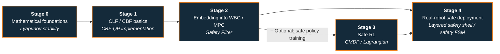

# Safe Control

**At a glance**:

- **Who it's for**: People who need to control robots while satisfying safety constraints.
- **Path**: Stage 0–4 · Mathematical foundations → CLF / CBF → CLF + CBF into WBC / MPC → layered safety shell on the real robot; Safe RL is an optional branch for learned policies.
- **Depth roadmap**: A branch of the [motion control main roadmap](motion-control.md).

## Roadmap overview

## How to use this path

- The target reader is an engineer or researcher with a control theory background who wants to add safety guarantees
- You need basic linear algebra and intuition for differential equations; RL basics help in the later stages
- Each stage has prerequisites, core questions, what to do, and what you should be able to produce

**Relation to the main roadmap:**
- Safe control can serve as constraints or a safety filter for WBC / MPC; in RL, distinguish reward penalties, CMDP constraints, and runtime filters; reward penalties by themselves give no safety guarantee
- If you want to add safety guarantees while working on L4 of the main roadmap, see this roadmap
- If you do RL, first make clear in Stage 3 whether the guarantee is an expected cumulative cost, a probability bound, or a per-timestep constraint; when you need to never cross the boundary, combine it with the safety layers of Stages 1–2 and their applicability assumptions
- If you are moving a policy onto a real robot and worry about the robot falling / losing control / faults injuring people, see Stage 4 of this roadmap (it can also be read first, as the safety baseline before going on hardware)

---

## Stage 0 Mathematical foundations

### Prerequisites
- Linear algebra (matrices, eigenvalues)
- Basics of differential equations (stability intuition)
- A bit of convex optimization (what a QP is)

### Core questions
- What Lyapunov stability means
- When Lyapunov conditions guarantee only stability and when they imply asymptotic convergence; why a negative semidefinite derivative still needs conditions such as invariant sets

### What to read
- [Lyapunov stability formalization](../../wiki/formalizations/lyapunov.md)
- Khalil, *Nonlinear Systems* — Chapter 4 (stability definitions)

### What to do
- Pick a simple first- or second-order system, hand-write a Lyapunov function, and verify that its derivative is negative semidefinite
- Compare against Khalil *Nonlinear Systems* Chapter 4, and match the stability definitions to your own proof

### What you should be able to produce
- Be able to verify Lyapunov stability of a simple system by hand
- Understand the meaning of positive definite functions and negative semidefinite derivatives

---

## Stage 1 CLF / CBF basics

### Core questions
- What problems CLF and CBF each solve (convergence vs. safety boundary)
- How the two are jointly placed into a QP optimization

### What to read
- [Control Lyapunov Function](../../wiki/formalizations/control-lyapunov-function.md)
- [Control Barrier Function](../../wiki/concepts/control-barrier-function.md)
- [CLF vs CBF comparison](../../wiki/comparisons/clf-vs-cbf.md)
- Ames et al., *Control Barrier Function based Quadratic Programs* (2017)

### What to do
- Implement a CBF-QP with Python + CVXPY that guarantees a 2D cart does not cross a boundary

### What you should be able to produce
- Be able to explain the mathematical definitions and functional differences of CLF and CBF
- Be able to write the standard form of a CBF-QP

---

## Stage 2 Applying CLF+CBF in WBC/MPC

### Core questions
- How to embed CLF and CBF constraints into the QP layer of WBC
- What the difference is between a safety filter and an MPC safety constraint

### What to read
- [Safety Filter](../../wiki/concepts/safety-filter.md)
- [Whole-Body Control](../../wiki/concepts/whole-body-control.md)
- [Query: using CLF+CBF jointly in WBC/MPC](../../wiki/queries/clf-cbf-in-wbc.md)
- Zeng et al., *Safety-Critical Model Predictive Control* (2021)

### What to do
- Add a CBF safety filter to a simple locomotion environment and observe its effect on the gait

### What you should be able to produce
- Be able to describe how a safety filter works
- Be able to identify which constraint layers in WBC can take CLF/CBF terms

---

## Stage 3 Safe RL

### Core questions
- The difference between a Constrained MDP (CMDP) and a standard MDP
- How to train safe policies with Lagrangian methods or barrier methods

### What to read
- [Safe RL](../../wiki/methods/safe-rl.md)
- [CMDP formalization](../../wiki/formalizations/cmdp.md)
- [Safe real-world RL fine-tuning](../../wiki/concepts/safe-real-world-rl-fine-tuning.md)
- Garcia & Fernandez, *A Comprehensive Survey on Safe RL* (2015)
- [Reinforcement Learning](../../wiki/methods/reinforcement-learning.md)

### What to do
- Run a constrained RL experiment with Safety Gym (OpenAI) or safe-control-gym

### What you should be able to produce
- Be able to explain the formal definition of a CMDP
- Be able to distinguish CMDP expected cumulative cost constraints, reward penalties, and per-timestep safety constraints, and state the model, feasibility, and deployment assumptions each requires

---

## Stage 4 Real-robot safe deployment: layered safety shell

### Prerequisites
- The safety filter from Stage 2; add Stage 3 when using learned policies; classical WBC/MPC deployment does not require completing Safe RL
- Have a policy ready for hardware (RL or WBC both work), and have read the basic concepts of [Sim2Real](../../wiki/concepts/sim2real.md)

### Core questions
- Why the guarantees of CBF / Safe RL are not enough: model errors, actuator faults, bus timeouts, and estimator divergence all lie outside the algorithm's assumptions; **safety must be independent of the policy**, distributed across the algorithm / control board / drive / mechanical layers
- What safe state to switch to on hard faults: a deterministic FSM (watchdog, bus timeout → damping / zero torque / freeze), and the **fail-passive gap** of "zero torque = falling down"
- How to make an emergency stop that does not fall: first judge whether the current state is still "stoppable", then choose a stopping strategy or damping-based fall prevention
- How to mitigate damage when a fall is unavoidable; how to verify step by step before going on hardware (SIL → HIL → gantry → progressive testing)

### What to read
- [Sim2Real closed-loop error layered engineering](../../wiki/queries/sim2real-closed-loop-engineering.md) — §6 "Layered safety: independent of the policy"
- [Sim2Real engineering checklist](../../wiki/queries/sim2real-checklist.md) — Phase 4 "First real-robot deployment": safety rope / emergency stop / torque limit / standing first
- [Robot safety state machine](../../wiki/concepts/robot-safety-state-machine.md) and [wbc_fsm](../../wiki/entities/wbc-fsm.md) (an instance of Passive / Loco / WBC mode switching)
- [Fail-Passive Gap](../../wiki/entities/paper-fail-passive-gap.md) — ISO 13849 safe-on-power-loss vs active balance in bipeds; the external chain can be rated for PL, the robot-side reaction chain cannot
- [Safe-Stop](../../wiki/entities/paper-safe-stop-humanoid.md) — models the emergency stop as reach-avoid; stops only when two stoppability estimates agree, otherwise damping fallback
- [ResSafe](../../wiki/entities/paper-ressafe.md) / [SafeWBC](../../wiki/entities/paper-motion-cerebellum-safewbc.md) — learned / CBF-based safety layers attached after the policy or WBC output
- [SafeFall](../../wiki/entities/paper-hrl-stack-41-safefall.md) and [Balance Recovery](../../wiki/tasks/balance-recovery.md) — fall prediction + damage mitigation strategies, dormant in normal operation
- [Hardware-in-the-Loop](../../wiki/concepts/hardware-in-the-loop.md) / [Humanoid testing workflow L0–L5](../../wiki/concepts/humanoid-testing-workflow.md) — step-by-step verification before going on hardware
- [SLowRL](../../wiki/entities/paper-slowrl-safe-lora-locomotion-sim2real.md) — uses Recovery safety filtering to limit exploration during real-robot fine-tuning (connects to Stage 3)
- [Model versioning and OTA](../../wiki/concepts/model-versioning-ota.md) — weights may be swapped only in the Passive / Safe state
- [RL policy real-robot debugging playbook](../../wiki/queries/robot-policy-debug-playbook.md)

### What to do
- In simulation, add an `Init → Passive → Active → Fault → Safe` state machine to your control stack, inject bus timeouts, deadline misses, and IMU failures, and check that each fault enters the safe state within one control cycle and does not automatically bounce back to Active
- Do one hardware bring-up in the order of Phase 4 of the [Sim2Real Checklist](../../wiki/queries/sim2real-checklist.md): gantry protection + hardware emergency stop + torque limit → standing ≥ 30 s → stepping in place → very slow straight walking
- For a humanoid, write down clearly "what exactly the Safe state is": zero torque / damped standing / kneel-down script, and state in which states it will lead to a fall

### What you should be able to produce
- A layered safety table for your robot: for each layer (mechanical / drive / control board / algorithm), fault source → detection → safety action
- Be able to explain the division of labor between the safety filter (constraining normal control) and the safety FSM (handling hard faults), and why the fail-passive gap is a gap in humanoid certification
- A reusable pre-hardware checklist

---

## Quick entry summary

| Stage | Core question | Knowledge page entry |
|------|---------|-----------|
| Stage 0 | Lyapunov stability | [Lyapunov stability](../../wiki/formalizations/lyapunov.md) |
| Stage 1 | CLF / CBF and CBF-QP | [Control Barrier Function](../../wiki/concepts/control-barrier-function.md) |
| Stage 2 | Embedding into WBC / MPC | [Safety Filter](../../wiki/concepts/safety-filter.md) |
| Stage 3 | Safe RL / CMDP | [Safe RL](../../wiki/methods/safe-rl.md) |
| Stage 4 | Real-robot layered safety / safety FSM / emergency stop | [Robot safety state machine](../../wiki/concepts/robot-safety-state-machine.md) |

## Relation to other pages

- Full growth roadmap reference: [Main roadmap: motion control → physical intelligence full-stack growth roadmap](motion-control.md)
- Related depth roadmaps (by topical proximity; full catalog in the [roadmap overview](motion-control.md#depth-optional-index)):
  - [Classical model-based control](depth-classical-control.md) — Safety Filter / CBF constraints embedded into WBC/MPC
  - [Sim2Real](depth-sim2real.md) — the transfer side of Stage 4 real-robot safe deployment (identification, DR, hardware bring-up process)
  - [RL motion control](depth-rl-locomotion.md) — the policy training side of Stage 3 Safe RL
  - [Contact manipulation](depth-contact-manipulation.md) — contact force bounds are another class of safety constraints
- Related knowledge pages:
  - [Lyapunov stability](../../wiki/formalizations/lyapunov.md)
  - [Control Lyapunov Function](../../wiki/formalizations/control-lyapunov-function.md)
  - [Control Barrier Function](../../wiki/concepts/control-barrier-function.md)
  - [CLF vs CBF comparison](../../wiki/comparisons/clf-vs-cbf.md)
  - [Safety Filter](../../wiki/concepts/safety-filter.md)
  - [Safe RL](../../wiki/methods/safe-rl.md) and [CMDP formalization](../../wiki/formalizations/cmdp.md)
  - [Whole-Body Control](../../wiki/concepts/whole-body-control.md)
  - [Query: using CLF+CBF jointly in WBC/MPC](../../wiki/queries/clf-cbf-in-wbc.md)
  - [Robot safety state machine](../../wiki/concepts/robot-safety-state-machine.md) and [Sim2Real closed-loop error layered engineering](../../wiki/queries/sim2real-closed-loop-engineering.md)
  - [Real-robot safe fine-tuning knowledge chain](../../wiki/overview/hub-safe-fine-tuning.md)

## References

- [Lyapunov stability](../../wiki/formalizations/lyapunov.md)
- [Control Lyapunov Function](../../wiki/formalizations/control-lyapunov-function.md)
- [Control Barrier Function](../../wiki/concepts/control-barrier-function.md)
- [CLF vs CBF comparison](../../wiki/comparisons/clf-vs-cbf.md)
- Ames et al., *Control Barrier Function based Quadratic Programs* (2017)
- Khalil, *Nonlinear Systems*
- [Sim2Real closed-loop error layered engineering](../../wiki/queries/sim2real-closed-loop-engineering.md), [Sim2Real engineering checklist](../../wiki/queries/sim2real-checklist.md)
- [Robot safety state machine](../../wiki/concepts/robot-safety-state-machine.md), [Fail-Passive Gap (arXiv:2608.02809)](../../wiki/entities/paper-fail-passive-gap.md), [Safe-Stop (arXiv:2609.02358)](../../wiki/entities/paper-safe-stop-humanoid.md)
