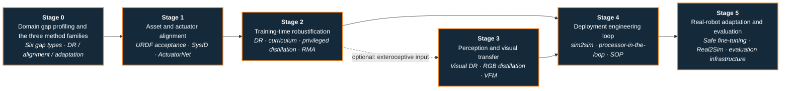

# Simulation-to-Real Transfer (Sim2Real)

**At a glance**:

- **Who it's for**: people who want to reliably move policies trained in simulation onto real robots.
- **Path**: Stage 0–5 · Domain gap profiling → asset and actuator alignment → training-time robustification → deployment engineering loop → real-robot adaptation and evaluation; perception Sim2Real is optional reading depending on the policy inputs.
- **Depth roadmap**: the expanded version of L6 integrated practice in the [motion control main roadmap](motion-control.md), cutting across all depth directions of "train in simulation → deploy on the real robot".

## Roadmap overview

## How to use this path

- The target readers can already train a usable policy in Isaac Lab / MuJoCo, but "it goes wrong as soon as it's on the real robot"; the main battlefield is real-robot deployment of legged locomotion, humanoid whole-body control, and manipulation policies
- Sim2Real addresses **the distribution gap between simulation and reality**: it is not responsible for training a good policy, which is the topic of the [RL depth roadmap](depth-rl-locomotion.md) and the [imitation learning depth roadmap](depth-imitation-learning.md); it is responsible for making the trained policy still hold on the real robot
- Each stage has prerequisites, core questions, what to do, what to read, and what you should be able to produce

**Relation to the main roadmap:**
- This roadmap is the expanded version of main-roadmap **L6 (integrated practice · sim2real loop)**; you can enter after completing L5.2 (able to train a simulated locomotion policy)
- Stage 1 actuator alignment shares motor-model knowledge with the [torque motor design depth roadmap](depth-torque-motor-design.md); Stage 3 shares the "perception into policy" engineering stack with the [perceptive locomotion depth roadmap](depth-perceptive-locomotion.md)
- If the goal is "keep learning on the real robot after deployment", after completing Stage 5 Direction A, continue with the three paths laid out in [safe real-world RL fine-tuning](../../wiki/concepts/safe-real-world-rl-fine-tuning.md)

---

## Stage 0 Domain gap profiling and the three method families: first pin down where the gap comes from

**First attribute failures to specific gap categories, then choose methods; otherwise you fall into a loop of "mindlessly adding DR".**

### Prerequisites
- Fluent in Python + PyTorch
- Main-roadmap L5.2 level (have fully trained a locomotion or manipulation policy in Isaac Lab / MuJoCo)

### Core questions
- The six sources of domain gap: dynamics parameters, actuator response, sensor noise, latency and communication jitter, visual appearance, firmware and bus paths
- The three method families: which distribution each of **simulation-side randomization** (DR), **distribution alignment** (SysID / Domain Adaptation), and **real-robot adaptation** (privileged distillation / RMA / fine-tuning) changes
- Why "the more realistic the simulation, the better" is a misconception: the tradeoff between randomization for robustness vs alignment for accuracy

### What to do
- Classify each real-robot (or sim2sim) failure of your policy into the six gap types to form a failure list
- Write a one-sentence applicability criterion for each of the three method families (when to calibrate, when to randomize, when to adapt online)

### What to read
- [Sim2Real](../../wiki/concepts/sim2real.md) — the concept hub, including an engineering workflow overview diagram
- [Sim2Real approaches comparison](../../wiki/comparisons/sim2real-approaches.md) — a selection decision tree for the three route families
- [Query: how to reduce the sim2real gap](../../wiki/queries/sim2real-gap-reduction.md)
- Tobin et al. 2017, *Domain Randomization for Transferring Deep Neural Networks* — the foundational DR paper; Peng et al. 2018, *Sim-to-Real Transfer with Dynamics Randomization*

### What you should be able to produce
- A "gap source × countermeasure" mapping table
- Explain in one sentence whether DR / SysID / RMA each changes the training distribution, the simulation distribution, or the policy itself

---

## Stage 1 Asset and actuator alignment: pulling simulation toward the real robot

**A large share of the real-robot gap comes from inaccurate actuator models; align assets and actuators first, then talk about randomization.**

### Prerequisites
- Stage 0 content
- Know URDF/MJCF structure and joint PD control

### Core questions
- What URDF/MJCF acceptance must check: inertia, collision boxes, joint axes, gear ratios; why generative sim-ready assets are not "usable as generated"
- What SysID calibrates: mass and inertia, friction, latency; the recipe of chirp excitation + CMA-ES identification (PACE / BAM)
- Tradeoffs between implicit vs explicit actuator models; which actuators ActuatorNet (data-driven), BAM extended friction (analytical), and armature compensation each suit
- How to quantify the actuator-level gap: SAGE-style simulation replay aligned against real-robot logs
- The gap for closed-chain mechanisms such as parallel ankles between "open-loop tree used in training / series-parallel on the real robot"

### What to do
- Do suspended chirp identification on one joint, and compare the RMSE between simulated trajectories and real-robot logs before and after calibration
- Use SAGE-style replay alignment to build an actuator gap profile for your own platform

### What to read
- [System Identification](../../wiki/concepts/system-identification.md)
- [Implicit / Explicit actuator modeling](../../wiki/concepts/implicit-explicit-actuator-modeling.md) · [Armature modeling](../../wiki/concepts/armature-modeling.md)
- [Actuator Network](../../wiki/methods/actuator-network.md) — data-driven actuator model
- [BAM extended friction model](../../wiki/entities/paper-bam-extended-friction-servo-actuators.md) · [PACE](../../wiki/entities/paper-pace-sim2real-legged-robots.md) — two representative routes of analytical identification
- [SAGE (Sim2Real Actuator Gap Estimator)](../../wiki/entities/sage-sim2real-actuator-gap-estimator.md)
- [Humanoid full-robot closed-loop inertia calibration](../../wiki/concepts/humanoid-closed-loop-inertia-calibration.md) and [PRIME](../../wiki/entities/prime-system-id.md) (RSS 2026) — single-joint bench measurements cover only the bare joint and cannot capture the full robot's distributed mass and lifetime drift: the four sheets of kinematics / inertia / IMU bias / foot force must be made into a closed loop that can be updated with load and bound to the robot's serial number; PRIME provides a runnable implementation (differentiable Anitescu contact + Crocoddyl, MAP joint estimation of trajectory/contact forces/physically consistent inertia, validated on G1 and Go2, open-sourced under BSD-3-Clause)
- [Humanoid robot parallel joint kinematics](../../wiki/concepts/humanoid-parallel-joint-kinematics.md)

### What you should be able to produce
- A URDF/actuator acceptance checklist and an actuator gap profile for your platform
- Be able to explain "why a policy trained on implicit does not necessarily transfer directly when switched to explicit"

---

## Stage 2 Training-time robustification: DR · curriculum · privileged distillation · online adaptation

**Stage 1 pulls simulation toward the real robot; this layer pushes the policy to stay stable even out of distribution.**

### Prerequisites
- Stage 1 content
- Able to modify RL training configurations (reward, randomization terms, curriculum)

### Core questions
- Which parameters DR randomizes, how to set the ranges, and when it actually hurts performance; how DR and curriculum learning work together
- Why privileged teacher–student is a core sim2real recipe: it turns RL exploration into supervised learning labeled by the teacher
- RMA's two stages: train the base policy with privileged extrinsics, train the adaptation module with history-trajectory supervision, and implicitly estimate environment parameters within seconds on the real robot
- Constraints as a safety layer: write the motor speed–torque envelope into training (MUJICA, KAIST Hound MOR-constrained RL), replacing "betting on robustness with pure DR"

### What to do
- Run three ablation groups on your own task, "no DR / dynamics DR / DR + RMA", and record training stability and sim2sim results
- Write a DR parameter table for your platform, annotating the basis for each range (calibrated value ± uncertainty, not a guess)

### What to read
- [Domain Randomization](../../wiki/concepts/domain-randomization.md) · [Curriculum Learning](../../wiki/concepts/curriculum-learning.md)
- [Privileged Training](../../wiki/concepts/privileged-training.md)
- [PEAR / Robot-Use RL](../../wiki/entities/paper-pear-robot-use-rl.md) — trains a multi-turn reasoning policy with binary rewards purely in simulation and transfers it to a real YAM; note the deployment limits of the robot coordinate interface, IK, and inference latency.
- [RMA (Rapid Motor Adaptation)](../../wiki/entities/paper-rma-rapid-motor-adaptation.md) — the representative work on online adaptation
- [MUJICA](../../wiki/entities/paper-mujica-wheel-legged-multi-skill.md) — a zero-shot example of putting motor envelope constraints into P3O
- [Actuator-constrained RL for high-speed quadrupeds](../../wiki/entities/paper-actuator-constrained-rl-high-speed-quadruped-locomotion.md) (arXiv:2312.17507) — MOR constraints + reducer mapping; HOUND at 6.5 m/s and high-speed sim2real ablations

### What you should be able to produce
- A DR parameter table with justified ranges
- Be able to explain what each of RMA's two stages supervises, and why no real-robot fine-tuning is needed at deployment

---

## Stage 3 Perception and visual Sim2Real

**State-policy transfer solves the "body"; visual-policy transfer must also solve the "eyes".**

### Prerequisites
- Stage 2 content
- Know the basic structure of policies with depth camera / RGB inputs

### Core questions
- Three ways to tackle the visual gap: visual domain randomization, state teacher → RGB student distillation (PPO + DAgger), replacing heavy depth randomization with vision foundation models
- Why large-scale pretraining on synthetic depth + noise augmentation can support zero-shot real-robot navigation (SRU)
- How 3DGS / path-traced rendering narrows the visual gap to synthesize training data (LEGS / OASIS)

### What to do
- Add parallel depth noise augmentation to a depth-input policy and compare zero-shot sim2sim / real-robot performance
- Pick any visual sim2real work and place it within the three-way split of "randomization / distillation / VFM replacement"

### What to read
- [GR00T-VisualSim2Real](../../wiki/entities/gr00t-visual-sim2real.md) — PPO teacher + DAgger RGB student, G1 zero-shot
- [LadderMan](../../wiki/entities/paper-ladderman-humanoid-perceptive-ladder-climbing.md) — uses VFM depth on the real robot instead of heavy depth randomization
- [SRU](../../wiki/entities/paper-sru-spatially-enhanced-recurrent-memory.md) — zero-shot navigation with synthetic depth pretraining + depth noise augmentation
- [LEGS](../../wiki/entities/paper-legs-embodied-gaussian-splatting-vla.md) · [OASIS](../../wiki/entities/paper-loco-manip-04-oasis.md) — 3DGS / path-traced visual DR synthetic data
- [RoboRender](../../wiki/entities/robo-render.md) — turns simulator trajectories into more realistic and diverse robot RGB videos while preserving geometry/action annotations, narrowing the visual gap

### What you should be able to produce
- A transfer decision record for "state policy → visual policy" (choose one of randomization / distillation / VFM, or a combination)
- Be able to explain why countermeasures for the visual gap and the dynamics gap cannot substitute for each other

---

## Stage 4 Deployment engineering loop: sim2sim regression → processor-in-the-loop → incremental SOP

**Before going to the real robot, expose every problem that can be exposed in simulation; once on the real robot, proceed incrementally per the SOP rather than trusting luck.**

### Prerequisites
- Stage 2 content (Stage 3 visual part as needed)
- Know the basic constraints of ROS / real-time middleware and onboard compute boards

### Core questions
- Why do cross-simulator regression (IsaacGym → MuJoCo sim2sim): to separate "overfitting to the simulator implementation" from "the true gap"
- Middleware and frequency alignment: policy frequency + low-level PD frequency, and consistency of action/state normalization between simulation and the real robot
- Processor-in-the-loop: when firmware scheduling, CAN/I2C bus semantics, and jitter must be brought into the training loop
- ONNX export and onboard inference runtime selection; incremental real-robot SOP (gantry → free-running → on the ground) and system troubleshooting

### What to do
- Export the policy to ONNX and measure inference latency and jitter on the target onboard board
- Run through the full sim2real checklist, and produce one sim2sim regression report before going to the real robot

### What to read
- [Query: Sim2Real Checklist](../../wiki/queries/sim2real-checklist.md) — the full engineering checklist (including a 3-minute quick version)
- [Processor-in-the-loop Sim2Real](../../wiki/concepts/processor-in-the-loop-sim2real.md)
- [Software-in-the-Loop](../../wiki/concepts/software-in-the-loop.md) and [Hardware-in-the-Loop](../../wiki/concepts/hardware-in-the-loop.md) — extend the previous item into the full SIL → PIL → HIL in-the-loop ladder: which parts can stay in pure software regression (simulated robot + ROS 2 bridge), and which must bring the real controller / drive / bus into a real-time closed loop before moving to the full robot; includes first-hand engineering perspectives from OPAL-RT and RHILS, and disambiguates from Hybrid Imitation Learning, which shares the abbreviation
- [Query: RL policy real-robot debugging playbook](../../wiki/queries/robot-policy-debug-playbook.md)
- [ONNX](../../wiki/entities/onnx.md) · [ONNX Runtime vs MNN vs TensorRT](../../wiki/comparisons/onnxruntime-vs-mnn-vs-tensorrt.md)
- [Open Duck Mini](../../wiki/entities/open-duck-mini.md) — a public full-chain sim2real reference on a low-cost platform
- [NVIDIA Isaac Lab · Spot Locomotion Sim2Real](../../wiki/entities/nvidia-isaac-lab-spot-locomotion-sim2real.md) — official tutorial: train flat-ground velocity tracking with Isaac-Velocity-Flat-Spot-v0, ONNX inference on Jetson Orin + zero-shot deployment via the Spot SDK
- [NVIDIA Isaac Lab · UR10e Industrial Assembly Sim2Real](../../wiki/entities/nvidia-isaac-lab-ur10e-industrial-assembly-sim2real.md) — official case study: zero-shot assembly with RL producing motion/insertion, Isaac ROS doing 6D perception, and a UR Direct Torque impedance loop executing at 500 Hz on the real robot

### What you should be able to produce
- A deployment SOP document and sim2sim regression report for your platform
- Be able to locate whether a real-robot failure is a policy problem, a model gap, or an engineering-chain problem

---

## Stage 5 Real-robot adaptation, Real2Sim, and evaluation

### Prerequisites
- Stage 4 content

**Direction A: Safe real-robot fine-tuning and few-shot adaptation**
- The finishing paradigm of frozen simulation policy + low-rank residual (LoRA) + safety shell; few-shot dynamics alignment that changes only the execution mapping, not the task intent
- Keywords: [Safe real-world RL fine-tuning](../../wiki/concepts/safe-real-world-rl-fine-tuning.md), [SLowRL](../../wiki/entities/paper-slowrl-safe-lora-locomotion-sim2real.md), [FADA](../../wiki/entities/paper-fada-humanoid.md), [LIFT](../../wiki/entities/lift-humanoid.md), [SplitAdapter](../../wiki/entities/paper-splitadapter-load-aware-loco-manipulation.md)

**Direction B: Real2Sim and digital twins**
- Build simulation assets and digital cousins with credible contact dynamics from monocular/real-robot video, filling in the simulation side in reverse; for the full treatment of this direction see the [Real2Sim depth roadmap](depth-real2sim.md) (the reverse complement of this roadmap)
- Keywords: [CRISP](../../wiki/methods/crisp-real2sim.md), [SimFoundry](../../wiki/entities/paper-simfoundry-real2sim-scene-generation.md), [PhysX-Omni](../../wiki/entities/physx-omni.md)

**Direction C: Evaluation infrastructure and the sim-vs-real evaluation gap**
- Trustworthy simulation as closed-loop evaluation infrastructure: real-to-sim correlation, the tradeoff between reproducibility vs real-world representativeness
- Keywords: [Simulation evaluation infrastructure](../../wiki/concepts/simulation-evaluation-infrastructure.md), [Sim vs Real evaluation gap](../../wiki/concepts/sim-vs-real-eval-gap.md), [Genesis World 1.0](../../wiki/entities/genesis-world-10.md)

**Direction D: Cross-embodiment transfer and convergence with the full-robot stack**
- Whether the domain gap must be crossed again after changing the robot body; where sim2real sits in the VLA / BFM full-robot stack
- Keywords: [Cross-embodiment policy transfer selection guide](../../wiki/queries/cross-embodiment-transfer-strategy.md), [RL depth](depth-rl-locomotion.md), [BFM depth](depth-bfm.md), [VLA depth](depth-vla.md)

---

## Quick entry summary

| Stage | Core question | Knowledge page entry |
|------|---------|-----------|
| Stage 0 | Domain gap profiling and the three method families | [Sim2Real](../../wiki/concepts/sim2real.md) |
| Stage 1 | Asset and actuator alignment | [System Identification](../../wiki/concepts/system-identification.md) |
| Stage 2 | Training-time robustification | [Domain Randomization](../../wiki/concepts/domain-randomization.md) |
| Stage 3 | Perception and visual transfer | [GR00T-VisualSim2Real](../../wiki/entities/gr00t-visual-sim2real.md) |
| Stage 4 | Deployment engineering loop | [Sim2Real Checklist](../../wiki/queries/sim2real-checklist.md) |
| Stage 5 | Real-robot adaptation / Real2Sim / evaluation | [Safe real-world RL fine-tuning](../../wiki/concepts/safe-real-world-rl-fine-tuning.md) |

## Relation to other pages

- Full growth roadmap reference: [Main roadmap: motion control → physical intelligence full-stack growth roadmap](motion-control.md) (this roadmap is the expanded version of L6)
- Related depth roadmaps (by topical proximity; for the full index see [Roadmap overview](motion-control.md#depth-optional-index)):
  - [RL locomotion](depth-rl-locomotion.md) — the most common upstream policy training for this roadmap
  - [Real2Sim](depth-real2sim.md) — the reverse complement: fixing simulation assets vs moving policies onto the real robot
  - [Embodied evaluation](depth-embodied-eval.md) — sim↔real calibration and the evaluation gap
  - [Torque motor design](depth-torque-motor-design.md) — the hardware source of the actuator-level gap

## References

- [Sim2Real concept page](../../wiki/concepts/sim2real.md) and [Sim2Real approaches comparison](../../wiki/comparisons/sim2real-approaches.md)
- Tobin et al., *Domain Randomization for Transferring Deep Neural Networks from Simulation to the Real World* (2017, [arXiv:1703.06907](https://arxiv.org/abs/1703.06907))
- [RMA: Rapid Motor Adaptation for Legged Robots](https://arxiv.org/abs/2107.04034) — RMA (RSS 2021)
- [Xbotics-Embodied-Guide (Xbotics community embodied AI learning guide)](https://github.com/Xbotics-Embodied-AI-club/Xbotics-Embodied-Guide) — Sim2Real SOP engineering steps
- [SAGE: Sim2Real Actuator Gap Estimator](https://github.com/isaac-sim2real/sage) — a toolchain for measuring the actuator-level gap
- [Train an SO-101 Robot From Sim-to-Real With NVIDIA Isaac](https://docs.nvidia.com/learning/physical-ai/sim-to-real-so-101/latest/index.html) — comparison of four policy types: DR / Co-training / Cosmos / SAGE+GapONet
- Tobin et al. 2017 (foundational Domain Randomization); Peng et al. 2018 (Dynamics Randomization)
