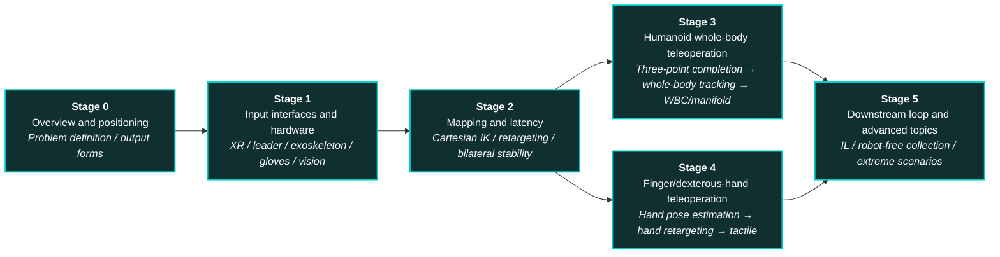

# Teleoperation

**At a glance**:

- **Who it's for**: People who want to build a system for controlling a humanoid robot in real time while also collecting demonstration data.
- **Path**: Stage 0–5 · Overview and positioning → input interfaces and hardware → mapping and latency → optional branches (whole-body / fingers and dexterous hands) → downstream loop and advanced topics.
- **Depth roadmap**: A branch of the [motion control main roadmap](motion-control.md); upstream it connects to the [motion retargeting depth roadmap](depth-motion-retargeting.md), downstream it supplies training data for the [imitation learning](depth-imitation-learning.md) and [BFM](depth-bfm.md) depth roadmaps.

## Roadmap overview

## How to use this path

- The target reader is someone who wants to build a "human control → robot execution + data collection" loop; the first bucket of data in the humanoid data flywheel almost always has to pass through the teleoperation gate
- Teleoperation solves two things, **human–robot heterogeneous mapping + real-time closed loop**: humans and robots differ in DOF, workspace, and dynamics (Stage 2), the loop must close within tens of milliseconds of latency (Stage 2 bilateral stability), and it must simultaneously manage the **whole body** (Stage 3) and the **fingers** (Stage 4), two sub-chains with vastly different DOF
- This roadmap separates the two parts users care about most, **humanoid whole-body teleoperation** and **finger teleoperation**, into Stage 3 and Stage 4, each with its own mapping difficulties, low-level control, and hardware lineage
- Each stage has prerequisites, core questions, what to do, what to read, and what you should be able to produce

**Relation to the main roadmap:**
- This roadmap spans main-roadmap [L1 (kinematics)](motion-control.md#l1-robotics-backbone) (arm IK is the direct prerequisite for Stages 2/3) and L5 (RL and imitation learning: whole-body tracking policies and downstream IL)
- The [motion retargeting depth roadmap](depth-motion-retargeting.md) expands "turning human motion into reference trajectories offline" into a full lineage; this roadmap cares about the **real-time, in-the-loop, latency-budgeted** version of retargeting, and additionally covers hardware interfaces and the finger sub-chain
- If your goal leans toward the "manipulate while walking" task side, take the [Loco-Manipulation depth roadmap](depth-loco-manipulation.md); this roadmap focuses on the "how a human pours motion into the robot" side

---

## Stage 0 Teleoperation overview and positioning

**First distinguish the three output forms of teleoperation (demonstration data / deployment-time takeover / competitive control), then choose an interface; otherwise you will pick the wrong system for the wrong goal.**

### Prerequisites
- Fluent in Python, able to read rotation representations (quaternion / rotation matrix / 6D)
- Basic notion of humanoid robot DOF structure (floating base + two arms + two hands + two legs)

### Core questions
- What teleoperation actually solves: **real-time** motion mapping under human–robot heterogeneity, while turning the operation process into learnable demonstrations
- Why the evaluation lines differ for the three output forms: **demonstration data collection** (needs coverage and consistency), **deployment-time intervention takeover** (needs to catch the robot and not teach hesitation into the policy), **competitive/extreme control** (needs low latency and robustness)
- Where teleoperation sits in the data pipeline: collection → cleaning → retargeting → imitation learning training → deployment
- Where the boundaries are between teleoperation and motion capture, exoskeletons, and robot-free collection

### What to do
- Read the main teleoperation entry page and go through "why it matters / key challenges / mainstream systems / downstream pipeline"
- Read a survey to build three-dimensional selection intuition of "interface × robot × data scale"

### What to read
- [Teleoperation](../../wiki/tasks/teleoperation.md) — main entry: challenges / system comparison table / pipeline to policy learning
- [Teleoperation of Humanoid Robots: A Survey (paper notes)](../../wiki/entities/paper-notebook-teleoperation-of-humanoid-robots-a-survey.md) — survey-level overview
- [Manipulation demonstration data collection guide (Query)](../../wiki/queries/demo-data-collection-guide.md) — hands-on collection
- [ROVE](../../wiki/entities/paper-rove-humanoid-vla-intervention.md) — why "deployment-time takeover ≠ expert demonstration"

### What you should be able to produce
- Be able to say in one sentence what teleoperation solves and what each of the three output forms requires
- Be able to draw the "teleoperation collection → training → deployment" data pipeline and mark the error sources

---

## Stage 1 Input interfaces and hardware channels

**The ceiling of teleoperation is set first by the interface: what XR, leader arms, exoskeletons, data gloves, and pure vision each can capture and what they lose is the premise for everything that follows.**

### Prerequisites
- Stage 0 content
- Basic sensing and communication concepts (USB HID / evdev, OpenXR, DDS)

### Core questions
- Tradeoffs across five interface lineages: **XR headset + controllers** (AVP / PICO / Quest), **leader–follower arms** (ALOHA / GELLO), **upper-limb exoskeletons** (isomorphic cockpit), **data gloves / optical motion capture**, **pure vision** (no wearables)
- Capture completeness of each interface: is end-effector pose sufficient, are finger joints available, is there force/touch, is the lower body covered
- How a cross-platform XR middleware layer folds device differences into a unified tracking stream
- Why robot-free (UMI-style handheld) collection can decouple "collection" from "a specific robot"

### What to do
- Use an open-source XR teleoperation stack (cross-platform middleware) to connect head + two-hand tracking streams to a humanoid model, and observe latency and tracking jitter
- Collect the same grasping task once with a leader arm and once with VR controllers, and compare end-effector accuracy and operator fatigue

### What to read
- [Data gloves vs vision teleoperation (comparison)](../../wiki/comparisons/data-gloves-vs-vision-teleop.md) — main entry for collection channel selection
- [XRoboToolkit](../../wiki/entities/paper-xrobotoolkit.md) — OpenXR cross-platform XR teleoperation middleware (PICO/Quest)
- [ACE cross-platform visual exoskeleton system (paper notes)](../../wiki/entities/paper-notebook-ace-a-cross-platform-visual-exoskeletons-system.md) and [NuExo upper-limb exoskeleton (paper notes)](../../wiki/entities/paper-notebook-nuexo-a-wearable-exoskeleton-covering-all-upper.md) — exoskeleton cockpits
- [UME-EXO](../../wiki/entities/paper-ume-exo.md) — exoskeleton with real-time torque feedback + whole-body arm-configuration capture
- [HandUMI](../../wiki/entities/handumi.md) and [mimic wearable U1](../../wiki/entities/mimic-wearable-u1.md) — robot-free handheld/exoskeleton collection
- [HiFi-UMI](../../wiki/entities/paper-hifi-umi.md) — high-fidelity robot-free bimanual UMI (~3 mm accuracy, <40 µs synchronization, six views); zero-robot post-training matches in-domain teleoperation; open-sourced HiFi-UMI-2K (2000 h, CC BY 4.0); collection system code not released as of the ingest date
- [RIO (Robot I/O)](../../wiki/entities/robot-io-rio.md) — Node-based abstraction for multi-device teleoperation
- [xpad](../../wiki/entities/xpad.md), [Oculus Quest Teleop](../../wiki/entities/oculust-quest-teleop.md), and [Isaac Teleop](../../wiki/entities/isaac-teleop.md) — gamepad kernel driver / VR / in-simulation recording
- [ALOHA](../../wiki/entities/aloha.md) — low-cost leader–follower bimanual arms
- [ALOHA 2](../../wiki/entities/aloha-2.md) — Google DeepMind hardware iteration: gripper/frame/gravity compensation upgrades + D405 four-camera array; open-source Menagerie simulation workcell (after system identification) bound to the same set of assets as the original

### What you should be able to produce
- An interface selection table for your direction (five columns: end effector / fingers / force-touch / lower body / cost)
- A minimal collection loop that connects XR or leader tracking streams to a robot model in real time

---

## Stage 2 Mapping and latency: from device signals to robot commands

**Teleoperation is "real-time retargeting with a latency budget": end-effector tracking, configuration continuity, latency compensation, and bilateral stability must be solved together.**

### Prerequisites
- Stage 1 content
- Forward/inverse kinematics (FK/IK) concepts (see main roadmap [L1](motion-control.md#l1-robotics-backbone) and Stage 1 of the [motion retargeting depth roadmap](depth-motion-retargeting.md))
- Linear algebra and least squares

### Core questions
- Arm Cartesian tracking: VR/controllers give an end-effector `T_target` every tick; how to find "the single IK solution nearest to the current joint angles" to keep configuration continuity
- Real-time vs offline retargeting differences: latency budget, sliding-window inference, safety clamping
- Bilateral teleoperation stability: how to stay passive/stable under communication latency with a force-feedback loop
- Why geometric/closed-form retargeting is both sufficient and cheap for upper-body teleoperation

### What to do
- Use analytic IK (e.g., ssik) to do VR end-effector tracking on a 6R/7R arm, and verify the `q_seed` nearest branch and jump detection triggering replanning
- Artificially inject 100–200 ms latency into the loop, observe the success-rate degradation on fine alignment tasks, and try a version of predictive display

### What to read
- [ssik (analytic inverse kinematics)](../../wiki/entities/ssik.md) — `q_seed` nearest branch and `seed_tolerance` jump detection for 6R/7R arms
- [Motion Retargeting](../../wiki/concepts/motion-retargeting.md) and [Motion Retargeting Pipeline](../../wiki/concepts/motion-retargeting-pipeline.md) — the retargeting problem and pipeline
- [GMR (kinematic retargeting)](../../wiki/methods/motion-retargeting-gmr.md) — geometric alignment first, physics left to downstream
- [Whole-Body Bilateral Teleoperation (paper notes)](../../wiki/entities/paper-notebook-whole-body-bilateral-teleoperation-with-multi-st.md) — multi-site bilateral teleoperation stability
- [Kinematic vs dynamic feasibility](../../wiki/concepts/kinematic-vs-dynamic-feasibility.md) — "can strike the pose" ≠ "can stay upright and keep up"

### What you should be able to produce
- A working VR → arm end-effector analytic IK real-time tracking script, with configuration continuity and jump protection
- Be able to explain "where latency comes from, where it is compensated, and what guarantees bilateral stability"

---

## Stage 3 Humanoid whole-body teleoperation

**Whole-body teleoperation is hard because of "sparse input + whole-body DOF + staying upright": three points (head and hands) must be completed into a lower body, and the reference must hold up under execution by a whole-body tracking policy and low-level WBC.**

### Prerequisites
- Stage 2 content
- [RL depth roadmap](depth-rl-locomotion.md) Stage 0–2 level (able to train whole-body tracking policies in simulation)
- Basic concepts of [Whole-Body Control](../../wiki/concepts/whole-body-control.md)

### Core questions
- How sparse teleoperation input (three points: head + two hands, or plus waist/ankle trackers) is completed into a whole-body reference: kinematic planning for the lower body vs learned completion
- How a whole-body tracking policy (GMT) turns a noisy human reference into whole-body motion executable on a real robot: the TWIST2 / SONIC lineage
- Two routes to low-level stability: explicit WBC vs the motion manifold constraint of a behavior foundation model (BFM-Zero)
- What constraints heavy loads, unstructured terrain, and closed-loop global pose each add to whole-body teleoperation
- Why gated experts / motion priors preserve highly dynamic skills better than "distilling into one unified policy"

### What to do
- Get a simulated teleoperation loop "VR three points → SMPL/keypoint retargeting → whole-body tracking policy" running, and observe lower-body completion quality and fall rate
- For the same whole-body teleoperation clip, use "frame-by-frame hard tracking" and "motion manifold constraint" low levels respectively, and compare stability and feasible region

### What to read
- [Whole-Body Tracking Pipeline](../../wiki/concepts/whole-body-tracking-pipeline.md) and [WBT depth hub](../../wiki/overview/hub-wbt.md) — the main whole-body tracking chain
- [SONIC (scaled motion tracking)](../../wiki/methods/sonic-motion-tracking.md) and [TWIST2](../../wiki/entities/paper-twist2.md) — dual GMT backends; head-and-hands three points drive the upper body + planning completes the lower body
- [BFM-Zero](../../wiki/entities/paper-bfm-zero.md) and the [BFM depth roadmap](depth-bfm.md) — low level with motion manifold constraints; VR teleoperation is one of its interfaces
- [HEFT](../../wiki/entities/paper-heft.md) — noisy raw VR + WPC bimanual payload, full-size L7 heavy-load teleoperation
- [PILOT](../../wiki/entities/paper-pilot-perceptive-loco-manipulation.md) — VR long-horizon loco-manip + perceptive MoE whole-body LLC
- [CLOT](../../wiki/entities/paper-amp-survey-16-clot.md) — long-horizon drift-free whole-body teleoperation with closed-loop global pose
- [TeleGate](../../wiki/entities/paper-telegate.md) — gating to select frozen experts + VAE motion prior, highly dynamic running/jumping/fall recovery
- [CWI](../../wiki/entities/paper-cwi-composite-humanoid-whole-body-imitation.md) — Quest bimanual 9D keypoints + velocity/height distillation interface, no whole-body MoCap needed
- [Teleopit](../../wiki/entities/paper-teleopit.md) — a single PICO VR sensing source uniformly drives whole-body tracking + cross-morphology dexterous-hand optimization retargeting + active vision, History Encoder + failure-aware rewind; on held-out sets Mocap SR 91.7% / PICO SR 100.0%, both above TWIST2/SONIC/HoloMotion; 96 demonstrations train ACT 90% / GR00T 95%; five repos open-source
- [CHILD whole-body humanoid teleoperation system (paper notes)](../../wiki/entities/paper-notebook-child-a-whole-body-humanoid-teleoperation-system.md) and [HOMIE isomorphic exoskeleton cockpit (paper notes)](../../wiki/entities/paper-loco-manip-161-040-homie.md)

### What you should be able to produce
- An end-to-end teleoperation loop from sparse VR input to executable whole-body motion
- Be able to explain the tradeoffs of "how to complete sparse input, whether the low level uses WBC or a manifold, how to keep highly dynamic motion from collapsing"

---

## Stage 4 Finger and dexterous-hand teleoperation

**Finger teleoperation is the sub-chain of whole-body teleoperation with the highest DOF density, the hardest observation, and the most contact sensitivity: the human hand's ~21 DOF must be mapped to a 6–20+ DOF robot hand while preserving contact semantics.**

### Prerequisites
- Stage 2 content (hand mapping is likewise constrained real-time IK)
- [Motion retargeting depth roadmap](depth-motion-retargeting.md) Stage 6 Direction B (contact-preserving dexterous-hand retargeting)

### Core questions
- Where the hand pose comes from: **data gloves/tactile gloves** (joint angles measured directly) vs **pure-vision hand pose estimation** (AVP/cameras, no wearables but loses occlusion handling and force)
- The core tension of hand retargeting: **direct joint-space mapping** (isomorphic hands) vs **fingertip/contact task-space mapping** (heterogeneous hands), and how to abstract a unified hand action space
- Contact preservation: refining from whole-body skeleton-level mapping to **hand–object contact topology preservation**, avoiding interpenetration/loss of contact
- Tactile feedback: robot-side touch (GelSight/F-T) fed into the policy, operator-side haptic display of size/stiffness
- Constraints that bimanual coordination and the dexterous-hand hardware lineage place on achievable retargeting

### What to do
- Use a (glove-based or vision-estimated) hand pose to map human hand joint angles onto an open-source dexterous hand; first do direct joint-space mapping, then fingertip task-space IK, and compare grasp success rate and interpenetration
- Add a contact-preservation term to hand retargeting (fingertip–object surface distance constraint), and measure the drop in the fraction of frames that lose contact

### What to read
- [Data gloves vs vision teleoperation (comparison)](../../wiki/comparisons/data-gloves-vs-vision-teleop.md) — main comparison of the two hand-capture channels
- [Dexterous Kinematics](../../wiki/concepts/dexterous-kinematics.md) and [UHAS unified hand action space](../../wiki/methods/uhas-unified-hand-action-space.md) — hand mapping abstractions
- [TopoRetarget](../../wiki/methods/toporetarget-interaction-preserving-dexterous-retargeting.md), [SPIDER](../../wiki/methods/spider-physics-informed-dexterous-retargeting.md), and [DynaRetarget vs TopoRetarget (comparison)](../../wiki/comparisons/dynaretarget-vs-toporetarget-retargeting.md) — contact-preserving dexterous-hand retargeting
- [Bunny-VisionPro real-time bimanual dexterous teleoperation (paper notes)](../../wiki/entities/paper-notebook-bunny-visionpro-real-time-bimanual-dexterous-tel.md), [DexUMI (paper notes)](../../wiki/entities/paper-notebook-dexumi-using-human-hand-as-the-universal-manipul.md), [DexterCap (paper notes)](../../wiki/entities/paper-notebook-dextercap.md) — vision/handheld finger capture
- [TeleDexter](../../wiki/entities/paper-teledexter.md) — **hand–object co-tracking** low-level controller: MoCap fingertip + object targets → simulated RL zero-shot to the real robot; **75.2% SR** averaged over seven tasks, and serves as a dexterous data-collection engine (**not open-source**)
- [NestDex](../../wiki/entities/paper-nestdex.md) — **copilot nested data collection**: human-controlled arm + 1-DoF clutch, an inner proprioceptive hand-skill generates finger motion; at deployment the outer visuomotor policy **drops the inner layer** (arXiv:2608.13362, **not open-source**)
- [GLIDE](../../wiki/entities/paper-glide-beyond-human-demonstration.md) — infers failure modes from task descriptions and teleoperation code, inserts rule guardrails into collection and deployment, and helps complete motions that are hard to demonstrate directly.
- [OSMO open-source tactile glove (paper notes)](../../wiki/entities/paper-notebook-osmo-open-source-tactile-glove-for-human-to-robo.md) and [ByteDexter 20-DOF dexterous hand teleoperation (paper notes)](../../wiki/entities/paper-notebook-dexterous-teleoperation-of-20-dof-bytedexter-han.md) — tactile glove / high-DOF hand
- [HapMorph](../../wiki/entities/paper-hapmorph-pneumatic-haptic-render.md) and [Touch Dreaming tactile policy](../../wiki/methods/humanoid-transformer-touch-dreaming.md) — operator-side haptic display / robot-side touch fed into the policy
- [Touch2Robot](../../wiki/entities/paper-touch2robot.md) — uses glove touch, human motion, and object tracking for real-time retargeting, so the demonstrator can see the target robot's contact feedback during collection.
- Dexterous-hand hardware lineage: [Shadow Hand](../../wiki/entities/shadow-hand.md), [Allegro Hand](../../wiki/entities/allegro-hand.md), [RUKA v2](../../wiki/entities/ruka-v2-hand.md), [ORCA Hand](../../wiki/entities/orca-hand.md), [mimic hand M1](../../wiki/entities/mimic-hand-m1.md), [MIDAS Hand](../../wiki/entities/midas-hand.md), [Handroid](../../wiki/entities/handroid.md)
- [CoordEx dexterous humanoid loco-manipulation](../../wiki/entities/paper-coordex-dexterous-humanoid-loco-manipulation.md) — coordinated whole-body + dexterous-hand teleoperation

### What you should be able to produce
- A real-time hand retargeting loop from human hand pose (glove or vision) to executable dexterous-hand commands
- Be able to explain the tradeoffs of "where the hand pose comes from, how heterogeneous hands are mapped, how contact is not lost, whether touch should be fed back"

---

## Stage 5 Downstream loop and advanced directions

**Teleoperation is not the end: its outputs must withstand the test of imitation learning training, large-scale collection, and real-robot deployment.**

### Prerequisites
- Stage 3 or Stage 4 content, chosen by whole-body/hand collection task; read both together when integrating the two chains

### Core questions
- The full chain by which teleoperation demonstrations enter imitation learning: `(obs, action)` sequences → BC / ACT / Diffusion Policy → deployment
- How robot-free collection scales up "collection": UMI-style handheld + later retargeting to multiple robots
- Correct use of deployment-time intervention takeover: why value-guided extraction is needed instead of treating everything as expert BC
- Data scale and benchmarks: household-scale large teleoperation datasets, teleoperation simulation benchmarks
- Extreme scenarios: additional requirements that heavy loads, full-contact competition, surgery, etc. place on teleoperation systems

### What to do
- Feed the demonstrations collected in Stage 3/4 into an open-source IL pipeline (BC/ACT/diffusion), and observe success rate and data efficiency
- Train one policy each on two datasets "with/without failed-demonstration filtering", and verify the effect of data quality on convergence

### What to read
- [Imitation Learning](../../wiki/methods/imitation-learning.md) and [Diffusion Policy](../../wiki/methods/diffusion-policy.md) — the main consumers of teleoperation data
- [BifrostUMI](../../wiki/entities/paper-bifrost-umi.md) and [HALOMI](../../wiki/entities/paper-halomi-humanoid-loco-manipulation.md) — robot-free demonstrations → humanoid whole-body visuomotor
- [ROVE](../../wiki/entities/paper-rove-humanoid-vla-intervention.md) — deployment-time MoCap takeover and RL post-training on suboptimal takeover trajectories
- [AutoIntervene](../../wiki/entities/paper-autointervene.md) — calibrated bidirectional takeover for action-chunking policies (deployment time)
- [NestDex](../../wiki/entities/paper-nestdex.md) — collection-time copilot; outer BC deployment no longer depends on the inner hand skill (arXiv:2608.13362)
- [HIW-500 dataset](../../wiki/entities/hiw-500-dataset.md) — 500+ h / 23K+ episodes open-source household-scale whole-body teleoperation dataset
- [TeleopBench (paper notes)](../../wiki/entities/paper-notebook-teleopbench-a-simulator-centric-benchmark-for-du.md) and [HumanoidArena](../../wiki/entities/paper-humanoidarena.md) — teleoperation / hierarchical control evaluation backends
- [EgoDex (paper notes)](../../wiki/entities/paper-notebook-egodex-learning-dexterous-manipulation-from-larg.md) — large-scale egocentric dexterous data

**Advanced directions:**
- **Teleoperation-free synthesis vs teleoperation collection cost**: see the comparison on the side of the [motion generation depth roadmap](depth-motion-generation.md) and [Real2Sim/synthetic demonstrations](depth-real2sim.md)
- **Extreme and commercial scenarios**: [HEFT](../../wiki/entities/paper-heft.md) heavy loads, [REK](../../wiki/entities/rek.md) / [URKL](../../wiki/entities/urkl.md) competitive fighting, [Humanoid Surgeon](../../wiki/entities/paper-humanoid-surgeon-in-vivo-laparoscopy.md) surgery in vivo
- **Cross-embodiment teleoperation**: one human reference drives heterogeneous humanoids/robot hands; see Stage 6 of the [motion retargeting depth roadmap](depth-motion-retargeting.md)

### What you should be able to produce
- An end-to-end pipeline from teleoperation collection to a deployable policy
- Experiment-level understanding of the causal chain "teleoperation quality ↔ downstream policy performance"

---

## Quick entry summary

| Stage | Core question | Knowledge page entry |
|------|---------|-----------|
| Stage 0 | Problem definition and output forms | [Teleoperation](../../wiki/tasks/teleoperation.md) |
| Stage 1 | Input interfaces and hardware | [Data gloves vs vision teleoperation](../../wiki/comparisons/data-gloves-vs-vision-teleop.md) |
| Stage 2 | Mapping and latency/bilateral stability | [ssik (analytic IK)](../../wiki/entities/ssik.md) |
| Stage 3 | Humanoid whole-body teleoperation | [Whole-Body Tracking Pipeline](../../wiki/concepts/whole-body-tracking-pipeline.md) |
| Stage 4 | Finger/dexterous-hand teleoperation | [Dexterous Kinematics](../../wiki/concepts/dexterous-kinematics.md) |
| Stage 5 | Downstream loop and advanced topics | [Imitation Learning](../../wiki/methods/imitation-learning.md) |

## Relation to other pages

- Full growth roadmap reference: [Main roadmap: motion control → physical intelligence full-stack growth roadmap](motion-control.md)
- Related depth roadmaps (by topical proximity; full catalog in the [roadmap overview](motion-control.md#depth-optional-index)):
  - [Imitation learning and skill transfer](depth-imitation-learning.md) — the main downstream of teleoperation demonstrations
  - [Motion retargeting](depth-motion-retargeting.md) — Stages 2/4 use its toolbox; the difference is real-time, in-the-loop, with latency
  - [Embodied data](depth-embodied-data.md) — how demonstrations are cleaned, annotated, stored, and mixed
  - [Contact manipulation](depth-contact-manipulation.md) — adjacent roadmap for contact preservation in finger teleoperation

## References

- [Teleoperation](../../wiki/tasks/teleoperation.md) and [Data gloves vs vision teleoperation](../../wiki/comparisons/data-gloves-vs-vision-teleop.md) — main entry and interface selection
- Goertz, *Master-Slave Manipulator* (Argonne National Laboratory, 1954) — foundational work on master–slave manipulator teleoperation, the starting point of teleoperation/telerobotics
- He et al., *OmniH2O: Universal and Dexterous Human-to-Humanoid Whole-Body Teleoperation* (2024) — representative work on humanoid whole-body teleoperation
- "XRoboToolkit" (arXiv:2508.00097, SII 2026 Best Paper) — OpenXR cross-platform XR teleoperation toolkit
- [TWIST2](../../wiki/entities/paper-twist2.md), [HEFT](../../wiki/entities/paper-heft.md), [TeleGate](../../wiki/entities/paper-telegate.md), [CWI](../../wiki/entities/paper-cwi-composite-humanoid-whole-body-imitation.md) — lineage of whole-body teleoperation low levels and interfaces
- [TopoRetarget](../../wiki/methods/toporetarget-interaction-preserving-dexterous-retargeting.md), [UHAS](../../wiki/methods/uhas-unified-hand-action-space.md) — finger teleoperation retargeting and hand action spaces
