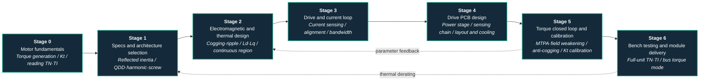

# Torque Motor Design

**At a glance**:

- **Who it's for**: people who want to take a joint motor all the way from task specs to a torque-closed-loop module that can pass acceptance testing.
- **Path**: Stage 0–6 · Motor fundamentals and reading curves → specs and architecture selection → electromagnetic and thermal design → drive hardware and current loop → drive PCB → FOC closed loop and calibration → bench acceptance.
- **Depth roadmap**: the hardware-foundation branch of the [motion control main roadmap](motion-control.md): the joint torque commands produced by the control / RL depth roadmaps are ultimately realized by the torque closed loop this roadmap delivers.

## Roadmap overview

## How to use this path

- The target readers are hardware/drive/robotics engineers who want to build **torque-controllable joint actuators**. This is not "pick a motor and bolt it on"; it is making "command 1 Nm and get 1 Nm" hold true across six layers: specs, electromagnetics, drive, board, calibration, and acceptance
- Requires basic electromagnetics and circuit intuition (Ampère force, back-EMF, RL circuits); FEA tools and control derivations are filled in step by step along the roadmap
- Each stage has prerequisites, core questions, what to read, what to do, and what you should be able to produce
- For an overview of the main process, first read [Motor design workflow (spec → simulation → prototype → control)](../../wiki/overview/motor-design-workflow.md). This roadmap is its **learning-order expansion**: that page answers "what are the process steps", while this roadmap answers "in what order to turn each step into a hands-on skill"

**Relation to the main roadmap:**
- This roadmap sits in the **hardware-foundation layer** beneath L0–L2 of the main roadmap and can be entered at any stage; we suggest entering around main-roadmap L2 (dynamics), when "joint torque" has turned from an abstract symbol into a physical requirement
- The WBC in Stage 4 of the [classical model-based control depth roadmap](depth-classical-control.md) and the policies in the [RL locomotion depth roadmap](depth-rl-locomotion.md) both ultimately output joint torque commands; the "torque source" these commands assume is exactly what this roadmap delivers
- Actuator modeling in sim2real ([Actuator Network](../../wiki/methods/actuator-network.md), [Implicit/Explicit modeling](../../wiki/concepts/implicit-explicit-actuator-modeling.md)) closes the loop with bench data in Stage 6. The hardware team delivers not just a module, but also a simulatable model of it

---

## Stage 0 Motor fundamentals and curve-reading skills

### Prerequisites
- Electromagnetics basics (Ampère force, Faraday's law, magnetic-circuit intuition)
- Basic circuits (RL circuits, the average-voltage idea behind PWM)
- Enough Python or MATLAB to plot curves

### Core questions
- Where exactly does a PMSM's torque come from, and why are the torque constant \(K_t\) and back-EMF constant \(K_e\) essentially the same thing
- What determines the constant-torque / constant-power regions of a TN curve, and why can the "advertised peak" and the "continuous torque" differ by 3x
- What do the linear region, saturation region, and drive current limit on a TI curve each tell you

### What to read
- [Motor torque-speed curve (TN curve)](../../wiki/concepts/motor-torque-speed-curve.md)
- [Motor torque-current curve (TI curve)](../../wiki/concepts/motor-torque-current-curve.md)
- [Field-oriented control (FOC)](../../wiki/concepts/field-oriented-control.md) — for now read only the part on "why look at the motor in the dq frame"
- [Humanoid Actuator 102: eight-chapter technology map](../../wiki/overview/humanoid-actuator-102-technology-map.md) — skim the full picture so you know where each later stop is

### What to do
- Find a real joint motor/module datasheet (e.g., [HighTorque Robotics](../../wiki/entities/hightorque-robotics.md) or any drone outrunner motor), mark the peak region, continuous region, and base speed on the TN plot, and infer the assumed bus voltage
- Fit \(K_t\) linearly from TI data points, find the saturation knee, and compare with the nominal value

### What you should be able to produce
- Explain over what range \(\tau = K_t i_q\) holds and when it breaks down (saturation, temperature rise, field weakening)
- Given any motor datasheet, judge within 5 minutes "whether its continuous capability lives up to the advertised peak"

---

## Stage 1 Joint spec definition and actuator architecture selection

### Core questions
- How to back out a joint's peak torque, continuous torque, base speed, and torque bandwidth from squat/walking/impact-resistance tasks
- The double edge of gear ratio \(n\): torque is amplified by \(n\), reflected inertia by \(n^2\); how to trade off impact resistance against force transparency
- Which joints suit each of the three species, QDD (quasi-direct drive), harmonic, and planetary roller screw, and why putting industrial servos straight into a humanoid is a trap

### What to read
- [Actuator 102 · 01: load and the mass spiral](../../wiki/overview/humanoid-actuator-102-load-and-mass-spiral.md) and [Actuator 102 · 03: gear reduction and reflected inertia](../../wiki/overview/humanoid-actuator-102-gear-reflected-inertia.md)
- [Actuator 102 · 07: decision matrix and the three species](../../wiki/overview/humanoid-actuator-102-decision-species.md) and [Actuator 102 · 06: the industrial actuator trap](../../wiki/overview/humanoid-actuator-102-industrial-actuator-trap.md)
- [Actuator 102 · 02: rotary-linear split architecture](../../wiki/overview/humanoid-actuator-102-split-architecture.md) and [Planetary roller screw linear actuation for humanoid legs (PRS route)](../../wiki/concepts/planetary-roller-screw-humanoid-leg-actuation.md)
- [Humanoid Hardware 101 · 04: integrated actuators](../../wiki/overview/humanoid-hardware-101-integrated-actuators.md)
- [Quasi-Direct Drive for Low-Cost Compliant Robotic Manipulation](../../wiki/entities/paper-notebook-quasi-direct-drive-for-low-cost-compliant-roboti.md) — a representative work of the QDD route
- [Human-Level Actuation for Humanoids](../../wiki/entities/paper-notebook-human-level-actuation-for-humanoids.md) — how to define specs so they cannot be "gamed"

### What to do
- For the knee of a 70 kg humanoid, back out peak/continuous torque and base speed from tasks (1–3 s squat, level walking, stair climbing), and sketch the target TN envelope
- Use the reflected-inertia formula to compare the equivalent inertia and backdrive torque of 6:1 vs 50:1 gear-ratio designs under landing impact

### What you should be able to produce
- A one-page **joint spec sheet**: peak/continuous torque, peak:continuous ratio (target ≥3:1), base speed, specific torque (Nm/kg), transmission type, and cooling assumptions
- For any humanoid joint, be able to say "what it is trading off by choosing this species"

---

## Stage 2 Electromagnetic and thermal design: designing torque quality into the iron core

### Core questions
- How slot-pole combination and winding type determine cogging torque and torque ripple: the "smoothness" of torque control is fixed when the drawings are made
- How the linear region of \(K_t\), magnetic saturation, and the \(L_d/L_q\) saliency ratio affect later MTPA and field weakening
- Why continuous torque is set by thermals: electromagnetics gives the upper bound, thermals give the lower bound

### What to read
- [Motor design workflow](../../wiki/overview/motor-design-workflow.md) steps 2–5 (topology and slot-pole → FEA → thermal and CFD → mechanical integration)
- [Selecting motor electromagnetic and multiphysics simulation software](../../wiki/comparisons/motor-em-simulation-software.md)
- [Completeness comparison of open-source torque motor electromagnetic designs](../../wiki/comparisons/open-source-torque-motor-em-design.md) — Ironless (prototype + FEMM) → FEMM-FOC → PYLEECAN/axfluxmdo redesign
- [FEMM](../../wiki/entities/femm.md) — official docs/examples and an open-source 2D FEA foundation
- [openCFS](../../wiki/entities/opencfs.md) — openCFS: an MIT-licensed finite-element multiphysics simulation tool covering acoustics, mechanics, electrics, magnetics, thermals, and their couplings, with XML configuration and data pre/post-processing materials.
- [Ironless QDD Actuator](../../wiki/entities/ironless-qdd-actuator.md) — a low-cost joint prototype with 36N42P + Halbach + open-source FEMM
- [Internal Cycloidal Actuator](../../wiki/entities/internal-cycloidal-actuator.md) — an open-source integrated design with outer rotor + reducer embedded inside the stator (learn air-gap radius, slot-pole windings, and coaxial integration)
- [PYLEECAN](../../wiki/entities/pyleecan.md) · [FEMM-FOC-Simulation](../../wiki/entities/femm-foc-simulation.md)
- [Actuator 102 · 04: thermals and torque control](../../wiki/overview/humanoid-actuator-102-thermal-and-control.md)
- [Query: humanoid robot battery and thermal management guide](../../wiki/queries/humanoid-battery-thermal-management.md) — linking the joint thermal budget to the whole-robot thermal chain

### What to do
- First follow the [FEMM](../../wiki/entities/femm.md) Magnetics Tutorial / Examples, then open Ironless `FEMM/` or run the FEMM-FOC Lua to build intuition for flux density/torque; then use Motor-CAD / Maxwell / [PYLEECAN](../../wiki/entities/pyleecan.md) to sweep 2–3 slot-pole designs on the same stator and compare cogging torque, ripple, and \(K_t\)
- Run a temperature-rise simulation, draw the "allowed continuous operating region" back onto the TN plot, and see how much the continuous region shrinks relative to the electromagnetic peak

### What you should be able to produce
- One electromagnetic design with a report: cogging torque, torque ripple, \(K_t\) linear region, \(L_d/L_q\), back-EMF harmonics
- Be able to answer "is this motor's continuous torque limited by winding temperature rise or by magnet temperature rise"

---

## Stage 3 Drive hardware and current loop: the physical foundation of the torque closed loop

### Core questions
- How the phase-current sensing scheme (low-side / inline / single-shunt reconstruction) relates to torque accuracy: if you cannot measure current accurately, torque is out of the question
- How PWM frequency, current-loop bandwidth, and current ripple in low-inductance high-\(K_v\) motors constrain one another
- What symptoms encoder accuracy, electrical-angle zero alignment, and wrong phase order each cause

### What to read
- [Field-oriented control (FOC) step-by-step derivation](../../wiki/formalizations/field-oriented-control-derivation.md) — from Clarke/Park transforms to current-loop design
- [Control loop latency modeling](../../wiki/formalizations/control-loop-latency-modeling.md) — a budgeting method for sampling, PWM update, and command latency
- [SimpleFOC (Arduino-FOC ecosystem)](../../wiki/entities/simplefoc.md) — a prototype-grade drive stack and the most readable teaching implementation
- [moteus](../../wiki/entities/moteus.md) · [Tinymovr](../../wiki/entities/tinymovr.md) — joint-oriented open-source drives (PCB + FOC + CAN/CAN-FD)
- [Comparison of open-source QDD actuator projects](../../wiki/comparisons/open-source-qdd-actuator-projects.md) — the open-source learning ladder SimpleFOC → moteus/Tinymovr → OpenTorque → ODRI
- The "Control (VI)" section of [Actuator 102 · 04: thermals and torque control](../../wiki/overview/humanoid-actuator-102-thermal-and-control.md) — a sense of scale: current loop >20 kHz, command to torque <1 ms

### What to do
- Use a SimpleFOC / ODrive-class open-source drive to spin up a gimbal or QDD motor: identify pole pairs, align the electrical angle, and get the \(i_d/i_q\) current closed loop running
- Apply a step to the current loop and measure rise time to estimate bandwidth; change the PWM frequency and current-loop gains and observe how ripple and noise change
- Advanced: study the moteus or Tinymovr schematics closely and compare their sensing and protection chains with your own board

### What you should be able to produce
- A physical (or high-fidelity simulated) drive that can run a current closed loop
- Be able to draw the signal chain "torque command → \(i_q^*\) → PWM → phase current → electromagnetic torque" and point out the error sources at each hop

---

## Stage 4 Motor drive PCB design: putting the current loop on your own board

### Core questions
- How to align power-stage selection with the Stage 1 joint spec: bus voltage and peak phase current determine the MOSFET \(R_{ds(on)}\)/\(Q_g\) tradeoff, gate drive (bootstrap or isolated), dead-time settings, and bus capacitance
- How Stage 3's "if you cannot measure current accurately, torque is out of the question" lands on the board: Kelvin connection of the shunt resistor, op-amp bandwidth and common-mode rejection, ADC sampling window and PWM center alignment
- How layout and routing keep power-loop parasitic inductance and switching noise in check: stack-up and ground partitioning, minimizing power-loop area, isolating encoder/bus small signals from the power stage
- Size and cooling constraints of a drive board embedded in the joint: how the copper + thermal pad + housing heat path ties into the Stage 2 thermal budget, and how to set board-level overcurrent/overtemperature/undervoltage protection thresholds

### What to read
- [KiCad (open-source PCB EDA)](../../wiki/entities/kicad.md) — a zero-license-cost toolchain from schematic → layout → Gerber; the [10.0 Chinese documentation](https://docs.kicad.org/10.0/zh/) and `kicad-cli` suit team version control and pre-fab DRC
- [Altium Designer](../../wiki/entities/altium-designer.md) — official docs for a commercial EDA (schematic → rule-driven layout → OutJob/manufacturing release, ECAD-MCAD collaboration); a common toolchain for production-oriented in-house drive boards
- The "Hardware: SimpleFOCBoards" section of [SimpleFOC (Arduino-FOC ecosystem)](../../wiki/entities/simplefoc.md) — open-source schematics and board-making guides, a starting point for low-power reference designs; for higher power see ODrive / VESC / [moteus](../../wiki/entities/moteus.md)
- [Open-source humanoid robot hardware](../../wiki/entities/open-source-humanoid-hardware.md) — open-source full-robot references with in-house joint drive boards (ODRI Solo, Berkeley Humanoid Lite, etc.)
- [Comparison of open-source QDD actuator projects](../../wiki/comparisons/open-source-qdd-actuator-projects.md) — an open-source list of complete joints and motor bodies such as ODRI / BHL / Internal Cycloidal / OpenTorque
- [Humanoid Hardware 101 · 05: power and compute electronics](../../wiki/overview/humanoid-hardware-101-power-compute-electronics.md) — the module-reuse and DFM cost-down perspective on PCB/BMS
- [CAN bus protocol](../../wiki/concepts/can-bus-protocol.md) and [CAN vs EtherCAT joint bus comparison](../../wiki/comparisons/can-vs-ethercat-joint-bus.md) — bus interface hardware (transceiver, isolation, termination resistors) must be decided when drawing the schematic

### What to do
- Study one open-source drive board schematic closely (any of SimpleFOC Mini / ODrive / [moteus](../../wiki/entities/moteus.md) / [Tinymovr](../../wiki/entities/tinymovr.md)), mark the four paths (power loop, gate drive, current-sensing chain, protection circuitry), and draw the signal flow
- Draw your own joint drive board: three-phase bridge + gate drive + phase-current sensing + MCU + CAN transceiver, going all the way through schematic → layout → fab → soldering
- Step-by-step bring-up: power up at low voltage with current limit and check gate and phase-voltage waveforms → calibrate current-sensing offset and gain → rerun Stage 3's electrical-angle alignment and \(i_d/i_q\) current closed loop
- Use an oscilloscope to compare the voltage across the shunt resistor with the firmware ADC readings, and quantify the error and noise floor of the current measurement chain; remeasure current-loop bandwidth and compare against the Stage 3 open-source board to find the gap

### What you should be able to produce
- An in-house drive board that can rerun the Stage 3 current closed loop, with schematic, layout, and bring-up records
- A hardware error budget for torque accuracy: how much torque error each of shunt-resistor accuracy/temperature drift, op-amp offset, ADC resolution, and dead-time distortion contributes. Stage 5's calibration and compensation start from this table

---

## Stage 5 FOC torque closed loop, calibration, and compensation

### Core questions
- How MTPA and field weakening allocate \(i_d/i_q\) according to \(L_d/L_q\), and why torque commands must be derated in the high-speed region
- Whether anti-cogging feedforward and friction compensation go in the drive or the upper-level controller, and the bandwidth and calibration cost of each
- How to choose among \(K_t\) calibration and the three ways to obtain torque: current estimation, joint torque sensor, series elastic (SEA)
- How to measure torque bandwidth (-3 dB), and what a 50–100 Hz target means for legged robots

### What to read
- The MTPA/field-weakening parts of [Field-oriented control (FOC)](../../wiki/concepts/field-oriented-control.md) and [FOC step-by-step derivation](../../wiki/formalizations/field-oriented-control-derivation.md)
- [Friction Compensation](../../wiki/concepts/friction-compensation.md) and [Joint Friction Models](../../wiki/concepts/joint-friction-models.md)
- [Gravity Compensation](../../wiki/concepts/gravity-compensation.md) — a static bias alongside friction feedforward; teaching mode is often $g(q)+\hat\tau_f$
- [Joint actuator parameter identification](../../wiki/methods/joint-actuator-parameter-identification.md) — algorithm choices for estimating $I_a$ and Coulomb/viscous friction on the bench
- [Actuator 102 · 05: compliance and sensing feedback](../../wiki/overview/humanoid-actuator-102-compliance-sensing.md) — force/torque sensing and compliance routes
- [Impedance Control](../../wiki/concepts/impedance-control.md) — the most common joint-level interface built on top of torque mode

### What to do
- Build a \(K_t\) calibration curve on the bench (including the saturation region and temperature points), compare with the nominal value, and write the calibration table into the drive firmware
- Implement anti-cogging feedforward + Coulomb/viscous friction compensation, and compare low-speed torque tracking and backdrive feel before and after compensation
- Run a frequency sweep on the torque loop, measure the -3 dB bandwidth, and locate the bottleneck (current loop, filtering, or mechanical resonance)

### What you should be able to produce
- A motor where "command 1 Nm and get 1 Nm": torque accuracy, ripple, and bandwidth are all quantifiable and re-measurable
- Be able to explain why estimating torque from current works for QDD, while high-ratio harmonic joints often need an added torque sensor

---

## Stage 6 Bench acceptance and joint module delivery

### Core questions
- How the full-unit (motor + reducer + drive) TN/TI differs from the bare motor: how reducer efficiency, backlash, and thermal resistance rewrite the envelope
- How to split the latency budget for bus torque mode (CAN/CAN-FD/EtherCAT), and how to verify a 1 kHz torque command link
- When delivering to the control/RL team, how the actuator's simulatable model (friction, latency, saturation) is derived from bench data

### What to read
- [Motor dynamometer](../../wiki/concepts/motor-dynamometer.md) — hysteresis/eddy-current/magnetic-powder absorption vs electric back-to-back; entry point to GB/T 43200 and IEC efficiency tests
- [Motor design workflow](../../wiki/overview/motor-design-workflow.md) steps 6–8 (bench → FOC verification → module acceptance)
- [In-house joint module development workflow](../../wiki/concepts/joint-module-self-development-workflow.md) — transmission configuration, the five-piece set, assembly consistency, and a four-layer test matrix (full-stack context for this Stage's deliverables)
- [Overview of motor drive low-level firmware communication protocols](../../wiki/overview/motor-drive-firmware-bus-protocols.md)
- [3D-printed open-source legged actuators paper (Urs et al.)](../../wiki/entities/paper-3d-printed-open-source-actuators-legged.md) — an acceptance example covering thermally limited torque, efficiency, backlash, and 420,000 gait cycles
- [ODRI actuator hardware](../../wiki/entities/odri-solo-and-bolt.md) · [Berkeley Humanoid Lite](../../wiki/entities/berkeley-humanoid-lite.md) — references for open-source joint/full-robot acceptance and assembly testing
- [Query: EtherCAT master optimization guide](../../wiki/queries/ethercat-master-optimization.md) and [Query: real-time control middleware configuration guide](../../wiki/queries/real-time-control-middleware-guide.md)
- [Actuator Network](../../wiki/methods/actuator-network.md), [Implicit/Explicit actuator modeling](../../wiki/concepts/implicit-explicit-actuator-modeling.md), [Armature Modeling](../../wiki/concepts/armature-modeling.md) — three ways to feed bench data back into simulation
- [NeuralActuator](../../wiki/entities/paper-neuralactuator-neural-actuation-modeling.md) — a Transformer actuator model that jointly predicts a differentiable-simulation torque surrogate and F/T-sensor-free external force estimates, reducing force estimation error to 0.12 N on a low-cost servo platform; it can serve as a fourth way to feed bench data back into simulation
- [Query: comparison of mainstream humanoid robot hardware](../../wiki/queries/hardware-comparison.md) — benchmark your level against the acceptance specs of commercial modules

### What to do
- After choosing an absorption or back-to-back bench using the [dynamometer](../../wiki/concepts/motor-dynamometer.md) selection checklist, measure the full module's TN/TI, efficiency map, and temperature-rise curve and reconcile them with the Stage 2 simulation; when the deviation is large, go back and revise the magnetic circuit or cooling instead of only tuning drive parameters
- Send torque commands over the bus at 1 kHz and measure the end-to-end latency and jitter of "command → phase current → output torque"
- Fit the bench data into an actuator model (analytical friction model or actuator network) and reproduce the bench step response in Isaac/MuJoCo

### What you should be able to produce
- A deliverable **joint module acceptance report**: full-unit TN/TI, torque accuracy/bandwidth, temperature rise, bus latency
- An actuator model that can go into a simulator: from here on hardware and sim2real speak the same language

---

## Quick entry summary

| Stage | Core question | Knowledge page entry |
|------|---------|-----------|
| Stage 0 | Where torque comes from, how to read TN/TI | [TN curve](../../wiki/concepts/motor-torque-speed-curve.md) |
| Stage 1 | Backing out specs and selecting among the three species | [Actuator 102 · 07: decision matrix and the three species](../../wiki/overview/humanoid-actuator-102-decision-species.md) |
| Stage 2 | Cogging/ripple/thermal continuous region | [Motor design workflow](../../wiki/overview/motor-design-workflow.md) |
| Stage 3 | Current sensing and current loop | [FOC step-by-step derivation](../../wiki/formalizations/field-oriented-control-derivation.md) |
| Stage 4 | Putting the drive power stage/sensing chain on a board | [Humanoid Hardware 101 · 05: power and compute electronics](../../wiki/overview/humanoid-hardware-101-power-compute-electronics.md) |
| Stage 5 | Torque calibration and compensation | [Field-oriented control (FOC)](../../wiki/concepts/field-oriented-control.md) |
| Stage 6 | Module acceptance and bus torque mode | [Motor dynamometer](../../wiki/concepts/motor-dynamometer.md) · [Joint module development workflow](../../wiki/concepts/joint-module-self-development-workflow.md) · [Low-level firmware communication protocols](../../wiki/overview/motor-drive-firmware-bus-protocols.md) |

## Relation to other pages

- Full growth roadmap reference: [Main roadmap: motion control → physical intelligence full-stack growth roadmap](motion-control.md)
- Process backbone overview: [Motor design workflow (spec → simulation → prototype → control)](../../wiki/overview/motor-design-workflow.md); this roadmap is its learning-order expansion
- Related depth roadmaps (by topical proximity; for the full index see [Roadmap overview](motion-control.md#depth-optional-index)):
  - [Full-robot hardware design](depth-humanoid-hardware-design.md) — full-robot power/latency budgets and bus topology above the joint module
  - [Classical model-based control](depth-classical-control.md) — joint torques output by the Stage 4 WBC are realized by this roadmap's torque closed loop
  - [Sim2Real](depth-sim2real.md) — downstream of actuator modeling and real-robot alignment
  - [Contact-rich manipulation](depth-contact-manipulation.md) — impedance/force-control interfaces are built on this roadmap's torque mode
- Related knowledge pages:
  - [Humanoid Actuator 102: eight-chapter technology map](../../wiki/overview/humanoid-actuator-102-technology-map.md)
  - [Humanoid Hardware 101 · 04: integrated actuators](../../wiki/overview/humanoid-hardware-101-integrated-actuators.md)
  - [Selecting motor electromagnetic and multiphysics simulation software](../../wiki/comparisons/motor-em-simulation-software.md)
  - [Motor torque-current curve (TI curve)](../../wiki/concepts/motor-torque-current-curve.md)
  - Joint module engineering details: [Breaking down reducer difficulty](../../wiki/concepts/joint-module-reducer-difficulty.md) · [Electromagnetic isolation](../../wiki/concepts/joint-module-electromagnetic-isolation.md) · [No-load velocity loop vs torque loop](../../wiki/concepts/joint-module-no-load-velocity-vs-torque-loop.md) · [Axial/radial thermal expansion check](../../wiki/concepts/joint-module-shaft-thermal-expansion.md) · [Consequences of rated current below load current](../../wiki/concepts/joint-motor-rated-current-overload.md)
  - [Gearbox Lubricant Temperature Observer](../../wiki/entities/paper-gearbox-lubricant-temperature-observer.md) — reducer lubricant temperature observation
  - [Query: humanoid robot hardware selection guide](../../wiki/queries/humanoid-hardware-selection.md)

## References

- [Motor design workflow (spec → simulation → prototype → control)](../../wiki/overview/motor-design-workflow.md)
- Common motor dynamometer references: GB/T 43200, IEC 60034-2-1, Magtrol manuals, ODrive open-source back-to-back, AIP joint back-to-back
- [Humanoid Actuator 102 series](../../wiki/overview/humanoid-actuator-102-technology-map.md)
- [Comparison of open-source QDD / torque joint actuators](../../wiki/comparisons/open-source-qdd-actuator-projects.md)
- [Completeness comparison of open-source torque motor electromagnetic designs](../../wiki/comparisons/open-source-torque-motor-em-design.md)
- [Field-oriented control (FOC) step-by-step derivation](../../wiki/formalizations/field-oriented-control-derivation.md)
- Blaschke, *The Principle of Field Orientation as Applied to the New Transvektor Closed-Loop Control System* (1972) — the origin of FOC
- Wensing et al., *Proprioceptive Actuator Design in the MIT Cheetah* (IEEE T-RO, 2017) — the design paradigm for QDD/proprioceptive actuators
- [Katz, *A Low Cost Modular Actuator for Dynamic Robots*](../../wiki/entities/paper-low-cost-modular-actuator-katz.md) (MIT S.M. thesis, 2018) — an end-to-end example of the MIT Mini Cheetah modular QDD actuator (electronics open-sourced)
- [MIT Mini Cheetah platform learning stack](../../wiki/entities/mit-mini-cheetah.md) — overview of software / Convex MPC / RL / open-source boundaries
- Urs et al., *Design and Characterization of 3D Printed, Open-Source Actuators for Legged Locomotion* (arXiv:2202.12395) — an acceptance example for thermals/lifetime/backlash
