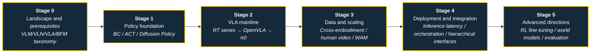

# Vision-Language-Action Models (VLA)

**At a glance**:

- **Who it's for**: people who want robots to understand instructions and get work done.
- **Path**: Stage 0–5 · Embodied model landscape → imitation learning foundation → VLA mainline (RT → OpenVLA → π0) → data and scaling → deployment and integration → advanced directions.
- **Depth roadmap**: a branch of the [motion control main roadmap](motion-control.md); forms a sister roadmap pair with the [BFM depth roadmap](depth-bfm.md): "task-level semantics / body-level coordination".

## Roadmap overview

## How to use this path

- The target readers have a deep learning background and want robots to "see images, hear instructions, and output actions"; the main battlefield is manipulation tasks
- VLA addresses **task-level semantics**: connecting a VLM's cross-modal understanding to robot actions; it is not responsible for humanoid whole-body coordination, which is the topic of the [BFM depth roadmap](depth-bfm.md)
- Each stage has prerequisites, core questions, what to do, what to read, and what you should be able to produce

**Relation to the main roadmap:**
- This roadmap is a "learning-side" advanced direction after main-roadmap L5 (RL and imitation learning); Stages 0–1 overlap heavily with the policy foundation in the [imitation learning depth roadmap](depth-imitation-learning.md)
- If the goal is "make a robot arm do what it's told", finishing Stage 3 is enough to start engineering; Stages 4–5 target deployment and the research frontier
- If the goal is humanoid whole-body control or a "high-level VLA + low-level BFM" full-robot stack, switch to the [BFM depth roadmap](depth-bfm.md) after Stage 2

---

## Stage 0 Embodied foundation model landscape and prerequisites

**First lay out the acronym map: VLM / VLN / VLA / WAM / BFM each cover one segment; reading papers with them mixed up only gets more confusing.**

### Prerequisites
- Fluent in Python + PyTorch
- Understand Transformer / attention (see [Transformer](../../wiki/concepts/transformer.md))
- User-level intuition for LLMs / VLMs (roughly know what CLIP and LLaVA are)

### Core questions
- What each acronym (VLM / VLN / VLA / world model) refers to and where the boundaries are
- What a foundation policy is, and how it fundamentally differs from a "single-task policy"
- Which layer of the robot stack VLA and BFM each solve, and why they are often stacked rather than chosen between

### What to do
- Using the taxonomy page, find one representative work for each of the five model classes and write a one-page comparison table
- Use [LeRobot](../../wiki/entities/lerobot.md) to run an inference demo of an off-the-shelf policy end to end (inference only, no training)

### What to read
- [VLM / VLN / VLA / VLX / world model taxonomy](../../wiki/comparisons/vlm-vln-vla-vlx-world-model-taxonomy.md)
- [Foundation Policy](../../wiki/concepts/foundation-policy.md) — the parent concept page of VLA
- [Embodied foundation model depth](../../wiki/overview/hub-embodied-foundation-model.md)
- [Query: closing the loop on the embodied foundation model family taxonomy](../../wiki/queries/embodied-fm-taxonomy-loop.md)
- [LLMs-from-scratch (Raschka)](../../wiki/entities/llms-from-scratch-raschka.md) — **optional prerequisite**: implementing Transformer/GPT from scratch; companion [YouTube playlist](https://www.youtube.com/playlist?list=PLTKMiZHVd_2IIEsoJrWACkIxLRdfMlw11)
- [Karpathy Zero to Hero (YouTube)](../../wiki/entities/andrej-karpathy.md) — **optional technical-track prerequisite**: [10-episode playlist](https://www.youtube.com/playlist?list=PLAqhIrjkxbuWI23v9cThsA9GvCAUhRvKZ) (micrograd → GPT → GPT-2); companion [`nn-zero-to-hero`](https://github.com/karpathy/nn-zero-to-hero)
- [Andrej Karpathy LLM explainers (YouTube)](../../wiki/entities/andrej-karpathy.md) — **optional prerequisite (intuition-oriented)**: [Intro to LLMs (~1 h)](https://www.youtube.com/watch?v=zjkBMFhNj_g) → [Deep Dive into LLMs (~3.5 h)](https://www.youtube.com/watch?v=7xTGNNLPyMI); build a mental model of pretrain/SFT/RLHF, tool calling, and context windows, which makes reading VLA papers easier

### What you should be able to produce
- Explain in one sentence what VLA is and what it is not
- Given a new paper, place it in the correct box among VLM / VLN / VLA / WAM / BFM

---

## Stage 1 Imitation learning policy foundation

**The VLA "action head" is built on this layer. If you have gone through Stages 0–3 of the [imitation learning depth roadmap](depth-imitation-learning.md), you can skip it.**

### Prerequisites
- Stage 0 content
- Understand supervised learning and the basic concepts of [Behavior Cloning](../../wiki/methods/behavior-cloning.md)

### Core questions
- Where BC's compounding error comes from, and why action chunking alleviates it significantly
- The modeling difference between ACT (BC with Transformer) and Diffusion Policy (explicit regression vs generative denoising)
- Why high-dimensional, multimodal action distributions need generative modeling

### What to do
- Train a pick-and-place policy in simulation with the official LeRobot / ACT implementation
- Compare the success rate and inference latency of ACT and Diffusion Policy on the same task

### What to read
- [Action Chunking](../../wiki/methods/action-chunking.md) and [BC with Transformer](../../wiki/methods/bc-with-transformer.md)
- [Diffusion Policy](../../wiki/methods/diffusion-policy.md) and [Diffusion Model](../../wiki/concepts/diffusion-model.md)
- [Imitation Learning](../../wiki/methods/imitation-learning.md)
- If the goal is to read **DP → Robotic DiT → Flow → GR00T** together with PredActor as eight connected representative works: see the topical [diffusion and flow matching policy depth roadmap](depth-robotics-diffusion-dit-flow.md)

### What you should be able to produce
- A vision-action imitation policy that runs end to end in simulation
- Be able to explain why action chunking and generative action heads became standard components of VLA

---

## Stage 2 VLA mainline: from the RT series to π0

**The VLA concept was established by RT-2 (2023): directly connecting a VLM's semantic capability to robot actions. This is the backbone of this roadmap.**

### Prerequisites
- Stage 1 content
- Know the basic structure of a VLM (vision encoder + LLM backbone)

### Core questions
- The key leap from RT-1 → RT-2: discretizing actions into tokens, co-fine-tuning with internet VQA data
- The open-source route of OpenVLA / Octo and the role of the cross-embodiment dataset OXE
- Why π0 uses a flow matching action expert rather than autoregressive action tokens, and what π0.7 changed
- How the SayCan line of "LLM high-level planning" relates to end-to-end VLA, and what problem instruction augmentation (DIAL) solves

### What to do
- Run an evaluation round on LIBERO / your own simulated tasks with OpenVLA or π0 open-source weights
- Fine-tune a small VLA on your own data with LoRA and record the data-size vs success-rate curve

### What to read
- [VLA](../../wiki/methods/vla.md) and [VLA knowledge chain hub](../../wiki/overview/hub-vla.md) — mainline index pages
- [VLA / world model 14-paper reading roadmap](../../wiki/overview/vla-wm-reading-roadmap-14-papers-technology-map.md) — CLIP→RT→OpenVLA→π₀ + four WM papers, each with its own `paper-*`
- [Robotics Transformer (RT series)](../../wiki/methods/robotics-transformer-rt-series.md), [RT-1](../../wiki/entities/paper-rt-1.md), [RT-2](../../wiki/entities/paper-rt-2.md), [OpenVLA](../../wiki/entities/paper-openvla.md), [Octo](../../wiki/entities/paper-octo.md)
- [π0](../../wiki/entities/paper-pi0.md) and [π0.7](../../wiki/methods/pi07-policy.md)
- [StarVLA-α](../../wiki/entities/paper-starvla-alpha.md) — a controlled baseline of a strong VLM plus a lightweight action head, distinguishing evaluation protocols for specialist, generalist, and different embodiments.
- [SayCan](../../wiki/methods/saycan.md) and [DIAL instruction augmentation](../../wiki/methods/dial-instruction-augmentation.md)
- [InternVLA-A1.5](../../wiki/entities/paper-internvla-a15-unified-vla.md) — a 2026 mainline frontier comparison: a single MoT framework unifying understanding + latent foresight + flow matching actions, with compositional generalization and long-horizon execution well beyond π₀.₅; the `InternRobotics/InternVLA-A1` `main` branch and HF `InternRobotics/internvla-a15` are open-sourced (CC BY-NC-SA 4.0)
- [LingBot-VLA](../../wiki/entities/lingbot-vla.md) — Qwen2.5-VL-3B + flow action head, pretrained on 20,000 hours of real bimanual robot data; open-source 4B weights and a LeRobot v3.0 post-training stack, leading π₀.₅ in RoboTwin simulation
- [KUAVO-VLA-1.0](../../wiki/entities/kuavo-vla-1.md) — Leju's industrial humanoid vertical-domain model, retrained from LingBot-VLA-2.0 (6B) on 680 h / 100 tasks, reaching 48.3% SR / 74.5% PS on a 25-task evaluation; `LeTools-Learning` is open-sourced, the 24-page technical report and official site are public, and the HF model and data are `gated: auto` and require an access request
- [Robbyant (Ant Lingbo)](../../wiki/entities/robbyant.md) — the publisher of LingBot-VLA: views VLA within the full Vision / Depth / Map / Video / World / VA stack and compares it with π₀ / GR00T / Skild Brain
- [BridgeVLA++](../../wiki/entities/paper-bridgevla-plusplus.md) — a multi-view heatmap-aligned 3D VLA plus unified spatiotemporal memory (coarse-stage keyframe retrieval + fine-stage initial geometry); RMBench memory-dependent tasks 18.9%→96.0%, RLBench 93.7%; code and weights are open-sourced
- [Galaxea G0.5](../../wiki/entities/paper-galaxea-g05.md) — VLM-as-Actor + a learned 27-dim ActionCodec removes the autoregressive token tax, with native CoT attended to directly; 76.7% vs π0.5 53.3% across six real-robot settings, LIBERO 98.9% / RoboTwin 93.3%; GalaxeaVLA + HF weights (`gated: auto`) are open-sourced (G0.5 Community License, non-commercial)
- [GSR / ParaVLA](../../wiki/entities/paper-gsr-paravla.md) — shows that VLA collapse under instruction paraphrasing comes from joint V-L routing rather than a failure to understand semantics; freezes T5, rebinds native vision, and retrains the action expert; SmolVLA +44.6 pp on LIBERO-Para; training code and HF weights are open-sourced
- [Indi](../../wiki/entities/paper-indi.md) — a frozen teacher VLM distills the local behavioral intent of demonstration segments into the action decoder, with no teacher needed at deployment; GR00T-N1.7 goes 64.3%→84.7% on SimplerEnv-Bridge and 62.0%→68.7% on the real robot (the official repo currently has only a placeholder README)
- [GazeVLA: learning robot manipulation intent from human gaze](../../wiki/entities/paper-gazevla.md) — CoRL 2026 Spotlight; first predicts 2D gaze intent, then generates actions; pretraining on human video → mixed human/robot post-training, with no gaze annotation needed on the robot side; official weights and evaluation scripts are still pending release
- [Topology-VLA](../../wiki/entities/paper-topology-informed-visual-prompting-vla.md) — uses topological signatures to distinguish states that look alike but require different detours, augments demonstrations via simulated planning, then has a VLM generate visual path prompts (not open-sourced)
- [RoboMP-DINOv2](../../wiki/entities/paper-robomp-dinov2.md) — adds region prompts on top of full image features instead of filtering with hard masks, avoiding loss of obstacle and background cues (only the vision encoder and color augmentation are open-sourced; no downstream policy/weights)
- [X-Planner](../../wiki/entities/paper-x-planner-event-structured-task-planning.md) — uses event states to bridge high-level instructions and downstream action models, writing long-task plans as executable events and exploring a continuous latent reasoning interface (inference and static benchmarks are open-sourced; training depends on an unreleased internal backend)
- [MIGU](../../wiki/entities/paper-migu-multimodal-instruction-grounding.md) — fuses language semantics with the 3D geometric uncertainty of pointing gestures to first form a target belief, then decides whether to execute or ask for clarification (`MingkeLu/MIGU` partially open-sources the core grounding, samples, and ROS interface, excluding the POMDP clarification dialogue and the S2 planner)
- [TEMPO](../../wiki/entities/paper-tempo-dynamic-manipulation.md) — CoRL 2026 Oral; supplements a single-frame VLA with a visual motion summary and action history to reduce ambiguity in bimanual dynamic manipulation; `tempo-robot/TEMPO` model code and 257 episodes of `TempoBench` data are open-sourced, with weights and real-robot deployment still to come

### What you should be able to produce
- Be able to draw the typical three-part VLA structure (vision encoding → semantic backbone → action expert) and explain how the various works differ
- A VLA fine-tuning experiment log on your own task

---

## Stage 3 Data and scaling

**VLA's bottleneck is not architecture but data: real-robot demonstrations are too expensive, so human video, world models, and cross-embodiment data have become the main battlefield.**

### Prerequisites
- Stage 2 content

### Core questions
- What scalable data sources exist beyond real-robot demonstrations: human first-person video (EgoScale, HumanNet), internet video (mimic-video)
- How a WAM (World Action Model) jointly models "predicting the future" and "generating actions"
- What problem decoupled forward / inverse dynamics pretraining (DeFI) solves
- What evidence currently exists for embodied scaling laws, and what is only extrapolation

### What to do
- Following the open-source reproduction landscape, pick a route that runs on a consumer GPU and reproduce it fully once
- Compare the downstream fine-tuning gap "with / without human video pretraining" (reading the papers' experiments is enough)

### What to read
- [SALA](../../wiki/entities/paper-sala-latent-actions.md) — unpaired semantic alignment of latent actions from human video, connecting robot-control anchors with pre-/post-training scaling
- [VLA open-source reproduction landscape 2025](../../wiki/overview/vla-open-source-repro-landscape-2025.md)
- [Embodied data pyramid survey](../../wiki/entities/paper-data-pyramid-embodied-manipulation.md) — a category-level coordinate system of five data-ecosystem layers × six attribute dimensions; a selection framework for "which data layer to add"
- [EgoScale](../../wiki/methods/egoscale.md), [HumanNet](../../wiki/entities/humannet.md), [mimic-video](../../wiki/methods/mimic-video.md)
- [World Action Models (WAM)](../../wiki/concepts/world-action-models.md) and [Pelican-Unified 1.0](../../wiki/methods/pelican-unified-1.md)
- [DeFI](../../wiki/methods/defi-decoupled-dynamics-vla.md) and [Embodied Scaling Laws](../../wiki/concepts/embodied-scaling-laws.md)
- [Xiaomi-Robotics-1](../../wiki/entities/xiaomi-robotics-1.md) — 100,000 hours of embodiment-free UMI pretraining + cross-embodiment post-training, verifying predictable scaling in both data and model size; `XiaomiRobotics/Xiaomi-Robotics-1` (Apache-2.0) has open-sourced 5B weights and evaluation/post-training code, while the 100,000-hour pretraining pipeline is not public
- [JoyAI-RA 0.5](../../wiki/entities/paper-joyai-ra-05.md) — VLWA: latent-action implicit alignment consumes unlabeled human video + 130-D canonical-action explicit alignment consumes reliable trajectories; dual-channel supervision makes human video the main scaling axis; on the AgiBot G1 real robot, seen 92.0 / unseen 75.5, far above π₀.₅ (74.0), and human-video scaling shows no saturation even at the largest tested scale; confirmed not open-sourced
- [ACE-Data-0](../../wiki/entities/paper-ace-data-0.md) — real-home dual-scale synchronized metric HOI/HSI (ego/exo/motion/object/audio/tactile); a 150 h mid-scale high-fidelity human demonstration layer, complementary to EgoScale/RekaDaily's "pile up hours" approach; the HF dataset API has been set to public and ungated (`gated: false`, about 22.18 TB), though the README still carries the old Coming Soon marker; no training code seen
- [RoboEdit](../../wiki/entities/paper-roboedit.md) — edits human-manipulation RGB video into physically plausible robot video + 3D hand states, automatically building the 14M-frame RoboEdit-14M (7 embodiments); editing SOTA + downstream control on a real Franka; `v4` adds the project page `roboedit.github.io`, still with no public code/data repo
- [Ego2Robot](../../wiki/entities/paper-ego2robot.md) — first-person human video passes through retargeting + arm synthesis + three-level quality checks to synthesize 18,561 h of robot data across 15 morphologies; co-training with real-robot data improves decoupled OOD on RoboTwin; pipeline not open-sourced

### What you should be able to produce
- Explain the role and cost of each layer of the VLA data pyramid (real-robot demonstrations / simulation / human video / internet video)
- A complete open-source VLA reproduction or ablation log

---

## Stage 4 Deployment and system integration

**Success rates in papers do not equal usability on a production line: inference latency, task orchestration, and hierarchical interfaces are the three major engineering problems in deploying VLA.**

### Prerequisites
- Stage 3 content

### Core questions
- Engineering problems in real-robot deployment: inference latency, asynchronous action chunk execution (Xiaomi-Robotics-0)
- The tradeoff between latency and generalization: large models are smarter but slower, so how to choose on the edge (latency–generalization tradeoff)
- How to orchestrate multi-skill long-horizon tasks: where the division of labor between behavior trees + VLA lies
- When a task needs the humanoid's whole body (carrying boxes, opening doors while walking), what interface the VLA outputs to the low level; this is the main topic of Stage 4 of the [BFM depth roadmap](depth-bfm.md)

### What to do
- Measure the end-to-end latency (capture image → dispatch action) of an open-source VLA on the target hardware and draw a latency breakdown table
- Use a behavior tree to chain 2–3 VLA skills into a long-horizon task and observe the failure-recovery logic

### What to read
- [JustRUA](../../wiki/entities/paper-justrua-robot-use-agents.md) — RoboDojo controlled comparison: measured state, depth estimation, short motion stepping, and Coding Actor
- [ACE-CaP-0](../../wiki/entities/paper-ace-cap-0.md) — on-demand demonstrations/simulation at development time; the frozen code policy runs without the coding agent at execution time
- [Reins](../../wiki/entities/paper-reins-robot-harness.md) — a multimodal agent drives a real robot via 3D perception, conditioned action chains, and parallel narration
- [STVLA](../../wiki/entities/paper-stvla-spatial-temporal-memory.md) — uses spatial geometry and bounded historical memory to mitigate occlusion and state ambiguity in long tasks
- [Xiaomi-Robotics-0](../../wiki/entities/xiaomi-robotics-0.md) — asynchronous action chunk deployment
- [ARP: asynchronous robot policies](../../wiki/entities/paper-asynchronous-robot-policies.md) — runs the VLM's low-frequency semantic cache and a high-frequency action expert with its own real-time vision in separate processes, explicitly modeling cache staleness and execution latency in training; more robust under dynamic perturbations, but still behind π0.5 on general RoboLab (official source/weights pending release)
- [Three shifts in the 2026 VLA open-source ecosystem](../../wiki/comparisons/vla-open-source-ecosystem-2026-three-shifts.md) — choose a reproduction entry point by policy model, experiment framework, unified evaluation, and post-training system; go from same-protocol baselines to deployment/post-training, and do not mistake tool frameworks for new VLA models
- [Embodied model latency–generalization tradeoff](../../wiki/concepts/embodied-fm-latency-generalization-tradeoff.md)
- [Evo-1](../../wiki/entities/paper-evo1-lightweight-vla.md) — a 0.77B lightweight VLA: two-stage training preserves VLM semantic alignment; 2.3 GB / 16.4 Hz on a consumer GPU; a representative sample for edge-side selection
- [Behavior tree VLA orchestration](../../wiki/concepts/behavior-tree-vla-orchestration.md)
- [Harness VLA](../../wiki/entities/paper-harness-vla.md) · [GaP](../../wiki/entities/paper-gap-graph-as-policy.md) — compare frozen-VLA orchestration driven by fixed primitives and by memory, computation graphs, and simulation rehearsal, checking tool interfaces and reproduction entry points respectively.
- [EventVLA](../../wiki/entities/paper-eventvla-visual-evidence-memory.md) — an end-to-end VLA with sparse visual-evidence memory, using base anchors + look-ahead keyframe prediction to solve the memory bottleneck in long-horizon manipulation; an in-model memory route alternative to behavior-tree orchestration
- [RoboTTT](../../wiki/entities/paper-robottt-test-time-training-vla-context.md) — embeds test-time training inside VLA layers, compressing visuomotor context into fixed-size fast weights, extending to about 8K steps and supporting online self-correction after deployment
- [ActFovea](../../wiki/entities/paper-actfovea.md) — a VLA runtime protection layer with no retraining and no weight changes, detecting perturbations via an action-conditioned fovea + spatiotemporal vision–action consistency; on 40 LIBERO tasks it pulls success under visual overlay attacks back from 49.3% to 90.3%, with 100% timely safe failure across 2000 replay trials
- [RoboHarness](../../wiki/entities/paper-robo-harness.md) — wraps heterogeneous policies such as VLA / RL / TAMP as agentic skills, uses understanding/memory/self-evolution auxiliary skills for capability-boundary routing, and a Memory Bridge for stable handoff; for LIBERO-LoHo results and protocol see the v3 entity record; the official repo is currently a mirror of the project page
- [RTCF](../../wiki/entities/paper-rtcf.md) — training-free test-time correction (**⚠️ v3 was withdrawn by the authors on 2026-10-28 due to insufficient experimental evidence; checked against the archived v2 full text**): Progressive Memory Alignment aligns successful trajectories according to execution history and transfers low-frequency motion residuals to a frozen PI-FAST; LIBERO 86.4%→88.4%, LIBERO-Long 61.6%→68.6%, about 11 ms/chunk extra overhead on the CPU side; no public code
- [Neural Introspection Gating](../../wiki/entities/paper-neural-introspection-gating.md) (IROS 2026) — a training-free, pluggable VLA inference scheduling layer: uses the previous step's action-token logit margin as a free uncertainty signal to gate VLA-Cache static patch reuse, recovering the drop that blind caching causes on LIBERO-Long while retaining about 80% of the compute savings (1.54 vs 1.43 TFLOPs); an Apache-2.0 implementation (`zjw4321/gated-vla-cache`) adapted to OpenVLA/OpenVLA-OFT is open-sourced
- [VLAQuantBench](../../wiki/entities/paper-vlaquantbench.md) — unifies quantization formats and scope, compares post-training quantization of VLAs on closed-loop tasks (independent layer groups and joint quantization), and checks success rate, calibration conditions, and real operator latency together (`jiuyixu25/VLAQuantBench` is open-sourced under MIT).
- [vla.simd](../../wiki/entities/paper-vla-simd.md) — accelerates CPU inference with SIMD kernels and computation reuse, analyzing query latency together with action chunk length (the project page currently links only a double-blind anonymous repo; named code and weights will be released after acceptance).
- [ReflexVLA](../../wiki/entities/paper-reflexvla.md) — ReflexBench six-task latency-aware evaluation + a 1B VLA (frozen DINOv3 future prediction + temporal fusion backbone + CUDA Graph); mean 50.4%, LIBERO 97.2%; the `LxRoboticsLab/ReflexBench` benchmark and data are open-sourced (BSD-3), with policy code to be released after acceptance
- [FlashVLA](../../wiki/entities/paper-flashvla.md) (UCSD/MIT) — equips flow matching VLAs with an interleaved noise buffer + chunk-level causal attention, emitting one action chunk per step at steady state while reducing both per-step latency and asynchronous observation mismatch; LIBERO async 2.43× (96.9%→97.8%); `z-lab/flashvla` algorithm/simulation evaluation and HF `π₀.₅` weights are open-sourced (excluding the Franka real-robot driver and Gello data)
- [Query: manipulation VLA architecture selection](../../wiki/queries/manipulation-vla-architecture-selection.md)

### What you should be able to produce
- A VLA deployment latency breakdown and optimization checklist on the target platform
- Be able to give a VLA integration plan for each of three scenarios: "single-arm tabletop task / mobile manipulation / humanoid whole body"

---

## Stage 5 Advanced directions

### Prerequisites
- Stage 4 content

**Direction A: RL fine-tuning and self-improvement**
- Continue improving pretrained policies with RL / real-robot data loops
- [PEAR / Robot-Use RL](../../wiki/entities/paper-pear-robot-use-rl.md) — no robot demonstrations; reinforcement-learns multi-turn visual reasoning and end-effector pose manipulation in simulation; compare against the training signals and execution latency of conventional action-chunk VLAs.
- Keywords: [ENPIRE](../../wiki/methods/enpire.md), [Safe real-world RL fine-tuning](../../wiki/concepts/safe-real-world-rl-fine-tuning.md), [STEAM](../../wiki/entities/paper-steam-advantage-modeling.md) (self-supervised temporal advantage for offline refinement of π₀, integrated into the official `RLinf`), [WCM](../../wiki/entities/paper-wcm-world-critic-model.md) (a world-model critic corrects the single-frame value estimation mismatch in VLA RL, with significant gains on 149 tasks across 4 benchmarks; `sylvestf/WCM` has open-sourced the critic under MIT, RL policy code pending), [TEMPO](../../wiki/entities/paper-tempo.md) (dual TD3 with low-frequency semantic projection / high-frequency action expert; CALVIN SR5 81.7%, anonymous page returns 404 and not open-sourced), [AutoIntervene](../../wiki/entities/paper-autointervene.md) (vision–action support-calibrated takeover for chunk policies, selective DAgger; algorithm not open-sourced, the same-named repo is a static page mirror), [Prism-GRPO](../../wiki/entities/paper-prism-grpo.md) (success+quality breaks Binary GRPO's same-outcome group degeneration, up to −56% RoboTwin rollouts; standalone patch not open-sourced)

**Direction B: World model fusion**
- Bring "predicting the future" into policy training or inference-time rehearsal; for the full Stage path see the [WAM depth roadmap](depth-wam.md)
- Keywords: [Generative World Models](../../wiki/methods/generative-world-models.md), [World Action Models](../../wiki/concepts/world-action-models.md), [WAM depth](depth-wam.md), [τ₀-VLA](../../wiki/entities/paper-tau0-vla.md) (memory-augmented high-level subtask policy + world-model-guided TTC beam search; long-horizon real-robot hierarchical 45.0% vs direct output 27.5%; `sii-research/tau-0-vla` has open-sourced the low-level MoT, Proposal, and world-model LoRA, while Value/Reflective/Router/TTC search are not public)

**Direction C: Whole-body and mobile manipulation extension**
- Extend VLA from tabletop robot arms to whole-body mobile manipulation
- Keywords: [VLA and world models (loco-manip 161 taxonomy)](../../wiki/overview/loco-manip-161-category-09-vla-world-models.md), [Loco-Manipulation depth roadmap](depth-loco-manipulation.md), [BFM depth roadmap](depth-bfm.md)

**Direction D: Navigation VLA**
- Extend language grounding from "how to use the hands" to "where to go"
- Keywords: [Vision–language navigation (VLN)](../../wiki/tasks/vision-language-navigation.md), [Navigation depth roadmap](depth-navigation.md)

---

## Quick entry summary

| Stage | Core question | Knowledge page entry |
|------|---------|-----------|
| Stage 0 | Embodied foundation model taxonomy | [VLM/VLN/VLA/VLX/world model taxonomy](../../wiki/comparisons/vlm-vln-vla-vlx-world-model-taxonomy.md) |
| Stage 1 | Imitation learning policy foundation | [Diffusion Policy](../../wiki/methods/diffusion-policy.md) |
| Stage 2 | VLA mainline | [VLA](../../wiki/methods/vla.md) |
| Stage 3 | Data and scaling | [VLA open-source reproduction landscape 2025](../../wiki/overview/vla-open-source-repro-landscape-2025.md) |
| Stage 4 | Deployment and integration | [Xiaomi-Robotics-0](../../wiki/entities/xiaomi-robotics-0.md) |
| Stage 5 | Advanced directions | [ENPIRE](../../wiki/methods/enpire.md) |

## Relation to other pages

- Full growth roadmap reference: [Main roadmap: motion control → physical intelligence full-stack growth roadmap](motion-control.md)
- Related depth roadmaps (by topical proximity; for the full index see [Roadmap overview](motion-control.md#depth-optional-index)):
  - [Imitation learning](depth-imitation-learning.md) — the BC/ACT/DP foundation overlapping VLA Stage 1
  - [WAM](depth-wam.md) — explicitly anticipating the world before outputting actions
  - [Navigation](depth-navigation.md) — navigation VLA / VLN
  - [Embodied data](depth-embodied-data.md) — cross-embodiment corpora and mixture ratios
  - [ICL](depth-icl.md) — context adaptation without changing weights
  - [Model architecture](depth-model-architecture.md) — a cross-cutting view: how to choose tokenization schemes, action-head forms, and latency budgets

## References

- [VLA](../../wiki/methods/vla.md) and [VLA knowledge chain hub](../../wiki/overview/hub-vla.md)
- [VLA open-source reproduction landscape 2025](../../wiki/overview/vla-open-source-repro-landscape-2025.md)
- "RT-2: Vision-Language-Action Models" (Brohan et al., 2023) — established the VLA concept
- "π0: A Vision-Language-Action Flow Model" (Black et al., 2024) — representative flow matching action expert
- "OpenVLA: An Open-Source Vision-Language-Action Model" (Kim et al., 2024) — open-source VLA and the OXE cross-embodiment route
- [GlanceWAM / VLA Crew 10-paper technology map (curated 2026-08-30)](../../wiki/overview/glancewam-vla-crew-10-papers-technology-map.md)
