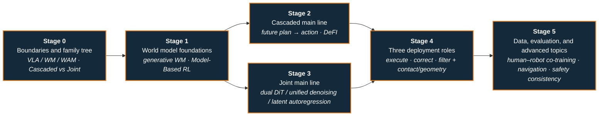

# World–Action Models (WAM)

**At a glance**:

- **Who it's for**: people who want a policy to explicitly anticipate how the world will change before it outputs an action.
- **Path**: Stage 0–5 · boundaries and family tree → world model foundations → Cascaded / Joint branches → three deployment roles → data and evaluation.
- **Depth roadmap**: a branch of the [motion control main roadmap](motion-control.md); together with the [VLA depth roadmap](depth-vla.md) it forms a sister pair of "reactive semantic policies / forward-coupled policies".

## Roadmap overview

## How to use this path

- The target reader already understands VLA / imitation-learning action heads and wants to enter **joint modeling of world prediction and action** - the main battlegrounds are manipulation, mobile manipulation, navigation, and contact-rich tasks
- WAM addresses **forward consequence coupling**: action generation must rest on an explicit (or equivalent) forward prediction of the future world; it does not replace language semantic grounding, which is the subject of the [VLA depth roadmap](depth-vla.md), nor does it replace whole-body motion priors, which are the subject of the [BFM depth roadmap](depth-bfm.md)
- Each stage has prerequisites, core questions, what to do, what to read, and what you should be able to produce
- Stage 2 and Stage 3 are two modeling routes; you can pick one branch to enter Stage 4. Reading them side by side does not mean Joint must be implemented after Cascaded. Standalone world model + search and training-only future supervision also serve as boundary contrasts; a method cannot be classified as WAM merely because a future loss appears.

**Relation to the main roadmap:**
- This roadmap is the advanced direction after main roadmap L5 (RL and imitation learning) leaning toward "world models × policies"; Stage 0–1 overlap heavily with [VLA depth roadmap](depth-vla.md) Stage 0 / Stage 5 direction B, and with [Generative World Models](../../wiki/methods/generative-world-models.md)
- If the goal is "a tabletop VLA that understands instructions", first finish [VLA depth roadmap](depth-vla.md) Stage 0–2, then enter this roadmap at Stage 0
- If the goal is a real-time Joint WAM for humanoid loco-manip, after Stage 3 continue with the low-level interfaces in the [Loco-Manipulation depth roadmap](depth-loco-manipulation.md) and the [BFM depth roadmap](depth-bfm.md)

---

## Stage 0 Boundaries and family tree: what is / is not a WAM

**First nail down the three tables \(p(a\mid o,l)\), \(p(o'\mid o,a)\), \(p(o',a\mid o,l)\), then read papers; otherwise every "VLA with a world-model loss" will be mislabeled as a WAM.**

### Prerequisites
- Proficient in Python + PyTorch
- [VLA depth roadmap](depth-vla.md) Stage 0–1 level (know BC / action chunking / generative action heads)
- Usage-level intuition for Transformers / diffusion or flow matching

### Core questions
- What distribution does each of VLA, standalone world model, and WAM model? What is the boundary criterion
- The module boundaries and main tensions of Cascaded WAM (`future plan → action`) and Joint WAM (`future + action`)
- Why "learning future video at training time ≠ having to generate video frame by frame at inference time"

### What to do
- Read the concept page and survey abstracts closely, and draw a comparison table of "VLA / WM / Cascaded WAM / Joint WAM" (target distribution, inference path, latency sources)
- Pick 3 papers from the [Awesome-WAM](../../wiki/concepts/world-action-models.md) / OpenMOSS list, and classify each as Cascaded or Joint in one sentence

### What to read
- [World Action Models (WAM)](../../wiki/concepts/world-action-models.md) — concept hub
- [Taxonomy of VLM / VLN / VLA / VLX / world models](../../wiki/comparisons/vlm-vln-vla-vlx-world-model-taxonomy.md)
- [Query: embodied foundation model family taxonomy loop](../../wiki/queries/embodied-fm-taxonomy-loop.md) — WAM corresponds to **⑤ rollout layer · joint modeling** of the five-layer loop
- Wang et al., *World Action Models* — [arXiv:2605.12090](https://arxiv.org/abs/2605.12090)
- Lu et al., *World-Action Models for Robot Learning and Control: A Survey* — [arXiv:2609.16074](https://arxiv.org/abs/2609.16074) · on this site: [RCL survey entity](../../wiki/entities/paper-rcl-wam-robot-learning-control-survey.md) + [Awesome list of 564 entries](../../wiki/entities/paper-rcl-wam-robot-learning-control-survey.md)

### What you should be able to produce
- Be able to say in one sentence what a WAM is and is not (relative to VLA and an external simulator)
- Given a new paper, place it in the correct box: Cascaded / Joint (or "just VLA + auxiliary loss")

---

## Stage 1 World models and dynamics foundations

**The "world side" of a WAM is built on this layer: without action-conditioned forward dynamics, joint modeling is out of the question.**

### Prerequisites
- Stage 0 content
- Know the basic story of model-based RL (imagined rollouts → planning / policy improvement)

### Core questions
- What generative world models (video / latent space) predict and do not predict; what engineering constraints still separate them from executable control
- How classic Model-Based RL / planning differs from Cascaded WAM as defined in the surveys (external engine vs part of the learned policy)
- Three capability interfaces of the robot world model training loop: in-policy prediction / learned simulator / controllable video

### What to do
- Read one generative WM paper and one in-policy WM paper, and compare "whether it participates in action conditioning"
- Sketch on paper the information flow of a Cascaded pipeline: observation → future representation → IDM / action head → control

### What to read
- [Generative World Models](../../wiki/methods/generative-world-models.md)
- [Model-Based RL](../../wiki/methods/model-based-rl.md)
- [V-JEPA 2 / 2-AC](../../wiki/entities/paper-vjepa2.md) — a staged foundation of video representation pretraining, robot action-conditioned post-training, and image-goal CEM planning; video pretraining alone does not directly enable robot control.
- [LpWM](../../wiki/entities/paper-lpwm.md) · [INTACT](../../wiki/entities/paper-intact.md) — audit sparse latent codes and intent-to-action readout respectively, comparing representations, search budgets, and causal-history protocols, to avoid treating all latent world models as the same control interface.
- [LeWM](../../wiki/entities/paper-lewm.md) and [LG-DKGP](../../wiki/entities/paper-lg-dkgp.md) — a contrasting branch of action-conditioned latent world models + CEM planning; the latter learns a continuous action-proposal prior, and should not automatically be classified as a Cascaded/Joint WAM just because it uses a world model
- [SLIM-0.5B](../../wiki/entities/paper-slim-05b.md) — boundary contrast: Stage-1 IDM/FDM shapes the prediction slots, while Stage-2 and inference do not explicitly predict future observations; by this page's Stage 0 criteria, it is not a direct example of `future plan → action`. Controlled H100 model inference is 60.6 ms / incremental peak 4.26 GiB, and must not be mixed with end-to-end deployment numbers from the web page
- [Robot world model training loop taxonomy](../../wiki/overview/robot-world-models-training-loop-taxonomy.md)
- [τ₀-World Model (τ0-WM)](../../wiki/entities/tau0-world-model.md) — a contrasting instance of joint prediction + test-time revision
- [PhysisForcing](../../wiki/entities/paper-physisforcing.md) — layered physical alignment at training time (pixel-level trajectories + semantic-level token relations), zero extra cost at inference: a constructive answer to "video fidelity ≠ physical plausibility"
- [PhysMani](../../wiki/entities/paper-physmani-dynamic-manipulation-world-model.md) — an online-learned divergence-free 3D Gaussian velocity-field world model coupled in parallel with a future-aware policy, targeting fast dynamic-object manipulation (ECCV 2026)
- [Xiaomi-Robotics-U0](../../wiki/entities/xiaomi-robotics-u0.md) — a 38B unified autoregressive world foundation model: co-trained on T2I/X2I and multi-view embodied scene generation/transfer/manipulation videos, with no built-in policy head, serving as a synthetic data engine for downstream VLAs - a direct example of "visually realistic ≠ actions inferable"
- [ODEWorld](../../wiki/entities/paper-odeworld.md) — PT-Flow learns a latent ODE velocity field in physical time; first-order JVP supervision + dynamics decoupling mitigates JEPA collapse; LIBERO long-horizon video PSNR 19.46, AgileX+X-VLA 55%→80%; inference code and weights are open source
- [Hydra-0](../../wiki/entities/paper-hydra-0.md) — uses sparse image-plane action flow as the cross-embodiment WM condition, robot EPE −90.4%, RoboLab open-loop r=0.96; 2,202 h of training; confirmed not open source
- [CausalWM](../../wiki/entities/paper-causalwm.md) — Aether AI's embodied world model: generates along an explicit causal chain of "optical flow → XYZ point map → future RGB"
- [TC-WM (task-centric world models)](../../wiki/entities/paper-task-centric-world-models.md) — linearly compresses frozen DINOv2 embeddings into compact latents, oriented toward task relevance rather than pixel reconstruction
- [CD-LAM](../../wiki/entities/paper-cd-lam.md) · [SCAR](../../wiki/entities/paper-scar-continuous-action.md) — deconfounding latent action models / treating action as an independent factor of visual change, mitigating world models that are "realistic but do not follow actions"
- [H-JEPA visual planning](../../wiki/entities/paper-h-jepa-visual-planning.md) — multi-timescale action-conditioned JEPA latent space + hierarchical planning from high-level subgoals to low-level actions
- [DreamTrue](../../wiki/entities/paper-dreamtrue-action-faithful-world-model.md) — offline geometric calibration aligns image-space action conditions, counterfactual post-training expands interaction coverage, and an embodied video reward model is used for RL post-training
- [AD-E2E-JEPA](../../wiki/entities/paper-ad-e2e-jepa.md) — an action-conditioned JEPA world model (frozen DINOv3 + SIGReg projector), goal-conditioned planning without policy training (end-to-end autonomous driving, as a contrast to humanoid/manipulation WMs)
- [D-JEPA](../../wiki/entities/paper-d-jepa-decision-aligned-latent-world-model.md) — learns relations among candidate futures from actual execution outcomes, fixing the mismatch between latent distance and task success or failure, so the world model picks actions that can succeed.
- [DR-WM](../../wiki/entities/paper-dr-wm.md) — calibrates spatial terrain physics with real robot action–response pairs, predicts action-induced motion and camera trajectories in Genesis, then generates future observations and iteratively updates the terrain; used for comparing navigation candidate actions and VLM route selection.
- [Murea-InWorld](../../wiki/entities/paper-murea-inworld.md) — Murea-InWorld combines an explicit world-state agent (Murea-Mind) with the audiovisual generator Murea-Fast into an interactive storytelling loop; inference code for Mind and Fast is open source, Fast weights are released, and the openness of Murea-Pro mentioned in the report is unconfirmed.
- [EdenLive](../../wiki/entities/edenlive.md) — EdenLive separates the upstream engine's state advancement from generative frame rendering: it generates a real-time visual stream from a reference video, target first frame, and text prompt; real-time inference code and 5B / 14B weights are officially released, and robot-view data augmentation is also listed as a use case.

### What you should be able to produce
- Be able to explain why "high video fidelity" does not equal "actions inferable / closed-loop capable"
- A first draft of a dual checklist of "world-side metrics vs policy-side metrics"

---

## Stage 2 Cascaded WAM: plan the future first, then decode actions

**Clear modules that make it easy to iterate the world path and the policy head separately; the main tension is the two-stage information bottleneck and alignment.**

### Prerequisites
- Stage 1 content
- Understand inverse dynamics (IDM) and the intuition of "inferring actions back from future representations"

### Core questions
- The typical Cascaded decomposition: `future plan → action`; the carrier of the future can be pixels, flow, depth, latent vectors, or tokens
- Why weakening the inverse module becomes the bottleneck of the whole chain (DeFI's critique of VPP-style pipelines)
- What problem is solved by decoupled pretraining (forward / inverse on different data sources) followed by coupling

### What to do
- Following DeFI's GFDM + GIDM, draw a table of "data source × pretraining objective × downstream coupling"
- Pick any Cascaded paper and mark whether it still generates full future video at inference time

### What to read
- [DeFI (decoupled dynamics VLA)](../../wiki/methods/defi-decoupled-dynamics-vla.md)
- The Cascaded section in [World Action Models](../../wiki/concepts/world-action-models.md)
- [Being-M0.7 (humanoid latent-space World–Action Model)](../../wiki/entities/paper-being-m07-humanoid-latent-wam.md) — a humanoid instance of Cascaded WAM: human-centric video-motion prior pretraining + a future-conditioned action expert, three-stage training and gated visual-prediction context; highest total on the new SIMPLE, tied with GR00T-N1.6 on the real G1
- [TrAct (visual trajectories bridging control and prediction)](../../wiki/entities/paper-tract.md) — VLAT jointly samples action–trajectory pairs on π₀.₅, TWM, a trajectory-conditioned world model, rolls out future video, and VLAC picks the highest-scoring rollout to execute; 2D trajectories serve as an embodiment-agnostic intermediate interface, LIBERO-INTEGRAL 27%→55%, real robot 49%→76%; code is public, checkpoints and part of the data are still missing
- [Action-consequence technology map](../../wiki/overview/robot-world-models-action-consequence-technology-map.md) — cross-cutting comparison with Joint / deployment

### What you should be able to produce
- Be able to draw the module boundaries of a Cascaded WAM and point out which link usually breaks when alignment fails
- A selection note on "when to choose Cascaded vs Joint" (latency, interpretability, whether data can be trained separately)

---

## Stage 3 Joint WAM: jointly predicting future and action under a shared backbone

**Tighter coupling and a more direct consistency objective; the main tensions are inference latency, training-objective design, and multimodal extension.**

### Prerequisites
- Stage 1 content; Stage 2 is for comparing module boundaries and is not required for this stage
- Understand the basic structure of dual DiT / MoT / flow-matching joint denoising (DiT4DiT can serve as a template)

### Core questions
- Several engineering forms of the Joint family: dual DiT (Video + Action), unified diffusion denoising, latent autoregressive observe–act–update
- Why many Joint WAMs use video co-supervision **at training time** but can be action-only / a single forward pass with fixed flow steps **at inference time**
- How humanoid loco-manip, mobile manipulation, and navigation each choose an action representation (motion token / latent action / waypoint)

### What to do
- Read one of DiT4DiT or MotionWAM closely, and draw the conditioning path of Video DiT ↔ Action DiT and the breakdown of inference latency
- Following ABot-M0.5's Dream Forcing: explain what is being aligned by training inverse dynamics on self-generated video latents

### What to read
- [DiT4DiT (dual-DiT joint VAM)](../../wiki/entities/paper-dit4dit-video-action-model.md)
- [MotionWAM (humanoid loco-manip · real-time WAM)](../../wiki/entities/paper-motionwam-humanoid-loco-manipulation-wam.md)
- [ABot-M0.5 (mobile manipulation · latent action + Dream Forcing)](../../wiki/entities/paper-abot-m05-mobile-manipulation-wam.md)
- [Dexmal DW05 (OpenDW)](../../wiki/entities/dexmal-dw05.md) — an open-source Joint WAM with a Wan backbone + three MoT expert heads jointly modeling video/action/value, including a full training/inference stack and a RoboTwin 2.0 fine-tuning evaluation package
- [Lumo-2 (Latent World-Action Model)](../../wiki/entities/lumo-2.md) — a Qwen3.5-4B latent-space world–action model, three-stage progressive modality pre-alignment + BAR block decoding, outperforming π₀.₅/Fast-WAM across all 22 real-robot challenges
- [Pelican-Unified 1.0](../../wiki/methods/pelican-unified-1.md), [Kairos](../../wiki/entities/paper-kairos-native-world-model-stack.md)
- [Cosmos 3](../../wiki/entities/cosmos-3.md) — platform-level Joint / multi-task I/O contrast
- [LingBot-VA / Robbyant](../../wiki/entities/robbyant.md) — MoT interleaved video–action modeling + closed-loop rollouts + asynchronous inference; the same company's World (world simulation) and VLA (feedforward policy) allow a side-by-side comparison of three output forms
- [WorldScape Policy 2.0](../../wiki/entities/paper-worldscape-policy-2.md) — a division of labor between two pathways, event-level VLM memory (three-view retrieval + gating) and visual short-term memory, with semantic forcing alignment; RoboTwin 2.0 94.3%, C2R 63.3% under v3 clean-only training (mean of clean/randomized, Fast-WAM 39.9%), real-robot cross-embodiment transfer 10–20%→60–70%; code and pretraining/post-training checkpoints are public
- [ω-0](../../wiki/entities/paper-omega-0.md) — a humanoid concurrent loco-manip Joint WAM with Wan future visual latent supervision + SONIC whole-body action latent diffusion; ω-HOME 40h+/4827 episodes, Omni success rate 81.8% on 11 tasks on G1, versus 44.5% for ψ-0; code, data, and pretrained checkpoint entry points are public
- [DreamWAM](../../wiki/entities/paper-dreamwam.md) — at training time uses RGB+Flow joint denoising and Depth/DINO gated residual supervision for beyond-RGB futures (appearance+motion+geometry+semantics), while inference remains RGB-only; LIBERO-Plus 69.16%→75.47%, real-robot visual perturbation 55.6%→74.4%; code/weights are open source
- [Dyna-2](../../wiki/entities/dyna-2.md) — Dyna Robotics' closed-source flagship WAM: pretrained on ≥1M h of egocentric human video (zero robot data), reporting human held-out and human→robot zero-shot power laws; ablations claim video co-training is a necessary condition for cross-embodiment scaling; after post-training on a small amount of on-robot data it runs on dual arms/dexterous hands/semi-humanoids; not open source
- [Riemann-1.0](../../wiki/entities/paper-riemann-1.md) — Riemann Dynamics' closed-source fully causal AR WAM: action first, then conditioning future vision on it; a three-stage curriculum over 232K+ h of human/UMI/robot data; RoboCasa365 62.6% (+8.4 vs ABot-M0.5), average 85.0% SR on the Tianji Marvin real robot; no arXiv / not open source
- [FACT](../../wiki/entities/paper-fact.md) — uses consequence supervision from failed demonstrations to break the success bias of Joint WAMs (training the future only on successful trajectories means wrong actions at test time still get paired with a "successful future"); a progress head can optionally score before deployment, and real-robot ablations show scoring ability drops significantly (79%) without failure co-training, proving the value head really consumes consequence supervision; the RoboTwin pipeline + HF checkpoint are open source
- [Motubrain](../../wiki/entities/paper-motubrain.md) — a UniDiffuser-style Joint WAM, three-stream MoT + H-bridge, adaptable with 50–100 trajectories of the same embodiment; RoboTwin 2.0 95.8/96.1; the official repo contains only the PDF, training/inference pending release
- [Flex-π](../../wiki/entities/paper-flex-pi.md) — a 6B multi-stream Joint WAM sharing a frozen Wan VAE to encode RGB+pointmap, jointly with DINOv3 features; stream dropout + CMF let a single checkpoint cover 56 stream combinations; v3 LIBERO-Plus 88.6% in both modes, real-robot completion and full-success rates reported separately; code, weights, and data are public
- [GlanceWAM](../../wiki/entities/paper-glancewam.md) — asynchronous sparse lookahead inside a single video DiT, with imagination off the critical path and 48 ms decoding in the action-head latent space; RoboCasa 72.2%, LIBERO 99.0%; code and weights are open source
- [OpenWAM](../../wiki/entities/paper-openwam.md) — modular infra + six controlled comparisons in the Study distill three pretraining principles; OpenWAM-α Wan2.2-5B + ActionDiT mutual mask; one-stage ego+robot co-training on 518.5M frames; LIBERO 99.3%, RoboTwin2.0-Full 93.60%, RoboDojo real robot 37.6 points/24.4% SR; GitHub + 46 HF checkpoints are open source

### What you should be able to produce
- Be able to compare the latency and closed-loop form of at least two Joint implementations (diffusion dual tower vs latent autoregressive loop)
- A decision record for the target platform on "whether inference rolls out future video"

---

## Stage 4 Three deployment roles: execute · correct · filter (+ contact / geometry)

**Turn "how the world will change before the action goes out" into pluggable interfaces: execute directly, correct a base VLA online, or filter before deployment.**

### Prerequisites
- Stage 2 or Stage 3 content, entered according to the chosen modeling route
- Intuition for real-robot deployment latency and asynchronous action chunks ([VLA depth roadmap](depth-vla.md) Stage 4 level is better)

### Core questions
- Three classes of roles: direct execution (DSWAM), online correction of a frozen VLA (DynaWM), deployment filtering with a latent WM (DreamSteer)
- Why contact-rich tasks need joint visuo-tactile modeling (VT-WAM) or a tactile WM as a data engine (TACO)
- When 4D geometric supervision stays at training time (MECo-WAM) and when it enters the inference path (RynnWorld-4D)

### What to do
- Use [action-consequence categories 01–04](../../wiki/overview/wm-action-consequence-category-01-wam-action-prediction.md) to pin the 12 curated works into the boxes "execute / correct / filter / contact / geometry / evaluate"
- Choose one class of deployment interface for your scenario, and write down the inputs and outputs and whether the base VLA is frozen

### What to read
- [Action-consequence technology map (2026-07 curation)](../../wiki/overview/robot-world-models-action-consequence-technology-map.md)
- [DSWAM](../../wiki/entities/paper-dswam-dual-system-wam.md) · [DynaWM](../../wiki/entities/paper-dynawm-vla-online-correction.md) · [DreamSteer](../../wiki/entities/paper-dreamsteer-vla-deployment-steering.md)
- [VT-WAM](../../wiki/entities/paper-vt-wam-visuotactile-contact-rich.md) · [MECo-WAM](../../wiki/entities/paper-meco-wam-4d-geometry-cotraining.md)
- [Contact manipulation depth roadmap](depth-contact-manipulation.md) — expansion on the force / tactile engineering side

### What you should be able to produce
- A selection table of "which class my stack should use: execute / correct / filter"
- Be able to explain the latency trade-off between training-time geometric supervision and inference-time 4D generation

---

## Stage 5 Data, evaluation, and advanced directions

### Prerequisites
- Stage 4 content

**Direction A: human–robot data and world supervision objectives**
- How in-the-wild egocentric human data is co-trained with robot teleoperation; how world prediction objectives (Pixel / DINO / 3D flow) change the gains under the embodiment gap; whether human-only pretraining is enough to establish cross-embodiment scaling laws
- Keywords: [EgoWAM](../../wiki/entities/paper-egowam-egocentric-human-wam-co-training.md), [WAM-TTT (human-video test-time training steering)](../../wiki/entities/paper-wam-ttt-human-video-test-time-steering.md), [Dyna-2 (1M h human→robot cross-embodiment scaling · closed source)](../../wiki/entities/dyna-2.md), [EgoScale](../../wiki/methods/egoscale.md), [Imitation learning depth roadmap](depth-imitation-learning.md)

**Direction B: WAM in navigation and spatial decision-making**
- Joint or autoregressive WAMs on image-goal / aerial VLN; interfaces with classic VLN / navigation VLAs
- Keywords: [NavWAM](../../wiki/entities/paper-navwam-goal-conditioned-visual-navigation-wam.md), [WorldVLN](../../wiki/entities/paper-worldvln-aerial-vln-wam.md), [Navigation depth roadmap](depth-navigation.md)

**Direction C: evaluation and safety consistency**
- Look at both the world side (fidelity, physical common sense, action inferability) and the policy side (success rate, long horizon, sim2real); avoid one-sided proxies
- Keywords: the evaluation sections of surveys, [GigaWorld-1](../../wiki/entities/paper-gigaworld-1-policy-evaluation.md), [SC3-Eval](../../wiki/entities/paper-sc3-eval.md) (self-consistent video generation as an evaluator of real-robot VLA policies, closed-loop Pearson 0.929), [HarnessEval-W](../../wiki/entities/paper-harnesseval-w.md) (an LLM harness connected to interactive world model evaluation, Intentional ranking ρ=0.93 with humans), open challenges (causal consistency between the imagined future and real execution)

**Direction D: converging with VLA / BFM / full-system mobile manipulation stacks**
- High-level semantics can still go through VLA; whole-body coordination goes through BFM; WAM provides a consequence-coupling or deployment-filtering layer
- Keywords: [VLA depth roadmap](depth-vla.md), [BFM depth roadmap](depth-bfm.md), [Loco-Manipulation depth roadmap](depth-loco-manipulation.md)

---

## Quick entry summary

| Stage | Core question | Knowledge page entry |
|------|---------|-----------|
| Stage 0 | VLA / WM / WAM boundaries and family tree | [World Action Models](../../wiki/concepts/world-action-models.md) |
| Stage 1 | Generative WMs and dynamics foundations | [Generative World Models](../../wiki/methods/generative-world-models.md) |
| Stage 2 | Cascaded main line | [DeFI](../../wiki/methods/defi-decoupled-dynamics-vla.md) |
| Stage 3 | Joint main line | [DiT4DiT](../../wiki/entities/paper-dit4dit-video-action-model.md) |
| Stage 4 | Three deployment roles | [Action-consequence technology map](../../wiki/overview/robot-world-models-action-consequence-technology-map.md) |
| Stage 5 | Data / evaluation / full-system convergence | [EgoWAM](../../wiki/entities/paper-egowam-egocentric-human-wam-co-training.md) |

## Relation to other pages

- Full growth roadmap reference: [Main roadmap: motion control → full-stack physical intelligence growth roadmap](motion-control.md)
- Related depth roadmaps (by topical proximity; for the full directory see [Roadmap overview](motion-control.md#depth-optional-index)):
  - [VLA](depth-vla.md) — the contrasting paradigm that outputs actions directly
  - [ICL](depth-icl.md) — in-context adaptation vs explicit joint world–action modeling
  - [Motion generation](depth-motion-generation.md) — the generation side of future video/actions
  - [Embodied evaluation](depth-embodied-eval.md) — world model fidelity and policy success rate
  - [Model architecture](depth-model-architecture.md) — a cross-cutting view: structural components and latency breakdown after future prediction is merged into the backbone

## References

- [World Action Models (WAM) concept page](../../wiki/concepts/world-action-models.md)
- [World Action Models: The Next Frontier in Embodied AI (survey preprint)](https://arxiv.org/abs/2605.12090) — Wang et al., arXiv:2605.12090
- [Action-consequence technology map](../../wiki/overview/robot-world-models-action-consequence-technology-map.md) and the 12 entity pages curated in 2026-07
- [Robot world model training loop taxonomy](../../wiki/overview/robot-world-models-training-loop-taxonomy.md)
- [GlanceWAM / VLA Crew 10-paper technology map (2026-08-30 curation)](../../wiki/overview/glancewam-vla-crew-10-papers-technology-map.md)
- OpenMOSS [Awesome-WAM](https://github.com/OpenMOSS/Awesome-WAM)
- [SLIM paper §3.3 / §4.4 / Appendix A.5](https://arxiv.org/html/2608.09771v1) — training-time prediction slots, inference interface, and the scope of H100 timing
