# Main Roadmap: Motion Control → Full-Stack Growth Path to Physical Intelligence

**At a glance**:

- **Who it's for**: Algorithm engineers who want to work on humanoid / biped motion control and want to understand Physical AI (VLA, world models, deployment) all the way through.
- **In one sentence**: First learn how to make a robot **stand steadily and walk** (classical control + reinforcement learning), then learn how to make it **understand instructions and run on real hardware** (large models + deployment).
- **How to study each layer**: Each layer gives "what to read / what to do / what to produce".

**Summary**:

- **One main line**: L−1 ~ L7 cover humanoid / biped motion control thoroughly; L8 ~ L12 then connect to large models and real-robot deployment.
- **Foundations and classical control**: L−1 ~ L3 lay the groundwork (overview, math, kinematics, dynamics, control basics); L4 covers LIP/ZMP, MPC, TSID/WBC.
- **Learning and deployment**: L5 covers RL / IL / motion retargeting; L6 ~ L7 cover Sim2Real and the full-stack exit.
- **Upward extension**: L8 ~ L12 cover Transformer, Diffusion / Flow Matching, VLA, world models, ONNX / ROS2 deployment.

<a id="roadmap-video"></a>

<figure class="roadmap-video">
<video controls preload="none" playsinline poster="assets/video/roadmap-motion-control-explained-poster.jpg">
<source src="assets/video/roadmap-motion-control-explained.mp4" type="video/mp4">
Your browser cannot play the embedded video; you can <a href="https://imchong.github.io/Robotics_Notebooks/assets/video/roadmap-motion-control-explained.mp4">open the video file directly</a>.
</video>
<figcaption><strong>Video walkthrough</strong> (1:39:40 · 24 chapters · Chinese voiceover + subtitles): goes level by level through L−1 → L0–L7 → L8–L12, explaining the key points and principles of each layer; answers to the self-check questions are given directly in the walkthrough. <a href="https://imchong.github.io/Robotics_Notebooks/assets/video/roadmap-motion-control-explained.mp4">Open in new tab / download</a> · <a href="https://github.com/ImChong/Robotics_Notebooks/tree/main/media/roadmap-motion-control-video">Script and generation scripts</a></figcaption>
<details class="roadmap-video-chapters">
<summary>Chapter timestamps</summary>
<ol>
<li>00:00 Opening: what this roadmap sets out to answer</li>
<li>01:50 Overview map: from camera image to motor torque</li>
<li>05:50 L−1 Prologue: the robotics tech stack at a glance</li>
<li>09:05 L0 Math and programming foundations</li>
<li>12:54 L1 Robotics backbone: FK / IK / Jacobian</li>
<li>17:33 L2 Dynamics and rigid-body modeling</li>
<li>22:03 L3 Control basics and optimization</li>
<li>28:58 L4 Humanoid motion control backbone: overview of the method chain</li>
<li>32:32 L4.1 LIP / ZMP: the inverted pendulum that walks</li>
<li>37:38 L4.2 Centroidal Dynamics</li>
<li>40:31 L4.3 Trajectory optimization and MPC</li>
<li>44:01 L4.4 TSID / whole-body control (WBC)</li>
<li>47:15 L5 Reinforcement learning basics: MDP → PPO</li>
<li>54:14 L5.2 Applications of RL in humanoid motion control</li>
<li>58:19 L5.3 Imitation learning: BC · DAgger · DeepMimic · AMP</li>
<li>1:02:14 L5.4 Motion retargeting</li>
<li>1:06:31 L6 Integrated practice: Sim2Real</li>
<li>1:11:24 L7 Exit: viewing the whole tech stack from motion control</li>
<li>1:15:30 L8 Transformer and representation: from token to VLM</li>
<li>1:19:08 L9 Action generation: Action Chunk · Diffusion · Flow Matching · DiT</li>
<li>1:23:37 L10 VLA / foundation policies: the π series and GR00T</li>
<li>1:28:04 L11 World models and Physical AI platforms</li>
<li>1:31:41 L12 Deployment: from a trained policy to real-robot motors</li>
<li>1:35:48 Wrap-up: filtering new work · depth directions · common sticking points · full roadmap recap</li>
</ol>
</details>
</figure>

## Understand This Roadmap in Three Sentences

1. **First get the classical control backbone working end to end**: LIP/ZMP → Centroidal → MPC → TSID/WBC.
2. **Then plug learning methods into it**: RL/IL are used to add capabilities, not to replace the control structure.
3. **Every layer must have runnable output**: code, experiment logs, and failure post-mortems — none can be missing.

> **The ultimate question this roadmap answers**: In a Physical AI system, from camera image to robot motor torque, which modules does the signal actually pass through? The answer is in [Physical AI full-stack view](#physical-ai-full-stack-view), expanded layer by layer in L0–L12.

<a id="roadmap-nav-start"></a>

## Where to Start (Navigation)

- Want to **watch the video walkthrough first**: play the [roadmap walkthrough video](#roadmap-video) at the top of the page (1:39:40, 24 chapters, explains the key points and principles of each layer level by level).
- Want to **understand the whole robotics tech stack in 30 seconds**: jump to [L−1 Prologue](#l1-prologue-the-robotics-tech-stack-at-a-glance--how-to-read-this-roadmap).
- Want the **shortest executable path**: jump to [Minimum executable learning path (90-day version)](#minimum-executable-learning-path-90-day-version).
- Want the **complete roadmap**: read in order L−1 → L0 → … → L7, then move on to the Physical AI extension in L8–L12.
- Want to **see the Physical AI full-stack map first / only follow the core path due to limited time**: jump to [Physical AI full-stack view](#physical-ai-full-stack-view) and [Physical AI Core Path](#physical-ai-core-path).
- Seeing a **new model / new paper and unsure whether to learn it**: first run it through [How to filter new Physical AI work](#physical-ai-signal-vs-noise).
- Want to **go straight into a specific direction**: jump to [Optional depth](#depth-optional-index); each of the thirty independent roadmap pages notes who it suits and which layer of the main line it connects from.

---

## Physical AI Full-Stack View: From Camera Image to Motor Torque

<a id="physical-ai-full-stack-view"></a>

**This section is the "map page" of the whole roadmap.** This roadmap uses **Robot Control + Robot Learning + Sim2Real** as its vertical backbone (L0–L6), extends upward to **Transformer → action generation → VLA → World Model** (L8–L11), and down to **real-robot deployment** (L12). The numbering, titles, and content of the original L0–L7 remain unchanged; L8–L12 are Physical AI extension layers added on top.

### 8 Layers + Deployment: Mapping to the Chapters of This Roadmap

| Layer | What this layer answers | Chapters in this roadmap | Key nodes |
|----|----------------|-----------|---------|
| **① Robot Fundamentals** | Why does a robot move? What is the object that the neural network ultimately controls? | [L0](#l0-math-and-programming-foundations)–[L2](#l2-dynamics-and-rigid-body-modeling) | Coordinate frames · SO(3) / SE(3) · FK / IK · Jacobian · rigid-body / contact dynamics · friction · actuators · state estimation |
| **② Robot Control** | After the policy outputs something, who turns it into torque? | [L3](#l3-control-basics-and-optimization)–[L4](#l4-humanoid-motion-control-backbone) | PID / PD · position / velocity / torque control · impedance · MIT-style PD · WBC · QP · MPC |
| **③ Robot Learning** | How is a policy learned from data / trial and error? | [L5](#l5-reinforcement-learning-and-imitation-learning) | MDP → Value → Policy Gradient → Actor-Critic → GAE → PPO; BC · DAgger · DeepMimic · AMP · BeyondMimic · MimicKit |
| **④ Sim2Real** | Why does a policy that works well in simulation fail on the real robot? | [L6](#l6-integrated-practice) | DR · observation noise · latency · actuator modeling · SysID · Teacher-Student · Sim2Sim |
| **⑤ Transformer / Representation** | How do images, language, and robot state become the same kind of "token"? | [L8](#physical-ai-l8-transformer) | token · embedding · QKV · self / cross-attention · ViT · VLM |
| **⑥ Action Generation** | Why do modern policies output a segment of actions at once, rather than a single action? | [L9](#physical-ai-l9-action-generation) | Action Chunk · Diffusion Policy · Flow Matching · DiT · Action Expert |
| **⑦ VLA / Foundation Policy** | How can one model simultaneously "see, understand language, and move"? | [L10](#physical-ai-l10-vla) | π0 → π0.5 → later π models · GR00T N1 (System 2 / System 1) |
| **⑧ World Model + Physical AI Platform** | When data is scarce and real robots are too expensive, what do you train and evaluate with? | [L11](#physical-ai-l11-world-model) | World Foundation Model · Cosmos · Isaac Sim / Isaac Lab · synthetic data |
| **Deployment → Real Robot** | How does a trained network run on time on the real robot? | [L12](#physical-ai-l12-deployment) (for system background see [L7.4](#l7-4-system-stack)) | ONNX · TensorRT · ROS2 · ros2_control · Jetson · PREEMPT_RT · CAN / EtherCAT |

### Backbone and Branches (Not a Single Chain)

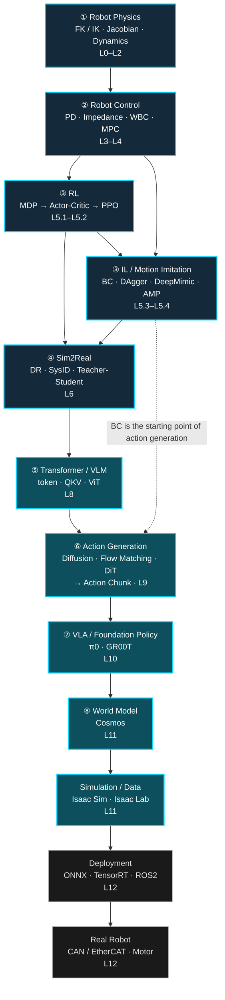

The diagram shows only the backbone and the single most important branch; other cross-dependencies:

- **Simulation → RL**: The simulation platforms of L11 are also the training ground for L5 RL.
- **Sim2Real → Deployment**: Classical RL locomotion policies do not go through a VLA; after training they go straight to L12 deployment.
- **Control → Real Robot**: Whether the upper layer is PPO or a VLA, low-level PD / WBC is always in the loop (see [L3](#policy-vs-low-level-controller)).
- **Real Robot → Sim2Real**: Real-robot failures go back to the [L6 failure-source table](#l6-sim2real-chain) for post-mortem.

### A Physical AI System: From Camera Image to Motor Torque

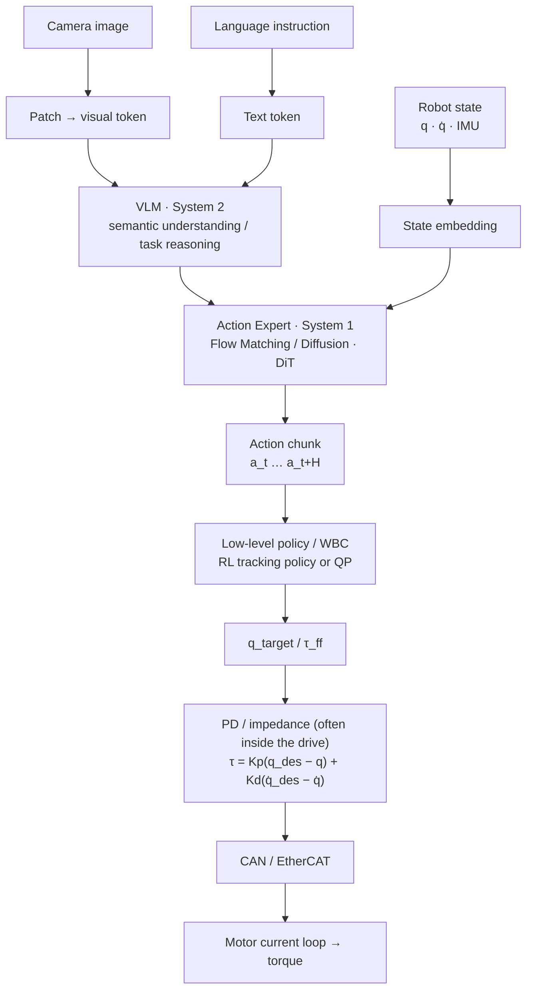

Readings from the motor encoders and IMU are fed back as the Robot state for the next tick, closing the loop.

| Stage | Typical frequency range (varies by platform) | Which layer of this roadmap |
|------|--------------------------|--------------|
| VLM semantic understanding (System 2) | Slower; runs decoupled from the action head | L8 / L10 |
| Action head outputs an action chunk (System 1) | End-to-end networks commonly 10–50 Hz; GR00T N1 reports about 120 Hz chunk output, π0 about 50 Hz control | L9 / L10 |
| Low-level tracking policy / WBC | Learned trackers such as SONIC about 50 Hz; model-based WBC commonly several hundred Hz to 1 kHz, measure on your platform | L4.4 / L5.2 |
| Joint PD / current loop | Higher-frequency closed loop inside the drive | L3 / L12 |

> Frequency figures come from existing pages on this site: [Decoupling control and inference frequencies](../../wiki/concepts/control-inference-frequency-decoupling.md), [GR00T N1](../../wiki/entities/paper-hrl-stack-34-gr00t_n1.md), [π0](../../wiki/entities/paper-pi0.md), [SONIC deployment stack](../../wiki/methods/sonic-motion-tracking.md). **Network queries, action dispatch, tracking control, and the inner loop inside the drive run at different frequencies**; verify each separately, and do not treat one architecture's 1 kHz as the threshold for all learned trackers.

<a id="physical-ai-core-path"></a>

### Physical AI Core Path (Shortest Path When Time Is Limited)

If the learner's time is limited, prioritize the following order, and **do not try to learn everything at once**:

1. Robot Kinematics / Dynamics — [L1](#l1-robotics-backbone) · [L2](#l2-dynamics-and-rigid-body-modeling)
2. PD / Torque Control — [L3: Policy ≠ low-level controller](#policy-vs-low-level-controller)
3. MDP / Actor-Critic — [L5.1](#l5-1-rl-basics)
4. PPO — [PPO](../../wiki/methods/ppo.md)
5. DeepMimic / AMP — [L5.3](#l5-3-imitation-learning)
6. Sim2Real — [L6](#l6-integrated-practice)
7. Transformer / Attention — [L8](#physical-ai-l8-transformer)
8. Diffusion Policy — [L9](#physical-ai-l9-action-generation)
9. Flow Matching / DiT — [L9](#physical-ai-l9-action-generation)
10. π0 / GR00T — [L10](#physical-ai-l10-vla)
11. World Model / Cosmos — [L11](#physical-ai-l11-world-model)
12. Deployment — [L12](#physical-ai-l12-deployment)

Suggested pacing: **Control → Robot Learning → Sim2Real → Transformer → Action Generation → VLA → World Model**; deployment (L12) can be interleaved after finishing simulation for any segment.

<a id="physical-ai-signal-vs-noise"></a>

### How to filter new Physical AI work (Signal vs Noise)

When you see a new model / new paper, first ask:

1. **Which module** of the Physical AI pipeline does it change (which cell among the 8 layers + deployment above)?
2. Is it a **new mechanism**, or just a new model name?
3. Is it effective **across robots / across tasks**?
4. Does it have a **paper / code / benchmark**?
5. Will this concept still be worth knowing **6–12 months from now**?

> **If you cannot place a new work into the roadmap, do not learn it deeply yet.**

**Source selection principle**: For each key concept, recommend at most **1 canonical paper + 1 official project page + 1 GitHub + optional Hugging Face**; skip if no corresponding link exists; prefer official sources, and do not include second-hand blogs / aggregator sites. The "What to read" sections in L8–L12 all follow this rule.

---

## L−1 Prologue: The Robotics Tech Stack at a Glance & How to Read This Roadmap

**This section is a "soft-landing step" for readers who have never looked at robotics before.** Experienced readers can jump straight to [L0 Math and programming foundations](#l0-math-and-programming-foundations) or [Minimum executable learning path](#minimum-executable-learning-path-90-day-version).

### Understand "What a Robot Is Doing" in 30 Seconds

Take any robot apart — robot vacuum, robotic arm, self-driving car, humanoid — and you'll find they all loop through the same 4 steps:

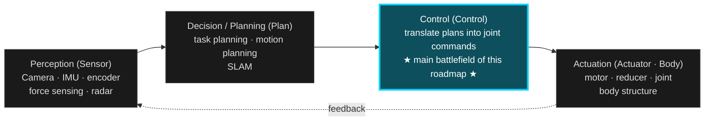

- **Perception**: camera / IMU / encoder / force sensing / radar → lets the robot know "where it is and what the world looks like".
- **Decision / planning**: high-level task planning, motion planning, SLAM → decides "where to go and which path to take".
- **Control**: turns planning goals into joint-level commands → decides "how much force / how many degrees each joint should produce in this millisecond".
- **Actuation**: motors, reducers, joints, body structure → turns commands into mechanical motion.

> **This roadmap drills only into the third box: control.** The other three boxes get a concentrated primer in the [L7 exit layer](#l7-exit-viewing-the-whole-robotics-tech-stack-from-motion-control), which gives you entry points into the corresponding sub-directions.

### Why "Humanoid / Biped" Is the Main Vehicle

Humanoid = **high degrees of freedom** (20+ joints) + **floating base** (not fixed to the ground) + **contact switching** (feet must take turns touching the ground) + **strong instability** (the center of mass always wants to run away).
Once you've learned humanoid control, transferring to robotic arms, quadrupeds, or wheeled bases is almost always a step down in difficulty, but not the other way around. That's why the humanoid is currently the "best teaching vehicle".

### Different Ways to Read for Three Kinds of Readers

| Who you are | Recommended way to read | What you don't need to do |
|--------|---------|------------|
| **Complete outsider** (want to understand the terminology and be able to talk with engineers) | Read only each L's "scenario metaphor / what you can do after learning / what to read" and each layer's "English acronym cheat sheet" | No need to write a single line of code or do exercises |
| **Want to enter the field** (programmer / student) | Follow the [minimum executable 90-day path](#minimum-executable-learning-path-90-day-version) → then go through L0 → L7 in full, doing "what to do" at every layer | No need to finish reading all the papers first |
| **Experienced practitioner** (relevant experience, filling gaps) | Jump straight to L4 / L5, focusing on each layer's "common pitfalls / self-check questions"; use [Optional depth](#depth-optional-index) to cut into research directions | No need to reread L0–L2 basics |

### How to Use Each Layer

Every L (except L−1 / L7) follows the same format:

1. **Scenario metaphor** — a one-sentence analogy for complete outsiders
2. **Why it exists / limits of the previous layer** — explains why this layer cannot be skipped
3. **Prerequisites → Core questions → What to do → What to read → What you should be able to produce** — an engineering execution checklist
4. **Common pitfalls + self-check questions** — for quick calibration by experienced readers

### Skip-to Matrix for Experienced Readers

If you've already worked with robot control on the job, you can jump straight to the corresponding L based on the questions you can answer. **Click the buttons below to go directly to the corresponding section:**

<div class="skip-to-buttons" style="display:grid; grid-template-columns:repeat(auto-fit, minmax(260px, 1fr)); gap:12px; margin:18px 0;">
<a class="btn-secondary" href="#l1-robotics-backbone" style="flex-direction:column; padding:14px 18px; text-align:center; border-radius:14px; line-height:1.5;"><strong>I know NumPy but not SE(3)</strong><span style="opacity:0.7; font-size:0.85em;">→ L1 Robotics backbone</span></a>
<a class="btn-secondary" href="#l2-dynamics-and-rigid-body-modeling" style="flex-direction:column; padding:14px 18px; text-align:center; border-radius:14px; line-height:1.5;"><strong>I can do FK / Jacobian in Pinocchio, but I'm not familiar with RNEA / CRBA / ABA</strong><span style="opacity:0.7; font-size:0.85em;">→ L2 Dynamics and rigid-body modeling</span></a>
<a class="btn-secondary" href="#l4-humanoid-motion-control-backbone" style="flex-direction:column; padding:14px 18px; text-align:center; border-radius:14px; line-height:1.5;"><strong>I know fixed-base inverse dynamics but have never touched floating-base</strong><span style="opacity:0.7; font-size:0.85em;">→ L4 Humanoid motion control backbone</span></a>
<a class="btn-secondary" href="#l41-lip--zmp" style="flex-direction:column; padding:14px 18px; text-align:center; border-radius:14px; line-height:1.5;"><strong>I'm familiar with LQR / MPC but haven't systematically studied LIP / Centroidal / WBC</strong><span style="opacity:0.7; font-size:0.85em;">→ L4.1 LIP / ZMP</span></a>
<a class="btn-secondary" href="#l52-applications-of-rl-in-humanoid-motion-control" style="flex-direction:column; padding:14px 18px; text-align:center; border-radius:14px; line-height:1.5;"><strong>I can run PPO in IsaacLab but don't know how to combine it with classical control</strong><span style="opacity:0.7; font-size:0.85em;">→ L5.2 Applications of RL in humanoid motion control</span></a>
<a class="btn-secondary" href="#l6-integrated-practice" style="flex-direction:column; padding:14px 18px; text-align:center; border-radius:14px; line-height:1.5;"><strong>I've got RL working in simulation but have never done sim2real deployment</strong><span style="opacity:0.7; font-size:0.85em;">→ L6 Integrated practice</span></a>
<a class="btn-secondary" href="#l7-exit-viewing-the-whole-robotics-tech-stack-from-motion-control" style="flex-direction:column; padding:14px 18px; text-align:center; border-radius:14px; line-height:1.5;"><strong>I've done motion control and want to see today's robot AI landscape</strong><span style="opacity:0.7; font-size:0.85em;">→ L7 Exit and frontier map</span></a>
</div>

**Don't mix the two main lines while learning:**
- **Classical control main line (L0–L4 + L6):** OCP → LIP/ZMP → Centroidal → MPC → TSID/WBC → State Estimation → Sim2Real
- **Learning-based main line (L5):** RL basics → locomotion RL → imitation learning / motion prior → motion retargeting → teacher-student
- Prioritize learning the classical main line thoroughly, then attach RL / IL as an extension layer; otherwise you can easily end up only able to tune hyperparameters without understanding why the control structure is designed the way it is.

### English Acronym Cheat Sheet (L−1 Bird's-Eye View of the Whole Roadmap)

| Acronym | Full English name | Brief description |
|------|----------|----------|
| DOF | Degrees of Freedom | Number of independent directions the robot can move in; humanoids commonly have about 25 DOF. |
| FK | Forward Kinematics | Joint angles → end-effector pose. |
| IK | Inverse Kinematics | End-effector target → back out the joint angles. |
| CoM | Center of Mass | Whole-body center of mass; one of the core states for balance control. |
| ZMP | Zero Moment Point | The point on the contact surface where the resultant moment is zero; if it stays inside the support polygon, the robot is unlikely to tip over. |
| DCM | Divergent Component of Motion | Divergent component of motion; used for foot placement and balance look-ahead. |
| CP | Capture Point | The foot placement point where stepping lets the robot asymptotically come to a stop; often derived from DCM. |
| MPC | Model Predictive Control | Solves for optimal control online over a receding horizon. |
| WBC | Whole-Body Control | Whole-body multi-task torque allocation and constraint handling. |
| TSID | Task-Space Inverse Dynamics | Task-space inverse dynamics; a common implementation framework for WBC. |
| PID | Proportional–Integral–Derivative | Classical feedback control; commonly the fallback for a single joint. |
| LQR | Linear Quadratic Regulator | Linear quadratic optimal regulator; a balance baseline. |
| RL | Reinforcement Learning | Learning a policy through trial and error. |
| PPO | Proximal Policy Optimization | A commonly used on-policy RL algorithm. |
| IL | Imitation Learning | Learning a policy from demonstration data. |
| BC | Behavior Cloning | Supervised imitation; the simplest form of IL. |
| Sim2Real | Simulation to Reality | Transferring a simulation policy to the real robot. |
| DR | Domain Randomization | Randomizing simulation parameters to improve real-robot robustness. |
| URDF | Unified Robot Description Format | XML description format for robot links and joints. |
| MJCF | MuJoCo XML Format | Model description format used by MuJoCo simulation. |
| IMU | Inertial Measurement Unit | Inertial measurement unit (accelerometer + gyroscope, etc.). |
| SLAM | Simultaneous Localization and Mapping | Simultaneous localization and mapping. |
| VLA | Vision–Language–Action | The integrated vision–language–action large-model approach. |
| ROS | Robot Operating System | Robot middleware and communication ecosystem (ROS2 is the new generation). |

> Before the main text of each L layer there is also a **layer-specific** acronym table; outsiders only need to skim this table first to build the muscle memory of "recognizing a term when you hear it".

### One Textbook Throughout: Modern Robotics

[Modern Robotics (Lynch & Park)](../../wiki/entities/modern-robotics-book.md) is the "grammar book" for L0–L4 of this roadmap. **It doesn't teach humanoid locomotion, but it explains 'pose / velocity / force / dynamics' clearly in the unified language of twist / screw / wrench.** The "What to read" under each later layer will point you to specific chapters; here we state its place in the whole roadmap once, to avoid repeating the citation at every layer:

| Modern Robotics chapter | Which layer of this roadmap it connects to |
|--------------------|----------------|
| Ch 2–3: Configuration Space / Rigid-Body Motions | L0–L1 (the SE(3) alphabet) |
| Ch 4–6: Forward / Velocity / Inverse Kinematics | L1 |
| Ch 5, Ch 8: Statics / Dynamics of Open Chains | L2 |
| Ch 9: Trajectory Generation | L3 / L4.3 |
| Ch 11: Robot Control | L3 / L4.4 |

> Ch 7 is **Kinematics of Closed Chains**, and Ch 10 is **Motion Planning**; read them as your task requires. For force control see **Ch 11.5 Force Control / Ch 11.6 Hybrid Motion-Force Control**, which connect to L3 / L4.4.

**Official resources**: [Project page](https://modernrobotics.northwestern.edu/) · [Book PDF and videos (Northwestern wiki)](https://hades.mech.northwestern.edu/index.php/Modern_Robotics) · [Companion code NxRLab/ModernRobotics](https://github.com/NxRLab/ModernRobotics). **You are not required to read the whole book** — for the Physical AI roadmap, focus on mastering four blocks: **SE(3), FK / IK, Jacobian, Dynamics** (Ch 2–6 and Ch 8 in the table above).

---

## Minimum Executable Learning Path (90-Day Version)

If you want "fewer but better, up and running as soon as possible", you can start by doing just these 5 things:

1. Get a [Locomotion](../../wiki/tasks/locomotion.md) simulation environment running (standing + walking forward).  
2. Implement an inverted pendulum [LQR](../../wiki/formalizations/lqr.md) or a simple [MPC](../../wiki/methods/model-predictive-control.md).  
3. Get a minimal [Whole-Body Control](../../wiki/concepts/whole-body-control.md) / [TSID](../../wiki/concepts/tsid.md) example running.  
4. Train a basic policy with PPO, and read [WBC vs RL](../../wiki/comparisons/wbc-vs-rl.md) to make method trade-offs.  
5. Prepare for deployment following the minimal [Sim2Real](../../wiki/concepts/sim2real.md) checklist; with only simulation available, complete a DR comparison or sim2sim regression, and record transfer results once you have access to a real robot.

> After completing these 5 things, go back to L0-L6 to fill in the theory, and you'll understand "why you need to learn these" much faster.

---

## L0 Math and Programming Foundations

**This one doesn't need to go deep, but it can't be skipped.**

> **Scenario metaphor:** You've just got a robot, but you can't even describe in code "which direction its arm is pointing" — L0 gives you "the lowest-level vocabulary of the robot world": vectors, matrices, rotations, transforms.

> **Why this layer exists:** The formulas in every later layer treat "pose / velocity / force" as jargon. Without L0, you'd have to look things up on the spot for every line of formula you read.

### English Acronym Cheat Sheet (L0)

| Acronym | Full English name | Brief description |
|------|----------|----------|
| SE(3) | Special Euclidean Group in 3D | The mathematical group of 3D rigid-body poses (rotation + translation). |
| SO(3) | Special Orthogonal Group in 3D | The group formed by 3D rotation matrices; \(R^\top R=I,\ \det R=1\). |
| PoE | Product of Exponentials | Represents forward kinematics as a product of matrix exponentials of joint screw axes. |
| FK | Forward Kinematics | Joint variables → end-effector pose (L0 usually introduces the concept; L1 goes deep). |
| QP | Quadratic Programming | Quadratic programming; the basic optimization form for later MPC / WBC. |
| SVD | Singular Value Decomposition | Singular value decomposition; commonly used to understand Jacobian rank and redundancy. |

### Prerequisites
- High school math + a bit of calculus intuition
- Can write Python (can read it, modify it, and get it running)

### Core questions
- How exactly is linear algebra used in robotics (matrices, vectors, transforms)
- What is the intuition behind optimization problems

### What to do
- Get a full set of Python / NumPy / Pinocchio environment code running
- No need to grind problem sets, but you need to develop a feel and intuition
- Use the Modern Robotics companion Python library to run minimal functions such as `MatrixExp3`, `MatrixExp6`, `FKinSpace`, confirming that you can connect matrix exponentials with rigid-body pose transforms

### What to read
- **[Linear algebra learning curation](../../wiki/entities/linear-algebra-curriculum.md)** (main L0 entry): [Georgia Tech *Interactive Linear Algebra*](https://textbooks.math.gatech.edu/ila/) + [Axler *Linear Algebra Done Right* 4e (PDF)](https://linear.axler.net/LADR4e.pdf) + [3Blue1Brown geometric intuition](https://www.3blue1brown.com/topics/linear-algebra); for extended materials (Strang 18.06, etc.) see the curation page
- [Modern Robotics](../../wiki/entities/modern-robotics-book.md) Ch 2-3: Configuration Space, Rigid-Body Motions
- [SE(3) representation](../../wiki/formalizations/se3-representation.md)
- [Comparison of rotation representations (SO(3))](../../wiki/comparisons/so3-rotation-representations.md) — pros and cons and selection among Euler angles / quaternions / matrices / so(3) / 6D
- [Pinocchio](../../wiki/entities/pinocchio.md) / [Crocoddyl](../../wiki/entities/crocoddyl.md)
- Background leaning toward **industrial arms / self-taught without a formal degree**: the Craig introduction and programming practice checklist in [Open-source robotics learning guide (qqfly)](../../wiki/entities/learn-robotics-qqfly-guide.md)

### What you should be able to produce
- Be able to write simple matrix operations with NumPy
- Be able to run a robotic-arm forward kinematics demo

### Self-check questions (you should be able to answer after learning)
- Why can't rotation matrices \(R\) be directly added / interpolated? What would you use instead to interpolate between two orientations?
- Given an SE(3) element \(g = (R, p)\), what form does a vector \(v\) take when expressed in the new frame?
- What are the respective pros and cons of describing rotation with the matrix exponential \(\exp([\omega]_\times)\) versus Euler angles / quaternions?

<details class="selftest-answers">
<summary>Reference answers (click to expand)</summary>

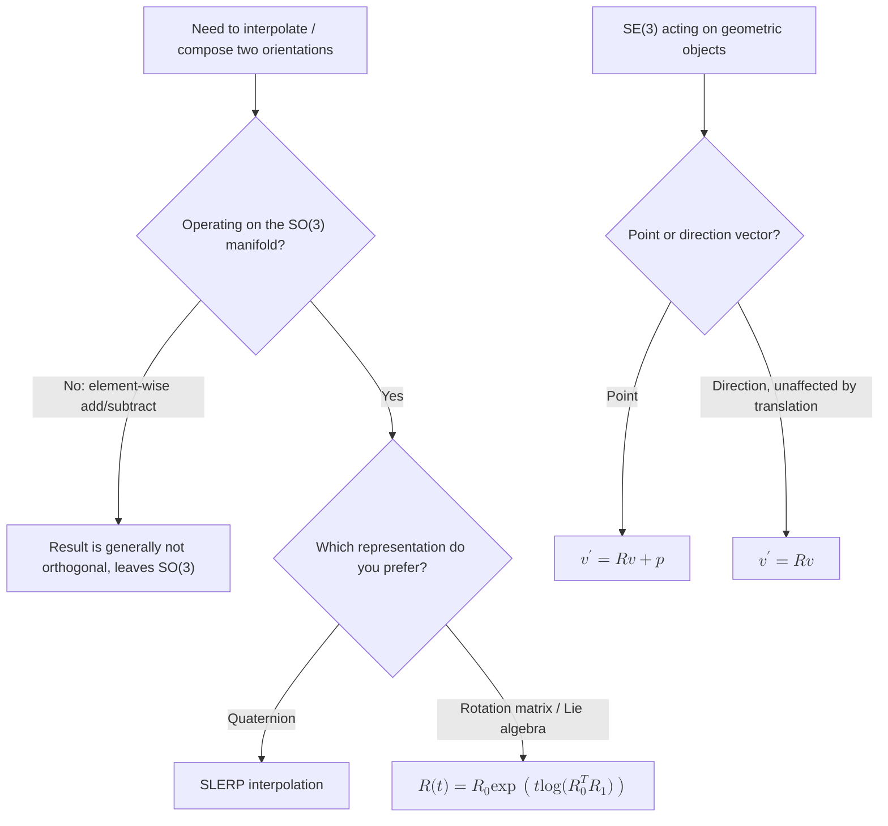

<ol>
<li><strong>Why R can't be directly added / interpolated:</strong> Rotation matrices belong to the SO(3) manifold (\(R^\top R=I,\ \det R=1\)), not a vector space; after element-wise addition or linear interpolation they are generally no longer orthogonal and leave SO(3). Interpolating orientations must be done on the manifold: quaternion SLERP, or on the Lie algebra \(R(t)=R_0\exp\!\big(t\log(R_0^\top R_1)\big)\).</li>
<li><strong>SE(3) acting on a point / vector:</strong> In homogeneous coordinates \(\tilde v' = g\,\tilde v\), which expands to \(v' = Rv + p\) (a point, affected by translation); if \(v\) is a free direction vector (unaffected by translation), it is only rotated: \(v' = Rv\). The key is to distinguish "point" from "direction".</li>
<li><strong>Matrix exponential / Euler angles / quaternions:</strong> Rotation matrix + matrix exponential has no singularities, composes directly, and is unified with twist / Lie algebra (PoE and the Jacobian are both based on it), but 9 numbers + 6 constraints is redundant; Euler angles use only 3 numbers and are intuitive, but have gimbal-lock singularities, are not unique, and interpolate poorly; quaternions use 4 numbers, have no singularities, and composition / SLERP is efficient and stable, but they have double cover (\(q\) and \(-q\) represent the same rotation). In engineering practice, use quaternions for internal computation, matrices / matrix exponentials for chained FK, and Euler angles only for human-readable input/output.</li>
</ol>
</details>

---

## L1 Robotics Backbone

**This is the foundation for everything that follows; if you skip it, you'll definitely have to come back and fill it in.**

> **Scenario metaphor:** Watching the joint angles of a robot arm change, can you immediately picture the trajectory traced by the end effector? L1 teaches you this translator: joint space ↔ task space.

> **Limits of the previous layer:** L0 lets you write matrix operations, but you don't yet know what mapping connects "the robot's joint angles" and "the end-effector pose"; L1 builds this translator.

### English Acronym Cheat Sheet (L1)

| Acronym | Full English name | Brief description |
|------|----------|----------|
| FK | Forward Kinematics | Joint angles → end-effector pose. |
| IK | Inverse Kinematics | End-effector target → joint angles; 6R arms often have multiple solutions. |
| DH | Denavit–Hartenberg | Classical link parameterization; this roadmap recommends PoE / twist instead. |
| PoE | Product of Exponentials | Describes open-chain FK with screw axes + matrix exponentials. |
| \(J\) / Jacobian | Manipulator Jacobian | Linear map from joint velocities → end-effector twist. |
| Twist | Spatial Velocity (6D) | Instantaneous rigid-body velocity (angular velocity + linear velocity). |
| Screw | Twist + Pitch | Screw motion; in PoE, the joint axis is the screw axis. |
| Wrench | Spatial Force (6D) | Six-dimensional generalized force of force + moment. |
| Ad | Adjoint Transformation | The \(6\times6\) matrix that transforms twists / wrenches between different frames. |

**This layer is best tackled in three steps; don't try to swallow it all at once:**

1. **L1.1 SE(3), rotations and rigid-body transforms** — describe "pose" clearly in math (rotation matrices, homogeneous transforms, Twist / Screw Axis, matrix exponential / PoE). This is the alphabet for everything that follows.
2. **L1.2 Forward and inverse kinematics (FK / IK)** — joint angles ↔ end-effector pose. First hand-write FK with the PoE formula to verify Pinocchio's output.
3. **L1.3 Jacobian and velocity kinematics** — joint velocities ↔ end-effector velocity, the difference between the space Jacobian and the body Jacobian; this is the entry key to L4 task-space control.

> These three steps share the single "What to do / What to read / What you should be able to produce" checklist below; just proceed in the order above.

### Prerequisites
- L0 content
- How a rigid body rotates in 3D space and how to describe its orientation

### Core questions
- What is the relationship between each joint angle of a robot and the end-effector position
- How to describe this mathematically
- What forward and inverse kinematics are
- Why twist, screw axis, and PoE are better suited than merely memorizing D-H parameters for connecting to Pinocchio / TSID / WBC later

### What to do
- Model a simple robotic arm with Pinocchio or Robotics Toolbox
- Write forward kinematics and inverse kinematics code
- Understand what the Jacobian matrix is
- Hand-write `FKinSpace` / `JacobianSpace` for a 2-3 DOF robotic arm using the Modern Robotics PoE formula, then align it with Pinocchio's output

### What to read
- [Modern Robotics](../../wiki/entities/modern-robotics-book.md) Ch 4-6: Forward Kinematics, Velocity Kinematics, Inverse Kinematics
- [Forward kinematics](../../wiki/formalizations/forward-kinematics.md) / [Inverse kinematics](../../wiki/formalizations/inverse-kinematics.md) / [Jacobian matrix](../../wiki/formalizations/robot-jacobian.md) (Shenlan "Fundamentals of Embodied Intelligence" 08–10)
- [Stanford "Introduction to Robotics" (Bilibili)](https://www.bilibili.com/video/BV17T421k78T/)
- Work through the official Pinocchio Tutorial
- [Humanoid Robot](../../wiki/entities/humanoid-robot.md)
- [Floating Base Dynamics](../../wiki/concepts/floating-base-dynamics.md)

### What you should be able to produce
- Be able to model a simple robot yourself and compute forward and inverse kinematics
- Be able to explain what the Jacobian matrix is in robotics and what it's used for
- Be able to distinguish the space Jacobian from the body Jacobian, and know how they enter the velocity/force mappings in task-space control

### Self-check questions (you should be able to answer after learning)
- Given the space Jacobian \(J_s\), how do you compute the body Jacobian \(J_b\)? How do their applications differ in task-space velocity control?
- How many IK solutions does a 6-DOF robotic arm generally have? Where do "elbow up / elbow down" come from?
- What is the biggest engineering advantage of the PoE formula over D-H parameters? Why are Pinocchio / TSID both built on twist / screw?

<details class="selftest-answers">
<summary>Reference answers (click to expand)</summary>

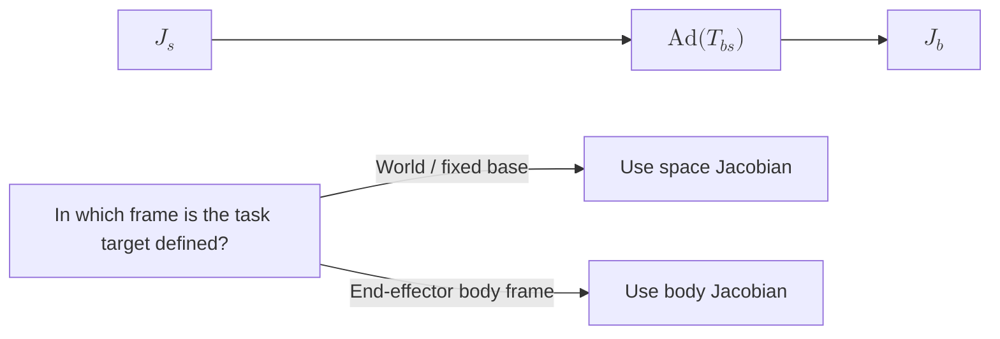

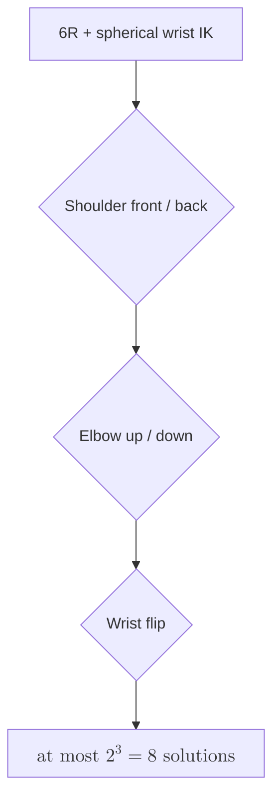

<ol>
<li><strong>space ↔ body Jacobian:</strong> \(J_b = [\mathrm{Ad}_{T_{bs}}]\,J_s\), where \(T_{bs}=T_{sb}^{-1}\) and \([\mathrm{Ad}]\) is the 6×6 adjoint matrix. \(J_s\) maps joint velocities to the end-effector twist "expressed in the fixed base frame", and \(J_b\) maps to the twist "expressed in the end-effector body frame". Use the Jacobian corresponding to the frame in which the target is defined: visual servoing / end-effector force control commonly use \(J_b\), world-frame targets use \(J_s\).</li>
<li><strong>Number of IK solutions:</strong> A 6R robotic arm with a spherical wrist has at most 8 solutions, coming from three binary choices: shoulder front / back, elbow up / down, wrist flip (\(2^3=8\)); a general 6R without a spherical wrist can have up to 16. "Elbow up / elbow down" comes from the \(\pm\) quadratic solution when solving for the elbow joint angle — for the same end-effector pose, the elbow can arch upward or downward.</li>
<li><strong>PoE vs D-H:</strong> PoE needs only each joint's screw axis + the zero-configuration pose; it is geometrically clear and doesn't require placing a D-H frame on every link (D-H is sensitive to the zero position / frame choice and unfriendly to tree structures and floating bases); moreover PoE naturally uses twist / screw, the same language as velocity kinematics (the Jacobian's columns are the transformed screw axes), wrenches, Lie groups / Lie algebras, and dynamics. Pinocchio / TSID are based throughout on twist / wrench / SE(3), so PoE connects seamlessly.</li>
</ol>
</details>

---

## L2 Dynamics and Rigid-Body Modeling

**Going from kinematics to dynamics is the most important leap in controlling robots.**

> **Scenario metaphor:** If you give the robot a torque, how will it move? L2 upgrades "geometric space" into "mechanical space" — moving from describing poses to describing the cause-and-effect relationship between motion and force.

> **Limits of the previous layer:** L1 kinematics only answers how "joint angular velocity ↔ end-effector velocity" is mapped, but cannot answer "how much torque is needed to produce this acceleration". Without dynamics, you can only do position control, and things fall apart once contact, high-speed motion, or force interaction come into play.

### English Acronym Cheat Sheet (L2)

| Acronym | Full English name | Brief description |
|------|----------|----------|
| RNEA | Recursive Newton–Euler Algorithm | Inverse dynamics: \((q,\dot q,\ddot q)\to\tau\), \(O(n)\). |
| CRBA | Composite Rigid Body Algorithm | Assembles the mass matrix \(M(q)\), \(O(n^2)\). |
| ABA | Articulated Body Algorithm | Forward dynamics: \(\tau\to\ddot q\), \(O(n)\), commonly used in simulation. |
| FB | Floating Base | The base is not fixed; a humanoid torso is a 6-DOF floating base. |
| CoM | Center of Mass | Center-of-mass position; closely related to centroidal momentum. |
| CMM | Centroidal Momentum Matrix | Map from generalized velocity → 6D centroidal momentum \(h_g=A_g\dot q\). |
| ID | Inverse Dynamics | Given the motion, find the required generalized forces. |
| FD | Forward Dynamics | Given generalized forces, find the accelerations. |

**This layer is best tackled in two steps:**

1. **L2.1 Single-rigid-body / fixed-base open-chain dynamics** — mass matrix \(M(q)\), Coriolis / gravity terms, forward and inverse dynamics (RNEA / CRBA / ABA). First get Pinocchio's API running, and verify against Modern Robotics Ch 8.
2. **L2.2 Floating-base and contact dynamics** — generalize fixed-base methods to humanoid robots with no fixed base + intermittent contact. Key points: floating-base state representation, how contact constraints are written as Jacobians, the physical meaning of the Centroidal Momentum Matrix.

> Important: you must understand L2.2 before entering L4, otherwise LIP / Centroidal MPC / WBC will all be "magic".

### Prerequisites
- L1 content (kinematics)
- A bit of calculus and ordinary differential equation intuition

### Core questions
- How joint torques drive robot motion
- What the mass matrix, gravity term, and Coriolis term are
- Why floating-base systems (the torso of a humanoid robot) can't use fixed-base methods
- How wrenches, the Jacobian transpose, and the principle of virtual work map task-space forces to joint torques

### What to do
- Write a single-rigid-body forward and inverse dynamics demo with Pinocchio
- Understand the basic form of centroidal dynamics
- Understand the state representation problem of floating-base systems
- Run `InverseDynamics` / `MassMatrix` / `ForwardDynamics` through the open-chain dynamics interface of Modern Robotics Ch 8, then compare against Pinocchio's RNEA / CRBA / ABA

### What to read
- [Modern Robotics](../../wiki/entities/modern-robotics-book.md) Ch 5, Ch 8: Statics, Dynamics of Open Chains
- Relevant chapters of Featherstone's "Robot Dynamics"
- The Centroidal section of the Pinocchio documentation
- [Floating Base Dynamics](../../wiki/concepts/floating-base-dynamics.md)
- [Gravity Compensation](../../wiki/concepts/gravity-compensation.md) — control usage of $g(q)=\mathrm{RNEA}(q,0,0)$
- [Centroidal Dynamics](../../wiki/concepts/centroidal-dynamics.md)
- [Contact Dynamics](../../wiki/concepts/contact-dynamics.md) / [Contact Wrench Cone](../../wiki/formalizations/contact-wrench-cone.md)

### Physical AI Perspective Supplement: Friction · Actuators · State Estimation

What the neural network ultimately controls is not an "ideal rigid body", but **motors + transmissions with friction, latency, and saturation**, and the state it sees is an **estimate** rather than the ground truth. These three things are the main sources of the L6 sim2real gap; establish the concepts first in L2:

- **Friction**: Coulomb + viscous + Stribeck; the larger the reducer, the more pronounced → [Joint friction models](../../wiki/concepts/joint-friction-models.md) / [Friction compensation](../../wiki/concepts/friction-compensation.md)
- **Actuators / motors**: torque constant, saturation, bandwidth, current loop; often idealized in simulation → [Explicit / implicit actuator modeling](../../wiki/concepts/implicit-explicit-actuator-modeling.md) / [Actuator Network](../../wiki/methods/actuator-network.md)
- **State estimation**: floating-base pose / velocity relies on IMU + encoder fusion, and the quality of the policy's observations depends on it → [State Estimation](../../wiki/concepts/state-estimation.md)

### What you should be able to produce
- Be able to explain the role of forward and inverse dynamics in robot control
- Be able to understand why centroidal dynamics matters
- Have an intuition for "what motion this torque will make the robot produce"
- Be able to write the relationship "task-space force / contact wrench → joint torques" in Jacobian-transpose form

### Self-check questions (you should be able to answer after learning)
- Write the standard form of the dynamics equation for a fixed-base open-chain robot, and explain the physical meaning of \(M(q)\), \(C(q,\dot q)\dot q\), and \(g(q)\) respectively.
- Why does the state of a floating-base system need \((q, \dot q, \text{base pose}, \text{base vel})\) rather than just \((q, \dot q)\)?
- Given the contact-point Jacobian \(J_c\) and the contact force \(f_c\) exerted by the environment on the robot, what is the corresponding generalized force? Why can't it be treated directly as the joint actuation torque in floating-base WBC?
- What does each of RNEA / CRBA / ABA compute, and how do their computational complexities differ? Which one would you use in a typical 1 kHz control loop in Pinocchio?

<details class="selftest-answers">
<summary>Reference answers (click to expand)</summary>

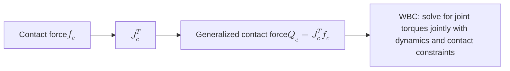

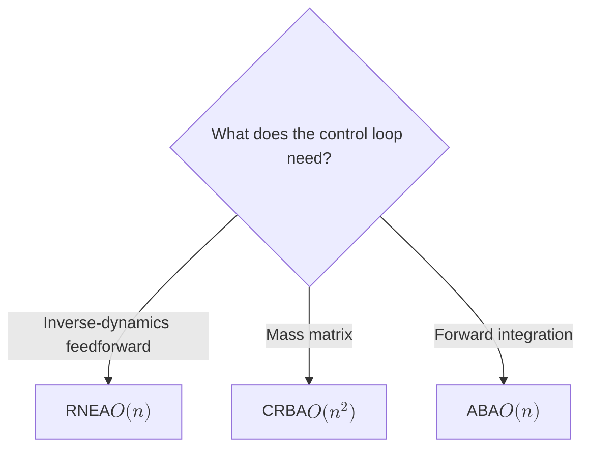

<ol>
<li><strong>Standard form of fixed-base dynamics:</strong> \(M(q)\ddot q + C(q,\dot q)\dot q + g(q) = \tau\). \(M(q)\): symmetric positive-definite mass / inertia matrix, characterizing the generalized force needed to produce acceleration (inertia); \(C(q,\dot q)\dot q\): Coriolis and centrifugal terms, arising from inertia varying with configuration and velocity coupling; \(g(q)\): generalized gravity force.</li>
<li><strong>Why a floating base needs base state:</strong> A floating-base torso has no fixed base, so its 6-dimensional pose is itself a free variable. Joint quantities \((q,\dot q)\) alone cannot express the whole robot's translation / rotation and momentum in the world, nor can you write balance constraints such as CoM / ZMP / contact, so the state must include base pose and base vel, with total dimension about \((n+6)\) for pose + \((n+6)\) for velocity.</li>
<li><strong>From contact force to generalized force:</strong> Virtual work gives \(Q_c = J_c^\top f_c\), where \(f_c\) is the contact force exerted by the environment on the robot. With a floating base, \(Q_c\) contains both base and joint components and cannot be directly equated with the joint actuation torque \(\tau\); it must satisfy \(M\dot v+h=S^\top\tau+J_c^\top f_c\), where \(v\) is the generalized velocity and \(S\) selects the actuated joints. WBC solves for \((\dot v,f_c,\tau)\) jointly with dynamics, contact kinematics, friction, and torque limits; the fixed-base statics relation for end-effector forces cannot directly replace this step.</li>
<li><strong>RNEA / CRBA / ABA:</strong> RNEA computes inverse dynamics (from \(q,\dot q,\ddot q\) to \(\tau\)), \(O(n)\); CRBA computes the mass matrix \(M(q)\), \(O(n^2)\); ABA computes forward dynamics (from \(\tau\) to \(\ddot q\)), \(O(n)\). A 1 kHz WBC loop needs inverse dynamics / torque feedforward, so use RNEA (paired with CRBA when \(M\) needs to be fed to the QP); ABA is mainly used for forward integration in simulators.</li>
</ol>
</details>

---

## L3 Control Basics and Optimization

**Without control theory, none of the later MPC / WBC / RL will connect.**

> **Scenario metaphor:** You can already compute "torque ↔ acceleration", but the question now is: at each specific moment, how much torque should be output so that the robot moves along **the trajectory you intend**? L3 upgrades "computing torque" into "deciding torque online".

> **Limits of the previous layer:** L2 dynamics tells you the physical relationship "input torque → output acceleration", but not "how much torque to input right now" — that is the controller's job. L3 is the underlying grammar for all methods in L4 (LIP / MPC / WBC).

### English Acronym Cheat Sheet (L3)

| Acronym | Full English name | Brief description |
|------|----------|----------|
| OCP | Optimal Control Problem | Optimal control problem; the mathematical shell of MPC / TrajOpt. |
| PID | Proportional–Integral–Derivative | Classical feedback; the fallback for joint-level tracking. |
| LQR | Linear Quadratic Regulator | Infinite-horizon linear quadratic optimal feedback \(u=-Kx\). |
| MPC | Model Predictive Control | Finite-horizon receding optimization; can include constraints. |
| QP | Quadratic Programming | Quadratic programming; the core solution form for WBC / convex MPC. |
| HQP | Hierarchical Quadratic Programming | Hierarchical QP; implements task priorities via null spaces. |
| PD | Proportional–Derivative | Proportional–derivative control; often used together with computed torque. |
| CT | Computed Torque Control | Tracks a desired trajectory with inverse-dynamics feedforward + feedback. |

### Prerequisites
- L2 content (dynamics)
- A bit of numerical optimization intuition (see [Numerical Optimization Curriculum](../../wiki/entities/numerical-optimization-curriculum.md))

### Core questions
- What problem each of PID / LQR / MPC solves
- What QP (quadratic programming) is, and why it's everywhere in robot control
- What the core idea of optimal control is
- Which layer of the control stack trajectory generation, feedback control, and constrained optimization each sit in

### What to do
- Write an LQR controller for an inverted pendulum in Python
- Run a simple QP with qpOASES or OSQP
- Understand the receding-horizon idea of MPC
- Reproduce the cubic/quintic time-scaling trajectories of Modern Robotics Ch 9, and add PD / computed torque tracking to a robotic-arm end-effector trajectory

### What to read
- [Modern Robotics](../../wiki/entities/modern-robotics-book.md) Ch 9, Ch 11: Trajectory Generation, Robot Control
- [Underactuated Robotics](https://underactuated.mit.edu/) (Tedrake's online lecture notes; Chapter 8 LQR, Chapter 10 trajectory optimization)
- Relevant chapters of "Robotics: Modelling, Planning and Control" - Siciliano
- [LQR](../../wiki/formalizations/lqr.md)
- [Optimal Control](../../wiki/concepts/optimal-control.md)
- [Model Predictive Control (MPC)](../../wiki/methods/model-predictive-control.md) / [Trajectory Optimization](../../wiki/methods/trajectory-optimization.md)
- [Whole-Body Control](../../wiki/concepts/whole-body-control.md) / [HQP](../../wiki/concepts/hqp.md) / [Null-space control](../../wiki/concepts/null-space-control.md)
- [Numerical Optimization Curriculum](../../wiki/entities/numerical-optimization-curriculum.md) (numerical optimization L0+ course map), [CMU Optimal Control 2025](../../wiki/entities/cmu-optimal-control-curriculum.md) (curation of the public 16-745 recordings)

<a id="policy-vs-low-level-controller"></a>

### Policy ≠ Low-Level Controller: From q_target to Motor Torque

**A learning policy and a low-level controller are not the same thing.** The vast majority of humanoid RL / VLA policies do not output current directly; instead they output joint targets, and a low-level controller closes the loop:

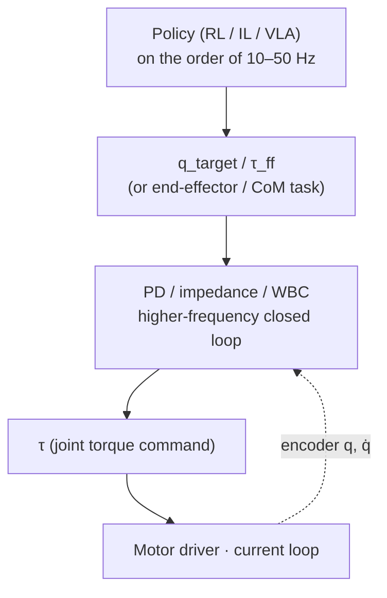

The most common layer is joint PD ("MIT-style PD", often called MIT mode: the drive simultaneously receives five quantities \(q_{des}, \dot q_{des}, K_p, K_d, \tau_{ff}\) and closes the loop inside the drive; this interface form became widespread with the open-source drivers of [MIT Mini Cheetah](../../wiki/entities/mit-mini-cheetah.md)):

$$\tau = K_p\,(q_{des} - q) + K_d\,(\dot q_{des} - \dot q) + \tau_{ff}$$

| Control mode | What the upper layer provides | Suited for | Relationship to the policy |
|---------|-----------|------|-----------------|
| **Position Control** | \(q_{des}\) (high gain) | Industrial arms, slow precise positioning | Very stiff, poor at handling contact impacts |
| **Velocity Control** | \(\dot q_{des}\) | Wheeled robots, mobile bases | Rarely used for humanoid joints |
| **Torque Control** | \(\tau\) | WBC / force control / highly dynamic motion | Requires accurate dynamics and motor models |
| **Impedance / PD (MIT-style)** | \(q_{des}, K_p, K_d, \tau_{ff}\) | Mainstream action space for humanoid RL | Policy outputs \(q_{des}\); \(K_p, K_d\) determine "softness/stiffness" |
| **Whole-Body Control / QP / MPC** | Task-space targets | Multi-contact, multi-task | See [L4](#l4-humanoid-motion-control-backbone); can also serve as the layer below the policy |

- The point is not the formula derivation, but this: **swap in a different set of \(K_p, K_d\) or a different control frequency for the same policy, and the real-robot behavior changes** — this is the first class of pitfalls in L6 sim2real.
- Further reading: [PID Control](../../wiki/methods/pid-control.md) · [Impedance control](../../wiki/concepts/impedance-control.md) · [Computed Torque Control](../../wiki/methods/computed-torque-control.md) · [How to set PD gains for humanoid RL](../../wiki/queries/legged-humanoid-rl-pd-gain-setting.md)

### What you should be able to produce
- Be able to explain the difference between LQR and MPC
- Be able to understand what problem QP solves in WBC
- Be able to build an MPC for a simple model yourself
- Be able to explain the relationship between computed torque, PD, impedance control, and later WBC task control

### Self-check questions (you should be able to answer after learning)
- Under what conditions do LQR and MPC yield the same feedback law? Why does a finite horizon or trajectory tracking by itself not imply that MPC must be used?
- Given a QP problem, how do you determine whether it is convex? Why does WBC strongly favor convex QPs?
- How is the "priority" of HQP (Hierarchical QP) implemented mathematically (hint: null-space projection)?
- What is the essential difference between impedance control and admittance control? When do you use the former, and when the latter?

<details class="selftest-answers">
<summary>Reference answers (click to expand)</summary>

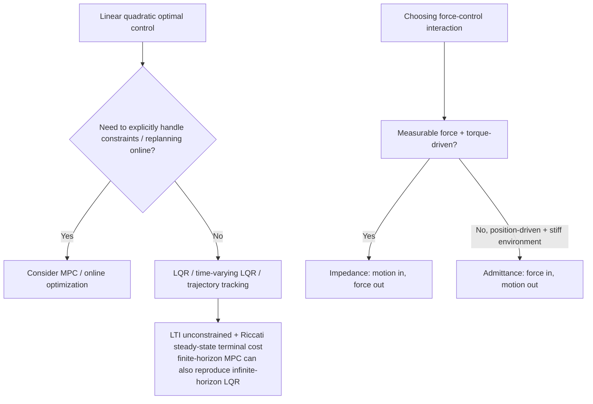

<ol>
<li><strong>When LQR and MPC are equivalent:</strong> For a linear time-invariant, unconstrained discrete system, if \((A,B)\) is stabilizable, \((A,Q^{1/2})\) is detectable, and \(Q\succeq0,R\succ0\), then the stabilizing Riccati solution \(P_\infty\) of infinite-horizon LQR can serve as the terminal cost of finite-horizon MPC, so that each first-step control is likewise \(u=-Kx\); there is no need to let the prediction horizon go to infinity. Finite horizons, time-varying models, and trajectory tracking can also be handled with time-varying LQR / linear quadratic tracking; consider MPC only when constraints must be handled explicitly online or repeated replanning is needed — these scenarios cannot all be written off as "MPC is required".</li>
<li><strong>Determining QP convexity:</strong> If the Hessian of the objective is positive semidefinite (\(P\succeq0\) in \(\tfrac12 x^\top P x\)) and the constraints are affine equalities/inequalities, it is a convex QP. When an optimal solution exists, any local optimum is also a global optimum; <strong>positive semidefinite does not guarantee uniqueness</strong>, and strict convexity (e.g. \(P\succ0\)) is a sufficient condition for uniqueness. WBC exploits sparse structure and warm starts in solving, but whether it reaches 1 kHz must still be measured against the problem size, solver tolerance, and worst-case time; it cannot be inferred directly from convexity.</li>
<li><strong>Mathematical implementation of HQP priorities:</strong> Use null-space projection: first solve the highest-priority task, and lower priorities can only optimize within the null space that does not disturb higher priorities — \(\dot q = J_1^{+}\dot x_1 + N_1 z\), where \(N_1 = I - J_1^{+}J_1\) is the null-space projector of task 1, projected layer by layer. Equivalently, a multi-level QP takes the upper level's optimal value as an equality constraint for the lower level (lexicographic solving).</li>
<li><strong>Impedance vs admittance:</strong> The essence is opposite causality. Impedance control "takes motion as input, outputs force": it generates force from position / velocity deviation via \(F=K\Delta x + D\Delta\dot x\) (torque-driven actuators; if the environment is stiff, the robot itself is compliant); admittance control "takes force as input, outputs motion": it generates a position reference from the measured external force (position-driven actuators). Use impedance when the environment is soft / unknown and high-bandwidth compliance and collision safety are needed (humanoid legs); use admittance when actuators can only do precise position control, face a stiff environment, and need high position accuracy (industrial assembly).</li>
</ol>
</details>

---

## L4 Humanoid Motion Control Backbone

**This is the core of this roadmap.**

> **Scenario metaphor:** You can already do position control for a robotic arm, but a humanoid robot has no fixed base and must constantly switch support feet — L4 teaches you to reorganize "general control theory" into a layered method chain "designed specifically for humanoids".

> **Limits of the previous layer:** L3 methods (PID / LQR / MPC / QP) are straightforward on fixed-base robots, but a humanoid is a floating base + intermittent contact + high-dimensional underactuated system, so they can't be applied directly; you need dedicated simplified models (LIP / Centroidal) and a layered structure (MPC + WBC).

### L4.0 Bridge: How to String L1–L3 into the L4 Method Chain

L4 is the steepest step in this roadmap. **Before entering L4.1, building a mental model of "why this order" is far more important than diving straight into each sub-method.**

The core tension of humanoid control is: **whole-body dynamics is too high-dimensional, strongly nonlinear, and dense with contact switches** — the general LQR / MPC learned in L3 can't simply be applied. The solution is not to invent new math, but to decompose along two axes: "models from coarse to fine, control from slow to fast":

| Axis | Meaning | Examples |
|---|---|---|
| **Model granularity** | How many state variables are used to describe the robot | LIP (3-dim) → Centroidal (6-dim momentum + contact forces) → whole-body dynamics (n+6-dim) |
| **Control frequency** | On which time scale decisions are made | Footstep / high-level planning (1–10 Hz) → MPC (50–200 Hz) → WBC (1 kHz) |

The L4 method chain simply **chains** these two axes together:

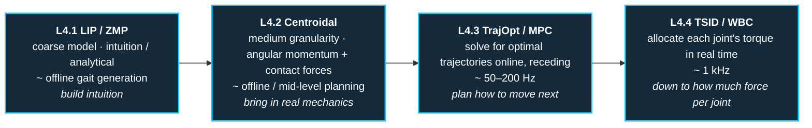

When learning each sub-method, always check whether you've really understood it with three things:

1. **Principle**: what are this method's state, constraints, and objective function
2. **Minimal code**: can you get the core loop running with a small example
3. **Limitations**: under what circumstances does it fail, and why does the next layer's method still need to take over

**Where Modern Robotics fits in L4:**

- Ch 3–5 provide a unified language for task-space pose, twist, Jacobian, and wrench
- Ch 8 explains open-chain dynamics, helping you understand the inverse-dynamics terms in Pinocchio / TSID
- Ch 9 explains trajectory generation, the low-dimensional entry point to MPC / trajectory optimization
- Ch 11 explains computed torque, motion control, and force control, prerequisite material for understanding the WBC task layer

> Modern Robotics itself is not a humanoid locomotion textbook; it won't directly teach LIP/ZMP, centroidal MPC, or floating-base contact switching; it's more like the "grammar book" for this main roadmap. When studying L4, if coordinate transforms, Jacobians, wrenches, or inverse dynamics are unclear, go back to the corresponding chapter to fill in.

#### Method Family Comparison Table (L4 + L5 at a Glance)

This table answers "how exactly are these terms related, and which scenarios does each apply to". **Outsiders can build a first-hand mental map from here, and experienced readers can use it to check their own classification.**

| Method | State / model granularity | Main constraints | Solver | Typical frequency | Typical use | Typical limitations |
|------|---------------|---------|--------|---------|---------|---------|
| **PID** | Joint-angle error | — | Analytical | 1 kHz+ | Single-joint closed loop, basic fallback | Can't handle coupling / multiple constraints |
| **LQR** | Linearized state space | — | Riccati equation | 100 Hz+ | Balance-control baseline, teaching | Model must be linearized |
| **LIP / ZMP** | 3-dim CoM + ZMP | Support polygon | Preview Control / analytical | Offline / 100 Hz | Flat-ground gait, balance criterion | Ignores angular momentum, ignores height changes |
| **Capture Point / DCM** | CoM + divergent momentum | Support polygon | Analytical | 100 Hz | Real-time balance criterion, foot placement decisions | Same assumptions as LIP |
| **Centroidal Dynamics** | 6D CoM momentum + contact forces | Contact force cone | QP / NLP | 50–200 Hz | Mid-level MPC model | Still not whole-body, needs WBC |
| **Trajectory Optimization** | Whole-body state trajectory | Full dynamics + contact | DDP / iLQR / IPOPT | Offline / slow | Generating reference trajectories offline / parkour | Not real-time, sensitive to initial guess |
| **MPC** | Simplified model / Centroidal | Full constraints | OSQP / qpOASES / Crocoddyl | 50–500 Hz | Online gait + contact-force planning | Model simplification error, real-time challenges |
| **TSID / WBC** | Whole-body joint accelerations | Contact + joint limits + task priorities | HQP / multi-level QP | 1 kHz | Turning MPC references into per-joint torques | Relies on accurate dynamics |
| **PPO** (RL) | Neural network policy | reward + curriculum + DR | Gradient + simulation data | Slow training / fast deployment | End-to-end gait, parkour, complex terrain | sim2real gap, not interpretable |
| **BC / IL** | Neural network policy | Supervised data | SGD | Slow training / fast deployment | Manipulation, transferring complex motions | compounding error |
| **DAgger** | BC + interactive queries | Same as BC + online correction | SGD + simulation queries | Slow training | Mitigating BC compounding | Needs a queryable expert |
| **AMP / Motion Prior** | RL + adversarial discriminator | reward + style discrimination | Gradient + adversarial | Slow training / fast deployment | Stylized motion, imitating MoCap | High data collection cost |
| **Diffusion Policy** | Neural network generating action sequences | Supervised data | Denoising | Slow training / medium deployment | Multimodal manipulation, grasping | Inference latency, high training data requirements |

**How to read this table**:
- Top half (PID → WBC) = model-based, stacked from coarse to fine, from slow to fast
- Bottom half (from PPO on) = learning-based, usually filling in parts that model-based methods struggle with (high-dimensional, hard to model explicitly, stylized)
- Real systems are usually **hybrid**: MPC + WBC + RL policy prior + IL data initialization

### L4.1 LIP / ZMP

> **Scenario metaphor:** Imagine walking a tightrope — your body's center of mass must always stay within the small support area under your feet, or you'll fall. LIP/ZMP is the mathematization of exactly this.

> **Limits of the previous layer:** L3 gave you general tools like LQR / MPC, but humanoid dynamics has dozens of state variables and is strongly nonlinear, so applying them directly is too heavy. LIP / ZMP is an **extremely simplified model** (treating the whole robot as "an inverted pendulum that walks"), letting you understand walking and balance with the fewest assumptions.

#### English Acronym Cheat Sheet (L4.1)

| Acronym | Full English name | Brief description |
|------|----------|----------|
| LIP | Linear Inverted Pendulum | Linear inverted pendulum model with fixed CoM height. |
| ZMP | Zero Moment Point | Balance criterion point within the support polygon. |
| DCM | Divergent Component of Motion | \(\xi=x+\dot x/\omega\); the unstable mode. |
| CP | Capture Point | Foot placement point where stepping lets the robot asymptotically come to a stop. |
| CoM | Center of Mass | Center of mass; LIP horizontal dynamics are built around it. |
| CoP | Center of Pressure | Center of pressure under the foot. |
| SP | Support Polygon | Support polygon; the ZMP must stay inside it. |

**Prerequisites:** [L2 Dynamics and rigid-body modeling](#l2-dynamics-and-rigid-body-modeling) + [L3 Control basics and optimization](#l3-control-basics-and-optimization)

**Core questions:** How does a biped robot walk on the ground without falling

**What to do:**
- Implement the simplest ZMP gait generation
- Generate a CoM trajectory with the LIP model

**What to read:**
- Kajita et al., "Biped walking pattern generation by using preview control of zero-moment point"
- [LIP / ZMP](../../wiki/concepts/lip-zmp.md)
- [Capture Point / DCM](../../wiki/concepts/capture-point-dcm.md)
- [ZMP / LIP formalization](../../wiki/formalizations/zmp-lip.md)

**What you should be able to produce:**
- Be able to explain the relationship between the ZMP and the support polygon
- Be able to generate a simple walking trajectory with the LIP model

**Self-check questions:**
- Why does the LIP model need to assume a fixed CoM height? How does this assumption break down during jumping / going up and down stairs?
- When does the ZMP leave the support polygon during walking? In engineering practice, how would you detect this from data?
- What additional problem does DCM / Capture Point solve compared with ZMP?

<details class="selftest-answers">
<summary>Reference answers (click to expand)</summary>

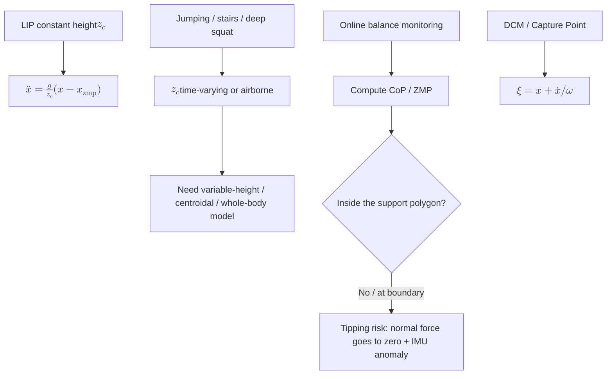

<ol>
<li><strong>Why LIP assumes a fixed CoM height:</strong> With a constant height \(z_c\), the horizontal dynamics linearize to \(\ddot x = \tfrac{g}{z_c}\,(x - x_{\mathrm{zmp}})\), which is analytically solvable, with a linear relationship between CoM and ZMP. During jumping the CoM height changes drastically or the robot is even airborne (contact force is zero), and when going up/down stairs / squatting deeply \(z_c\) keeps changing; this linear relationship breaks down, requiring a variable-height model or centroidal / whole-body dynamics.</li>
<li><strong>ZMP leaving the support polygon:</strong> When the ZMP touches / goes beyond the support polygon, the robot is about to tip over (the foot rotates about an edge, single-edge contact), and the normal force on that side of the sole goes to zero. In engineering practice, compute the CoP in real time from foot force / torque sensors or pressure arrays (ZMP = CoP during contact) and check whether it reaches the boundary; or detect the normal force on one side of the sole going to zero, combined with unexpected angular acceleration appearing on the IMU.</li>
<li><strong>What DCM / Capture Point additionally solves:</strong> It separates out the unstable divergent mode in LIP: \(\xi = x + \dot x/\omega\). It answers in a forward-looking way "where should the foot step to stop in one step" (the Capture Point is the foot placement that lets the CoM asymptotically come to rest), focusing control on the single unstable first-order mode; this makes it better suited than ZMP — which only judges "whether it's stable right now" — for real-time foot placement planning and disturbance recovery.</li>
</ol>
</details>

---

### L4.2 Centroidal Dynamics

> **Scenario metaphor:** LIP treats the humanoid as "a pole that walks". But in reality, waving arms, twisting the waist, and lifting legs all generate angular momentum, which the pole model can't explain — L4.2 gives you an intermediate model that's "neither too heavy nor too light".

> **Limits of the previous layer:** L4.1's LIP simplifies away angular momentum, ignores the swing-leg mass, and treats the support polygon as a static constraint; none of these can be ignored when a real robot walks. Centroidal Dynamics projects the whole robot onto the 6D CoM momentum space — more accurate than LIP, yet simpler than whole-body dynamics.

#### English Acronym Cheat Sheet (L4.2)

| Acronym | Full English name | Brief description |
|------|----------|----------|
| CMM | Centroidal Momentum Matrix | \(h_g=A_g(q)\dot q\); 6D centroidal momentum map. |
| CoM | Center of Mass | The core quantity of CoM position and momentum state. |
| AM | Angular Momentum | Angular momentum; ignored by LIP, explicitly retained by centroidal. |
| LM | Linear Momentum | Linear momentum. |
| MOR | Model Order Reduction | Model order reduction; how centroidal is positioned relative to whole-body dynamics. |
| Wrench | Spatial Contact Wrench | 6D force / moment at a contact point; drives momentum change. |

**Prerequisites:** [L4.1 LIP / ZMP](#l41-lip--zmp)

**Core questions:** LIP simplifies too aggressively; how do you describe real humanoid balance and contact forces

**What to do:**
- Model a humanoid robot with centroidal dynamics
- Understand what the centroidal momentum matrix is

**What to read:**
- Orin et al., "Centroidal dynamics of a humanoid robot"
- [Centroidal Dynamics](../../wiki/concepts/centroidal-dynamics.md)
- [Contact Dynamics](../../wiki/concepts/contact-dynamics.md)

**What you should be able to produce:**
- Be able to explain the difference between centroidal dynamics and LIP
- Understand the roles of linear momentum and angular momentum in balance control

**Self-check questions:**
- What are the dimensions of the Centroidal Momentum Matrix \(A_g(q)\)? What does its null space mean physically?
- Why is Centroidal Dynamics a kind of "model order reduction"? What information from the original whole-body dynamics does it lose?
- Using Centroidal Dynamics vs whole-body dynamics in MPC, by how many orders of magnitude does the solve latency differ?

<details class="selftest-answers">
<summary>Reference answers (click to expand)</summary>


<ol>
<li><strong>CMM dimensions and null space:</strong> \(A_g(q)\) is 6×(n+6) (floating base, n joints + 6-dim base), mapping the generalized velocity to the 6-dim centroidal momentum (3 linear momentum + 3 angular momentum): \(h_g = A_g(q)\dot q\). Its null space consists of internal self-motions that "don't change the whole robot's linear / angular momentum" (e.g. symmetric arm swings canceling each other out, internal reconfiguration about the CoM), i.e. the degrees of freedom under momentum conservation.</li>
<li><strong>Why it's model order reduction:</strong> It projects \((n+6)\)-dim whole-body dynamics onto the 6-dim centroidal momentum space, keeping only "net external force / moment = rate of change of momentum" \(\big(\dot h_g = \textstyle\sum \text{wrench} + mg\big)\), capturing the quantities most critical to balance with few states. What it loses is the specific configuration of each limb / the joint-level distribution (the same momentum can be achieved by infinitely many configurations), joint limits, and collisions — these are recovered by the lower-level WBC.</li>
<li><strong>How much the solve latency differs:</strong> Centroidal (6-dim + contact forces, medium-sized convex QP / NLP) takes roughly sub-millisecond to a few milliseconds per solve and can run online at 50–200 Hz; whole-body dynamics MPC (a nonlinear OCP of \((n+6)\) dimensions with full constraints) often takes tens to over a hundred milliseconds; the two differ by about 1–2 orders of magnitude. Hence the online layer mostly uses centroidal / simplified models, while whole-body dynamics is mostly used for offline trajopt or at low frequency.</li>
</ol>
</details>

---

### L4.3 Trajectory Optimization / MPC

> **Scenario metaphor:** You saw your foot slip a second ago — can you anticipate where to step over the next 2 seconds and change the gait in real time? MPC is the mathematization of exactly this: turning "a short window of future time" into an optimization problem solved in a receding manner.

> **Limits of the previous layer:** L4.2's Centroidal Dynamics gives you a set of equations, but **using these equations to plan CoM trajectories and contact forces online** requires adding another layer of optimization (Trajectory Optimization or MPC). This is the transition from "model" to "controller".

#### English Acronym Cheat Sheet (L4.3)

| Acronym | Full English name | Brief description |
|------|----------|----------|
| MPC | Model Predictive Control | Receding-horizon optimal control; only the first segment of control is executed at each step. |
| TrajOpt | Trajectory Optimization | Optimizes over an entire or long-horizon state–control trajectory. |
| OCP | Optimal Control Problem | Problem formulation of dynamics + cost + constraints. |
| NLP | Nonlinear Programming | Nonlinear programming; commonly used for non-convex whole-body TrajOpt. |
| DDP | Differential Dynamic Programming | Differential dynamic programming; a local TrajOpt method. |
| iLQR | Iterative Linear Quadratic Regulator | Iterative LQR; locally linearized TrajOpt. |
| RH | Receding Horizon | Receding horizon; the key idea for making MPC and TrajOpt online. |

**Prerequisites:** [L4.2 Centroidal Dynamics](#l42-centroidal-dynamics) + [L3 Control basics and optimization](#l3-control-basics-and-optimization)

**Core questions:** How to plan a whole CoM trajectory and contact forces, and how to do MPC online

**What to do:**
- Implement a centroidal MPC with CasADi or Crocoddyl
- Get a biped walking MPC running in simulation

**What to read:**
- Di Carlo et al., "Dynamic Locomotion in the MIT Cheetah 3 Through Convex Model-Predictive Control" (IROS 2018, [DOI 10.1109/IROS.2018.8594448](https://doi.org/10.1109/IROS.2018.8594448)) — the representative work on convex MPC (quadruped)
- Li & Nguyen, "Force-and-moment-based Model Predictive Control for Achieving Highly Dynamic Locomotion on Bipedal Robots" ([arXiv:2104.00065](https://arxiv.org/abs/2104.00065)) — the same idea applied to bipeds
- [Trajectory Optimization](../../wiki/methods/trajectory-optimization.md)
- [Model Predictive Control (MPC)](../../wiki/methods/model-predictive-control.md)
- [MPC tuning guide](../../wiki/queries/mpc-tuning-guide.md)
- [MPC solver selection](../../wiki/queries/mpc-solver-selection.md)

**What you should be able to produce:**
- Be able to implement a simplified centroidal MPC
- Be able to explain the reasoning behind prediction horizon, cost function design, and constraint handling

**Self-check questions:**
- Given an MPC that runs unstably (e.g. gait jitter), what is your first-hand troubleshooting order?
- What is the key difference between Trajectory Optimization and MPC? Why are these two terms often used interchangeably in humanoids?
- What tasks are Convex MPC and Nonlinear MPC each suited for? How are contact switches handled?

<details class="selftest-answers">
<summary>Reference answers (click to expand)</summary>

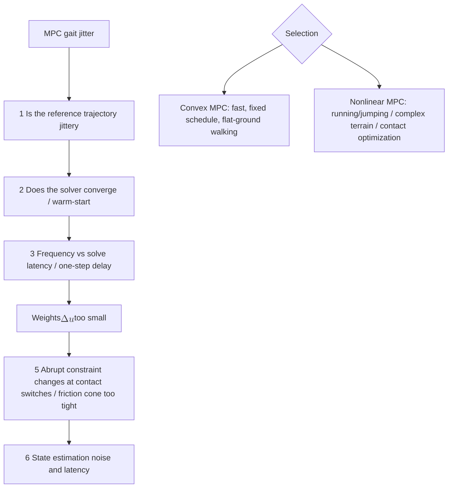

<ol>
<li><strong>Troubleshooting order for MPC jitter:</strong> From outside in — ① whether the reference itself is jittery (discontinuous upstream footstep / CoM trajectory); ② whether the solver truly converges / hits the iteration limit, and whether there's a warm-start; ③ timing: control frequency, solve latency, whether one-step delay is compensated; ④ weights: tracking too stiff while smoothing / regularization too soft causes high-frequency oscillation in the control input, add a \(\Delta u\) penalty; ⑤ model / constraints: abrupt constraint changes at contact switches, friction cone / ZMP constraints too tight; ⑥ state estimation noise / latency introducing feedback jitter.</li>
<li><strong>Difference between TrajOpt and MPC:</strong> Trajectory Optimization is mostly offline, solving for one optimal trajectory over the whole horizon at once (can use whole-body dynamics, long horizons, sensitive to initial guess); MPC runs online in a receding manner — each cycle it solves a short-horizon OCP, executes only the first step and then replans (receding horizon), relying on feedback to reject disturbances. They are often used interchangeably in humanoids because what the MPC core solves at each step is precisely a small trajectory optimization with the same mathematical form (OCP); the difference is only "offline once vs online receding + whether real-time".</li>
<li><strong>Convex vs Nonlinear MPC:</strong> Convex MPC (linear / convexified model + convex constraints) solves fast and deterministically, suited to periodic flat-ground walking and high-frequency real-time use; contact switches rely on a pre-specified contact schedule, and contact forces are subject to linearized friction-cone constraints; Nonlinear MPC (full / nonlinear dynamics) suits running and jumping, complex terrain, and simultaneous optimization of contact forces and posture; contact switches can use a predefined timing or complementarity constraints / phase optimization, at the cost of being non-convex, slow, and sensitive to initial guess.</li>
</ol>
</details>

---

### L4.4 TSID / Whole-Body Control

> **Scenario metaphor:** The MPC has already told you "where the CoM should be, where the feet should go, how the torso orientation changes" — but among the humanoid's 25 joints, who moves first and who moves later? Who yields to safety constraints? WBC is this arbiter, solving a QP / HQP every control cycle to allocate each joint's torque.

> **Limits of the previous layer:** L4.3's MPC outputs CoM / contact force / end-effector task references, and **does not directly tell you how much torque each joint should produce**. WBC is the final step that "lands" upper-level planning onto lower-level execution.

#### English Acronym Cheat Sheet (L4.4)

| Acronym | Full English name | Brief description |
|------|----------|----------|
| TSID | Task-Space Inverse Dynamics | Task-space framework for solving \(\tau,f\) under dynamics and contact constraints. |
| WBC | Whole-Body Control | Real-time whole-body multi-task, multi-constraint torque allocation. |
| HQP | Hierarchical Quadratic Programming | Hierarchical QP with strict task priorities. |
| QP | Quadratic Programming | The convex optimization core of weighted WBC. |
| ID | Inverse Dynamics | Given \(\ddot q\), solve for \(\tau\); part of the WBC equality constraints. |
| IC | Impedance Control | Shaping the force–motion relationship; often high priority for contact safety. |

**Prerequisites:** [L4.3 Trajectory Optimization / MPC](#l43-trajectory-optimization--mpc)

**Core questions:** How does the reference trajectory planned by the upper layer become the force each joint should produce

**What to do:**
- Implement a whole-body task controller with the TSID library
- Handle torso stabilization, foot tracking, and contact constraints simultaneously

**What to read:**
- Del Prete et al., "Prioritized motion-force control of constrained fully-actuated robots"
- [TSID](../../wiki/concepts/tsid.md)
- [TSID Formulation](../../wiki/formalizations/tsid-formulation.md)
- [Whole-Body Control](../../wiki/concepts/whole-body-control.md)
- [WBC implementation guide](../../wiki/queries/wbc-implementation-guide.md)
- [WBC tuning guide](../../wiki/queries/wbc-tuning-guide.md)

**What you should be able to produce:**
- Be able to implement a multi-level-priority WBC with the TSID framework
- Be able to explain how task-space targets are mapped to joint torques

**Self-check questions:**
- What constraints typically appear in the TSID QP (write 2 each of equality / inequality)? What does the objective function usually look like?
- When the CoM reference output by the upper-level MPC conflicts with WBC's contact constraints, what happens? How do you handle it with task priorities?
- Why is impedance control often placed at a higher-priority level among WBC tasks?

<details class="selftest-answers">
<summary>Reference answers (click to expand)</summary>

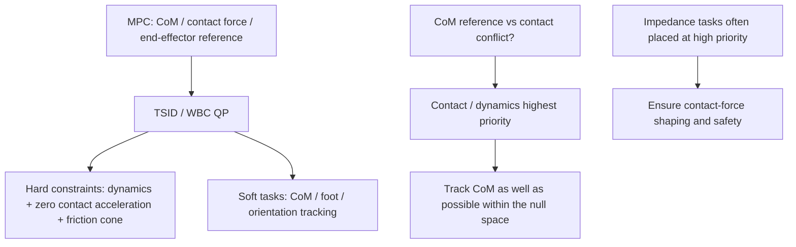

<ol>
<li><strong>Constraints and objective of the TSID QP:</strong> Equalities, e.g.: ① floating-base dynamics consistency \(M\ddot q + h = S^\top \tau + J_c^\top f\); ② zero acceleration at rigid contacts \(J_c\ddot q + \dot J_c\dot q = 0\). Inequalities, e.g.: ① contact forces lie within the friction cone; ② joint torque / position / velocity limits (or ZMP within the support polygon). The objective function is usually the sum of weighted quadratic tracking errors of the tasks \(\sum_i w_i\lVert J_i\ddot q + \dot J_i\dot q - \ddot x_i^{\mathrm{des}}\rVert^2\) (CoM, feet, torso orientation, posture regularization) plus regularization on \(\tau,f\).</li>
<li><strong>Conflict between the CoM reference and contact constraints:</strong> If contact / dynamics consistency is set as a hard constraint, WBC will prioritize keeping contact feasible, and the CoM reference is only tracked "as well as possible", resulting in steady-state error or clipping. Handling: use task priorities — contact / dynamics at the highest (hard constraints), CoM tracking as a lower-priority soft task, optimally approximated within the null space that doesn't violate contact; HQP is strictly hierarchical, while weighted QP approximates the hierarchy with large weights; if necessary, the upper-level MPC adjusts the reference based on feedback.</li>
<li><strong>Why impedance often sits at high priority:</strong> Impedance / compliance directly affects contact stability and interaction safety. If it's overridden by lower-priority position tasks, this easily leads to unstable contact forces, stiff collisions, or contact jumps; placing contact / end-effector impedance behavior at a higher level ensures that no matter how the lower levels optimize posture, contact forces are always well shaped, so the robot interacts with the environment safely and compliantly.</li>
</ol>
</details>

---

## L5 Reinforcement Learning and Imitation Learning

**After finishing L4, you should have a complete understanding of model-based control. L5 is another path: learning-based.**

> **Scenario metaphor:** L4 is "I already know the physics + know the goal" and compute a control law; L5 goes the other way — letting the robot **figure out a policy by itself through trial** (RL) or **learn one by imitating humans** (IL).

> **Limits of the previous layer:** L4's classical control requires accurate modeling + an explicit objective function; for tasks dense with contact switches and whose goals are hard to write as cost functions (running, jumping, complex terrain, manipulation), development cycles are long. RL / IL fill this gap with data — but they can't replace the structural understanding of L4, otherwise you'll only be able to tune hyperparameters.

The most common pitfall at this stage is treating RL / IL as a shortcut to "skip modeling". A more solid way to learn is:
- Treat RL / IL as a **capability extension layer**, not a master key that replaces all control structures
- Always ask: is what this policy learned high-level decision-making, low-level tracking, or a mix of both
- When you run into sim2real, contact switching, or interpretability problems, go back to the model and constraint perspective of L4 and re-examine the problem

### L5.0 Bridge: From "Signposts" to a Minimal Closed Loop of Runnable Code

Before diving into PPO tuning, it's recommended to first align the [MDP five-tuple](../../wiki/formalizations/mdp.md) with simulation stepping using a **~50-line script** — see [Embodied RL minimal closed loop](../../wiki/concepts/embodied-rl-minimal-closed-loop.md) for details.

**Policy intuition (fork-in-the-road metaphor)**: The agent has no labeled correct answers and iterates only on environment feedback; the sign saying "going right wins 501/1000" is the **policy** $\pi(a|s)$. Placing a stone in Go is a **discrete action**; humanoid joint torques/targets are **continuous actions** — same vehicle, different action spaces. In engineering, the policy is usually a neural network, updated by gradients with PPO/SAC, etc.

**MDP and POMDP**:

| Element | Embodied meaning | Real-robot caveats |
|------|----------|----------|
| $S$ | IMU, joint angles, depth/point clouds, etc. | Often noisy and delayed |
| $A$ | Torques, joint targets, gait parameters | Mostly continuous vectors |
| $R$ | Moving forward, balance, grasp success, fall penalty | The key lever for shaping behavior |
| $P$ | Simulator or real-robot dynamics | Differs among PyBullet / MuJoCo / Isaac |
| $\gamma$ | Discount on future rewards | Affects "short-sighted" vs "far-sighted" |

The standard MDP assumes the full state is observable; real-robot deployment is almost always a [POMDP](../../wiki/formalizations/pomdp.md) — use multi-frame vision + RNN/Transformer to encode the hidden state before outputting actions.

**PPO vs SAC division of labor in embodied settings (beginner cheat sheet)**:

| Algorithm | Preferred scenarios | Core mechanism |
|------|----------|----------|
| [PPO](../../wiki/methods/policy-optimization.md) | Quadruped/humanoid walking, large-scale parallel simulation | Clip limits the policy update magnitude, stable training |
| [SAC](../../wiki/comparisons/ppo-vs-sac.md) | Dexterous hands, fine grasping, disturbance-sensitive tasks | Maximum-entropy regularization, more thorough exploration |

Shared principle: **the policy must not jump too much in a single iteration**, otherwise learned behavior collapses. For sparse-reward manipulation, you can add [HER](../../wiki/methods/her.md).

**Minimal closed-loop experiments (recommended order)**:

1. [PyBullet](../../wiki/entities/pybullet.md) KUKA arm reaching a target point: hand-write $S,A,R$ + implement $P$ with `stepSimulation` (don't hook up RL yet).
2. Gymnasium toy environment + PPO, to get familiar with the on-policy API.
3. Isaac Lab humanoid parallel training (see L5.2).

Article 4 of the Shenlan Embodied AI column "Fundamentals of Embodied Intelligence" expands on the above line of thinking for beginners, complementing the geometry / control main line of L0–L4; see the [column map](../../wiki/overview/shenlan-embodied-ai-fundamentals-series.md).

<a id="l5-1-rl-basics"></a>

### L5.1 Reinforcement Learning Basics

> **Scenario metaphor:** Throw the robot into a simulator, give it a reward rule ("move forward +1, fall -10"), and let it try over and over — it can learn a policy. L5.1 teaches you this "trial-and-error training" framework.

> **Limits of the previous layer:** L4 methods all rely on accurate dynamics + explicit objectives; when the model is inaccurate, or the goal is hard to write as a cost function, RL uses data to sidestep modeling.

#### English Acronym Cheat Sheet (L5.1)

| Acronym | Full English name | Brief description |
|------|----------|----------|
| RL | Reinforcement Learning | Agent interacts with the environment to maximize cumulative reward. |
| MDP | Markov Decision Process | The standard sequential decision-making formalization for RL. |
| PPO | Proximal Policy Optimization | Clips the importance ratio for stable on-policy updates. |
| SAC | Soft Actor–Critic | Maximum-entropy off-policy; usually higher sample efficiency. |
| PG | Policy Gradient | Family of methods that directly optimize policy parameters. |
| VF | Value Function | Estimates the long-term return of a state or state–action pair. |
| TRPO | Trust Region Policy Optimization | Trust region policy optimization; the precursor idea of PPO. |

**Prerequisites:** L2 + L3 content (optimization intuition)

**Core questions:** How does RL let a humanoid robot learn to walk by itself

**What to do:**
- First get the [Embodied RL minimal closed loop](../../wiki/concepts/embodied-rl-minimal-closed-loop.md) running: the [PyBullet](../../wiki/entities/pybullet.md) KUKA target-reaching task, aligning $S,A,R,P$ with `stepSimulation` (you can use hand-written velocity control; no need to bring in PPO first)
- Train a policy with PPO in a simple environment (gymnasium); use the [Cartpole problem](../../wiki/concepts/cartpole.md) to compare the action/reward/termination differences between `CartPole-v1` and `Isaac-Cartpole-v0`
- Understand the meaning of reward shaping, policy gradient, and value function
- Against the [MDP](../../wiki/formalizations/mdp.md) five-tuple, be able to clearly state what $S,A,R,P,\gamma$ each are in your own environment

**What to read:**
- [Hands-on Reinforcement Learning (the "Mushroom Book")](../../wiki/entities/hands-on-rl-book.md) — Chinese-language RL basics and PPO/SAC practice ([online book](https://hrl.boyuai.com/) / [video course](https://www.boyuai.com/elites/course/xVqhU42F5IDky94x))
- Spinning Up (OpenAI)
- [Reinforcement Learning](../../wiki/methods/reinforcement-learning.md)
- [Policy Optimization](../../wiki/methods/policy-optimization.md)
- [PPO vs SAC](../../wiki/comparisons/ppo-vs-sac.md)
- [POMDP](../../wiki/formalizations/pomdp.md) — must-read before real-robot deployment

**RL backbone concept chain (from the Physical AI perspective, you only need to master this one):**

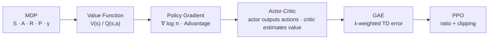

The 8 concepts you need to really understand in one PPO iteration: **trajectory** (parallel environment rollout) → **reward** → **TD error** \(\delta_t = r_t + \gamma V(s_{t+1}) - V(s_t)\) → **GAE** → **Advantage** \(\hat A_t\) → **ratio** \(r_t = \pi_\theta / \pi_{old}\) → **clipping** \(\mathrm{clip}(r_t, 1-\epsilon, 1+\epsilon)\) → **policy update** (multi-epoch minibatch).

| Concept | Canonical paper | On-site card |
|------|----------------|---------|
| PPO | [Proximal Policy Optimization Algorithms (arXiv:1707.06347)](https://arxiv.org/abs/1707.06347) | [PPO](../../wiki/methods/ppo.md) |
| GAE | [High-Dimensional Continuous Control Using Generalized Advantage Estimation (arXiv:1506.02438)](https://arxiv.org/abs/1506.02438) | [GAE](../../wiki/methods/gae.md) |

Engineering implementation reference: [rsl_rl](https://github.com/leggedrobotics/rsl_rl) (the PPO implementation commonly used for humanoid and legged training in legged_gym / Isaac Lab).

**What you should be able to produce:**
- Be able to explain the core idea of PPO
- Be able to design a simple RL reward and train with it

**Self-check questions:**
- Explain why PPO's clipping mechanism avoids overly large policy updates; what problems arise when the clip threshold is too large / too small?
- With the same amount of data, which has higher sample efficiency, on-policy (PPO) or off-policy (SAC)? Why does mainstream humanoid RL still use PPO?
- Given a reward function (forward term + balance term + smoothness term), if the robot learns to "hop forward" instead of "walk", how would you change the reward?

<details class="selftest-answers">
<summary>Reference answers (click to expand)</summary>

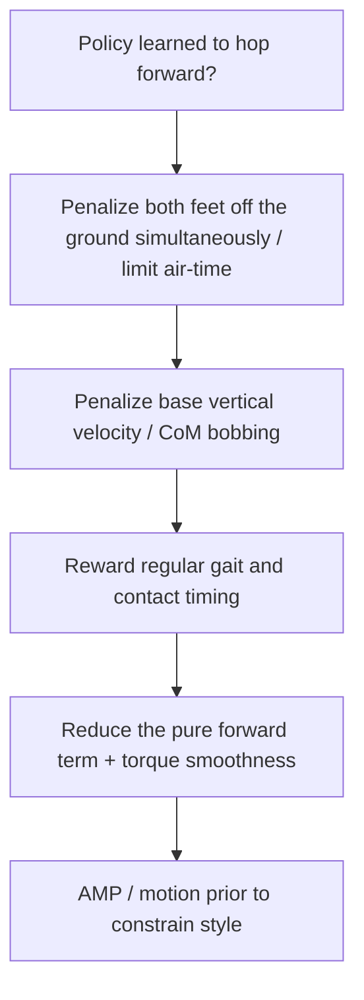

<ol>
<li><strong>PPO's clipping:</strong> Using the importance ratio \(r=\pi_\theta/\pi_{\mathrm{old}}\), the objective takes \(\min\!\big(r\hat A,\ \mathrm{clip}(r,1-\epsilon,1+\epsilon)\hat A\big)\). When one update makes \(r\) deviate too far from 1, clipping truncates the advantage gain, so updates that go beyond the trust region get no extra return, thereby suppressing overly large policy jumps (an approximate trust region). \(\epsilon\) too large: constraint too loose, updates too aggressive, prone to collapse; too small: updates too conservative, slow convergence, low sample utilization.</li>
<li><strong>Sample efficiency and why PPO is still used:</strong> With the same amount of data, off-policy SAC is more sample-efficient (a replay buffer reuses history repeatedly), while on-policy PPO discards data once used. But mainstream humanoid RL still uses PPO, because large-scale parallel simulation (tens of thousands of environments on IsaacGym) makes samples "cheap", the bottleneck is wall-clock rather than sample count, and PPO is simple to implement, robust to hyperparameters, fits parallel on-policy sampling, trains stably, and easily accommodates curriculum / DR.</li>
<li><strong>How to change the reward for "hopping forward":</strong> This is mostly reward hacking (the forward score doesn't constrain contact / flight phases). You can: ① add a penalty for both feet off the ground simultaneously or limit feet air-time, requiring periodic single-foot support; ② penalize base vertical velocity / CoM up-and-down fluctuation; ③ reward a regular gait (step frequency, foot trajectory, contact timing); ④ reduce the weight of the pure forward term, add torque / energy smoothness penalties to suppress explosive bouncing; ⑤ use AMP / motion prior to constrain toward a "walking" style.</li>
</ol>
</details>

---

### L5.2 Applications of RL in Humanoid Motion Control

> **Scenario metaphor:** Applying a generic RL algorithm directly to a humanoid often fails to learn — it needs "suitable reward / observation / action spaces + a pile of training tricks". L5.2 brings the toy environments of L5.1 down to the engineering details of real humanoid locomotion.

> **Limits of the previous layer:** L5.1 gets PPO running on [CartPole](../../wiki/concepts/cartpole.md); a humanoid's 25 DOF + floating base state space is several orders of magnitude higher-dimensional, requiring specialized techniques such as reward shaping, curriculum, early termination, privileged information, and teacher-student.

#### English Acronym Cheat Sheet (L5.2)

| Acronym | Full English name | Brief description |
|------|----------|----------|
| DR | Domain Randomization | Randomizes physical / sensing parameters in simulation to narrow the sim2real gap. |
| PD | Proportional–Derivative | Low-level joint position tracking; RL often outputs PD targets. |
| AMP | Adversarial Motion Priors | A discriminator constrains the policy to stay close to MoCap style. |
| ET | Early Termination | Ends an episode early on falls etc., saving training. |
| Priv. | Privileged Information | Extra state visible only to the simulation teacher. |
| T–S | Teacher–Student | A fully observing teacher distills into a student with limited observations. |
| Loco | Locomotion | Movement / walking-type motor skills. |

**Prerequisites:** L5.1 + the observation, dynamics, and joint control foundations of L1–L3; add L4.3/4.4 when choosing hybrid MPC/WBC control

**Core questions:** How to assemble observations, actions, rewards, and parallel training into a locomotion closed loop; when MPC/WBC is needed, and how to verify transfer

**What to do:**
- Train a humanoid walking policy with Isaac Lab or MuJoCo; use the corresponding Isaac Gym version when reproducing historical work
- Optional: compare [rl-mpc-locomotion](../../wiki/entities/rl-mpc-locomotion.md), where RL tunes MPC weights, with [ReCo](../../wiki/entities/paper-reco.md), where MPC commands a low-level RL, clearly marking the interfaces of each and the boundaries of their quadruped evidence

**What to read:**
- [DeepMimic](../../wiki/methods/deepmimic.md) and [AMP Reward](../../wiki/methods/amp-reward.md) — the motion imitation/style reward branch (L5.3), not the hybrid MPC/WBC architecture itself
- [legged_gym](../../wiki/entities/legged-gym.md)
- [Isaac Gym / Isaac Lab](../../wiki/entities/isaac-gym-isaac-lab.md)
- [WBC vs RL](../../wiki/comparisons/wbc-vs-rl.md)
- [MPC vs RL](../../wiki/comparisons/mpc-vs-rl.md)
- [Query: Navigation of open-source motion control projects](../../wiki/queries/open-source-motion-control-projects.md)

**Four branches of PPO on humanoids:**

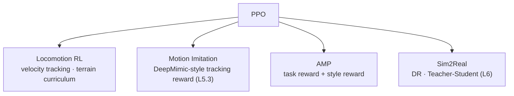

- Training platform: [Isaac Lab](../../wiki/entities/isaac-lab.md) (GPU parallel simulation + RL task framework); for AMP's reward structure see [AMP Reward](../../wiki/methods/amp-reward.md).

**What you should be able to produce:**
- Be able to train a humanoid walking RL policy in simulation
- Be able to explain the respective strengths and limitations of RL and WBC

**Self-check questions:**
- Which action space among position / velocity / torque does humanoid RL usually use? Why does IsaacLab choose it by default?
- What exactly is "privileged information" in teacher-student? Why can't the student get it?
- Compared with pure PPO, what is the biggest engineering advantage of motion prior methods like AMP / DeepMimic?

<details class="selftest-answers">
<summary>Reference answers (click to expand)</summary>

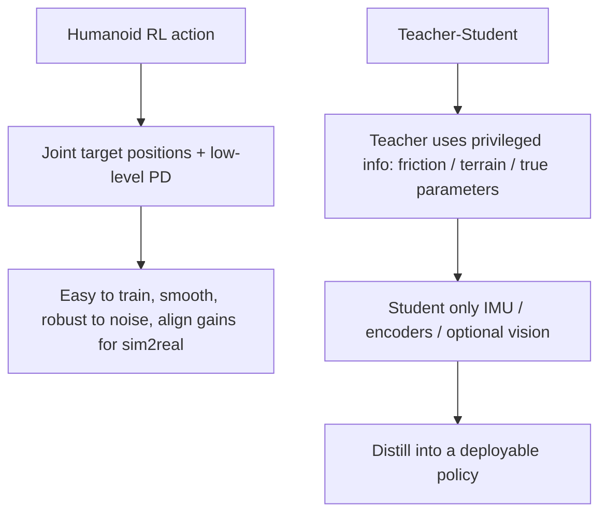

<ol>
<li><strong>Choice of action space:</strong> Mainstream humanoid RL uses position (outputting joint target positions / offsets from a default posture, tracked by low-level PD). IsaacLab defaults to this because PD tracks at high frequency and gives the policy a low-frequency, smooth, easy-to-learn interface, with built-in damping and stability, robust to network output noise; for sim2real you only need to align the PD gains. Direct torque at high frequency is prone to jitter and sensitive to latency, making it both hard to train and hard to transfer.</li>
<li><strong>Privileged information:</strong> Refers to precise quantities available in simulation but not during real-robot deployment: true ground friction / contact forces, terrain height maps, robot mass / inertia, external disturbance forces, precise base velocity, etc. The teacher uses them to train quickly and well; the student can only use proprioception available on the real robot (IMU, encoders, history) plus optional vision, and learns a policy under limited observations by distilling / imitating the teacher — because these privileged sensors are unavailable at deployment.</li>
<li><strong>Engineering advantage of motion priors:</strong> AMP / DeepMimic use reference motions (MoCap) as priors; the biggest advantage is avoiding hand-designing complex rewards — style / naturalness are provided automatically by an adversarial discriminator or imitation error, saving a great deal of reward shaping and tuning and yielding natural, transferable gaits; it also shrinks the exploration space, speeds up convergence, and avoids the weird gaits that pure PPO learns.</li>
</ol>
</details>

---

<a id="l5-3-imitation-learning"></a>

### L5.3 Imitation Learning

> **Scenario metaphor:** Rather than letting the robot repeatedly try and fail, let it "watch how humans do it" — MoCap and teleoperation data come in, and the robot directly outputs similar motions.

> **Limits of the previous layer:** Pure RL has extremely high exploration cost and extremely hard-to-write rewards for complex motions (dancing, manipulation, parkour). IL uses human demonstration data to provide a **good starting point**; but IL itself suffers from compounding error and usually needs RL or DAgger layered on top to be stable.

#### English Acronym Cheat Sheet (L5.3)

| Acronym | Full English name | Brief description |
|------|----------|----------|
| IL | Imitation Learning | Learning a policy from expert trajectories. |
| BC | Behavior Cloning | Supervised learning \(\pi(s)\approx a_{\mathrm{expert}}\). |
| DAgger | Dataset Aggregation | Asks the expert to relabel states visited by the policy. |
| MoCap | Motion Capture | Human / object motion capture data. |
| Retarget | Motion Retargeting | Maps the demonstration skeleton onto the target robot. |
| ASE | Adversarial Skill Embeddings | One of the IL / RL frameworks for composable skill embeddings. |
| Cov. Shift | Covariate Shift | Mismatch between training and deployment state distributions; the core difficulty of BC. |

**Prerequisites:** L5.1

**Core questions:** Teaching robots to perform motions using human motion data

**What to do:**
- Do motion retargeting with MoCap data (expanded in [L5.4 Motion retargeting](#l54-motion-retargeting))
- Try Behavior Cloning + DAgger

**What to read:**
- "ASE: Adversarial Skill Embeddings"
- "DeepMimic"
- [Imitation Learning](../../wiki/methods/imitation-learning.md)
- [Behavior Cloning](../../wiki/methods/behavior-cloning.md)
- [DAgger](../../wiki/methods/dagger.md)
- [Motion Retargeting](../../wiki/concepts/motion-retargeting.md)

**Imitation learning family (from supervision to "reference motion + physics simulation + RL"):**

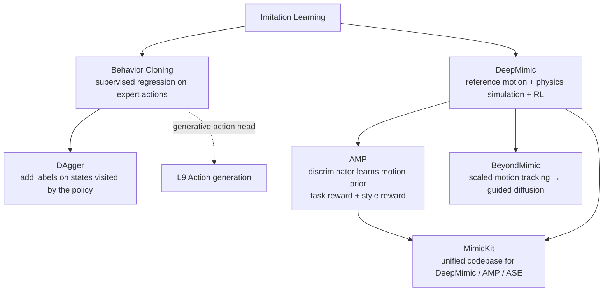

| Method | Key point in one sentence | Canonical paper | Project | Code | On-site card |
|------|-------------|-----------------|---------|------|---------|
| **DeepMimic** | reference motion + physics simulation + RL: tracking reward makes a physical character reproduce motion capture | [arXiv:1804.02717](https://arxiv.org/abs/1804.02717) | [Project page](https://xbpeng.github.io/projects/DeepMimic/) | [xbpeng/DeepMimic](https://github.com/xbpeng/DeepMimic) | [DeepMimic](../../wiki/methods/deepmimic.md) |
| **AMP** | discriminator learns a motion prior, total reward = task reward + style reward, no more frame-by-frame tracking | [arXiv:2104.02180](https://arxiv.org/abs/2104.02180) | [Project page](https://xbpeng.github.io/projects/AMP/) | [MimicKit · AMP](https://github.com/xbpeng/MimicKit/blob/main/docs/README_AMP.md) | [AMP Reward](../../wiki/methods/amp-reward.md) · [AMP family survey](../../wiki/overview/humanoid-amp-motion-prior-survey.md) |
| **BeyondMimic** | Scaled motion tracking on real humanoids + composing skills with guided diffusion | [arXiv:2508.08241](https://arxiv.org/abs/2508.08241) | [Project page](https://beyondmimic.github.io/) | [whole_body_tracking](https://github.com/HybridRobotics/whole_body_tracking) | [BeyondMimic](../../wiki/methods/beyondmimic.md) |
| **MimicKit** | The Peng group's modular motion imitation framework, one codebase running multiple algorithms | [arXiv:2510.13794](https://arxiv.org/abs/2510.13794) | — | [xbpeng/MimicKit](https://github.com/xbpeng/MimicKit) | [MimicKit](../../wiki/entities/mimickit.md) |
| **DAgger** | Interactive relabeling, mitigating BC's compounding error | [arXiv:1011.0686](https://arxiv.org/abs/1011.0686) | — | — | [DAgger](../../wiki/methods/dagger.md) |

> The code entry given on AMP's official project page is the DeepMimic / MimicKit repository; this roadmap uses the AMP documentation in MimicKit as the code link.

**What you should be able to produce:**
- Be able to transfer a segment of MoCap data onto a humanoid robot
- Be able to explain why DAgger is better than pure BC

**Self-check questions:**
- What does BC's compounding error mean mathematically (hint: state distribution drift)?
- Why can DAgger mitigate compounding error? What extra cost does it incur?
- In Motion Retargeting, what problems do different skeleton proportions + different joint limits each cause? How are they mitigated in engineering practice?

<details class="selftest-answers">
<summary>Reference answers (click to expand)</summary>

```mermaid
flowchart TD
  BC[BC trains only on the expert state distribution] --> Drift[Policy errors cause state drift]
  Drift --> O1["$$O(\epsilon T^2)$$"]
  DAg[DAgger] --> Roll[Roll out on states visited by the policy]
  Roll --> Label[Expert relabels and data is aggregated]
  Label --> O2["$$O(\epsilon T)$$"]
  Ret[Motion Retargeting] --> R1[Different proportions: IK matches end effectors / contacts]
  Ret --> R2[Different limits: clipping + constrained optimization]
```

<ol>
<li><strong>BC's compounding error:</strong> Training only sees the state distribution visited by the expert; at deployment, the policy's own small errors carry it into unseen states, and errors accumulate over time (covariate shift / state distribution drift). Mathematically, if the per-step error is \(\epsilon\), the total error grows quadratically with horizon \(T\) as \(O(\epsilon T^2)\) — once it deviates, the subsequent state distribution mismatches the training distribution and errors reinforce themselves.</li>
<li><strong>Why DAgger mitigates it, and the cost:</strong> DAgger has the policy roll out on the states it itself visits, then asks the expert to label the correct actions for these states and aggregates them into the dataset iteratively, so that the training distribution gradually covers the states the policy actually encounters, eliminating covariate shift and reducing the error from \(O(\epsilon T^2)\) to \(O(\epsilon T)\). Cost: it requires an online expert that can be queried at any time for continuous labeling (expensive), and rolling out an immature policy on a real robot can be unsafe.</li>
<li><strong>Two classes of problems in Motion Retargeting:</strong> Different skeleton proportions — copying joint angles directly misplaces the end effectors (hands / feet), causes feet to penetrate the ground / slip; you should scale proportionally and use IK to match end-effector / contact keypoints rather than copying joint angles; different joint limits — the source motion may exceed physical limits, making it infeasible / saturated; you should clip / remap into the feasible range or add limit constraints in the optimization and redistribute. In engineering practice, IK + optimization-based retargeting (matching CoM / foot contacts / end-effector trajectories) is mostly used, with contact and limit constraints layered on top.</li>
</ol>
</details>

---

### L5.4 Motion Retargeting

> **Scenario metaphor:** The "human" in motion capture and your robot don't share the same skeleton — different leg-length proportions, fewer joints, stricter limits. Copy human joint angles over directly, and the robot's feet will slip, penetrate the ground, and its posture will distort. L5.4 is this "translation gate": translating human motion into reference trajectories the robot **can execute**.

> **Limits of the previous layer:** L5.3 assumes "the demonstration data is already motion the robot can execute". In reality the vast majority of demonstrations come from humans (motion capture / monocular video / generative models), and must first be mapped across skeletons into robot reference trajectories before tracking rewards and BC labels have anything to align with. Errors in this step are passed unchanged to the downstream policy, and are further amplified in the sim2real stage of L6.

#### English Acronym Cheat Sheet (L5.4)

| Acronym | Full English name | Brief description |
|------|----------|----------|
| Retarget | Motion Retargeting | Maps human / animal motion onto the target robot's skeleton. |
| MoCap | Motion Capture | The most common source of reference motion. |
| SMPL | Skinned Multi-Person Linear Model | A commonly used parametric human body model; the typical input to retargeting. |
| IK | Inverse Kinematics | Solves joint angles back from end-effector / keypoint targets. |
| QP | Quadratic Programming | A common solution form that writes retargeting as a constrained quadratic program. |
| GMR | General Motion Retargeting | A kinematic retargeting baseline of keypoint IK + QP. |
| NMR | Neural Motion Retargeting | Learned whole-segment mapping, trained on simulation-anchored paired data. |
| WBT | Whole-Body Tracking | The downstream consumer of retargeting output: whole-body tracking training. |
| AMP | Adversarial Motion Prior | A discriminative reward that uses reference motions to constrain RL policy style. |

**Prerequisites:** L1 (FK / IK, SE(3)) + L2 (floating base and contact) + L5.3

**Core questions:** How to translate "how a human moves" into reference trajectories that "the robot can keep up with"

**What to do:**
- First run a counterexample experiment: take a segment of [AMASS](../../wiki/entities/amass.md) / [LAFAN1](../../wiki/entities/lafan1-dataset.md) motion, copy the human joint angles directly onto a humanoid URDF and play it back, and measure foot slip, sole penetration, and limit violations — building first-hand intuition for "why you can't skip retargeting"
- Get a kinematic baseline running: keypoint IK + QP ([GMR](../../wiki/methods/motion-retargeting-gmr.md)-type tools), with end-effector / foot contacts as cost terms and joint limits as hard constraints
- Add a quality gate to the output: foot-slip velocity, penetration depth, joint velocity / acceleration spikes, root trajectory drift; filter first before entering the training set
- Hook the retargeting output up to a tracking policy ([DeepMimic](../../wiki/methods/deepmimic.md) / [AMP reward](../../wiki/methods/amp-reward.md) style), and use "whether the policy can keep up" to validate retargeting quality in reverse

**What to read:**
- [Motion Retargeting](../../wiki/concepts/motion-retargeting.md) — main concept entry
- [Motion Retargeting Pipeline](../../wiki/concepts/motion-retargeting-pipeline.md) — the end-to-end chain of capture → alignment → solving → filtering
- [Motion Retargeting Objective](../../wiki/formalizations/motion-retargeting-objective.md) — formalization of the objective function and constraints
- [GMR vs NMR vs ReActor](../../wiki/comparisons/gmr-vs-nmr-vs-reactor.md) — choosing among three approaches
- [Kinematic feasibility vs dynamic feasibility](../../wiki/concepts/kinematic-vs-dynamic-feasibility.md) — the conceptual pitfall most easily stepped into in this section
- [Motion Data Quality](../../wiki/concepts/motion-data-quality.md), [Comparison of humanoid reference motion datasets](../../wiki/comparisons/humanoid-reference-motion-datasets.md)
- To go deeper: [Depth roadmap: Motion retargeting](depth-motion-retargeting.md) (complete Stage 0–6 lineage, including the quadruped branch and the trajectory editor toolchain)

**What you should be able to produce:**
- Be able to retarget a public MoCap clip onto a specified humanoid model, and give a quantitative quality report on foot slip / penetration / limits
- Be able to clearly explain the trade-offs among the three approaches — kinematic optimization, learned mapping, and physics-aware — and choose separately for "real-time teleoperation" and "offline batch production of training data"
- Be able to feed retargeting output into tracking training, and judge whether a failure is a data problem or a policy problem

**Self-check questions:**
- Which terms does a retargeting objective function usually consist of? Which of them must be written as hard constraints rather than penalty terms, and why?
- A retargeting result "looks very human-like", but no matter how you train the tracking policy it can't keep up — what are the possible causes?
- Real-time whole-body teleoperation vs offline batch production of BFM training data: which class of retargeting approach should each scenario choose?

<details class="selftest-answers">
<summary>Reference answers (click to expand)</summary>

```mermaid
flowchart TD
  Src[Human reference: MoCap / video / generated] --> Align[Skeleton and coordinate alignment]
  Align --> Opt[IK/QP: pose similarity + end-effector contact + smoothness]
  Opt --> Hard[Hard constraints: joint limits / self-collision / soles don't penetrate the ground]
  Hard --> QC[Quality gate: foot slip / penetration / velocity spikes / root drift]
  QC --> Track[Tracking training: DeepMimic / AMP / WBT]
  Track -->|If it can't keep up, revise the reference| Opt
```

<ol>
<li><strong>Objective function and hard constraints:</strong> The typical form is a weighted sum — a pose similarity term (joint angle / keypoint position alignment), end-effector and contact terms (hand and foot positions, zero slip of the support foot), a balance term (CoM / ZMP within the support region), a smoothness term (joint velocity / acceleration regularization), plus joint limits and self-collision. Among these, **joint limits, self-collision, and soles not penetrating the ground are feasibility constraints and must be written as hard constraints**: when written as penalty terms, the solver will "buy out" the penalty to reduce pose error, producing a reference that is physically impossible to execute, and the error goes straight into the training set; whereas similarity and smoothness are preferences, suitable as weighted cost terms to trade off.</li>
<li><strong>"Looks very similar" but can't be tracked:</strong> A classic case of <strong>kinematically feasible ≠ dynamically feasible</strong>. Retargeting only aligns the geometry (small keypoint error), but doesn't constrain mass distribution and contact forces: the robot's mass distribution and actuator torque / velocity limits differ from a human's, and accelerations in the reference may exceed joint capabilities; support-foot contact timing is stretched or there is millimeter-level penetration / foot slip, causing the contact-force solve to diverge during tracking; the root trajectory (base height / orientation) carries drift from the source data, so the reference itself "can't stand". Troubleshooting order: first measure the physical metrics of the reference itself (required torques, whether CoM/ZMP leaves the support region, foot slip velocity), then look at the tracking policy's rewards and gains; physics-aware retargeting (closed loop inside simulation) or dynamics post-processing of the reference is a more targeted fix than continuing to tune tracking hyperparameters.</li>
<li><strong>Choice for the two scenarios:</strong> <strong>Real-time teleoperation</strong> needs millisecond latency, single-frame / sliding-window input, and the ability to switch robot models at any time → choose the kinematic optimization approach (GMR-style IK + QP, real-time on CPU, no training needed), leaving physical feasibility to the downstream WBC / tracking policy as a safety net. <strong>Offline batch production of BFM / WBT training data</strong> has no real-time budget but requires physical consistency and large scale → choose learned whole-segment mapping (NMR-style, training a feedforward network on simulation-anchored paired data, high throughput) or physics-aware retargeting (ReActor / SPIDER-style, jointly optimizing the reference and tracking policy in simulation); what you gain is that contact and self-collision are internalized at the data stage, so downstream training doesn't need repeated cleaning.</li>
</ol>
</details>

---

## L6 Integrated Practice

**By now, you should understand both paths: motion control and learning. The final step is to truly connect them.**

> **Scenario metaphor:** No matter how good it looks walking in simulation, it falls hardest on the real robot — L6 teaches you how to bridge this "simulation to reality" gap.

> **Limits of the previous layer:** L4 / L5 both assume ideal conditions in simulation: noise-free sensors, latency-free actuators, fully known dynamics. On the real robot none of these three hold, requiring specialized bridging techniques such as system identification + domain randomization + teacher-student.

### English Acronym Cheat Sheet (L6)

| Acronym | Full English name | Brief description |
|------|----------|----------|
| Sim2Real | Simulation to Reality | Deploying a simulation-trained policy to the real robot. |
| SysID | System Identification | Identifying real parameters such as mass, friction, and latency. |
| DR | Domain Randomization | Randomization during training to cover real-robot uncertainty. |
| T–S | Teacher–Student | A privileged teacher distills into a deployable student. |
| Gap | Sim-to-Real Gap | Dynamics / sensing differences between simulation and the real robot. |
| Lat. | Actuator Latency | Actuator and communication latency; RL policies are especially sensitive. |

### Prerequisites
- The full L4 workflow
- Basic operations of L5 RL and IL

### Core questions
- How to form a closed loop from training to deployment
- How to transfer simulation training results to a real robot
- How to design a complete RL + WBC pipeline

### What to do
- Design and train a complete humanoid RL + WBC pipeline
- Perform one sim2real transfer
- Tune domain randomization parameters and observe the effects

### What to read
- [Sim2Real](../../wiki/concepts/sim2real.md)
- [System Identification](../../wiki/concepts/system-identification.md)
- [Domain Randomization](../../wiki/concepts/domain-randomization.md)
- [Sim2Real Checklist](../../wiki/queries/sim2real-checklist.md) (including [Quick deployment check](../../wiki/queries/sim2real-checklist.md#快速部署检查))
- [Robot policy debugging playbook](../../wiki/queries/robot-policy-debug-playbook.md)

<a id="l6-sim2real-chain"></a>

### Sim2Real Main Chain: 10 Checkpoints from Simulation to Real Robot

Sim2Real is not a small node of RL, but an independent engineering chain:

```mermaid
flowchart TB
  Sim["Simulation"] --> DR["Domain Randomization"]
  DR --> ON["Observation Noise"]
  ON --> Lat["Latency"]
  Lat --> Act["Actuator Modeling"]
  Act --> SID["System Identification"]
  SID --> TS["Teacher-Student"]
  TS --> Val["Policy Validation"]
  Val --> S2S["Sim2Sim<br/>verify again in a different physics engine"]
  S2S --> Real["Real Robot"]
  Real -. failure post-mortem .-> SID
```

**Common sources of real-robot policy failures** (in troubleshooting order; the earlier, the more "basic" and more common):

| Source | Typical symptoms | Troubleshooting entry |
|------|---------|---------|
| **joint ordering** | Twitches as soon as powered on / left and right legs swapped | [Robot Joint Order Check Tool Online](https://imchong.github.io/Robot_Joint_Order_Check_Tool_Online/): side-by-side comparison of URDF / MJCF joint ordering in Isaac Gym, Isaac Lab, MuJoCo, ros2_control, etc. |
| **observation mismatch** | Observation dimensions / frames / units / normalization inconsistent with training | [Robot Learning IO Board Online](https://imchong.github.io/Robot_Learning_IO_Board_Online/): compare observation inputs and action outputs between training and deployment for projects such as SONIC / BeyondMimic · [Humanoid policy observation inputs](../../wiki/concepts/humanoid-policy-observation-inputs.md) |
| **action scaling** | Action amplitude too large / too small, default pose offset | Same as above: compare against the reference project's action output definition, check action scale and default joint pos |
| **control frequency** | Simulation decimation inconsistent with the real-robot control period | [Decoupling control and inference frequencies](../../wiki/concepts/control-inference-frequency-decoupling.md) |
| **latency** | High-frequency oscillation, phase lag | [Control loop latency modeling](../../wiki/formalizations/control-loop-latency-modeling.md) |
| **motor model** | Torque saturation, insufficient bandwidth, PD behavior differs from simulation | [Actuator Network](../../wiki/methods/actuator-network.md) · [System Identification](../../wiki/concepts/system-identification.md) |
| **sensor noise** | IMU drift, encoder noise causing jitter | [Domain Randomization](../../wiki/concepts/domain-randomization.md) · [State Estimation](../../wiki/concepts/state-estimation.md) |
| **contact mismatch** | Slipping, foot-strike impacts differ from simulation | [Contact Dynamics](../../wiki/concepts/contact-dynamics.md) · Sim2Sim cross-validation |

- **Sim2Sim before Sim2Real**: Train in Isaac, replay and verify in MuJoCo; this filters out most ordering / scaling / frequency errors before going to the real robot. Online demo: [Robot Learning Sim2Sim Online](https://imchong.github.io/Robot_Learning_Sim2Sim_Online/) (MuJoCo + ONNX in-browser inference).
- **Teacher-Student**: privileged-information teacher → deployment-observation student; see [Teacher-Student / DAgger training](../../wiki/methods/teacher-student-dagger-training.md).
- For a systematic treatment see the [Sim2Real depth roadmap](depth-sim2real.md); for inference / communication / real-time aspects on the deployment side see [L12](#physical-ai-l12-deployment).

### What you should be able to produce
- A working humanoid RL policy (in simulation)
- A record of one sim2real transfer experiment
- A document describing your understanding of the whole pipeline

### Self-check questions (you should be able to answer after learning)
- Given a PPO policy trained in simulation, list 5 things you must do before real-robot deployment.
- What problems arise when the Domain Randomization range is chosen too large / too small? How do you set DR bounds?
- Why is actuator latency in sim2real more destructive to RL policies than to classical MPC?

<details class="selftest-answers">
<summary>Reference answers (click to expand)</summary>

```mermaid
flowchart TD
  PPO[PPO trained in simulation] --> S1[1 System ID]
  S1 --> S2[2 Actuators: limits / latency / bandwidth]
  S2 --> S3[3 Observation alignment: noise / frames / filtering]
  S3 --> S4[4 Inject latency + DR in training]
  S4 --> S5[5 Safe deployment: speed limits / e-stop / fallback]
  DR[Domain Randomization] --> Big[Too large: overly conservative or fails to learn]
  DR --> Small[Too small: gap remains, fails immediately on the robot]
  Big --> Tune[Center on SysID, widen gradually + real-robot feedback]
  Small --> Tune
```

<ol>
<li><strong>5 things you must do before real-robot deployment:</strong>
<ol>
<li><strong>System Identification:</strong> identify real mass / inertia, joint friction, PD gains, torque-current curves.</li>
<li><strong>Actuator modeling:</strong> add torque limits, transmission latency / bandwidth, first-order motor lag.</li>
<li><strong>Observation alignment:</strong> sensor noise / bias / latency, frames and units, filtering consistent with training.</li>
<li><strong>Training-side robustification:</strong> inject latency / noise / external disturbances during training and apply Domain Randomization to improve robustness.</li>
<li><strong>Safe and gradual deployment:</strong> joint and speed limits, torque saturation, e-stop, gantry suspension / gradually handing over authority, with a fallback controller ready.</li>
</ol>
</li>
<li><strong>DR range too large / too small:</strong> Too large — the task becomes too hard, and the policy learns to be overly conservative (crouching low, moving slowly), sacrificing performance or even failing to learn (signal drowned in noise); too small — it doesn't cover the real robot's parameters, the sim2real gap stays large, and it fails as soon as it's deployed (overfitting to simulation). Setting bounds: center on the identified values, set ranges according to hardware uncertainty (sensing / assembly / wear) and widen gradually (curriculum), tune using real-robot / held-out validation feedback, covering the real distribution as much as possible while still converging.</li>
<li><strong>Why actuator latency is more lethal to RL:</strong> An RL policy is a high-bandwidth reactive mapping that fits observation-action timing extremely tightly, and often implicitly assumes zero latency; latency introduces phase lag, turning the tight feedback learned during training into oscillation / positive feedback, while being uninterpretable with no explicit phase margin to tune. Classical MPC / WBC has an explicit model, can incorporate latency into prediction (time-delay model, Smith predictor), and has the concept of stability margins, making it relatively more controllable.</li>
</ol>
</details>

---

## L7 Exit: Viewing the Whole Robotics Tech Stack from Motion Control

**This layer doesn't teach you to write code; its purpose is: after you've gone through L0–L6, to give you the last piece of the "full robotics stack" puzzle, so that you can talk with engineers in any direction of this field.**

Having read this far, you already know what the "control box" does. This section covers the other three boxes from the [L−1 30-second overview](#understand-what-a-robot-is-doing-in-30-seconds), as well as the few directions that are truly most active in 2024–2026. Each block doesn't go deep, and only gives: **what it is → how it connects to motion control → 1 recommended entry page**.

### L7.1 Perception Layer (Perception / SLAM / State Estimation)

#### English Acronym Cheat Sheet (L7.1)

| Acronym | Full English name | Brief description |
|------|----------|----------|
| SE | State Estimation | Fuses IMU, encoders, vision, etc. to estimate pose and velocity. |
| SLAM | Simultaneous Localization and Mapping | Simultaneous mapping and localization in unknown environments. |
| IMU | Inertial Measurement Unit | Inertial measurement; high-frequency proprioceptive motion sensing. |
| RGB-D | RGB + Depth | Color plus depth camera; a common input for 3D perception. |
| VO | Visual Odometry | Estimating camera / body motion from vision alone. |
| SEM | Semantic Segmentation | Pixel-level semantics; the entry point to scene understanding. |

**What it is**: Lets the robot estimate "its own pose + world geometry + object properties" from sensors such as cameras / IMU / radar / encoders / force sensing. Core subfields:
- **State Estimation**: fuses IMU + encoders + vision to estimate the 6D pose and velocity of the robot body in the world.
- **SLAM**: simultaneous mapping + localization, so the robot knows where it is even in unknown environments.
- **3D perception / object recognition / semantic segmentation**: turns RGB-D / point clouds into "there's a box on the ground, 0.5 m from me".

**How it connects to motion control**:
- Motion control needs **accurate body state** (joint angles, torso pose, whether the feet are on the ground). If state estimation is even slightly off, the downstream WBC / MPC falls apart. L4's TSID / WBC in practice relies heavily on a low-latency state estimator.
- More than half of the real-robot sim2real (L6) gap comes from **inaccurate actuator models** + **state estimation noise**.

**Entry pages**: [State Estimation](../../wiki/concepts/state-estimation.md) · [Navigation and SLAM autonomy stack](../../wiki/overview/navigation-slam-autonomy-stack.md)

### L7.2 Decision and Planning Layer (Motion Planning / Task Planning)

#### English Acronym Cheat Sheet (L7.2)

| Acronym | Full English name | Brief description |
|------|----------|----------|
| MP | Motion Planning | Path / trajectory planning under geometric or dynamic constraints. |
| RRT | Rapidly-exploring Random Tree | Sampling-based planning; commonly used in high-dimensional spaces. |
| CHOMP | Covariant Hamiltonian Optimization for Motion Planning | Trajectory-optimization-based motion planning. |
| HTN | Hierarchical Task Network | Hierarchical task decomposition planning. |
| PDDL | Planning Domain Definition Language | The standard language for symbolic task planning. |
| FP | Footstep Planning | Humanoid foot placement and gait timing planning. |

**What it is**: On the map built by perception, it answers "where to go first, where next, and with what motions to get there". Core subfields:
- **Motion Planning**: A* / RRT / RRT* / CHOMP / TrajOpt → produce collision-free trajectories.
- **Task Planning / HTN / PDDL**: decompose "put the cup on the table" into "approach → grasp → move → place".
- **Footstep Planning** (humanoid-specific): decides the next foot placement and gait timing.

**How it connects to motion control**:
- The planning layer provides **reference trajectories** (foot positions, CoM trajectory, joint targets), and the downstream L4 MPC / WBC is responsible for tracking them.
- L4.3's trajectory optimization overlaps heavily with classical motion planning; the differences lie in **whether dynamics constraints are included** and **whether it is solved online**.

**Entry pages**: [Trajectory Optimization](../../wiki/methods/trajectory-optimization.md) · [Locomotion task map](../../wiki/tasks/locomotion.md)

### L7.3 Manipulation Layer (Manipulation / Grasping)

#### English Acronym Cheat Sheet (L7.3)

| Acronym | Full English name | Brief description |
|------|----------|----------|
| EE | End Effector | End effector (gripper, tool, etc.). |
| Grasp | Grasping | Grasping and stable holding. |
| CRM | Contact-Rich Manipulation | Manipulation that is contact-rich and dominated by force interaction. |
| DP | Diffusion Policy | A diffusion model generates action sequences; commonly used for multimodal manipulation. |
| ACT | Action Chunking with Transformers | One of the imitation learning architectures for chunked action prediction. |
| WBC | Whole-Body Control | The low level of manipulation tasks still often relies on whole-body force control. |
| LoCo-Manip | Loco-Manipulation | Manipulating while moving (walking + carrying). |

**What it is**: Fine interaction between the hand / end effector and objects, including grasping, placing, assembly, bimanual coordination, and contact-rich fine manipulation (screwing, plugging/unplugging).

**How it connects to motion control**:
- Manipulation and locomotion share **the same foundation of impedance control / WBC / contact modeling**.
- Modern contact-rich manipulation mainly follows the **imitation learning route** (ACT / Diffusion Policy), but the low-level force control still comes from classical control; this is why L4's WBC is also a cornerstone in manipulation tasks.

**Entry pages**: [Manipulation task map](../../wiki/tasks/manipulation.md) · [Contact-rich manipulation depth roadmap](depth-contact-manipulation.md)

<a id="l7-4-system-stack"></a>

### L7.4 Systems and Software Stack (ROS / Middleware / Deployment)

#### English Acronym Cheat Sheet (L7.4)

| Acronym | Full English name | Brief description |
|------|----------|----------|
| ROS | Robot Operating System | Middleware ecosystem of robot nodes, topics, and services. |
| RT | Real-Time Control | Millisecond-level hard real-time control loop. |
| CAN | Controller Area Network | A common motor bus protocol. |
| EtherCAT | Ethernet for Control Automation Technology | Industrial real-time Ethernet; low-latency drives. |
| HAL | Hardware Abstraction Layer | Hardware abstraction; unifies simulation and real-robot interfaces. |
| Gazebo | Gazebo Simulator | One of the classic simulators accompanying ROS. |

**What it is**: The engineering infrastructure needed to connect all the above modules and run them on a real robot.
- **ROS / ROS2**: the most commonly used message middleware, node abstraction, and launch system in robotics.
- **Real-time control loop**: low-latency (1–2 kHz) real-time control loop, and multi-rate communication with high-level planning (10–100 Hz).
- **Simulators**: MuJoCo / Isaac Sim / Gazebo / Drake, each with its own applicable scenarios.
- **Hardware abstraction**: URDF / MJCF / real driver interfaces, CAN / EtherCAT.

**How it connects to motion control**:
- L4's TSID / WBC usually runs in a **real-time process** (1 kHz), while the upper-level MPC runs in a **non-real-time process** (50–500 Hz), communicating via ROS2 / shared memory. Only by understanding this architecture can you explain "why an algorithm that seems to work falls apart on the real robot".
- The entire L6 sim2real chain depends on aligning URDF / controllers / communication latency.

**Entry pages**: [Pinocchio](../../wiki/entities/pinocchio.md) · [Isaac Gym / Isaac Lab](../../wiki/entities/isaac-gym-isaac-lab.md) · for the complete deployment chain from policy export to the bus, see [L12 Deployment](#physical-ai-l12-deployment)

### L7.5 2024–2026 Frontier Map (Keywords You'll See Again and Again)

#### English Acronym Cheat Sheet (L7.5)

| Acronym | Full English name | Brief description |
|------|----------|----------|
| VLA | Vision–Language–Action | Vision–language-conditioned policies; e.g. RT-2, π0. |
| WM | World Model | Learns environment dynamics for imagined rollouts. |
| E2E | End-to-End | A single network from sensing to action, with fewer layers. |
| FM | Foundation Model | A general-purpose model pretrained at scale and then fine-tuned. |
| BFM | Behavior Foundation Model | The direction of foundation models for robot behavior. |
| HFM | Humanoid Foundation Model | The direction of general-purpose humanoid large models / foundation policies. |
| LfWM | Learning from World Models | Training or planning inside a world model. |
| Tactile | Tactile Sensing | Touch sensing; commonly used for closed-loop fine assembly. |

Robot AI has been rapidly reshaping over the past three years, with the following directions advancing in parallel; they do not replace L4's classical control, but **stack a layer of "generalization / end-to-end" on top of classical control**:

| Direction | Key question | Representative work / keywords | Further reading |
|------|---------|----------------|-----------|
| **Humanoid Foundation Model** | One large model driving many kinds of humanoid robots | GR00T (NVIDIA), Helix (Figure), Astribot | [Locomotion task map](../../wiki/tasks/locomotion.md) |
| **VLA (Vision-Language-Action)** | Driving robots to complete manipulation with language instructions | RT-2, OpenVLA, π0, Pi-0.5 | [Imitation Learning](../../wiki/methods/imitation-learning.md) |
| **World Model for Robotics** | Letting robots train in an "imagined world" | Dreamer-V3, UniSim, GAIA-1 | (further reading) |
| **Large-scale Teacher-Student** | Training a student with a privileged teacher to achieve sim2real | "Learning to Walk in Minutes", ANYmal, Unitree, etc. | [Sim2Real](../../wiki/concepts/sim2real.md) |
| **AMP / Motion Prior** | Distilling MoCap motion into RL policies with an adversarial loss | AMP, ASE, CALM, PHC | [Imitation learning depth roadmap](depth-imitation-learning.md) |
| **End-to-End Locomotion** | End-to-end RL from vision + proprioceptive observations → joint actions | [Extreme Parkour](../../wiki/entities/extreme-parkour.md), ANYmal Parkour, [DreamWaQ++](../../wiki/entities/dreamwaq-plus.md) | [RL depth roadmap](depth-rl-locomotion.md) |
| **Whole-Body Loco-Manipulation** | Manipulating while walking (carrying boxes, pushing doors) | HumanPlus, OmniH2O, OKAMI | [Manipulation task map](../../wiki/tasks/manipulation.md) |
| **LLM + RL hierarchy** | Semantic/task-level large model + low-level RL force-control execution | Various VLA + low-level policy stacks | [VLA](../../wiki/methods/vla.md) · [Embodied RL minimal closed loop](../../wiki/concepts/embodied-rl-minimal-closed-loop.md) |
| **Intrinsic reward exploration** | Self-driven pretraining without hand-crafted rewards | RND, DIAYN, etc. | [Intrinsic reward pretraining](../../wiki/overview/bfm-category-03-intrinsic-reward-pretraining.md) |
| **Tactile / force closed loop** | High-frequency tactile feedback for fine assembly | DIGIT, GelSight series | (further reading) |

> This section doesn't expand on any one direction — any one of them is enough for a whole new main roadmap. Having read this far, you can already **understand what each one** is solving, and that is the purpose of L7.

> Among them, the three directions **VLA / Humanoid Foundation Model / World Model** are broken down into learnable layers following the Physical AI pipeline in [L8–L11](#physical-ai-l8-transformer); deployment is covered in [L12](#physical-ai-l12-deployment).

### What You Can Do After Completing This Roadmap

Going back to the "three kinds of readers" perspective from L−1:

- **Outsiders**: can explain over dinner "why humanoid robots find walking so hard", "VLA and PPO are things at different layers", and "where the sim2real gap mainly comes from".
- **Those wanting to enter the field**: have at least one project in hand that runs PPO + WBC in simulation, and can interview for robot control / simulation positions.
- **Experienced practitioners**: string scattered experience into a single mental index, knowing where each new paper belongs within L0–L12 and where it connects to methods you already know.

---

## L8 Transformer and Representation: From Token to VLM

<a id="physical-ai-l8-transformer"></a>

**L0–L7 are the motion control main line; L8–L12 from here on are the Physical AI full-stack extension. L8 is the bridge from classical robot learning into Foundation Models.**

> **Scenario metaphor:** Images, language, and joint angles are originally three different "languages". The Transformer first translates them all into the same kind of "word" (token), then lets each word query how relevant the other words are to itself.

> **Limits of the previous layer:** Policies in L5–L6 are mostly MLPs whose input is a fixed-dimensional proprioceptive state vector. Once camera images, language instructions, and multi-frame history are added to the input, you need a structure that can turn different modalities into the same kind of sequence and let them "query" each other.

### English Acronym Cheat Sheet (L8)

| Acronym | Full English name | Brief description |
|------|----------|----------|
| Token | Token | One unit in a sequence: an image patch, a subword, or a state vector. |
| QKV | Query / Key / Value | The three projections of attention: use Q to match K, and weight V by the degree of match. |
| MHA | Multi-Head Attention | Multiple sets of QKV in parallel, each attending to different relationships, then concatenated. |
| ViT | Vision Transformer | Cuts an image into patches and feeds them into a Transformer as tokens. |
| VLM | Vision-Language Model | Vision encoder + language model; the "understanding" backbone of a VLA. |
| MLP | Multi-Layer Perceptron | The per-token feedforward layer after attention in a Transformer block. |

### Prerequisites
- The neural network training intuition from L5 (MLP, loss functions, gradient descent)
- Linear algebra: matrix multiplication, softmax

### Core Structure

```mermaid
flowchart TB
  Img["Image"] --> Patch["Patch → Visual Token"]
  Lang["Language"] --> Txt["Text Token"]
  State["Robot State"] --> Emb["Embedding"]
  Patch --> TF["Transformer<br/>Self / Cross-Attention · MLP · Residual"]
  Txt --> TF
  Emb --> TF
  TF --> Out["Contextual representation<br/>→ L9 action head"]
```

One Transformer block: `x → LayerNorm → Multi-Head Attention → +x (residual) → LayerNorm → MLP → +x (residual)`, where attention is \(\mathrm{softmax}(QK^\top/\sqrt{d_k})\,V\).

### You Only Need to Truly Understand the Following

**You are not required to read the whole paper.** You only need to truly understand:

- **token / embedding**: any input first becomes a sequence of vectors
- **QKV and the attention matrix**: row \(i\) of the matrix = the attention weights of token \(i\) over all tokens
- **self-attention vs cross-attention**: looking at each other within the same sequence vs one sequence (e.g. action tokens) querying another sequence (e.g. VLM tokens)
- **multi-head attention**, **residual**, **MLP**, **transformer block**
- **ViT**: image patches as tokens; **VLM**: visual tokens fed into a language model

### What to read
- Canonical paper: [Attention Is All You Need (arXiv:1706.03762)](https://arxiv.org/abs/1706.03762) · on-site card [paper page](../../wiki/entities/paper-attention-is-all-you-need.md)
- [Transformer](../../wiki/concepts/transformer.md) · [Multi-Head Attention](../../wiki/concepts/multi-head-attention.md) · [Cross-modal attention](../../wiki/formalizations/cross-modal-attention.md)
- [Vision Transformer](../../wiki/concepts/vision-transformer.md) (canonical: [An Image is Worth 16x16 Words (arXiv:2010.11929)](https://arxiv.org/abs/2010.11929))
- VLM: [PaliGemma](../../wiki/entities/paper-rcl-2407-07726-paligemma-a-versatile-3b-vlm-for-transfer.md) (π0's VLM backbone) · [VLM / VLA / World Model taxonomy comparison](../../wiki/comparisons/vlm-vln-vla-vlx-world-model-taxonomy.md)
- How multimodal inputs become tokens: [VLA Tokenization](../../wiki/formalizations/vla-tokenization.md)
- To choose a backbone systematically: [Model architecture depth roadmap](depth-model-architecture.md)

### What you should be able to produce
- Be able to hand-write single-head attention in ≤ 30 lines of NumPy / PyTorch, and explain the meaning of each row of the attention matrix
- Be able to draw the data flow "image + language + state → token → Transformer", and clearly state where each kind of token comes from

### Self-check questions (you should be able to answer after learning)
- Where do Q, K, and V come from in self-attention and cross-attention, respectively? Why does a VLA's action head often use cross-attention to read from the VLM?
- Why must attention scores be divided by \(\sqrt{d_k}\)?
- How is robot state (joint angles, IMU) usually turned into tokens? How does it differ from image patch tokens?

<details class="selftest-answers">
<summary>Reference answers (click to expand)</summary>

<ol>
<li><strong>self vs cross:</strong> In self-attention, Q, K, and V all come from the same sequence; in cross-attention, Q comes from one sequence (e.g. noisy action tokens), and K, V come from another sequence (e.g. VLM output tokens). Having the action head read the VLM via cross-attention lets the action generation network stay small and run separately at high frequency, while "querying" semantic and visual information as needed.</li>
<li><strong>Dividing by \(\sqrt{d_k}\):</strong> The variance of the dot product grows with the dimension \(d_k\); without scaling, softmax easily saturates into a near one-hot distribution, gradients become small, and training becomes unstable.</li>
<li><strong>State tokens:</strong> Usually a small MLP / linear layer projects the whole proprioceptive state (or each joint) into an embedding with the same dimension as the other tokens; it has no spatial patch structure, is low-dimensional and high-frequency, and is often used as a direct conditioning input to the action head.</li>
</ol>
</details>

---

## L9 Action Generation: Action Chunk · Diffusion · Flow Matching · DiT

<a id="physical-ai-l9-action-generation"></a>

> **Scenario metaphor:** Rather than asking "what to do next" at every step, plan the whole segment of motion for the next half second at once, then execute it to the beat.

> **Limits of the previous layer:** L8 gives a representation that can simultaneously understand images, language, and state, but "how to get actions out of the representation" is not yet solved. L5.3's BC regresses a single action with MSE: when demonstrations are multimodal (in the same scene, going around on the left or on the right are both correct), they get averaged into "crashing straight into it"; single-step output is also very sensitive to inference latency.

### English Acronym Cheat Sheet (L9)

| Acronym | Full English name | Brief description |
|------|----------|----------|
| BC | Behavior Cloning | Supervised regression on expert actions; the starting point of action generation. |
| DP | Diffusion Policy | Generates a segment of action sequence with denoising diffusion. |
| FM | Flow Matching | Learns a velocity field and integrates noise along an ODE into actions. |
| DiT | Diffusion Transformer | Uses a Transformer as the denoising / velocity-field network. |
| ACT | Action Chunking with Transformers | An imitation learning architecture that predicts H steps of actions at once. |
| H | Horizon | The length of an action chunk (how many steps are output at once). |

### First, a Comparison: Traditional Policy vs Modern VLA Action Head

```mermaid
flowchart TB
  subgraph Old["Traditional policy"]
    O1["observation"] --> A1["one action a_t"]
  end
  subgraph New["Modern VLA action head"]
    O2["image + language + state"] --> AC["action chunk<br/>a_t, a_t+1, …, a_t+H"]
  end
```

### Diffusion Policy: Denoising Out a Segment of Actions

```mermaid
flowchart TB
  N["noisy action trajectory<br/>Gaussian noise"] --> C["condition on observation<br/>image / state features"]
  C --> D["iterative denoising<br/>K steps"]
  D --> S["action sequence"]
```

Benefits: can represent multimodal action distributions, the whole action segment is temporally consistent, and training is just denoising regression so it's stable; cost: inference requires multi-step denoising, so latency is high.

### Diffusion → Flow Matching → DiT: Why They Suit Robots

- **Flow Matching**: regresses the velocity field of a chosen probability path, and at inference integrates along an ODE from noise to action; it can use either a diffusion path or a conditional straight-line path. A straight conditional path does not guarantee that the learned marginal trajectories are also straight, let alone guarantee single-step generation or always being faster than diffusion. π0's use of 10 steps is a specific recipe; latency also depends on the backbone, sampler, precision, and hardware.
- **DiT**: replaces the U-Net in the denoising network with a Transformer. In robotics, tokens become the individual time steps of the action chunk, and observation conditions are injected via cross-attention / AdaLN → can connect directly to the VLM tokens of L8.
- **Action Expert**: π0's name for it — a separate, smaller set of Transformer weights outside the VLM, dedicated to processing state and noisy action tokens, generating action chunks with flow matching; GR00T N1's DiT action head plays the same role (see L10).
- **Cost of Action Chunks**: prediction length is not the same as open-loop execution length; usually only a prefix is executed before replanning. Response speed depends on the executed prefix, observation latency, and asynchronous stitching; see [Receding-horizon policy execution](../../wiki/concepts/receding-horizon-policy-execution.md) and [Real-Time Chunking](../../wiki/entities/paper-real-time-chunking.md).

### What to read

| Concept | Canonical paper | Project | Code | On-site card |
|------|----------------|---------|------|---------|
| Diffusion Policy | [arXiv:2303.04137](https://arxiv.org/abs/2303.04137) | [Project page](https://diffusion-policy.cs.columbia.edu/) | [real-stanford/diffusion_policy](https://github.com/real-stanford/diffusion_policy) | [Diffusion Policy](../../wiki/methods/diffusion-policy.md) |
| Action Chunking (ACT) | [arXiv:2304.13705](https://arxiv.org/abs/2304.13705) | — | [tonyzhaozh/act](https://github.com/tonyzhaozh/act) | [Action Chunking](../../wiki/methods/action-chunking.md) |
| Flow Matching | [arXiv:2210.02747](https://arxiv.org/abs/2210.02747) | — | — | [Flow matching in embodied policies](../../wiki/concepts/flow-matching-embodied-policy.md) |
| DiT | [arXiv:2212.09748](https://arxiv.org/abs/2212.09748) | — | [facebookresearch/DiT](https://github.com/facebookresearch/DiT) | [DiT paper page](../../wiki/entities/paper-dit-scalable-diffusion-transformers.md) · [Diffusion Transformer](../../wiki/concepts/diffusion-transformer.md) |

- Systematic treatment: [Diffusion and flow matching policy depth roadmap](depth-robotics-diffusion-dit-flow.md) · Course: [MIT Flow Matching & Diffusion 2026](../../wiki/overview/mit-flow-matching-diffusion-2026.md)

### What you should be able to produce
- Get Diffusion Policy running on a 2D toy task (e.g. Push-T), and compare behavioral differences between H=1 and H=16
- Be able to explain why MSE-BC fails on multimodal demonstrations while diffusion / flow matching doesn't

### Self-check questions (you should be able to answer after learning)
- What two benefits and one cost do action chunks bring?
- When comparing the deployment latency of flow matching and DDPM-style policies, besides the number of sampling steps, which other conditions must be aligned?
- In a DiT action head, through which mechanisms can observation / language conditions be injected?

<details class="selftest-answers">
<summary>Reference answers (click to expand)</summary>

<ol>
<li><strong>action chunk:</strong> Modeling multiple action steps at once and buffering them for execution lets the network's inference frequency be lower than the action dispatch frequency; but it is not guaranteed to eliminate BC's distribution shift. Predicting H steps does not mean executing all of them open-loop; usually a shorter prefix is executed before replanning; response speed depends on prefix length, observation latency, and chunk stitching.</li>
<li><strong>Latency of flow matching:</strong> Learning a velocity field is not the same as single-step generation, nor does it automatically guarantee being faster. Under the same hardware, precision, and observation conditions, you should align the backbone, sampler, number of network evaluations, prediction/execution horizon, and success rate before comparing end-to-end latency; a straight conditional path also doesn't guarantee straight marginal sampling trajectories.</li>
<li><strong>Condition injection:</strong> Three common ways: cross-attention (action tokens as Q querying observation / VLM tokens), AdaLN (modulating the scale and shift of LayerNorm with a condition vector, the approach of the original DiT paper), and directly concatenating condition tokens into the sequence for self-attention.</li>
</ol>
</details>

---

## L10 VLA / Foundation Policy: The π Series and GR00T

<a id="physical-ai-l10-vla"></a>

> **Scenario metaphor:** Put L8's "eyes + language understanding" and L9's "hand skills" into the same brain, then train it together on data from many robots and many tasks.

> **Limits of the previous layer:** L9's action head only "generates actions from observations", and its understanding depends on the preceding encoder; a single-task Diffusion Policy needs new data collection and retraining for every new task. VLA joins a pretrained VLM (with internet-scale semantic knowledge) with an action head, and trains on cross-task, cross-robot data.

**This layer tracks only a few representative systems: Physical Intelligence's π series and NVIDIA's GR00T.** For other VLAs, first run them through [Signal vs Noise](#physical-ai-signal-vs-noise) before deciding whether to go deeper; for the full landscape see the [VLA depth roadmap](depth-vla.md).

### English Acronym Cheat Sheet (L10)

| Acronym | Full English name | Brief description |
|------|----------|----------|
| VLA | Vision–Language–Action | A model that directly outputs actions conditioned on vision–language. |
| VLM | Vision-Language Model | The understanding backbone of a VLA (π0 uses PaliGemma, GR00T N1 uses Eagle-2). |
| System 2 / System 1 | Dual-System | Dual-system division of labor: slow semantic reasoning / fast action generation. |
| DiT | Diffusion Transformer | The network architecture of GR00T N1's action head. |
| FM | Flow Matching | The action generation objective shared by π0 and GR00T N1. |
| WBC | Whole-Body Control | Low-level whole-body control still needed beneath the VLA. |

### The π Series: Evolution on the Same Architecture

```mermaid
flowchart TB
  In["image + language + robot state"] --> VLM["VLM<br/>(PaliGemma backbone)"]
  VLM --> AE["Action Expert<br/>Flow Matching"]
  AE --> AC["Action Chunk"]
```

```mermaid
flowchart LR
  P0["π0<br/>VLM + flow matching<br/>action expert"] --> P05["π0.5<br/>co-training on heterogeneous data<br/>open-world generalization"]
  P05 --> PL["Later π models<br/>(e.g. π0.7)"]
```

- **π0**: established the skeleton "VLM + Action Expert + Flow Matching → Action Chunk"; action tokens read VLM tokens via attention.
- **π0.5**: adds co-training on heterogeneous data (multiple robots, web data, high-level semantic subtasks) on the same skeleton, first outputting a semantic subtask and then generating action chunks at high frequency, aiming at open-environment generalization.
- **Later π models**: continue changing data alignment and prompting on the same skeleton (e.g. π0.7's multimodal prompting). **How to learn: whenever a new π model comes out, only ask which part of the skeleton it changed.**

| Model | Paper | Project / Blog | Code | On-site card |
|------|-------|---------------|------|---------|
| π0 | [arXiv:2410.24164](https://arxiv.org/abs/2410.24164) | [pi.website/blog/pi0](https://www.pi.website/blog/pi0) | [Physical-Intelligence/openpi](https://github.com/Physical-Intelligence/openpi) | [π0](../../wiki/entities/paper-pi0.md) |
| π0.5 | [arXiv:2504.16054](https://arxiv.org/abs/2504.16054) | [pi.website/blog/pi05](https://www.pi.website/blog/pi05) | openpi (same as above) | [π0.5](../../wiki/entities/paper-pi05-open-world-vla.md) |
| π0.7 | [arXiv:2604.15483](https://arxiv.org/abs/2604.15483) | [pi.website/blog/pi07](https://www.pi.website/blog/pi07) | — | [π0.7](../../wiki/methods/pi07-policy.md) |

### GR00T: System 2 / System 1 Dual System

```mermaid
flowchart TB
  V["Vision"] --> VLM["VLM · System 2<br/>semantic understanding / reasoning"]
  L["Language"] --> VLM
  VLM --> R["representation<br/>(VLM middle-layer tokens)"]
  R -->|cross-attention| DiT["DiT · System 1<br/>Flow Matching denoising"]
  S["Robot State"] --> DiT
  DiT --> AC["Action Chunk"]
```

- **System 2 ≈ reasoning / semantic understanding**: the VLM looks at images and reads instructions — slow but understands semantics.
- **System 1 ≈ fast motor action generation**: the DiT action head outputs action chunks at a higher frequency (GR00T N1 reports about 120 Hz).
- **How the five terms relate**: the VLM produces representations → **DiT** is the network architecture of the action head → **Cross Attention** is how the DiT reads the VLM representations → **Flow Matching** is the DiT's training / sampling objective → **Action Chunk** is the output form.
- **GR00T does not replace low-level control**: humanoid whole-body balance is still handed to a low-level controller (e.g. [GR00T-WholeBodyControl](../../wiki/entities/gr00t-wholebodycontrol.md)) — back to [the layering of L3](#policy-vs-low-level-controller).

| Item | Paper | Project | Code | Hugging Face | On-site card |
|------|-------|---------|------|--------------|---------|
| GR00T N1 | [arXiv:2503.14734](https://arxiv.org/abs/2503.14734) | [NVIDIA research page](https://research.nvidia.com/labs/lpr/publication/gr00tn1_2025/) | [NVIDIA/Isaac-GR00T](https://github.com/NVIDIA/Isaac-GR00T) | [nvidia/GR00T-N1-2B](https://huggingface.co/nvidia/GR00T-N1-2B) | [GR00T N1](../../wiki/entities/paper-hrl-stack-34-gr00t_n1.md) · [Isaac GR00T platform](../../wiki/entities/isaac-gr00t.md) · [GR00T N1.5](../../wiki/entities/paper-gr00t-n1-5.md) |

- Concept cards: [VLA](../../wiki/methods/vla.md) · [Foundation Policy](../../wiki/concepts/foundation-policy.md)

### What you should be able to produce
- Be able to draw the data flows of π0 and GR00T N1, and point out the similarities and differences in their "VLM → action head" interfaces
- If you have a GPU, run one offline inference using the examples in openpi or Isaac-GR00T, and record the time per inference

### Self-check questions (you should be able to answer after learning)
- How do π0's Action Expert and GR00T N1's DiT each read information from the VLM?
- Why, after a VLA outputs actions, does a humanoid still need the WBC / PD layer?
- When a new π model is released, what method do you use to decide whether to study it in depth?

<details class="selftest-answers">
<summary>Reference answers (click to expand)</summary>

<ol>
<li><strong>How they read:</strong> π0 places the VLM and the Action Expert in the same Transformer sequence (two sets of weights), and action tokens look directly at VLM tokens via attention; GR00T N1's DiT is a separate network that uses cross-attention to read the tokens output by the VLM's middle layer. Both use flow matching to generate action chunks.</li>
<li><strong>Still needing low-level control:</strong> A VLA usually outputs joint/end-effector targets or action chunks, which still need a dedicated execution loop to handle balance, contact, and actuation limits. Learned trackers (e.g. SONIC at about 50 Hz) and model-based WBC run at different frequencies, and the action-chunk query frequency is not the same as the action execution frequency; whether deployment requirements are met depends on the whole chain, and cannot be judged from the VLA's Hz alone (see L3, L4.4, L12).</li>
<li><strong>Judging a new model:</strong> Place it back onto the π0 skeleton (VLM / Action Expert / data / training objective / inference method) to see which part it changed, then run it through the 5 Signal-vs-Noise questions; if it can't be placed onto the skeleton and has no code or benchmark, don't study it deeply yet.</li>
</ol>
</details>

---

## L11 World Models and Physical AI Platforms

<a id="physical-ai-l11-world-model"></a>

> **Scenario metaphor:** Pilots first fly thousands of hours in a simulator. A World Model is the robot's "learnable simulator": given the current world and an action, it predicts what will be seen next.

> **Limits of the previous layer:** VLAs need massive, diverse, action-labeled data; real-robot collection is expensive and slow, hard to cover long-tail scenarios, and evaluating every checkpoint on a real robot is also expensive.

### English Acronym Cheat Sheet (L11)

| Acronym | Full English name | Brief description |
|------|----------|----------|
| WM | World Model | An environment model that learns "state + action → future". |
| WFM | World Foundation Model | A general-purpose world model pretrained on large-scale video that can be post-trained downstream. |
| SDG | Synthetic Data Generation | Generating training data from simulation or world models. |
| WAM | World–Action Model | A model that predicts both world changes and actions. |
| Sim | Simulation | Physics-engine-based simulation (e.g. Isaac Sim). |

### Core Definitions

```mermaid
flowchart LR
  S["current world state"] --> WM["World Model"]
  A["action"] --> WM
  WM --> F["predicted future<br/>video frames / state"]
```

- **World Model**: learns environment dynamics; **World Foundation Model**: a general-purpose world model pretrained on large-scale video; **Video World Model**: takes video frames as the prediction target; **Synthetic Data**: data generated by simulation or world models; **Physical AI Data**: real / synthetic data with physical interaction and action labels.

### Why Customers Need This Layer

A World Model is not a "latest AI" label; it addresses four concrete bottlenecks when deploying VLAs:

1. **Data**: real-robot teleoperation data is a bottleneck → augment with simulation + world models (changing lighting, textures, scenes, viewpoints).
2. **Evaluation**: testing every checkpoint on a real robot is too expensive → screen first in simulation / world models.
3. **Long tail**: rare failure scenarios are hard to reproduce in reality → synthesize them for training and testing.
4. **Planning**: some methods use a world model to "imagine" the consequences of actions before choosing an action (see the [WAM depth roadmap](depth-wam.md)).

### Platform Division of Labor: Which Cell of the Pipeline Each Module Occupies

```mermaid
flowchart TB
  Cos["Cosmos<br/>World Foundation Model"] --> Data["synthetic / world data"]
  IS["Isaac Sim<br/>physics simulation · rendering"] --> Data
  IS --> IL["Isaac Lab<br/>robot learning (RL / IL)"]
  Data --> G["GR00T<br/>foundation robot policy"]
  IL --> G
  G --> J["Jetson<br/>edge inference · deployment"]
  J --> R["ROS2<br/>robot integration"]
```

> The NVIDIA stack is used as an example here because it has public components in every cell; **every cell has alternatives** (simulation: MuJoCo / Genesis; training: LeRobot; policy: openpi; edge compute: other dev boards). What you need to learn is the "cells", not the products.

### What to read

| Item | Paper | Official | Code | Hugging Face | On-site card |
|------|-------|------|------|--------------|---------|
| Cosmos | [arXiv:2501.03575](https://arxiv.org/abs/2501.03575) | [nvidia.com/ai/cosmos](https://www.nvidia.com/en-us/ai/cosmos/) | [NVIDIA/Cosmos](https://github.com/NVIDIA/Cosmos) | [Cosmos-Predict2 collection](https://huggingface.co/collections/nvidia/cosmos-predict2) | [NVIDIA Cosmos](../../wiki/entities/nvidia-cosmos.md) · [paper page](../../wiki/entities/paper-sa-2501-03575-cosmos-world-foundation-model-platform-for-physi.md) |
| Isaac Lab | [arXiv:2511.04831](https://arxiv.org/abs/2511.04831) | [Documentation](https://isaac-sim.github.io/IsaacLab/) | [isaac-sim/IsaacLab](https://github.com/isaac-sim/IsaacLab) | — | [Isaac Lab](../../wiki/entities/isaac-lab.md) |
| Isaac Sim | — | [developer.nvidia.com/isaac/sim](https://developer.nvidia.com/isaac/sim) | — | — | [Isaac Sim](../../wiki/entities/isaac-sim.md) |

- World model concepts: [Functional taxonomy of world models](../../wiki/concepts/functional-taxonomy-world-models.md) · [Generative world models](../../wiki/methods/generative-world-models.md) · [World Action Models](../../wiki/concepts/world-action-models.md)
- Data side: [Cosmos Transfer](../../wiki/entities/cosmos-transfer.md) · [NVIDIA Physical AI datasets](../../wiki/entities/nvidia-physical-ai-datasets.md) · [Embodied data depth roadmap](depth-embodied-data.md) · [Real2Sim depth roadmap](depth-real2sim.md)

### What you should be able to produce
- Be able to explain with one diagram: where the data of a VLA project comes from (real robot / simulation / world model / human video), and what problem each source solves
- Be able to distinguish the respective strengths and irreplaceable aspects of "physics simulators" and "video world models"

### Self-check questions (you should be able to answer after learning)
- When training robots, what are the respective strengths and weaknesses of physics simulators (Isaac Sim / MuJoCo) and video world models (Cosmos)?
- What is the biggest risk of training a policy with data synthesized by a world model? How do you mitigate it?

<details class="selftest-answers">
<summary>Reference answers (click to expand)</summary>

<ol>
<li><strong>Simulators vs video world models:</strong> Physics simulators have explicit physics, are interactive, support parallel RL, and can provide ground-truth state and contact forces, but visual realism and asset cost are their weaknesses; video world models learn appearance and common physical phenomena from real videos, with strong visual realism and scene diversity, but physical consistency is not guaranteed, they struggle to provide ground truth such as contact forces, and inference is costly. A common practice is to use them complementarily: simulation produces structure and actions, and the world model does appearance transfer and augmentation.</li>
<li><strong>Risks of synthetic data:</strong> The generated future is inconsistent with real physics (object penetration, mass not conserved), and the policy learns "the physics inside the model". Mitigation: calibrate with real data and mix in proportion, generate structure with physics simulation and use the world model only to change appearance, and do final evaluation on a real robot or in high-fidelity simulation.</li>
</ol>
</details>

---

## L12 Deployment: From a Trained Policy to Real-Robot Motors

<a id="physical-ai-l12-deployment"></a>

> **Scenario metaphor:** Finishing model training is only "the recipe is written"; deployment means getting the dish to the table on time within a fixed rhythm — one beat late, and the robot may fall.

> **Limits of the previous layer:** All the training in L5–L11 happens on GPU servers; on the real robot, compute, memory, and power are limited, and inference must be synchronized with the real-time control loop, bus, and drives. The roadmap must reach the real robot, not stop at the model.

### English Acronym Cheat Sheet (L12)

| Acronym | Full English name | Brief description |
|------|----------|----------|
| ONNX | Open Neural Network Exchange | A cross-framework model exchange format. |
| ORT | ONNX Runtime | A cross-platform ONNX inference engine. |
| TRT | TensorRT | Inference optimization and runtime on NVIDIA GPUs. |
| ROS 2 | Robot Operating System 2 | Robot node / topic / service middleware. |
| RT | Real-Time | Execution with deterministic deadlines; PREEMPT_RT is the Linux real-time patch. |
| CAN | Controller Area Network | A common motor bus. |
| EtherCAT | Ethernet for Control Automation Technology | Low-latency, tightly synchronized industrial real-time Ethernet. |

### Main Deployment Chain

```mermaid
flowchart TB
  P["trained policy<br/>PyTorch"] --> E["Policy Export"]
  E --> O["ONNX"]
  O --> RT["TensorRT / ONNX Runtime<br/>Jetson or x86 GPU"]
  RT --> N["ROS2 node<br/>observation assembly · inference · action post-processing"]
  N --> C["robot controller<br/>ros2_control / custom real-time loop<br/>Real-Time Linux (PREEMPT_RT)"]
  C --> B["CAN / EtherCAT"]
  B --> D["Motor Driver<br/>PD / current loop"]
  D --> M["Motor → Real Robot"]
```

### Key Engineering Concepts

| Concept | What it is | Why it makes the real robot fail |
|------|-------|------------------|
| **inference frequency** | How many times per second the network runs inference | Lower than the policy frequency during training → actions become sparse, behavior distorts |
| **control frequency** | Frequency of the low-level control loop | Inconsistent with simulation decimation → PD behavior differs from training |
| **latency** | Total delay from observation acquisition to torque taking effect | Phase lag → oscillation (see [L6 self-check](#l6-integrated-practice)) |
| **jitter** | Variation in cycle time | Average latency is normal but occasional overruns happen — harder to reproduce and more dangerous |
| **observation delay** | Sensor data is already stale when it reaches the policy | Not modeled during training → state estimate doesn't match reality |
| **action delay** | Delay from an action being output to taking effect at the drive | Bus queuing and drive cycles add up |
| **hardware synchronization** | Multiple drives / sensors sampling and executing at the same instant | Joints out of sync → whole-body coordination distorts; EtherCAT distributed clocks are used to solve this |

### What to read
- Export and inference: [ONNX](../../wiki/entities/onnx.md) ([onnx.ai](https://onnx.ai/)) · [ONNX Runtime](../../wiki/entities/onnxruntime.md) ([onnxruntime.ai](https://onnxruntime.ai/)) · [TensorRT](../../wiki/entities/tensorrt.md) ([official](https://developer.nvidia.com/tensorrt)) · [Inference engine comparison](../../wiki/comparisons/onnxruntime-vs-mnn-vs-tensorrt.md)
- Middleware and controllers: [ROS2 basics](../../wiki/concepts/ros2-basics.md) ([ROS 2 documentation](https://docs.ros.org/en/rolling/)) · [ros2_control](../../wiki/entities/ros2-control.md) ([control.ros.org](https://control.ros.org/)) · [Real-time control middleware guide](../../wiki/queries/real-time-control-middleware-guide.md)
- Compute: [NVIDIA Jetson](../../wiki/entities/nvidia-jetson.md) · [Deployment dev board selection](../../wiki/comparisons/robot-policy-deployment-dev-board-selection.md)
- Real-time systems: [PREEMPT_RT (Linux Foundation Realtime wiki)](https://wiki.linuxfoundation.org/realtime/start)
- Buses and drives: [EtherCAT](../../wiki/concepts/ethercat-protocol.md) · [CAN](../../wiki/concepts/can-bus-protocol.md) · [CAN vs EtherCAT](../../wiki/comparisons/can-vs-ethercat-joint-bus.md) · [Motor drive firmware and bus protocols](../../wiki/overview/motor-drive-firmware-bus-protocols.md)
- Scenario guides: [Deployment conditions for RL policy sim2real](../../wiki/queries/rl-sim2real-deployment-conditions.md) · [VLA deployment guide](../../wiki/queries/vla-deployment-guide.md)

### What you should be able to produce
- Export a policy trained in Isaac Lab to ONNX, first verify it with MuJoCo sim2sim, then run inference at a fixed frequency in a ROS2 node
- Measure the end-to-end latency distribution (mean + P99) and control-cycle jitter, and write them into the deployment record
- After going to the real robot, troubleshoot item by item according to the failure-source table of the [L6 Sim2Real main chain](#l6-sim2real-chain)

### Self-check questions (you should be able to answer after learning)
- When the inference frequency is lower than the control frequency, how are actions bridged?
- Why is jitter often more dangerous than average latency?
- After exporting to ONNX / TensorRT, how do you confirm that the inference results match PyTorch?

<details class="selftest-answers">
<summary>Reference answers (click to expand)</summary>

<ol>
<li><strong>Bridging frequencies:</strong> The common practice is to decouple the inference thread from the control thread: each cycle the control thread reads the latest action, indexing into the action chunk by time, or interpolating / holding between adjacent targets; the target joint positions are then tracked by high-frequency PD.</li>
<li><strong>Why jitter is more dangerous:</strong> A fixed latency can be modeled in training (latency randomization) or compensated in the controller; jitter is random, occasional overruns that are hard to cover in training, and a single long cycle can destabilize balance control, while also being hard to reproduce and pinpoint.</li>
<li><strong>Consistency verification:</strong> Run the same batch of fixed inputs (including boundary values) through PyTorch, ONNX Runtime, and TensorRT separately, and compare the maximum absolute error of the outputs; after FP16 / INT8 quantization, set tolerances separately, and verify the behavior once more in the sim2sim closed loop.</li>
</ol>
</details>

---

<a id="depth-optional-index"></a>

## Optional Depth (Independent Roadmap Pages)

The main roadmap leans toward "first stabilize one backbone", but when you actually do research or projects, you always need to dig deep into some sub-direction. Each of the thirty depth paths below **is an independent roadmap page**, branching off from some stage of the main roadmap (ordered by the timing of each direction's starting milestone):

| Depth path | Who it's for | Connection point on the main line |
|---------|------|-----------|
| [If your goal is PCB design (zero circuit background → first board → schematic → Layout → debugging → power / high-speed / EMC → mass production)](depth-pcb-design.md) | Those who have never drawn a board and want to learn all the way to independently delivering robot driver boards, sensor boards, and main controller carrier boards | Board-level hardware foundation: can enter at any stage, in parallel with the torque motor / whole-robot hardware depth roadmaps |
| [If your goal is teleoperation (humanoid whole-body teleoperation + finger teleoperation → demonstration data/real-time takeover)](depth-teleoperation.md) | Those who want humans to control humanoids in real time and collect high-quality demonstration data | Data side: can enter after L2, chained around L5 |
| [If your goal is rocket landing control (powered descent guidance → lossless convexification → 6-DoF sequential convexification → attitude and thrust vectoring → navigation and onboard solving → full-profile recovery)](depth-rocket-landing.md) | Those who want rockets to return autonomously and land upright steadily at a designated point | After L3 (the aerospace version of L4.3 trajectory optimization / MPC) |
| [If your goal is torque-controlled motor design (specifications → electromagnetic/thermal → FOC torque closed loop → joint module)](depth-torque-motor-design.md) | Those who want to take a joint motor from task specifications to an acceptance-ready torque closed-loop module | Hardware foundation: can enter at any stage, recommended around L2 |
| [If your goal is classical model-based control (LIP/ZMP → MPC → WBC)](depth-classical-control.md) | Those who want to write the model-based backbone as runnable controllers | L2 → L4 |
| [If your goal is humanoid whole-robot hardware design (specification budget → mechanical → electrical → communication → whole-robot acceptance)](depth-humanoid-hardware-design.md) | Those who want to turn task requirements into a whole robot that powers on, runs control, and can be delivered | Whole-robot hardware foundation: can enter at any stage, recommended around L2 |
| [If your goal is safe control (CLF / CBF / Safe RL)](depth-safe-control.md) | Those who want to add provable safety constraints to WBC / MPC / RL | Any of L4.4 / L5 |
| [If your goal is RSI (recursive self-improvement)](depth-rsi.md) | Those who want "the improvement mechanism itself" to be automatically improved, and to land the closed loop on real-robot policies | Meta level beyond L7 (R&D-process side; enter after L5/L6 provide evaluation and real-robot foundations) |
| [If your goal is contact-rich manipulation tasks](depth-contact-manipulation.md) | Those who want to do fine contact such as assembly, plugging/unplugging, and bimanual coordination | After L4.4 / L5.3 |
| [If your goal is navigation (SLAM → Nav2 → VLN → navigation VLA)](depth-navigation.md) | Those who want robots to know where they are and where to go | Expansion of L7.1 / L7.2 |
| [If your goal is model architecture (backbone family tree → perception encoding → action head → multimodal foundation → scaled deployment)](depth-model-architecture.md) | Those who want to choose network architectures for policies rather than copying a paper's Method every time | Cuts across L5–L7 (before L5, getting things working with a small MLP is enough) |
| [If your goal is imitation learning and skill transfer](depth-imitation-learning.md) | Those who want to drive robot skills from human demonstration data | After L5.3 |
| [If your goal is RL motion control](depth-rl-locomotion.md) | Those who want to use RL to make humanoids walk without grinding through control theory from scratch | L3 → L5.2 |
| [If your goal is Loco-Manipulation (mobile manipulation)](depth-loco-manipulation.md) | Those who want robots to use their hands while walking (carrying boxes, opening doors, carrying trays) | After L4 + L5 |
| [If your goal is humanoid soccer (omnidirectional walking → perceptive kicking → multi-robot tactics)](depth-humanoid-soccer.md) | Those who want robots to chase the ball, shoot, and play a full match | After L5 |
| [If your goal is motion retargeting (human motion → robot reference trajectories)](depth-motion-retargeting.md) | Those who want to build a data pipeline "human motion → robot-executable references" | Expansion of L5.4 (L1's FK/IK as prerequisites) |
| [If your goal is humanoid swarm performance (synchronized group dance → formation movement → group stunts)](depth-humanoid-swarm-performance.md) | Those who want a group of humanoids to dance on the same stage, change formations, and show off skills cooperatively | After L5.3 |
| [If your goal is cross-embodiment transfer (embodiment difference profiling → unified interface → morphology-aware architecture → multi-embodiment co-training → human→robot transfer → new embodiment adaptation)](depth-cross-embodiment.md) | Those who want one policy to adapt to different embodiments, without retraining from scratch when swapping grippers, robot models, or morphologies | After L5.4 (policy-level extension of retargeting; meets L10 on the manipulation side) |
| [If your goal is Sim2Real (domain gap profiling → actuator alignment → robust training → real-robot deployment)](depth-sim2real.md) | Those who want to reliably move policies trained in simulation onto real robots | L5.2 → L6 (the expanded version of L6) |
| [If your goal is humanoid boxing (motion tracking → latent-space skills → adversarial self-play)](depth-humanoid-boxing.md) | Those who want two humanoids to spar in the ring like humans | After L5.3 |
| [If your goal is ICL (embodied in-context learning)](depth-icl.md) | Those who want robots to perform a new task after reading a single demonstration, without changing weights | After L5.3 (chained with the teleoperation depth roadmap on the demonstration data side) |
| [If your goal is BFM (humanoid Behavior Foundation Model)](depth-bfm.md) | Those who want one checkpoint to control the humanoid's whole body | After L5.3 |
| [If your goal is embodied model evaluation (cognition → world model → policy success rate → motion control metrics → sim↔real calibration)](depth-embodied-eval.md) | Those who want to prove/disprove whether an embodied model (including motion control models) is actually good | The acceptance side of L2–L5, the conclusion-issuing stage of L6 / L7 |
| [If your goal is perceptive locomotion (Perceptive Locomotion)](depth-perceptive-locomotion.md) | Those who want robots to look at terrain and climb stairs, cross obstacles, and do parkour | After L5 |
| [If your goal is motion generation (text/multimodal → humanoid motion)](depth-motion-generation.md) | Those who want to create human/humanoid motion with generative models | After L5.3 |
| [If your goal is diffusion and flow matching policies (Diffusion Policy → DiT → Flow Matching VLA)](depth-robotics-diffusion-dit-flow.md) | Those who want to read DP / DiT-Block / RDT / π₀ / GR00T / Dita following the evolution of action denoising mechanisms | After L5.3 (the expanded version of L9 action generation) |
| [If your goal is VLA (vision-language-action models)](depth-vla.md) | Those who want robots to understand instructions and do work | After L5.3 |
| [If your goal is Real2Sim (real world → simulatable assets/scenes/twins)](depth-real2sim.md) | Those who want to compress the real world into trainable/evaluable simulation assets | L6 / L7 (the expanded version of L6/L7 assets and evaluation) |
| [If your goal is embodied data (pyramid layering → collection → cleaning and annotation → format aggregation → augmentation and synthesis → mixture flywheel)](depth-embodied-data.md) | Those who want to build a deliverable data supply pipeline for embodied models | L5 / L7 (the expanded version of training inputs and data infrastructure) |
| [If your goal is WAM (World–Action Model)](depth-wam.md) | Those who want the policy to explicitly foresee how the world will change before outputting actions | After L5.3 |

Each depth page has its own Stage 0–N breakdown and can be read independently; when you hit a theoretical sticking point, return to the corresponding section of the main roadmap to fill it in.


## Common Sticking Points

### 1. Learned a pile of theory but don't know how to connect it
Approach: follow the L0 → L6 order above; every stage has deliverables — don't just read without practicing.

### 2. RL training is unstable and you don't know how to tune it
Approach: start by initializing RL from IL (give it a good policy prior first); this is much more stable than training pure RL from scratch.

### 3. Don't know whether your model is right
Approach: first build a baseline with model-based methods such as WBC / MPC; RL results need a comparison before you can tell whether they're good.

### 4. The Sim2Real gap is too large
Approach: first do System Identification well, then expand the disturbance range with Domain Randomization, and finally consider online adaptation.

### 5. Finished Modern Robotics, but don't know how it connects to humanoid control
Approach: see [L−1's "What role Modern Robotics plays in this roadmap"](#one-textbook-throughout-modern-robotics). MR is the mathematical language + fixed-base robot foundations; once you actually move into humanoids you still need to add [Floating Base Dynamics](../../wiki/concepts/floating-base-dynamics.md), [Centroidal Dynamics](../../wiki/concepts/centroidal-dynamics.md), [Contact Dynamics](../../wiki/concepts/contact-dynamics.md), and [Whole-Body Control](../../wiki/concepts/whole-body-control.md).

### 6. Too many new VLA / world model papers to keep up with
Approach: first use [How to filter new Physical AI work](#physical-ai-signal-vs-noise) to place it into one cell among the 8 layers + deployment; if it can't be placed and has no paper / code / benchmark, don't study it deeply yet.

---

## Further Reading

- Textbook used throughout: [Modern Robotics](../../wiki/entities/modern-robotics-book.md)
- Engineering pitfall supplement: [Humanoid robot motion control Know-How](../../wiki/overview/humanoid-motion-control-know-how.md) — real-robot experience with sensor noise, motor thermal management, and terrain adaptation
- To switch direction and dig deeper: see [Optional depth](#depth-optional-index) above

## References

- [Modern Robotics official Ch 7](https://modernrobotics.northwestern.edu/nu-gm-book-resource/kinematics-of-closed-chains/) and [§11.5 Force Control](https://modernrobotics.northwestern.edu/nu-gm-book-resource/11-5-force-control/) — textbook chapters and entry points for kinematics/force control.
- [MIT Underactuated Robotics · LQR](https://underactuated.mit.edu/lqr.html) — finite-horizon, time-varying LQR and trajectory tracking; Riccati recursion of the terminal cost.
- [Boyd & Vandenberghe, Convex Optimization §4.2–4.4](https://web.stanford.edu/~boyd/cvxbook/bv_cvxbook.pdf) — global optimality of convex optimization, strict convexity, and QP; convexity is not equivalent to a unique solution or real-time performance.
- [Herzog et al., Momentum Control with Hierarchical Inverse Dynamics §2.1, Eqs. (1)–(2)](https://arxiv.org/pdf/1410.7284v2) — floating-base dynamics, and the division of roles between generalized contact forces and actuation torques.
- [SONIC deployment source `control_dt_(0.02)`](https://github.com/NVlabs/GR00T-WholeBodyControl/blob/1e1ec4f5f27e6c3e03048f693bd7c60cce04afda/gear_sonic_deploy/src/g1/g1_deploy_onnx_ref/src/g1_deploy_onnx_ref.cpp#L2186) — the actual division of labor between Control at 50 Hz and separate input/command threads.
- The on-site concept/method pages, original papers, and official project entry points in each layer's recommended reading; for deployment criteria see [Sim2Real Checklist](../../wiki/queries/sim2real-checklist.md).
